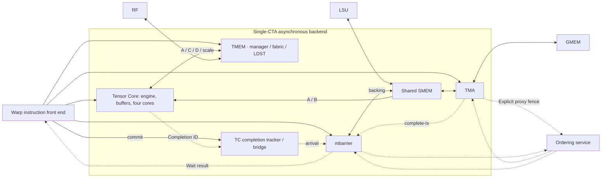

# Microarch Brief

Allegro executes asynchronous instructions for one active CTA. The front end can submit work before an earlier instruction's result becomes visible. Operand availability, memory port occupancy, and completion records determine which operations can proceed concurrently. See [Supported PTX](supported_ptx.md) for legal instruction and operand combinations and the [RTL module index](../rtl_specs/top/blackwell_async_subsystem_top.md#module-index) for ports, state machines, and handshake timing.

## 1. Top-level organization and resources

The surrounding system selects the warp, decodes instructions, and enforces program order and convergence. TMA moves data between GMEM and shared SMEM. MMA reads B from SMEM, A from SMEM or TMEM, and C from TMEM when accumulating. Four cores feed their dot arrays from local Tensor Core Buffers and write D to TMEM. RF accesses TMEM through LD/ST. Solid arrows carry commands or data. Dashed arrows carry completion events, visibility requests, and acknowledgments.

### Execution resources and shared ports

| Module | Organization and capacity | Scheduling constraint |
|---|---|---|
| Tensor Core | Each of the four cores can issue one 8×8 microtile per cycle, for a peak of **256 complete dots per cycle** across the subsystem. In v1, F16/TF32 (wide) and K32 share the first four pipeline stages in each core. | The engine shares three ordered command records and two input contexts. Each core covers 32 rows of M128 and all N columns. [dot array](../rtl_specs/tensor_core/blackwell_tc_dot_array.md) |
| Tensor Core Buffer | A/B/C/D occupy 14 KiB per core. The four cores, shared B loader, and scale slots total **61.5 KiB per backend**. R_OP adds 832 B per core. | A is reused across column blocks, B is loaded eight columns at a time, and C and D each rotate between two slots. The [buffer table](#tc-buffer) gives slot ownership and release edges. |
| SMEM | **228 KiB**, organized as 32 banks × 1,824 words × 32 bits. Eight 16 B groups provide a peak of 128 B/cycle in each direction. | TC, TMA, barrier backing, and LSU share the ports. Each group arbitrates reads and writes separately. A read samples at grant edge g and returns at g+2 at the earliest. A write commits at acceptance and its ACK can retire on the next edge. [SMEM fabric](../rtl_specs/smem/blackwell_smem_fabric.md) |
| TMEM | **256 KiB**, organized as 128 banks (4 partitions × 32 banks) × 128 words × 128 bits. Peak bandwidth is 512 B/cycle per partition in each direction. | TC and RF LD/ST share the banks. A read samples one edge after grant g and returns at g+3 at the earliest. A write commits one edge after acceptance w. Its ACK can retire at w+2, and its successful ACK releases the corresponding same-address C read. [TMEM partition](../rtl_specs/tmem/blackwell_tmem_partition.md) |
| TMEM management and RF LD/ST | The active CTA exclusively owns 512 columns at base 0. Five reference bits cover three MMA records, one LD, and one ST. LD buffers 512 B of words and ST buffers one 128 B beat. The wait tracker has 32 live entries and one ST snapshot. | The allocation can be released once all references return. The next ST beat can overlap an outstanding ACK. [manager](../rtl_specs/tmem/blackwell_tmem_manager.md) · [LD/ST](../rtl_specs/tmem/blackwell_tmem_ldst_engine.md) |
| TMA commands and address generation | The command FIFO is **8 entries** deep. There are 20 tickets (18 general-purpose and two for group or control commands), two setup slots, and one three-stage walker (S0…S2). The descriptor cache has four 128 B lines. | The FIFO holds commands awaiting dispatch, setup prepares addresses, and the walker enumerates segments. A command releases its setup slot when its last segment enters S0. Its ticket continues to track completion. [TMA unit](../rtl_specs/tma/blackwell_tma_unit.md#copy-overlap) · [descriptor cache](../rtl_specs/tma/blackwell_tma_descriptor_cache.md) |
| TMA data path | All copies share **64 segment tags (8 KiB of full segments) and 16 × 128 B data slots**. GMEM data and descriptors share a 128 B channel. SMEM has eight 16 B group ports. | Tags track outstanding transactions, slots hold payloads, and port grants determine the actual service cycles. Each resource applies backpressure independently. [TMA data path](../rtl_specs/tma/blackwell_tma_data_path.md#peak) |
| TC completion tracking | 32 MMA operation records and eight commit records. | Accepts final completion by ID and advances each commit against the set of operations preceding its issuer's cutoff. [TC tracker](../rtl_specs/tensor_core/blackwell_tc_completion_tracker.md) |
| mbarrier | A four-entry object cache, eight software command records, 16 TMA producer bindings, and 32 wait entries. | Multiple producers can bind the same phase. Each tracks its own completed bytes. A waiting thread occupies a wait entry while the object cache services other updates. [frontend](../rtl_specs/mbarrier/blackwell_mbarrier_frontend.md) · [unit](../rtl_specs/mbarrier/blackwell_mbarrier_unit.md) · [wait](../rtl_specs/mbarrier/blackwell_mbarrier_wait.md) |

### Tensor Core Buffer

Core `c` computes rows `32c…32c+31`. Divide the output into eight-column blocks `j` and each block into four eight-row groups `r=0…3`. For each microtile, decode the eight A rows and eight B columns once and broadcast each to the eight dot lanes in the same row or column. Each lane computes its own products, reduction, and C accumulation. An `op_load(j,r)` prepares one microtile in the core's R_OP. The `dot_fire` edge issues it to the arithmetic pipeline. Each core can issue one microtile per cycle, performing 64 complete dots. An instruction has J=N/8 column blocks and issues Q=4J=N/2 microtiles per core. The core loads each 256 B B block into R_OP only at `r=0`. The next three row groups reuse the registered B. Each column block reuses the A row groups. This traversal determines the release edge for each buffer. [Four-core data path](../images/tensor_core_tmem/tensor_core_tmem_pipeline.svg) · [PNG](../images/tensor_core_tmem/tensor_core_tmem_pipeline.png) · [Diagram source](../images/tensor_core_tmem/draw_pipeline.py)

| Buffer and capacity | Fill and consumption | Reuse condition |
|---|---|---|
| A per core, 2 × 1 KiB | One slot per input context, filled from SMEM or TMEM. Each eight-row, 256 B group becomes ready independently and serves all column blocks on the core. | Report input_free after the ID's last `op_load` and after the core's source reads and control obligations settle. The engine can assign the input context to the next command once all four cores release it and the required snapshots are idle. |
| Shared B loader, 2 × 256 B | Each slot assembles one eight-column block from SMEM and delivers it to all four cores. When one slot holds the earlier command's last block, the other can start fetching a block for the next command. | Each core handshakes independently. The slot can be reserved for a successor on the edge where the last core accepts the old block. |
| B per core, 4 × 2 KiB | A column occupies 32 B and a block occupies 256 B. An N64/128/256 operand occupies 1/2/4 contiguous partitions respectively. The partitions hold 4/2/1 operands of the same size. Mixed sizes use contiguous free partitions. | A core can overwrite an old block starting on the edge after its last `op_load(j,3)`. Ordinary MMA consumes installed blocks individually. A cross-instruction WS hit requires the entire previous entry to have been installed on all four cores. |
| C per core, 2 × 1 KiB | Each slot holds an eight-column block tagged with `(id,j)` for four `op_load` operations. Accumulation reads the old value from TMEM. `input_d=0` injects zero. | On the old block's last `op_load(j,3)`, the core can reserve the slot for the block two positions ahead and issue its first read. At an instruction boundary, the two tail slots pass in turn to blocks 0 and 1 of the next instruction. |
| D per core, 2 × 1 KiB | Collect the results of four row groups per block, then write valid lanes and words to TMEM. | The next generation can deposit results on the edge after acceptance of the old block's final write request. Outstanding ACKs retain the old ID and block and determine when a same-address read may issue. |
| Scale A per core, 2 × 128 B. Shared scale B, 4 × 1 KiB | Scaled instructions snapshot their operands by context and supply R_OP. Two physical banks in shared scale B hold the two snapshots. The TMEM source lane is selected independently. | Release by ID after all four cores finish using their inputs and snapshot reads have settled. |
| R_OP per core, 832 B | Holds 256 B each of A, B, and C and 32 B each of scale A and scale B for the current microtile. Issues these operands to the dot array with the ID and mode. | An empty slot can load a microtile. When the current microtile asserts dot_fire, the slot can load the next microtile on the same edge, including the first microtile of the next MMA. |

The four local B buffers and shared assembly slots occupy 32.5 KiB. The 61.5 KiB total includes the four cores' A/B/C/D (56 KiB), shared B assembly slots (0.5 KiB), scale A across four cores (1 KiB), and shared scale B (4 KiB). R_OP, arithmetic pipelines, and control bits are accounted for separately. See [MMA core](../rtl_specs/tensor_core/blackwell_tc_mma_core.md), [B loader](../rtl_specs/tensor_core/blackwell_tc_b_loader.md), [B residency and replacement](../rtl_specs/tensor_core/blackwell_tc_mma_engine.md#b-residency), and [Scale B snapshots](../rtl_specs/tensor_core/blackwell_tc_scale_b_snapshot.md) for block overwrite and partial distribution.

## 2. Instruction scheduling

The front end selects the issuing warp. Each backend engine registers commands at its own input and advances them as dependencies and port capacity allow. M0 and M1 below denote two MMA commands in acceptance order.

### 2.1 Command acceptance and wait sets

M0's `cmd.fire` allocates an engine command record and registers its ID with the TC tracker on the same edge. M1 can do the same as soon as a record is free. For a command accepted at edge c, the engine registers pin eligibility at c+1 and can request the pin at c+2. It requests pins and assigns input contexts in acceptance order. The third record can acquire its pin while both input contexts are occupied. [MMA engine](../rtl_specs/tensor_core/blackwell_tc_mma_engine.md)

At acceptance, a commit records earlier MMAs of the same epoch and issuer whose completion has yet to arrive. An MMA registered on that edge belongs to a later commit. TMEM LD/ST registers a live entry on external command acceptance. `tcgen05.wait::st` captures the warp's stores preceding the cutoff. A store registered on that edge belongs to a later wait. TMA reserves a ticket at command acceptance and dispatches copies in FIFO order. A load binds the target barrier phase before issuing its first segment. Group commit advances group age at acceptance. A bulk-group read wait captures committed tensor copies in its issuer's cutoff that still owe descriptor or source reads. [Identity and cutoffs](../rtl_specs/top/blackwell_async_subsystem_top.md#identity) · [TMEM wait tracker](../rtl_specs/tmem/blackwell_tmem_wait_tracker.md) · [TMA unit](../rtl_specs/tma/blackwell_tma_unit.md)

### 2.2 Operand dependencies and first microtile issue

M0 and M1 load their first microtiles in acceptance order. For M1, the engine requires its pin, preparation on all four cores, B selection, and any required scale snapshots. Once all cores have A row group 0, installed B block 0, C block 0, and an R_OP slot able to accept, they load the first microtile on the same edge. The first dot can issue on the next edge. The cores then advance their own `(j,r)` cursors. Row groups 1…3 and later B/C blocks need only be ready by their consumption edges. [MMA engine](../rtl_specs/tensor_core/blackwell_tc_mma_engine.md) · [MMA core](../rtl_specs/tensor_core/blackwell_tc_mma_core.md)

Before M1 reads same-address C[j], every older overlapping D[j] on the core must have closed its write set and received all successful ACKs. The ACK for block 0 can delay M1's first issue. Later blocks meet their own consumption deadlines independently. Offset overlaps wait for older writes to the overlapping domain to settle. A TMEM A or scale operand intersecting this command's D must be fully sampled before first issue. Overlaps with an older D also obey the older-write dependency. A zero-injected block skips the C read. Subsequent same-address writes still follow write order. [MMA core](../rtl_specs/tensor_core/blackwell_tc_mma_core.md)

### 2.3 Cross-MMA handoff and steady-state throughput

While M0 is in the dot pipeline, M1 can load A row groups, prefetch B blocks, and read C blocks whose dependencies have cleared. On the edge where M0's last microtile enters the dot pipeline, all four cores can load M1's first microtile into R_OP. M0 can continue writing D while M1 computes. At a family change, space at the target pipeline input and each core's issue-order queue govern handoff. Results are delivered in input order. [dot array](../rtl_specs/tensor_core/blackwell_tc_dot_array.md)

**Consecutive MMA throughput.** Steady-state N128 FP16 same-address accumulation issues 16 × 4 microtiles per core. With A and B in SMEM and each word read once, the 4 KiB A and 4 KiB B reads also take 64 cycles at 128 B/cycle. After warmup, the target interval between first dots is **64 cycles**, sustaining one microtile per core per cycle across the boundary. This requires early command and pin readiness, an aligned K-major layout using all eight read groups, successful D ACKs in time for the corresponding C reads, ready result and write ports, and no competing traffic. [Top-level acceptance conditions and observation edges](../rtl_specs/top/blackwell_async_subsystem_top.md#cycles)

### 2.4 Copy handoff and memory port contention

TMA compares the head copy's GMEM and SMEM spans with older accesses and observes pending fences. A new write overlapping an old read waits for the old source reads to finish. An access dependent on an old write waits for its destination write ACKs. If the previous last segment enters S0 at `f`, an independent successor can send its first segment at `f+1` when its addresses, fences, binding, and capacity allow. A load takes a data slot on successful GMEM data reception. A store takes one before issuing its SMEM source read. Acceptance of the final destination write request releases the slot. The original tag tracks late ACKs. MMA A/B fetches compete with TMA store source reads for the same SMEM group read ports. A TMA load write and MMA read to the same bank and word use different edges. Actual grants determine which block is delayed. [TMA data path](../rtl_specs/tma/blackwell_tma_data_path.md#peak) · [SMEM arbitration](../rtl_specs/smem/blackwell_smem_fabric.md)

TMEM LD keeps each lane's full current 128-bit word in the 512 B buffer and sends RF beats in register order. ST can replace the contents of its 128 B buffer with the next RF beat on the edge that accepts the old beat's last TMEM write request. Outstanding ACKs retain the old identity. [LD/ST data path](../rtl_specs/tmem/blackwell_tmem_ldst_engine.md#ld-word)

### 2.5 Completion notification, record reclamation, and visibility

Each MMA collects its own read returns, arithmetic results, and actual D write ACKs, releases resources including its pin, and notifies the tracker once by ID. The engine reclaims its three command records in acceptance order. If the instructions have independent issuers and no data dependency, M1 can complete first and trigger its own commit arrival. While M0 awaits an ACK, both records remain occupied. [Nonempty commits across issuers](../rtl_specs/top/blackwell_async_subsystem_top.md#mma-nonempty-commit)

| What the consumer observes | Edges required for success |
|---|---|
| TMEM LD/ST | LD finishes delivering data when RF accepts its last beat. ST waits for every actual write ACK. The operation clears its obligation to the wait tracker after its ordinary done is consumed. The same warp's ST wait then returns according to its cutoff set. |
| TMA bulk group | Two bits per tensor copy distinguish the current, most recently closed, and older groups. `.read 0/1` captures tickets of the same issuer that have reached the cutoff group and still owe Tensor Map or source-data reads. The wait can return while an older store from that issuer awaits its GMEM write ACK. Each response carries the original command ID. [TMA unit](../rtl_specs/tma/blackwell_tma_unit.md#tickets) |
| Consuming TC or TMA load results through mbarrier | A successful TC commit generates an arrival. A TMA load submits complete-tx after receiving all actual SMEM write ACKs. The phase flips once both arrival and byte conditions are satisfied. A consuming warp returns a true predicate after matching the phase and receiving the acquire ACK. [mbarrier wait](../rtl_specs/mbarrier/blackwell_mbarrier_wait.md) |

For every value of `time_hint`, each wait has a budget of **64 ARMED cycles**. Timeout returns false. A phase match requires a successful acquire acknowledgment before returning true. [Wait budget and the 64th/65th edge](../rtl_specs/mbarrier/blackwell_mbarrier_wait.md#wait-budget)

These timings assume legal command streams and the stated memory and ordering service conditions. [Top-level contract](../rtl_specs/top/blackwell_async_subsystem_top.md#common-protocol) · [Target workloads](supported_ptx.md)
