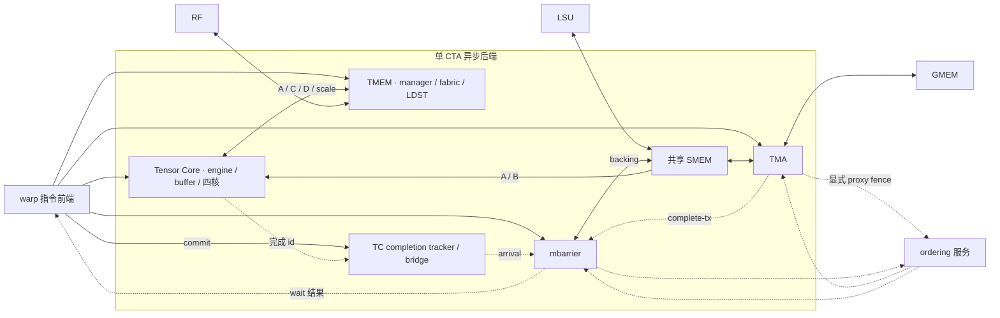

# Microarch Brief

Allegro 为一个活跃 CTA 执行异步指令。前端可以在一条指令的结果可见之前提交后续工作。后端依据操作数、存储端口和完成记录的实际占用决定哪些工作能并行。指令与操作数的合法组合见 [PTX 支持范围](supported_ptx.md)，端口、状态机与握手时序见 [RTL 模块索引](../rtl_specs/top/blackwell_async_subsystem_top.md#module-index)。

## 1. 顶层组成与资源

外围选择 warp、解码指令，并保证程序序和收敛。沿数据流看，TMA 在 GMEM 与共享 SMEM 之间搬运数据；MMA 从 SMEM 取 B，从 SMEM 或 TMEM 取 A，累加时从 TMEM 读 C。四个核从本地 Tensor Core Buffer 向 dot 阵列供数，把结果 D 写回 TMEM。RF 经 LD/ST 访问 TMEM。图中实线为命令或数据，虚线为完成、可见性请求及确认。

### 执行资源与共享端口

| 模块 | 规模与容量 | 对调度的约束 |
|---|---|---|
| Tensor Core | 4 核，每核 1 个 8×8 dot 阵列。每核含 F16/TF32、低精度、FP4、INT8 四族，各 64 路，四核合计 4 × 4 × 64 = 1,024 路。每核每拍可向一族发 1 个微块，四核峰值 **256 个完整 dot/拍**。 | 一个 engine 共用 3 份有序命令记录、2 个输入上下文。每核负责 M128 的 32 行和全部 N 列。[dot array](../rtl_specs/tensor_core/blackwell_tc_dot_array.md) |
| Tensor Core Buffer | 每核 A/B/C/D 共 14 KiB。四核连同共享 B loader 和各级 scale 槽共 **61.5 KiB/后端**。R_OP 另计 832 B/核。 | A 跨列块复用，B 按八列装填，C/D 双槽滚动。各槽的所有者和释放沿见[本章 Buffer 表](#tc-buffer)。 |
| SMEM | **228 KiB**，32 bank × 1,824 word × 32 bit。八组各 16 B，后端每方向峰值 128 B/拍。 | TC、TMA、barrier backing 和 LSU 共享端口。每组分别仲裁读写，读在 grant 沿 g 采样，最早 g+2 交付。写在接受沿提交，ACK 最早下一沿退休。[SMEM fabric](../rtl_specs/smem/blackwell_smem_fabric.md) |
| TMEM | **256 KiB**，128 bank（4 分区 × 32 bank） × 128 word × 128 bit。每分区每方向峰值 512 B/拍。 | TC 与 RF LD/ST 共用 bank。读在 grant 沿 g 的下一沿采样，最早 g+3 交付。写在接受沿 w 的下一沿提交，ACK 最早 w+2 退休，同址 C 据对应成功 ACK 放行。[TMEM partition](../rtl_specs/tmem/blackwell_tmem_partition.md) |
| TMEM 管理与 RF LD/ST | 当前 CTA 独占 512 列，base=0。五个引用位分别属于三条 MMA 记录、一个 LD 和一个 ST。LD word 缓冲 512 B，ST beat 缓冲 128 B。wait tracker 有 32 条 live 行和一条 ST 快照。 | 引用归还后可释放整块。ST 的下一 beat 可与旧 ACK 重叠。[manager](../rtl_specs/tmem/blackwell_tmem_manager.md) · [LD/ST](../rtl_specs/tmem/blackwell_tmem_ldst_engine.md) |
| TMA 命令与地址生成 | 命令 FIFO 深 **8**，20 个 ticket（18 个通用、2 个供 group 或控制），2 个 setup 槽，1 个三级 walker（S0…S2）。descriptor cache 含 4 条 128 B line。 | FIFO 保存待派发命令，setup 准备地址，walker 逐段枚举。末段进入 S0 即归还 setup 槽，ticket 继续跟踪旧命令。[TMA unit](../rtl_specs/tma/blackwell_tma_unit.md#copy-overlap) · [descriptor cache](../rtl_specs/tma/blackwell_tma_descriptor_cache.md) |
| TMA 数据通路 | 全部 copy 共享 **64 个段 tag（满段共 8 KiB）、16 × 128 B 数据槽**。GMEM 数据与 descriptor 共用 128 B 通道，SMEM 接八组各 16 B 端口。 | tag 代表在途事务，数据槽容纳 payload，端口决定实际服务拍。三种资源分别施加背压。[TMA data path](../rtl_specs/tma/blackwell_tma_data_path.md#peak) |
| TC 完成跟踪 | 32 条 MMA 操作记录，8 条 commit 记录。 | 按 id 接收最终完成，按同 issuer 的截止集合推进 commit。[TC tracker](../rtl_specs/tensor_core/blackwell_tc_completion_tracker.md) |
| mbarrier | 4 项对象 cache，前端有 8 条软件命令记录和 16 条 TMA producer 绑定，wait 单元有 32 项等待记录。 | 多个 producer 可绑定同一 phase，独立记录各笔完成字节。等待线程保留 wait 项，对象 cache 可继续服务其他更新。[frontend](../rtl_specs/mbarrier/blackwell_mbarrier_frontend.md) · [unit](../rtl_specs/mbarrier/blackwell_mbarrier_unit.md) · [wait](../rtl_specs/mbarrier/blackwell_mbarrier_wait.md) |

### Tensor Core Buffer

核 `c` 计算行 `32c…32c+31`。把输出按八列分块 `j`，每块再按八行分四组 `r=0…3`。每片的 8 行 A 和 8 列 B 各解码一次，分别广播给同行和同列的 8 路 dot。每路独立计算本格的乘积、归约和 C 累加。每次 `op_load(j,r)` 在本核 R_OP 备好一个微块，随后在 `dot_fire` 沿送入算术流水。每核每拍最多发一片，执行 64 路完整 dot。每条指令有 J=N/8 个列块，每核发 Q=4J=N/2 片。每个 256 B 的 B 块只在 `r=0` 从本地 buffer 装入 R_OP，后三个行组直接使用寄存器里的 B。A 行组在每个列块重复使用。这个遍历顺序决定了各 buffer 的释放边沿。[四核数据通路图](../images/tensor_core_tmem/tensor_core_tmem_pipeline.svg) · [PNG](../images/tensor_core_tmem/tensor_core_tmem_pipeline.png) · [图源](../images/tensor_core_tmem/draw_pipeline.py)

| Buffer 与容量 | 装填与消费 | 可以何时复用 |
|---|---|---|
| 每核 A，2 × 1 KiB | 每个输入上下文一份，从 SMEM 或 TMEM 装入。每八行 256 B 独立就绪，供该核遍历全部列块。 | 该 id 末次 `op_load` 且本核源读与控制结清后报告 input_free。四核均释放且所需快照静止后，engine 可把输入上下文交给后条。 |
| 共享 B loader，2 × 256 B | 一个槽从 SMEM 装配一个八列块，分别交付四核。前条末块已占一个槽时，另一空槽可开始取后条的块。 | 四核分别握手。最后一个核接受旧块的同沿可为后继预留此槽。 |
| 每核 B，4 × 2 KiB | 一列 32 B，每块 256 B。N64/128/256 的一份 B 分别占连续 1/2/4 区。同尺寸可驻留 4/2/1 份，混合尺寸按连续空区分配。 | 每核旧块末次 `op_load(j,3)` 后的下一沿起可覆盖该块。普通 MMA 按已安装块消费；WS 跨指令命中要求旧项已向四核完整安装。 |
| 每核 C，2 × 1 KiB | 每槽持一个带 `(id,j)` 的八列块，供四次 `op_load`。需要累加时从 TMEM 读旧值，`input_d=0` 时注零。 | 旧块末次 `op_load(j,3)` 同沿可为相隔两块的后继预留该槽并发首读。前条尾部两槽依次交给后条的块 0、1。 |
| 每核 D，2 × 1 KiB | 每块收四个行组的结果，再按有效 lane/word 写 TMEM。 | 旧块末笔写请求接受后，下一沿可接新一代结果。未返回的 ACK 仍归旧 id 和块，决定同址读何时可发。 |
| scale A 每核 2 × 128 B；scale B 共享 4 × 1 KiB | scaled 指令按上下文取快照并向 R_OP 供数。共享 scale B 使用两个物理 bank 保存两条快照，TMEM 源 lane 独立选择。 | 四核结束输入使用且快照读结清后，按 id 释放。 |
| 每核 R_OP，832 B | 持有当前微块的 A、B、C 各 256 B 与 scale A/B 各 32 B，随 id 和模式一起送 dot。 | 空槽可装片。已有微块在本沿 dot_fire 时可同时装下一片，包括后条 MMA 的首片。 |

四核 B 加共享装配槽占 32.5 KiB。61.5 KiB 包含四核 A/B/C/D（56 KiB）、共享 B 装配槽（0.5 KiB）、四核 scale A（1 KiB）和共享 scale B（4 KiB）。R_OP、算术流水和控制位单独计容。块覆盖与部分分发的接口分别见 [MMA core](../rtl_specs/tensor_core/blackwell_tc_mma_core.md)、[B loader](../rtl_specs/tensor_core/blackwell_tc_b_loader.md)、[B 驻留与替换](../rtl_specs/tensor_core/blackwell_tc_mma_engine.md#b-residency) 和 [scale B 快照](../rtl_specs/tensor_core/blackwell_tc_scale_b_snapshot.md)。

## 2. 指令调度

前端决定从哪个 warp 提交指令。后端各引擎在自己的入口登记命令，依据数据依赖和端口容量推进。下文用 M0、M1 表示两条按序接受的 MMA。

### 2.1 命令接受与等待集合

M0 的 `cmd.fire` 同沿占用 engine 命令记录并向 TC tracker 登记 id。M1 有空位即可同样登记。engine 逐 id 预检和 pin，按接受序给待准备命令分配输入上下文。即使两个输入上下文都在使用，第三份命令记录仍可用于预检与 pin。[MMA engine](../rtl_specs/tensor_core/blackwell_tc_mma_engine.md)

commit 在接受沿只需记录同 epoch、同 issuer 且尚未收到完成通知的较早 MMA。同沿新登记的 MMA 留给后续 commit。TMEM LD/ST 在外部命令接受沿登记 live 行；`tcgen05.wait::st` 捕获本 warp 截止前的 ST。同沿新登记的 ST 同样留给后续 wait。TMA 在命令接受沿预留 ticket，copy 按 FIFO 顺序派发。load 在首段发出前绑定目标 barrier 的 phase，group commit 在接受沿推进组龄，wait 在接受沿捕获仍欠源读的旧组成员。[身份与截止](../rtl_specs/top/blackwell_async_subsystem_top.md#identity) · [TMEM wait tracker](../rtl_specs/tmem/blackwell_tmem_wait_tracker.md) · [TMA unit](../rtl_specs/tma/blackwell_tma_unit.md)

### 2.2 操作数依赖与首片发射

M0、M1 按接受序装入各自首片。对 M1，engine 要求预检、pin、四核 prepare 和 B 选择完成，所需 scale 快照就绪。四核各自具备 A 行组 0、已安装的 B 块 0、C 块 0 及可接收的 R_OP 后，在同一沿装首片；首个 dot 最早在下一沿。之后四核按各自的 `(j,r)` 游标推进，行组 1…3 和其余 B/C 块各自在消费沿前就绪即可。[MMA engine](../rtl_specs/tensor_core/blackwell_tc_mma_engine.md) · [MMA core](../rtl_specs/tensor_core/blackwell_tc_mma_core.md)

M1 读同址 C[j] 前，本核所有较老重叠 D[j] 都须关闭写集合并收齐成功 ACK。块 0 的 ACK 可能挡住 M1 首发，其余块独立满足各自的消费门限。偏移重叠按域等老写结清。若 TMEM A/scale 与本条 D 相交，该源在本条首发前完整采样；与老 D 重叠也须满足老写门限。注零块免读 C，后续同址写仍遵守写序。[MMA core](../rtl_specs/tensor_core/blackwell_tc_mma_core.md)

### 2.3 跨 MMA 交接与稳态吞吐

M0 在 dot 流水中时，M1 可装 A 行组、预取 B 块并读满足依赖的 C。M0 末片进入 dot 的同一沿，四核可以把 M1 首片装入 R_OP。之后 M1 计算时，M0 的 D 仍可写回。换算术族时由目标流水入口空间和每核的发射顺序队列约束交接，结果按输入序交付。[dot array](../rtl_specs/tensor_core/blackwell_tc_dot_array.md)

**连续 MMA 的吞吐目标。** 稳态 N128 FP16 同址累加每核需发 16 × 4 个微块。A/B 均取自 SMEM 且每字只读一次时，每条读 4 KiB A 和 4 KiB B，按 128 B/拍也需要 64 拍。预热后，在命令与 pin 提前就绪、K-major 对齐布局用满八组读口、同址 D 的成功 ACK 赶上对应 C 读、算术结果和写端口均可接收且无其他争用时，相邻首 dot 的目标间隔为 **64 拍**，交界处持续每核每拍一片。[顶层验收条件与观察沿](../rtl_specs/top/blackwell_async_subsystem_top.md#cycles)

### 2.4 copy 交接与存储端口争用

TMA 对队首 copy 检查 GMEM、SMEM 地址区间和 fence。新写与旧读相交时等旧源读取结束，新访问依赖旧写时等旧目标写 ACK 结清。前条末段在 `f` 进入 S0，独立后条在地址、fence、绑定及容量满足时最早于 `f+1` 送首段。load 在成功接收 GMEM 数据时取数据槽，store 在发 SMEM 源读前取槽。末次目标写请求接受即可释放该槽，迟到的 ACK 仍由原 tag 跟踪。MMA 取 A/B 与 TMA store 读源竞争同组 SMEM 读口；TMA load 写与 MMA 读遇到同 bank 同 word 冲突时错开。实际 grant 决定哪一块延后。[TMA 数据通路](../rtl_specs/tma/blackwell_tma_data_path.md#peak) · [SMEM 仲裁](../rtl_specs/smem/blackwell_smem_fabric.md)

TMEM LD 把每个 lane 当前的完整 128-bit word 留在 512 B 缓冲中，按寄存器顺序送 RF。ST 的 128 B 缓冲可在旧 RF beat 的末笔 TMEM 写请求被接受的同一沿接替为下一 beat；旧 ACK 保留原身份。[LD/ST 数据通路](../rtl_specs/tmem/blackwell_tmem_ldst_engine.md#ld-word)

### 2.5 完成通知、记录回收与可见性

每条 MMA 按自己的 id 收齐读返回、算术结果和实际 D 写 ACK，归还 pin 等资源，向 tracker 通知一次。engine 的三个命令记录按接受序回收。若两条指令来自独立 issuer 且数据无依赖，M1 可以先完成并触发自己的 commit arrival。M0 仍在等待 ACK 时，两条命令记录都占槽。[跨 issuer 非空 commit 验收](../rtl_specs/top/blackwell_async_subsystem_top.md#mma-nonempty-commit)

| 消费者观察什么 | 成功所需的边沿 |
|---|---|
| TMEM LD/ST | LD 最后 RF beat 被接受才完成数据交付；ST 等所有实际写 ACK。普通 done 被消费后才向 wait tracker 结清该操作。同 warp 的 ST wait 再按自己的截止集合返回。 |
| TMA bulk group | 每条 tensor copy 以两位区分当前组、最近关闭组和更早组。`.read 0/1` 捕获同 issuer 已到截止组且尚欠源读的 ticket。store 的 full 另等所有实际 GMEM 写 ACK。[TMA unit](../rtl_specs/tma/blackwell_tma_unit.md#tickets) |
| 经 mbarrier 消费 TC 或 TMA load 的结果 | 成功 TC commit 产生 arrival。TMA load 收齐实际 SMEM 写 ACK 后提交 complete-tx。该 phase 的 arrival 与字节条件均满足才翻转，消费 warp 匹配 phase 并取得 acquire ACK 后才返回成功谓词。[mbarrier wait](../rtl_specs/mbarrier/blackwell_mbarrier_wait.md) |

无论 `time_hint` 取何值，一次等待的预算均为 **64 个 ARMED 拍**。超时返回 false，匹配 phase 后须取得成功的 acquire 确认才返回 true。[等待预算与第 64/65 沿边界](../rtl_specs/mbarrier/blackwell_mbarrier_wait.md#wait-budget)

上述时序适用于正常执行。运行期故障经顶层终止 CTA，外围隔离后复位。三个 kernel 的功能和关键边沿用于验收，整 kernel 总周期用于观测。[顶层合同](../rtl_specs/top/blackwell_async_subsystem_top.md#common-protocol) · [目标用例](supported_ptx.md)
