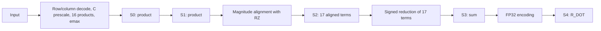

# blackwell_f16tf32_dot

## Description

Computes one complete FP16/BF16 dot16 or TF32 dot8 using `C_eff+ΣA*B`. Each core array instantiates 64 copies. TF32 enables only the first eight terms. The other terms do not participate in special-value handling or emax. The core unpacks in logical K order. [dot array](../tensor_core/blackwell_tc_dot_array.md) applies negate, decodes each row or column, and broadcasts the result. See [input formats](blackwell_f16tf32_dot.md#formats) for numerical formats.

| Signal / channel | Direction | Type / width | Peer | Handshake or sampling condition |
| --- | --- | --- | --- | --- |
| req | Input | a[16],b[16] each contain `{class2,sign1,sig11,e:s8}` elements, plus c32 and scale_input_d4, 740 bits total | TC dot array | req.fire captures S0. See [dot array](../tensor_core/blackwell_tc_dot_array.md) for class and element order |
| rsp | Output | result32, 32bit | TC dot array | rsp.fire delivers the FP32 result |

## Functionality

clk/rst_n and valid/ready follow the [common conventions](../top/blackwell_async_subsystem_top.md#common-protocol). The upstream checks the type combination and excludes invalid values. FP16/BF16 use 16-bit elements and TF32 uses a 32-bit container.

### Input formats and reference requirements

Represent finite values as `(-1)^sign × significand × 2^exponent`. For normals, significand=2^p+fraction and exponent=exp_field−bias−p. For subnormals, significand=fraction and exponent=1−bias−p. Zero has significand=0.

| Format | exponent/fraction bit | bias | Special values |
|---|---|---:|---|
| FP16 | 5/10 | 15 | All-one exponent: frac=0 gives Inf, otherwise NaN |
| BF16 | 8/7 | 127 | Same as above |
| TF32 container | FP32 container, retaining 10 fraction bits for arithmetic | 127 | Detect NaN using the full FP32 fraction before truncating the low 13 bits |

The bit-exact reference uses integer significands and the truncation points specified for this pipeline. See [FP32 pack](blackwell_dot_fp32_pack.md#numeric-contract) for special-value resolution and FP32 packing.

### Pipeline registers

Five independent elastic stages with no additional output register. S1 registers the S0 products ahead of alignment. Passing the products through S1 takes one cycle.

| Stage | Payload per dot | Fields |
|---|---:|---|
| S0/S1, each | 574bit | special2, 16×(sign1,sig22,exp9,zero1), emax9, C(sign1,sig24,exp9,zero1) |
| S2 | 572bit | special2, 16×signed33 product, signed33 C, emax signed9 |
| S3 | 44bit | special2, sum signed33, emax signed9 |
| S4 | 32bit | result32 |

Total data storage is 1796 bits/dot or 14368 B for 64 dots. Five valid bits per dot add 40 B/core. The array keeps a stage-matched microtile tag chain shared by all 64 leaves.

### Decode, align, reduce, and pack

The row/column decoders represent finite values as `sign*sig11*2^(e−10)`. For FP16 normals, sig=1024+frac and e=exp−15. For subnormals, sig=frac and e=−14. BF16 uses sig=(128+frac)<<3 or subnormal frac<<3, with e=exp−127 or −126 respectively. TF32 takes the upper 10 bits of the FP32 fraction with the FP32 exponent. NaN detection uses all 23 fraction bits. A zero exponent and zero upper 10 fraction bits classify a finite TF32 as zero. Fill A and B terms 8…15 with +0 in TF32 mode.

1. First compute `C_eff=C*2^(-scale_input_d)` for C. Adjust the exponent for normals. When entering the subnormal range, shift the unsigned significand right and truncate. For an original subnormal, shift the fraction directly. Preserve Inf, NaN, and zero. Prescale C in an FP32 container.
2. An exact 11×11 multiplication produces sig22. Sign-extend both e values to 9 bits before adding. Decode C to sig24 and eC, with normal value sig24×2^(eC−23). Select emax only from nonzero finite products and C. If all are zero, use −256 and force the result to +0.
3. Use product magnitude `sig22<<5` and C magnitude `sig24<<2`. Right-shift each by emax−e. Shifts of 32 or more yield zero. Apply the sign to produce signed33. S2/S3 retain emax. Do not compute base_exp in 9 bits.
4. Sum the 17 terms in signed33, including at most 16 products, without intermediate FP32 rounding. Pad odd reduction-tree entries with zero. Bounds on valid input magnitudes guarantee no overflow.
5. Before S4, sign-extend emax to 10 bits, then compute `base_exp=sext10(emax)−25` for FP32 packing. For the product of minimum normal BF16 inputs, emax=−252 and base_exp=−277. Subtracting in 9 bits before extension overflows. S3→S4 captures only the final 32-bit encoding. Resolve NaN/Inf by operand class and exclude specials from finite emax.

Put FP16 A=2 and B=3 only at k=1, with C=1 and scale_input_d=0. With the array applying negate_a, the request's A at that index must be −2 and the leaf result −5 (0xc0a00000).

### Result transfer and stalls

Input fire at l captures S0. Without stalls S4 is visible after l+4 and can transfer at l+5. P=5 and II=1. Backpressure propagates toward the input stage by stage. Each full stage holds its payload until it can advance. Reset clears only the five valid bits.

Verify all FP16/BF16 input combinations, TF32 NaNs identifiable only in the low 13 bits, maximum/minimum normals, subnormals, exact cancellation, conflicting Inf signs, and C prescale underflow. The bit-exact reference must reproduce the specified fixed-point order. Per-term host floating-point addition is insufficient. Randomly stall continuous requests and check for loss, duplication, and correct edge-by-edge pairing of S4 results with input tags.

RTL: [blackwell_f16tf32_dot.sv](../../../rtl/dot/blackwell_f16tf32_dot.sv).

## Submodules

| Submodule | Instances per dot | Connections and control |
| --- | --- | --- |
| [dot_emax_tree](blackwell_dot_emax_tree.md) | 1 | S0 selects the maximum exponent among valid products and C. |
| [dot_align_fixed_rz](blackwell_dot_align_fixed_rz.md) | 17 | S2 aligns 16 products and one C. |
| [dot_signed_reduce_tree](blackwell_dot_signed_reduce_tree.md) | 1 | S3 captures the signed33 reduction of 17 terms. |
| [dot_fp32_pack](blackwell_dot_fp32_pack.md) | 1 | Encode with the extended base_exp and capture in S4. |
| [pipeline_reg](../base/blackwell_pipeline_reg.md) | 5 | One stage each for S0…S4, propagating backpressure stage by stage. |
