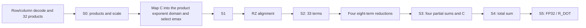

# blackwell_f4f6f8_dot

## Description

Computes a complete 32-term low-precision dot with any A/B combination of E4M3/E5M2/E3M2/E2M3/E2M1 and optional UE8M0 1X scale. Each core's low-precision array contains 64 copies. The core places raw elements in the low bits of each byte. The array decodes and broadcasts elements and scales by row or column.

| Signal / channel | Direction | Type / width | Peer | Handshake or sampling condition |
| --- | --- | --- | --- | --- |
| req | Input | a[32],b[32] each contain `{class2,sign1,sig4,e:s5}` elements, plus c32 and one `{nan1,e:s8}` each for scale_a/scale_b, 818 bits total | TC dot array | req.fire captures S0. See [dot array](../tensor_core/blackwell_tc_dot_array.md) for class and bit order |
| rsp | Output | result32, 32bit | TC dot array | rsp.fire delivers the result |

## Functionality

Command dtype values 3…7 select E4M3, E5M2, E3M2, E2M3, and E2M1 respectively. See the [interfaces](../top/blackwell_async_subsystem_top.md#common-protocol) for common protocol and [input formats](blackwell_f4f6f8_dot.md#formats) for numerical formats.

### Input formats and reference requirements

Represent finite values as `(-1)^sign × significand × 2^exponent`. For normals, significand=2^p+fraction and exponent=exp_field−bias−p. For subnormals, significand=fraction and exponent=1−bias−p. Zero has significand=0.

| Format | exponent/fraction bit | bias | Special values |
|---|---|---:|---|
| E4M3 | 4/3 | 7 | exp=15 and frac=7 gives NaN. All other encodings are finite. No Inf |
| E5M2 | 5/2 | 15 | exp=31: frac=0 gives Inf, otherwise NaN |
| E3M2 | 3/2 | 3 | All encodings finite |
| E2M3 | 2/3 | 1 | All encodings finite |
| E2M1 | 2/1 | 1 | All encodings finite, including positive and negative zero |

UE8M0 has no sign or fraction. Values 0…254 represent 2^(byte−127). Value 255 is NaN.
The bit-exact reference uses integer significands and the truncation points specified for this pipeline. See [FP32 pack](blackwell_dot_fp32_pack.md#numeric-contract) for special-value resolution and FP32 packing.

### Pipeline registers

| Stage | bit/dot | Contents |
|---|---:|---|
| S0 | 605 | special33, 32 sets of sign1/product8/exp6/zero1, product emax valid1+exp10, C sign1/mag27/exp10/zero1, scale exponent10 |
| S1 | 605 | special33, 32 sets of sign1/product8/exp6/zero1, C sign1/mag27/domain_exp10/zero1, scale_exp10, emax10+valid1 |
| S2 | 967 | special33, 32×signed28, C signed28, base_exp10 |
| S3 | 208 | special33, 5×signed33 partial sums, base_exp10 |
| S4 | 76 | special33, sum33, base_exp10 |
| S5 | 32 | result32 |

Total 2493 bits/dot or 19944 B/64 dots, plus six valid bits/dot. The array holds the tags. S5 is R_DOT with no additional result buffer.

### Products, scaling, reduction, and packing

Decode all formats to `sign*sig4*2^(e−3)`. Let p be the source fraction width. For normals use sig4=((1<<p)+frac)<<(3−p), and for subnormals sig4=frac<<(3−p), adding zero low bits. Preserve subnormal magnitudes without flushing to zero. The leaf multiplies the two unsigned sig4 values. Both S0 and S1 register the raw unsigned product8. Sign-extend both e values to 6 bits before adding them.

With MX disabled, each row and column decoder sends `{nan=0,e=0}`. When enabled, decode 0…254 to e=byte−127 and 0xff to `{nan=1,e=0}`. The leaf extends both e values to signed10 and sums them to obtain E. Either nan bit produces NaN. Convert the C exponent to `eC−E` and set C mag27=`sig24<<2`. Select emax from nonzero product exponents and the exponent of nonzero C. If all are zero, set valid=0 and return +0.

The S1→S2 combinational wiring forms unsigned mag27 using `{product8,19'b0}` and feeds it to the aligner alongside the S1 C mag27. Align all magnitudes to emax by right-shifting and truncating before applying signs. Set base_exp=`emax−25+E`. Reduce the 32 signed28 terms in four groups of eight to signed33 partial sums. The fifth partial sum is sign-extended C. Reduce those five terms on the next cycle. Use sufficient width and prove no overflow for valid inputs. Accumulating 32 terms in 28 bits is insufficient.

For E2M1 0x3×0x2 with every other term and C zero, the result must be 0x3fc00000. For E4M3 0x3f×0x3f, both sig4 values are 15 and product8 must be 225 in S0/S1. Disable MX and set C=2^20 with all remaining products zero. The difference between emax and the product exponent is 20 and the aligned magnitude is 112. Flipping one input sign yields −112. Stalling and resuming S1 must preserve the term.

### Result transfer and stalls

P=6. Edge l captures S0. S5 is visible after l+5 and the earliest output transfer is l+6. II=1. Each of the six elastic stages holds independently. Reset clears valid. Adjacent inputs may change dtype and MX mode. S0 captures the microtile's products, special classifications, and scale exponent. Later stages use only the in-flight fields.

Verify all 25 dtype combinations, finite extrema/zero/subnormal/NaN as applicable, E5M2 Inf, UE8M0 0/254/255, and signed cancellation. Compare MX against a reference using exactly the same fixed-point alignment. Check truncation for large exponent differences between scaled finite products and C. Assert correct behavior under uniform backpressure across 64 lanes and fault injection with partial ready.

Implementation reference: [existing implementation](../../../rtl/dot/f4f6f8_dot_prod.sv).

## Submodules

| Submodule | Instances per dot | Connections and control |
| --- | --- | --- |
| [dot_emax_tree](blackwell_dot_emax_tree.md) | 2 | S0 compares 32 products. S1 incorporates C converted to the product domain. |
| [dot_align_fixed_rz](blackwell_dot_align_fixed_rz.md) | 33 | Align the 32 products and C separately and capture them in S2. |
| [dot_signed_reduce_tree](blackwell_dot_signed_reduce_tree.md) | 5 | Four eight-term trees produce partial sums. A final tree reduces those sums and C. |
| [dot_fp32_pack](blackwell_dot_fp32_pack.md) | 1 | The S4 sum and exponent produce the S5 result. |
| [pipeline_reg](../base/blackwell_pipeline_reg.md) | 6 | One stage each for S0…S5. Each holds the captured fields listed in the table. |
