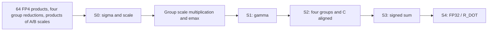

# blackwell_fp4_dot

## Description

Computes a complete 64-term E2M1 dot. Reduce four groups of 16 terms, apply each group scale, and accumulate with FP32 C. Each core has 64 copies, each with a 32-bit FP32 result.

| Signal / channel | Direction | Type / width | Peer | Handshake or sampling condition |
| --- | --- | --- | --- | --- |
| req | Input | a[64],b[64] each contain `{sign1,q4}` elements, plus c32 and `{nan1,sig4,e:s9}` per element of scale_a[4],scale_b[4], 784 bits total | TC dot array | req.fire captures S0. Pack each side's elements from low bits in k order and scales in 16-term group order h |
| rsp | Output | result32 | TC dot array | rsp.fire delivers the result |

The [top-level common protocol](../top/blackwell_async_subsystem_top.md#common-protocol) defines clock, reset, and channel sampling.

## Functionality

For NVFP4/UE4M3 the array decodes a scale per 16 terms. For MXFP4/UE8M0 it decodes a scale per 32 terms. The [scale layout](../tensor_core/blackwell_tc_scale_b_snapshot.md#scale-layout) defines the placement of shared scales within a group.

### FP4 and scale special values

See [low-precision input formats](blackwell_f4f6f8_dot.md#formats) for E2M1 and UE8M0 encodings. UE4M3 ignores its high bit and decodes as positive E4M3. Low seven bits 0x7f encode NaN. See [FP32 pack](blackwell_dot_fp32_pack.md#numeric-contract) for special-value resolution.

### Pipeline registers

| Stage | bit/dot | payload |
|---|---:|---|
| S0 | 161 | special2, 4×sigma13, 4×scale product8, 4×scale exponent10, C sign1/sig24/relative_exp10 |
| S1 | 167 | special2, 4×sign1/mag19/exp10, C sign1/sig24/exp10, emax10 |
| S2 | 237 | special2, 4×signed47 gamma, signed37 C, base_exp10 |
| S3 | 61 | special2, signed49 sum, base_exp10 |
| S4 | 32 | result32 |

Total 658 bits/dot or 5,264 B/core, plus five valid bits/dot. S4 decodes the 2-bit finite/+Inf/−Inf/NaN result class and directly implements R_DOT. A NaN scale or NaN C selects canonical NaN. Otherwise an infinite C supplies the result and its sign.

### Products within groups, scaling across groups, and reduction

For E2M1 magnitude encodings 0…7, the array supplies twice the magnitude q as `{0,1,2,3,4,6,8,12}`, with a separate sign. In S0 each group sign-extends its 16 signed 9-bit products to 13 bits. A carry-save tree compresses these rows into two operands. One carry-propagating addition produces `sigma` before the S0 register. Discarding carries above bit 12 preserves the result modulo 2¹³. Because the exact sum lies in [−2,304, 2,304], its signed 13-bit representation is exact. It represents four times the true unscaled sum.

Interpret each scale as `sig4*2^e`. UE8M0 uses sig=8 and e=byte−130 for bytes 1…254. Byte 0 represents an FP32 subnormal scale with sig=4 and e=−129. UE4M3 ignores the top bit. Normals use sig=8+frac and e=exp−10, subnormals sig=frac and e=−9, and zero sig=0 and e=−129. See [input formats](blackwell_fp4_dot.md#formats) for NaN.

Pack raw factors densely by logical g. For each row or column the array sends decoded UE4M3 factor h to request group h and decoded UE8M0 factor g to both groups 2g and 2g+1. The leaf selects A/B scales per group and sign-extends both e values to 10 bits before adding for the multiplication. A nan bit on any consumed scale produces NaN.

For each group use `gamma_mag=abs(sigma)*sigA*sigB` (19 bits, since 16 × 12² × 15² = 518,400) and `gamma_exp=eA+eB`, with the sign of sigma. Decode C into sign, sig24, and its integer-significand exponent eC (normal exp_field−150, subnormal −149). The relative exponent of C is `eC+17`.

For a finite result, select emax from the exponents of groups with nonzero gamma_mag and the relative exponent of nonzero C. Either a zero group sum or a zero scale gives gamma_mag=0. When all four magnitudes and C are zero, use emax=0. Shift gamma left by 27 and the C significand left by 12. Align their magnitudes with RZ by the difference between emax and each relative exponent, producing four signed47 groups and signed37 C. The C magnitude is at most (2²⁴−1) × 2¹² before alignment. Sign-extend C at the reduction input. Register the exact signed49 sum and feed it directly to FP32 packing, with `base_exp=emax−29`. The maximum sum magnitude is bounded by 4 × 518,400 × 2²⁷ + (2²⁴−1) × 2¹² < 2⁴⁸. Four same-sign maximal groups can exceed the signed48 range.

A zero reduction sum produces +0. A negative nonzero reduction sum whose magnitude is below 2^−149 packs to −0. With zero products in all four groups, unit scales, and C=0x00000001, the result is 0x00000001.

With all A and B values equal to 1, SA=(1,2,4,8), all SB values equal to 1, and C=−1, UE4M3 4X must produce 239 (0x436f0000).

### Result transfer and stalls

P=5. Edge l captures S0, R_DOT is visible after l+4, and output may transfer on the next edge. II=1. Each elastic stage holds independently. Reset clears valid. Verify every FP4 input encoding, both valid modes, UE4M3 zero/subnormal/NaN and ignored high bit, UE8M0 boundaries, group cancellation, and large exponent differences with C. Compare each sigma and gamma with an integer reference to locate rounding differences.

RTL: [blackwell_fp4_dot.sv](../../../rtl/dot/blackwell_fp4_dot.sv).

## Submodules

| Submodule | Instances per dot | Connections and control |
| --- | --- | --- |
| [signed_reduce_tree](blackwell_dot_signed_reduce_tree.md) | 5 | Four carry-save trees produce the exact 16-term group sums at S0. The S3 tree sums the four aligned groups and C. |
| [pipeline_reg](../base/blackwell_pipeline_reg.md) | 5 | Connect S0…S4 at the widths in the table. Group multiply-adds, scaling, and FP32 encoding are combinational between stages. |
