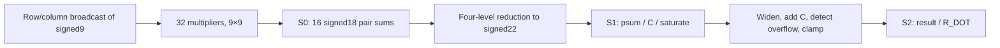

# blackwell_int8_dot

## Description

Computes one complete 32-term S8/U8 integer dot plus S32 C, with independent A/B signedness. Each core's integer array has 64 copies. Logical K=32 and all terms participate in a single reduction.

| Signal / channel | Direction | Type / width | Peer | Handshake or sampling condition |
| --- | --- | --- | --- | --- |
| req | Input | a[32],b[32] each contain signed9 elements, plus c32 and saturate1, 609 bits total | TC dot array | req.fire captures S0. Element k=0 occupies the low 9 bits |
| rsp | Output | result32,overflow1, 33bit | TC dot array | rsp.fire delivers the result |

## Functionality

Follow the [common protocol](../top/blackwell_async_subsystem_top.md#common-protocol). overflow indicates that the infinite-precision final integer result exceeds the S32 range. It is reported even when saturation is disabled.

### Operand extension, reduction, and saturation

The array uses each row and column dtype to sign-extend S8 or zero-extend U8 to signed9. Legal signed9 inputs represent S8 or U8 values in [−128,255]. Each signed17 product is in [−32640,65025]. Add adjacent products exactly in signed18 before S0. Sign-extend the 16 pair sums to signed22 and reduce through four addition levels before S1. The 32-term sum lies in [−1044480,2080800]. Extend C to signed33 and add psum. Valid ranges guarantee 33 bits suffice. When saturation is enabled, clamp to [−2^31,2^31−1]. Otherwise return the low 32 bits. Saturate only the final result.

| Stage | payload bit | Contents |
|---|---:|---|
| S0 | 321 | 16×signed18,C32,saturate1 |
| S1 | 55 | psum22,C32,saturate1 |
| S2 | 33 | result32,overflow1 |

Total 409 bits/dot or 3,272 B/core, plus three valid bits/dot. S2 is the result register.

Set the two low bytes of A to 0xff, 0x01, and of B to 0x02, 0x03. Set all other terms to zero and C=4. With S8 A and U8 B the result is 5. Changing only A to U8 gives 517.

### Result transfer and stalls

Input fire at l captures S0. R_DOT is visible after l+2 and first transfers at l+3. P=3 and II=1. Three independent elastic stages include R_DOT. A downstream stall must not overwrite any stage. Reset clears valid.

Test all four signedness combinations, signed/unsigned interpretations of 0xff, both extreme C values, positive/negative overflow, saturation and wrap, cancellation, and random backpressure. The reference sums in at least 64 signed bits and applies S32 rules only at the end. Per-term S32 wrap or saturation is incorrect.

RTL: [blackwell_int8_dot.sv](../../../rtl/dot/blackwell_int8_dot.sv).

## Submodules

| Submodule | Instances per dot | Connections and control |
| --- | --- | --- |
| [pipeline_reg](../base/blackwell_pipeline_reg.md) | 3 | S0 captures pair sums, S1 the partial sum, and S2 the result including overflow. |
