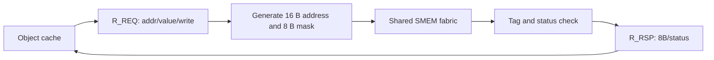

# blackwell_mbarrier_backing

## Description

Converts 8 B object cache fills and writebacks into masked 16 B transactions on the shared SMEM fabric. It has no additional object cache and does not modify counts. See [common](../top/blackwell_async_subsystem_top.md#common-protocol) for interfaces, [mbarrier_object](blackwell_mbarrier_unit.md#object) for objects, and [memory_transaction](../top/blackwell_async_subsystem_top.md#memory-routing) for transactions.

| Signal / channel | Direction | Type / width | Peer | Sampling condition |
|---|---|---|---|---|
| `back_req` | Input | [bar_back_req_t](#backing-types) (97 bits) | Object unit | Transfer on `back_req.fire`. One object read or write. |
| `back_rsp` | Output | [bar_back_rsp_t](#backing-types) (68 bits) | Object unit | Transfer on `back_rsp.fire`. Successful reads return 8 B. Writes return value=0. |
| `smem_req` | Output | [smem_atom_req_t](../smem/blackwell_smem_fabric.md#transactions) (255 bits) | SMEM fabric | Transfer on `smem_req.fire`. client=11, 16 B aligned. |
| `smem_rsp` | Input | [smem_atom_rsp_t](../smem/blackwell_smem_fabric.md#transactions) (211 bits) | SMEM fabric | Transfer on `smem_rsp.fire`. Accept only the current live tag as a match. |
| `epoch` | Input | 16 bits | Top level | Level. Change only after drain. |
| `stop` | Input | 1 bit | Top level | Level. Drain indication. Does not gate internal back_req. |
| `drained` | Output | 1 bit | Top level | Level. No pending request, external transaction, or held response. |
| `fault` | Output | 1 bit (sticky) | Top level | Level. External protocol error, cleared by reset. |



## Functionality

<a id="backing-types"></a>

### Internal backing types

`bar_back_req_t={write:1,addr:32,value:64}` is 97 bits and `bar_back_rsp_t={status:4,value:64}` is 68 bits. Only one transaction can be outstanding. Each SMEM request still carries its full token.

### Request and result storage

| Item | Capacity | Purpose |
|---|---:|---|
| R_REQ | 97bit | Accepted object operation, held until external completion |
| R_RSP | 68bit | Result returned to the unit |
| live tag | 78bit | Identifies the single external transaction |
| token counter | 16bit | Token incremented within this client |
| State/valid/fault | Control bits | No second 128-bit return buffer |

Only one external transaction may be outstanding. At read return handshake, extract the required 64 bits directly into R_RSP. No full-line backup is required. Reserve R_RSP before receiving the external return so that the output can tolerate backpressure.

States are EMPTY, ISSUE, WAIT_MEM, and RESP. In EMPTY without fault, accept back_req, including requests servicing earlier operations or flush during stop. After range and alignment checks, enter ISSUE. An illegal internal address raises fault. External fire enters WAIT_MEM, a matching return enters RESP, and consumption of back_rsp returns to EMPTY.

### Addresses, masks, and return matching

```text
line_addr = back_req.addr & ~0xf
half      = back_req.addr[3]
byte_mask = half ? 0xff00 : 0x00ff
write_data = zero_extend(value) << (half * 64)
read_value = smem_rsp.data[half*64 +: 64]
```

Preserve the logical byte address. The SMEM fabric maps 4 B words to banks and commits both selected subwords on one edge. Do not read-modify-write the neighboring 8 B object. A write ACK confirms the selected 8 B actually committed. Acceptance of back_req alone does not save the object.

`tag.client=11` and `tag.id={epoch,issuer=0,seq=0}` are fixed context for this internal client. They do not denote an accepted external command or publish op_done. Increment the token modulo 2^16 after back_rsp retires. Do not reuse the tag of the one live transaction. Once the old request receives its final ACK and retires, its token may be reused. Counter wrap must not prevent a required flush. The external protocol guarantees exactly one return per request.

The write bit on read or write responses must match R_REQ and the full tag must match. Never route another client's response here. If an unknown tag or wrong direction arrives, consume it and raise fault without assigning it to the current transaction. Recovery requires isolation and reset under the top-level contract.

### Request-to-response timing

For an object request accepted at g, the earliest SMEM request acceptance is g+1. The fabric defines SMEM service latency. If the matching return is accepted at r, back_rsp can be consumed at r+1 at the earliest. Each operation produces at most one external request and one internal response.

A non-OK read return or write ACK raises fault immediately and suppresses successful back_rsp. Only a successful actual write ACK permits the unit to clear dirty or release the victim.

INVAL and flush wait for a successful write response here. smem_req fire alone is insufficient. Local updates of dirty object counts can proceed while backing is busy until eviction or explicit flush requires a save.

### Arbitration and stalls

stop does not block back_req or its completion. The front end blocks new external operations. WAIT_MEM always reserves room for the matching return. A stalled back_rsp blocks only the next object request.

Other fabric clients can use nonconflicting banks concurrently. mbarrier has no exclusive claim on SMEM. Progress requires fair fabric arbitration, eventual external return, and eventual consumption of back_rsp by the unit.

During unit flush, process up to four dirty entries in sequence and confirm each write ACK separately. Failed and unsaved entries remain dirty. Flush must not return OK.

### Reset and exceptions

Synchronous reset clears state, valid, fault, and counters and leaves SMEM intact. Cancel or isolate external transactions before reset so old tags cannot reappear afterward.

A misaligned or out-of-range internal address raises fault without issuing an external transaction. An epoch change outside EMPTY is PROTOCOL. Integration must observe drained first.

On a normal epoch change, reset the token counter and establish the new context only in EMPTY with no held return or fault. Preserve SMEM. All legal returns from the previous epoch must already have retired. Do not discard them by comparing against the new epoch.

### Assertions and acceptance

Interleave reads and writes to both 8 B objects in one 16 B line while stalling requests and returns. Check that each back_req settles exactly once and the unselected half stays intact. Inject a wrong tag, wrong direction, or MEMORY return and verify that the unit retains the dirty victim until a successful write ACK.
