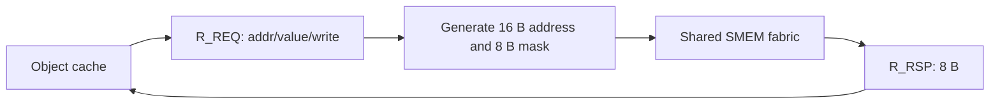

# blackwell_mbarrier_backing

## Description

Converts 8 B object cache fills and writebacks into masked 16 B transactions on the shared SMEM fabric. It has no additional object cache and does not modify counts. See [common](../top/blackwell_async_subsystem_top.md#common-protocol) for interfaces, [mbarrier_object](blackwell_mbarrier_unit.md#object) for objects, and [memory_transaction](../top/blackwell_async_subsystem_top.md#memory-routing) for transactions.

| Signal / channel | Direction | Type / width | Peer | Sampling condition |
|---|---|---|---|---|
| `back_req` | Input | [bar_back_req_t](#backing-types) (97 bits) | Object unit | Transfer on `back_req.fire`. One object read or write. |
| `back_rsp` | Output | [bar_back_rsp_t](#backing-types) (64 bits) | Object unit | Transfer on `back_rsp.fire`. Reads return 8 B. Writes return value=0. |
| `smem_req` | Output | [smem_atom_req_t](../smem/blackwell_smem_fabric.md#transactions) (255 bits) | SMEM fabric | Transfer on `smem_req.fire`. client=11, 16 B aligned. |
| `smem_rsp` | Input | [smem_atom_rsp_t](../smem/blackwell_smem_fabric.md#transactions) (207 bits) | SMEM fabric | Transfer on `smem_rsp.fire`. The read result or write ACK carries the live tag. |
| `epoch` | Input | 16 bits | Top level | Level. Change only after drain. |
| `stop` | Input | 1 bit | Top level | Level. Drain indication. Does not gate internal back_req. |
| `drained` | Output | 1 bit | Top level | Level. No pending request, external transaction, or held response. |



## Functionality

<a id="backing-types"></a>

### Internal backing types

`bar_back_req_t={write:1,addr:32,value:64}` is 97 bits and `bar_back_rsp_t={value:64}` is 64 bits. Only one transaction can be outstanding. Each SMEM request still carries its full token.

### Request and result storage

| Item | Capacity | Purpose |
|---|---:|---|
| R_REQ | 97bit | Accepted object operation, held until external completion |
| R_RSP | 64bit | Result returned to the unit |
| live tag | 78bit | Identifies the single external transaction |
| token counter | 16bit | Token incremented within this client |
| State/valid | Control bits | No second 128-bit return buffer |

Only one external transaction may be outstanding. At read return handshake, extract the required 64 bits directly into R_RSP. No full-line backup is required. Reserve R_RSP before receiving the external return so that the output can tolerate backpressure.

States are EMPTY, ISSUE, WAIT_MEM, and RESP. In EMPTY, back_req.fire captures the aligned object address and enters ISSUE, including during stop for an earlier operation or flush. External fire enters WAIT_MEM, a matching return enters RESP, and consumption of back_rsp returns to EMPTY.

### Addresses, masks, and return matching

```text
line_addr = back_req.addr & ~0xf
half      = back_req.addr[3]
byte_mask = half ? 0xff00 : 0x00ff
write_data = zero_extend(value) << (half * 64)
read_value = smem_rsp.data[half*64 +: 64]
```

Preserve the logical byte address. The SMEM fabric maps 4 B words to banks and commits both selected subwords on one edge. Do not read-modify-write the neighboring 8 B object. A write ACK confirms the selected 8 B actually committed. Acceptance of back_req alone does not save the object.

`tag.client=11` and `tag.id={epoch,issuer=0,seq=0}` are fixed context for this internal client. They do not denote an accepted external command or publish op_done. Increment the token modulo 2^16 after back_rsp retires. Do not reuse the tag of the one live transaction. Once the old request receives its final ACK and retires, its token may be reused. Counter wrap must not prevent a required flush. The external protocol guarantees exactly one return per request.

The fabric returns the direction from R_REQ and the full live tag for that transaction. A simulation assertion checks both on smem_rsp.fire.

### Request-to-response timing

For an object request accepted at g, the earliest SMEM request acceptance is g+1. The fabric defines SMEM service latency. If the matching return is accepted at r, back_rsp can be consumed at r+1 at the earliest. Each operation produces at most one external request and one internal response.

A write response reaches the object unit only after its masked SMEM write commits and the fabric returns the ACK.

The [object unit](blackwell_mbarrier_unit.md#miss-eviction-and-init) serializes service through the entire miss. While a dirty victim write awaits its ACK, the unit retains the victim and the original service request. A request for another resident object waits at service ingress. On `back_rsp.fire` for the write, the unit can reuse the victim for an INIT or proceed to target fill for an ordinary miss. INVAL and flush also wait for their masked writes to be acknowledged.

### Arbitration and stalls

stop does not block back_req or its completion. The front end blocks new external operations. WAIT_MEM always reserves room for the matching return. A stalled back_rsp blocks only the next object request.

Other fabric clients can use nonconflicting banks concurrently. mbarrier has no exclusive claim on SMEM. Progress requires fair fabric arbitration, eventual external return, and eventual consumption of back_rsp by the unit.

During unit flush, process up to four dirty entries in sequence and confirm each write ACK separately.

### Reset and epoch transition

Synchronous reset clears control, valid bits, and counters and leaves SMEM intact. The surrounding system isolates outstanding external transactions before reset.

On a normal epoch change, reset the token counter and establish the new context only in EMPTY with no held return. Preserve SMEM. All legal returns from the previous epoch must already have retired. Do not discard them by comparing against the new epoch.

### Writeback completion

Each accepted backing request settles once. A masked write preserves the adjacent object. The object unit retains a dirty victim until its writeback receives a successful ACK.
