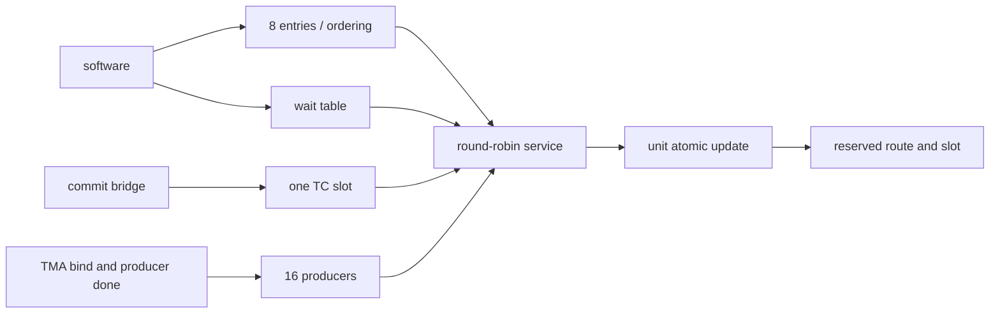

# blackwell_mbarrier_frontend

## Description

The front end arbitrates software commands, wait probes, TC commits, and TMA producers. It owns the software queue, TC slot, and producer binding table. All object updates go to [unit](blackwell_mbarrier_unit.md). The [wait unit](blackwell_mbarrier_wait.md) owns wait records.

| Signal / channel | Direction, type / width | Peer | Handshake or sampling condition |
| --- | --- | --- | --- |
| sw_cmd/sw_rsp, wait_cmd/wait_rsp | In/out, out/in [bar_cmd_t](#command)/[bar_rsp_t](#command) | Software front end, wait unit | Forward TRY_WAIT to wait. Return other software responses under their original IDs. |
| bind_req/bind_rsp, producer_done/producer_rsp | In/out [bar_bind_t](#command)/[op_done_t](../top/blackwell_async_subsystem_top.md#identity), in/out [bar_producer_done_t](#command)/op_done_t | TMA unit | One TMA producer class. Reserve the binding and both result positions. |
| tc_req/tc_rsp | In/out [tc_bar_req_t](#command)/op_done_t | TC completion bridge | Separate slot for a TC commit already registered in the tracker. |
| service_req/service_rsp, wait_probe_req/rsp | Out/in, in/out [bar_service_req_t](#command)/[bar_service_rsp_t](#command) | Object unit, wait unit | The unit serializes updates. Each route/slot reserves one unique return position. |
| release_req/release_rsp | Out/in [order_req_t](../top/blackwell_async_subsystem_top.md#ordering)/[order_rsp_t](../top/blackwell_async_subsystem_top.md#ordering) | Ordering service | Software update release and FENCE_INIT share a finite outstanding budget. |
| wait_busy_addr/wait_addr_busy, commit_busy_addr/commit_addr_busy | Two combinational queries, 32-bit input / 1-bit output each | wait, TC tracker | Check existing references to the INIT/INVAL address. |
| commit_candidate_addr/commit_blocked | 32-bit input / 1-bit output, combinational | Top-level commit ingress | The top queries lifecycle exclusivity at the candidate commit's address. The result gates new commit fire. |
| epoch, stop, drained, fault | Input u16, input bit, output bit, output bit | Top level | Drain on normal shutdown. Notify the top level of runtime faults. |

The [top-level common protocol](../top/blackwell_async_subsystem_top.md#common-protocol) defines clock, reset, and channel sampling.

## Functionality

### Acceptance and resource reservation

The eight software entries each contain cmd192, state3, and rsp63 (258 bits/entry), plus a shared 8×8-bit acceptance-order matrix. The separate TC slot holds tc_bar_req90 and state2. Each of 16 producer entries holds id58, addr32, phase1, bytes32, and state3 (FREE/QUERY_REQ/QUERY_WAIT/BIND_RSP/WAIT_DATA/UPDATE_REQ/UPDATE_WAIT/PRODUCER_RSP), totaling 126 bits/entry. Hold a stalled service, release, or software result selection until fire.

### Software commands and object lifetime

After precheck, software commands from the same issuer enter object service in acceptance order. Release forms first complete the common generic→async release. FENCE_INIT orders after earlier INIT commits from its issuer and retires on a distinct kind5 cluster ACK. A stalled fence result allows older service and producer work to continue. TRY and update use separate return slots.

An accepted INIT/INVAL owns its address exclusively until its software response retires. Before it occupies the unit, wait for earlier same-address software services, active bindings, waits, the TC slot, and unretired tracker commits for that address. On each edge `commit_blocked(addr)` matches an existing gate or a newly acceptable INIT/INVAL(addr). A new lifecycle command takes priority on that edge. The top gates only **new commit registration** and must let tc_req from old commits through. Bound producer_done, already presented waits/probes, and all old responses keep advancing. Other addresses remain eligible. The gate query depends only on software slot capacity, existing references, and address. It is independent of new commit.ready to avoid a combinational loop.

### Producer binding and completion

bind.fire reserves a producer entry. A successful QUERY records the initialized object's phase and retains it until producer_rsp is consumed. producer_done uses the bound phase and logical byte count for one COMPLETE_TX. Check the guard and decrement at the same object commit point. A TC request performs exactly one ARRIVE(1). Both wait for service_rsp on the original route/slot. Report non-OK status, wrong identity, duplicate update, or phase guard mismatch as a top-level fault.

### Service selection and progress

Round-robin across software, wait probe, TC, and producer classes and within each class. A continuously eligible class can be bypassed by at most three other service fires. unit.commit is independent of front-end result capture. A reserved slot does not wait for software ready. stop closes new software operations but continues accepting older TMA bind/producer_done, TC, service, and ordering traffic. drained requires no held or outstanding work. Synchronous reset clears ownership and fault. Duplicate or unknown identities raise fault. Verify same-edge same-address new commit and INIT, retirement of old commits under the gate, independent barriers for different issuers, producer updates with a full software output, and the phase guard.

### Request and response edges

A software command or binding occupies its slot at g and may present release or service at g+1. After accepting unit.service_rsp at r, the corresponding software or producer result can transfer at r+1. Hold a stalled result in its slot while other classes continue requesting service.

### Commands, bindings, and object service

The [Supported PTX list](../../proposals/supported_ptx.md) defines software-visible variants. The [object specification](blackwell_mbarrier_unit.md#object) defines counts and phase. Ingress accepts only normalized 8 B aligned addresses in this CTA. The front end expands omitted/default PTX modifiers. Arrival permits a discarded result, and wait compares parity. The response payload contains only the predicate and status.

| bar_cmd_t fields (high to low) | bit | Use |
|---|---:|---|
| id, op | 58, 4 | async_id_t and the encodings below. |
| addr, count, bytes | 32 each | CTA-local address, INIT/ARRIVE count, and transaction byte count. |
| parity, guard | 1, 1 | Old phase for TRY or bound phase for the producer's final update. The guard is internal to updates. |
| time_hint | 32 | Optional TRY_WAIT suspendTimeHint. Set to 0 when omitted and pass explicit values through wait_cmd. Every value uses the same [fixed wait budget](blackwell_mbarrier_wait.md#wait-budget). |

`bar_cmd_t` is **192 bits** and `bar_rsp_t={id:58,status:4,completed:1}` is **63 bits**. Zero unused fields. Reject unsupported opcodes/modifiers before narrowing. Return exactly one error for a known identity.

| op | Source | Effect |
|---:|---|---|
| 0 INIT | Software | Set P=E=count, T=0, phase=0. |
| 1 INVAL | Software | Wait for same-address references to drain, update backing, then end object lifetime. |
| 2 ARRIVE | Software or TC | Software .release.cta waits for release ACK before committing count. Internal TC uses count=1. |
| 3 ARRIVE_EXPECT_TX | Software | Commit P−1 and T+bytes atomically. Omitted sem/scope use the PTX release/CTA defaults. |
| 4 TRY_WAIT | Software | .parity.shared or .shared::cta compares only the current object phase, then obtains default acquire acknowledgment after a successful observation. |
| 5 FENCE_INIT | Software | fence.mbarrier_init.release.cluster orders local INITs already committed by this issuer. See completion conditions below. |
| 6 QUERY | Internal | On success return initialized/phase without updating the object. |
| 7 COMPLETE_TX | Internal TMA | Atomically deduct bytes under the bound phase. Only success may flip the phase. |

`bar_service_req_t={route2,slot5,cmd192}` is 199 bits and `bar_service_rsp_t={route2,slot5,rsp63,phase1,initialized1}` is 72 bits. route=0 selects software, 1 wait probe, 2 TC, and 3 TMA. Each request reserves the corresponding result position. Only a successful QUERY provides valid phase and initialized.

See [unit](blackwell_mbarrier_unit.md#change-type) for object change events and [backing](blackwell_mbarrier_backing.md#backing-types) for backing requests.

#### Bindings and TC arrivals

`bar_bind_t={id58,addr32}` is 90 bits. The front end acknowledges a successful binding with op_done_t. `bar_producer_done_t={id58,bytes32,status4}` is 94 bits, with status=OK during normal execution. Each binding has exactly one COMPLETE_TX(bytes) and one matching acknowledgment. TMA publishes full only after receiving producer_rsp. TC separately uses `tc_bar_req_t={id58,addr32}` (90 bits) for one ARRIVE(1) per commit ID.

#### Ordering

Ordinary software release, successful wait acquire, and init fence all use the common [ordering](../top/blackwell_async_subsystem_top.md#ordering). FENCE_INIT has no object address or nonzero count. In software acceptance order for its issuer, it waits for every earlier INIT to commit, then generates `kind=MBARRIER_INIT_RELEASE(5),scope=CLUSTER(3),from=generic,to=generic,addr=0,bytes=0`. The matching external ACK must establish visibility of the current thread's preceding INITs in this CTA's SMEM to cluster participants. The supported cluster contains only this CTA, but the ordering transaction remains distinct. Only the opcodes in the table enter hardware. Unused token, DROP, PENDING_COUNT, and deferred arrival for ordinary cp.async require no state. [PTX mbarrier](https://docs.nvidia.com/cuda/archive/12.8.2/parallel-thread-execution/index.html#parallel-synchronization-and-communication-instructions-mbarrier) · [PTX fence](https://docs.nvidia.com/cuda/archive/12.8.2/parallel-thread-execution/index.html#parallel-synchronization-and-communication-instructions-membar)
