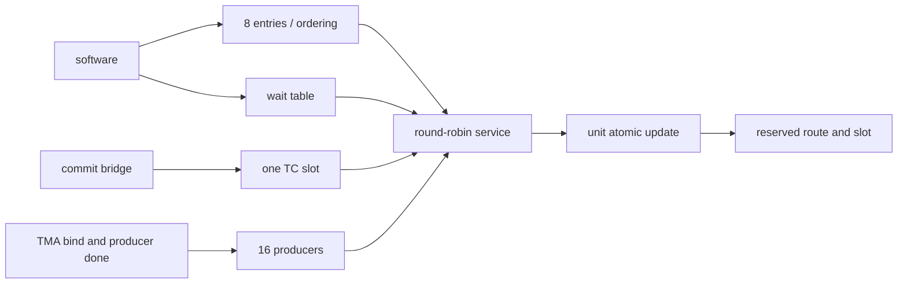

# blackwell_mbarrier_frontend

## Description

The front end arbitrates software commands, wait probes, TC commits, and TMA producers. It owns the software queue, TC slot, and producer binding table. All object updates go to [unit](blackwell_mbarrier_unit.md). The [wait unit](blackwell_mbarrier_wait.md) owns wait records.

| Signal / channel | Direction | Type / width | Peer | Sampling condition |
|---|---|---|---|---|
| `sw_cmd` | Input | [bar_cmd_t](#command) (191 bits) | Software front end | On `sw_cmd.fire`, accept the software command and route TRY_WAIT to the wait unit. |
| `sw_rsp` | Output | [bar_rsp_t](#command) (59 bits) | Software front end | On `sw_rsp.fire`, deliver the held predicate under the original ID. |
| `wait_cmd` | Output | [bar_cmd_t](#command) (191 bits) | Wait unit | On `wait_cmd.fire`, allocate the TRY_WAIT observation and retain its software queue position until QUERY enters object service. |
| `wait_rsp` | Input | [bar_rsp_t](#command) (59 bits) | Wait unit | On `wait_rsp.fire`, deliver the selected wait result on the same edge as `sw_rsp.fire`. |
| `bind_req` | Input | [bar_bind_t](#command) (90 bits) | TMA unit | On `bind_req.fire`, reserve the producer binding and both result positions. |
| `bind_rsp` | Output | [op_done_t](../top/blackwell_async_subsystem_top.md#identity) (58 bits) | TMA unit | On `bind_rsp.fire`, acknowledge the binding by ID. |
| `producer_done` | Input | [bar_producer_done_t](#command) (90 bits) | TMA unit | On `producer_done.fire`, accept completion from the bound TMA producer with a reserved result position. |
| `producer_rsp` | Output | [op_done_t](../top/blackwell_async_subsystem_top.md#identity) (58 bits) | TMA unit | On `producer_rsp.fire`, acknowledge the matching object update by ID. |
| `tc_req` | Input | [tc_bar_req_t](#command) (90 bits) | TC completion bridge | On `tc_req.fire`, accept ARRIVE for an already registered commit into its separate slot. |
| `tc_rsp` | Output | op_done_t (58 bits) | TC completion bridge | On `tc_rsp.fire`, acknowledge the matching commit arrival by ID. |
| `service_req` | Output | [bar_service_req_t](#command) (198 bits) | Object unit | On `service_req.fire`, submit one routed object operation with a reserved return position. |
| `service_rsp` | Input | [bar_service_rsp_t](#command) (68 bits) | Object unit | On `service_rsp.fire`, accept the serialized result by route and slot. |
| `wait_probe_req` | Input | [bar_service_req_t](#command) (198 bits) | Wait unit | On `wait_probe_req.fire`, the selected route-1 QUERY transfers on `service_req.fire`. |
| `wait_probe_rsp` | Output | [bar_service_rsp_t](#command) (68 bits) | Wait unit | On a route-1 `service_rsp.fire`, return the sampled state to the reserved wait slot on `wait_probe_rsp.fire`. |
| `release_req` | Output | [order_req_t](../top/blackwell_async_subsystem_top.md#ordering) (163 bits) | Ordering service | On `release_req.fire`, issue ordering for a software release or FENCE_INIT within the shared outstanding budget. |
| `release_rsp` | Input | [op_done_t](../top/blackwell_async_subsystem_top.md#identity) (58 bits) | Top-level ordering router | On `release_rsp.fire`, settle the matching ordering operation. |
| `wait_busy_addr` | Output | 32 bits | Wait unit | Level. Present the INIT/INVAL address to check for active wait references. |
| `wait_addr_busy` | Input | 1 bit | Wait unit | Level. Observe whether a wait entry references that address. |
| `commit_busy_addr` | Output | 32 bits | TC tracker | Level. Present the INIT/INVAL address to check for unretired commits. |
| `commit_addr_busy` | Input | 1 bit | TC tracker | Level. Observe whether a commit references that address. |
| `commit_candidate_addr` | Input | 32 bits | Top-level commit ingress | Level. Address of the proposed commit. |
| `commit_blocked` | Output | 1 bit | Top-level commit ingress | Level. Lifecycle exclusion gates new commit acceptance. |
| `epoch` | Input | 16 bits | Top level | Level identifying the active CTA lifetime. |
| `stop` | Input | 1 bit | Top level | Close new software operations and drain accepted work, including internal producer and commit traffic. |
| `drained` | Output | 1 bit | Top level | Level asserted after outstanding work and held transfers drain. |

The [top-level common protocol](../top/blackwell_async_subsystem_top.md#common-protocol) defines clock, reset, and channel sampling.

## Functionality

### Acceptance and resource reservation

The eight software entries each contain cmd191, state3, and rsp59 (253 bits/entry), plus a shared 8×8-bit acceptance-order matrix. The separate TC slot holds tc_bar_req90 and state2. Each of 16 producer entries holds id58, addr32, bytes32, and state3 (FREE/QUERY_REQ/QUERY_WAIT/BIND_RSP/WAIT_DATA/UPDATE_REQ/UPDATE_WAIT/PRODUCER_RSP), totaling 125 bits/entry. Hold a stalled service, release, or software result selection until fire.

### Software commands and object lifetime

Simulation assertions check each presented command’s normalized opcode, operands, aligned local address where applicable, epoch and fresh ID. The ID stays live through response retirement, including after a TRY hands off to the wait table.

Software commands from the same issuer enter object service in acceptance order. Release forms first complete the common generic→async release. FENCE_INIT orders after earlier INIT commits from its issuer and retires on a distinct kind5 cluster ACK. A stalled fence result allows older service and producer work to continue.

On `wait_cmd.fire`, TRY reserves a wait record and retains its software entry. The wait unit presents its initial QUERY on the next cycle. Only one allocated wait can be awaiting QUERY dispatch. Even if a change broadcast has already matched the wait, the QUERY still enters object service in issuer order. The route-1 `service_req.fire` and `wait_probe_req.fire` coincide and free the original TRY software entry. The next command from that issuer can advance on the following edge. The wait record owns the QUERY return and the eventual software response through retirement. All 32 wait records can hold unretired observations.

An accepted INIT/INVAL excludes younger same-address software operations, producer bindings, and new TC commits until its software response retires. Before the lifecycle command occupies the unit, it waits for older same-address software responses to retire and for active bindings, wait entries, the TC slot, and tracker commits for that address to drain. On each edge `commit_blocked(addr)` matches an existing gate or a same-edge INIT/INVAL(addr) transfer. A transferring lifecycle command also blocks a new same-address producer binding on that edge. The top gates only **new commit registration** and must let tc_req from old commits through. Bound producer_done, older same-address software commands (including queued TRY_WAIT allocation and probe dispatch), and all old responses keep advancing. Other addresses remain eligible. The gate query uses existing owners, software admission, and address comparison. It is independent of new commit.ready to avoid a combinational loop.

### Producer binding and completion

bind_req.fire reserves a producer entry. Its serialized QUERY binds the producer to the initialized object's observed phase before bind_rsp. The binding retains the address until producer_rsp.fire. Each bound producer submits one COMPLETE_TX with its logical byte count while that phase is current. A simulation assertion compares the phase sampled at QUERY with the pre-update phase at the atomic decrement. A TC request submits one ARRIVE(1). Each requester receives its acknowledgment after service_rsp transfers on the reserved route and slot.

### Service selection and progress

Round-robin across software, wait probe, TC, and producer classes and within each class. A continuously eligible class can be bypassed by at most three other service fires. unit.commit is independent of front-end result capture. A reserved slot does not wait for software ready. During DRAIN, stop closes external software admission. Queued TRY_WAITs continue to transfer on wait_cmd as capacity becomes available. Older TMA bind/producer_done, TC, service, and ordering traffic continue. drained requires no held or outstanding work. Synchronous reset clears ownership, outstanding selections and held results.

### Request and response edges

A software command or binding occupies its slot at g and may present release or service at g+1. After accepting unit.service_rsp at r, the corresponding software or producer result can transfer at r+1. Hold a stalled result in its slot while other classes continue requesting service.

### Commands, bindings, and object service

The [Supported PTX list](../../proposals/supported_ptx.md) defines software-visible variants. The [object specification](blackwell_mbarrier_unit.md#object) defines counts and phase. Ingress accepts only normalized 8 B aligned addresses in this CTA. The front end expands omitted/default PTX modifiers. Arrival permits a discarded result, and wait compares parity. The software response carries the original ID and the wait predicate.

| bar_cmd_t fields (high to low) | bit | Use |
|---|---:|---|
| id, op | 58, 4 | async_id_t and the encodings below. |
| addr, count, bytes | 32 each | CTA-local address, INIT/ARRIVE count, and transaction byte count. |
| parity | 1 | Expected phase for TRY_WAIT. |
| time_hint | 32 | Optional TRY_WAIT suspendTimeHint. Set to 0 when omitted and pass explicit values through wait_cmd. Every value uses the same [fixed wait budget](blackwell_mbarrier_wait.md#wait-budget). |

`bar_cmd_t` is **191 bits** and `bar_rsp_t={id:58,completed:1}` is **59 bits**. The issuer supplies a supported operation with unused fields zero. TRY_WAIT returns its resolved predicate in completed. Other software operations return completed=0.

| op | Source | Effect |
|---:|---|---|
| 0 INIT | Software | Set P=E=count, T=0, phase=0. |
| 1 INVAL | Software | Wait for same-address references to drain, update backing, then end object lifetime. |
| 2 ARRIVE | Software or TC | Software .release.cta waits for release ACK before committing count. Internal TC uses count=1. |
| 3 ARRIVE_EXPECT_TX | Software | Commit P−1 and T+bytes atomically. Omitted sem/scope use the PTX release/CTA defaults. |
| 4 TRY_WAIT | Software | .parity.shared or .shared::cta compares only the current object phase, then obtains default acquire acknowledgment after a successful observation. |
| 5 FENCE_INIT | Software | fence.mbarrier_init.release.cluster orders local INITs already committed by this issuer. See completion conditions below. |
| 6 QUERY | Internal | On success return initialized/phase without updating the object. |
| 7 COMPLETE_TX | Internal TMA | Atomically deduct bytes under the bound phase. Apply the phase-completion test at the decrement. |

`bar_service_req_t={route2,slot5,cmd191}` is 198 bits and `bar_service_rsp_t={route2,slot5,rsp59,phase1,initialized1}` is 68 bits. route=0 selects software, 1 wait probe, 2 TC, and 3 TMA. Each request reserves the corresponding result position. QUERY returns the sampled phase and initialized bit.

See [unit](blackwell_mbarrier_unit.md#change-type) for object change events and [backing](blackwell_mbarrier_backing.md#backing-types) for backing requests.

#### Bindings and TC arrivals

`bar_bind_t={id58,addr32}` is 90 bits. The front end acknowledges a successful binding with op_done_t. `bar_producer_done_t={id58,bytes32}` is 90 bits. Each binding has exactly one COMPLETE_TX(bytes) and one matching acknowledgment. TMA publishes full only after receiving producer_rsp. TC separately uses `tc_bar_req_t={id58,addr32}` (90 bits) for one ARRIVE(1) per commit ID.

#### Ordering

Ordinary software release, successful wait acquire, and init fence all use the common [ordering](../top/blackwell_async_subsystem_top.md#ordering). FENCE_INIT has no object address or nonzero count. In software acceptance order for its issuer, it waits for every earlier INIT to commit, then generates `kind=MBARRIER_INIT_RELEASE(5),scope=CLUSTER(3),from=generic,to=generic,addr=0,bytes=0`. The matching external ACK must establish visibility of the current thread's preceding INITs in this CTA's SMEM to cluster participants. The supported cluster contains only this CTA, but the ordering transaction remains distinct. Only the opcodes in the table enter hardware. Unused token, DROP, PENDING_COUNT, and deferred arrival for ordinary cp.async require no state. [PTX mbarrier](https://docs.nvidia.com/cuda/archive/12.8.2/parallel-thread-execution/index.html#parallel-synchronization-and-communication-instructions-mbarrier) · [PTX fence](https://docs.nvidia.com/cuda/archive/12.8.2/parallel-thread-execution/index.html#parallel-synchronization-and-communication-instructions-membar)
