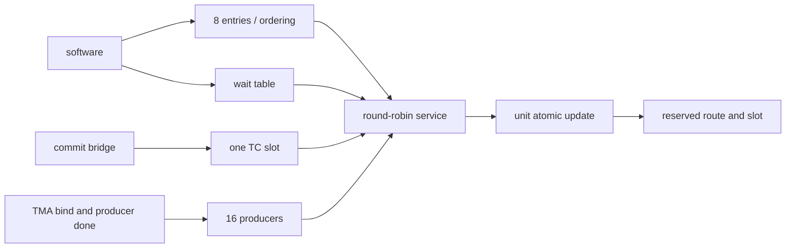

# blackwell_mbarrier_frontend

## Description

前端仲裁软件命令、wait 探测、TC commit 和 TMA producer。模块拥有软件队列、TC 槽和 producer 绑定表，所有对象更新送 [unit](blackwell_mbarrier_unit.md)，等待记录由 [wait](blackwell_mbarrier_wait.md) 持有。

| 信号 / 通道 | 方向、类型 / 位宽 | 对端 | 握手或采样条件 |
| --- | --- | --- | --- |
| sw_cmd/sw_rsp、wait_cmd/wait_rsp | 入/出、出/入 [bar_cmd_t](#command)/[bar_rsp_t](#command) | 软件前端、wait | TRY_WAIT 转 wait；其他软件命令以原 id 回应。 |
| bind_req/bind_rsp、producer_done/producer_rsp | 入/出 [bar_bind_t](#command)/[op_done_t](../top/blackwell_async_subsystem_top.md#identity)、入/出 [bar_producer_done_t](#command)/op_done_t | TMA unit | TMA 单一 producer 类，预留绑定与两个结果位置。 |
| tc_req/tc_rsp | 入/出 [tc_bar_req_t](#command)/op_done_t | TC completion bridge | 已由 tracker 登记的 TC commit，独立槽。 |
| service_req/service_rsp、wait_probe_req/rsp | 出/入、入/出 [bar_service_req_t](#command)/[bar_service_rsp_t](#command) | 对象 unit、wait | unit 串行更新，route/slot 唯一预留返回。 |
| release_req/release_rsp | 出/入 [order_req_t](../top/blackwell_async_subsystem_top.md#ordering)/[order_rsp_t](../top/blackwell_async_subsystem_top.md#ordering) | ordering 服务 | 软件 update 的 release 和 FENCE_INIT 共用有限在途预算。 |
| wait_busy_addr/wait_addr_busy、commit_busy_addr/commit_addr_busy | 出32bit/入1bit，两组组合查询 | wait、TC tracker | 查 INIT/INVAL 地址的已有引用。 |
| commit_candidate_addr/commit_blocked | 入32bit/出1bit，组合查询 | 顶层 commit 入口 | top 以新 commit 候选地址查询同址生命周期独占，结果 gate 新 commit fire。 |
| epoch、stop、drained、fault | 入 u16、入 bit、出 bit、出 bit | 顶层 | 正常关闭时排空；运行故障通知顶层。 |

时钟、复位及通道的采样约定见[顶层公共协议](../top/blackwell_async_subsystem_top.md#common-protocol)。

## Functionality

### 接受与资源预留

软件表 8 项，各含 cmd192、state3、rsp63，共 258bit/项，另有 8×8bit 接受先后矩阵。独立 TC 槽含 tc_bar_req90、state2。16 个 producer 行各存 id58、addr32、phase1、bytes32、state3（FREE/QUERY_REQ/QUERY_WAIT/BIND_RSP/WAIT_DATA/UPDATE_REQ/UPDATE_WAIT/PRODUCER_RSP），共 126bit/项。各类 service、release 和软件结果选择受阻保持到 fire。

### 软件命令与对象生命周期

软件命令预检后，同 issuer 按接受顺序进入对象服务；release 类型先完成公共 generic→async release。FENCE_INIT 与先前该 issuer INIT 的提交建立顺序，用独立 kind5 的 cluster ACK 退休，仅该 fence 的结果受阻时旧 service/producer 仍可继续。TRY 与更新的返回槽分离。

已接受 INIT/INVAL 对该地址独占，直到软件响应退休。它等更早软件同址服务、活跃绑定、wait、TC 槽及 tracker 中该址未退 commit 排空后才占 unit。每边沿，`commit_blocked(addr)` 命中旧 gate 或本沿可接受的新 INIT/INVAL(addr)。同沿新 lifecycle 优先；top 只 gate **新 commit 登记**，不能 gate 从旧 commit 发来的 tc_req。已有绑定的 producer_done、已展示 wait/probe 和所有旧响应均继续推进。其他地址不受阻。gate 查询只依赖软件槽容量、既有引用及地址，不依赖新 commit.ready，避免组合环。

### producer 绑定与完成

bind.fire 预留 producer 行，QUERY 成功后记录已初始化对象的 phase，保留至 producer_rsp 消费。producer_done 用已绑定的 phase 和逻辑字节数作一次 COMPLETE_TX；guard 与扣数在同一对象提交点检查。TC 请求只作一次 ARRIVE(1)。两者均等待原 route/slot 对应的 service_rsp。非 OK、错身份、重复更新或 phase guard 失配报告顶层 fault。

### 服务选择与进展

软件、wait probe、TC、producer 四类轮询，同类内轮询；持续有候选的类最多被另外三次 service fire 越过。unit.commit 与前端捕获结果独立，已预留槽不等待软件 ready。stop 关闭新软件操作，仍接旧 TMA bind/producer_done、TC、service 和 ordering。drained 要求所有 held/在途为空。同步复位清 owner/fault；重复/未知身份触发 fault。验证同址新 commit 与 INIT 同沿、旧 commit 在 gate 期间退休、两个不同 issuer 的独立 barrier、软件出口满时 producer 仍可更新及 phase guard。[专利结构参考](https://patents.google.com/patent/US20230289242A1/en)

### 请求与响应边沿

软件/绑定在沿 g 占槽，最早 g+1 发布 release 或 service。沿 r 收到 unit.service_rsp 后最早 r+1 交付对应软件或 producer 结果；结果受阻时槽保持，由其他类继续请求。

### 命令、绑定及对象服务

[PTX 支持清单](../../proposals/supported_ptx.md)定义软件可发的变体，[对象](blackwell_mbarrier_unit.md#object)定义计数与 phase。入口仅接受已归一化的本 CTA 8 B 对齐对象地址；PTX 的 omitted/default 修饰符在前端展开。arrival 接受丢弃结果的形式，wait 按 parity 比较。响应载荷只含谓词和状态。

| bar_cmd_t 字段（从高到低） | bit | 用法 |
|---|---:|---|
| id、op | 58、4 | async_id_t 与下表编码。 |
| addr、count、bytes | 各 32 | 本 CTA 地址、INIT/ARRIVE count、tx 数。 |
| parity、guard | 1、1 | TRY 的旧 phase，或 producer 最终更新携带的绑定 phase；guard 仅供内部更新。 |
| time_hint | 32 | TRY_WAIT 可选的 suspendTimeHint，省略置 0，显式值随 wait_cmd 传递。所有取值共用 [wait 的固定预算](blackwell_mbarrier_wait.md#wait-budget)。 |

`bar_cmd_t` 为 **192bit**，`bar_rsp_t={id:58,status:4,completed:1}` 为 **63bit**。未使用字段置零。未开放 opcode/修饰符在收窄前拒绝；已知身份返回一次错误。

| op | 来源 | 结算 |
|---:|---|---|
| 0 INIT | 软件 | 建立 P=E=count、T=0、phase=0。 |
| 1 INVAL | 软件 | 等同址引用排空，更新 backing 后结束对象生命周期。 |
| 2 ARRIVE | 软件或 TC | 软件 .release.cta 先等 release ACK 再提交 count；TC 内部固定 count=1。 |
| 3 ARRIVE_EXPECT_TX | 软件 | 同一次提交 P−1、T+bytes；省略 sem/scope 按 PTX 默认 release/CTA。 |
| 4 TRY_WAIT | 软件 | .parity.shared 或 .shared::cta，只比较当前对象 phase，成功观察后按默认 acquire 取得确认。 |
| 5 FENCE_INIT | 软件 | fence.mbarrier_init.release.cluster，作用于该 issuer 已提交的本地 INIT，完成条件见下。 |
| 6 QUERY | 内部 | 成功时返回 initialized/phase，不产生更新。 |
| 7 COMPLETE_TX | 内部 TMA | 按绑定 phase 原子扣 bytes，成功才可能翻 phase。 |

`bar_service_req_t={route2,slot5,cmd192}` 为 199bit；`bar_service_rsp_t={route2,slot5,rsp63,phase1,initialized1}` 为 72bit。route=0 软件、1 wait probe、2 TC、3 TMA。每个请求预留对应返回位置。仅成功 QUERY 的 phase、initialized 有效。

对象 change 事件及 backing 请求分别见 [unit](blackwell_mbarrier_unit.md#change-type) 和 [backing](blackwell_mbarrier_backing.md#backing-types)。

#### 绑定与 TC arrival

`bar_bind_t={id58,addr32}` 为 90bit。frontend 以 op_done_t 确认成功绑定。`bar_producer_done_t={id58,bytes32,status4}` 为 94bit，正常执行中 status=OK。每次绑定恰有一次 COMPLETE_TX(bytes) 及一次匹配确认；TMA 收到 producer_rsp 后才发布 full。TC 独立使用 `tc_bar_req_t={id58,addr32}`（90bit），按 commit id 对应一次 ARRIVE(1)。

#### 排序

普通软件 release、成功 wait acquire、init fence 均使用公共 [ordering](../top/blackwell_async_subsystem_top.md#ordering)。FENCE_INIT 无对象地址或非零 count，按同 issuer 软件接受顺序等待所有更早的 INIT 提交，随后产生 `kind=MBARRIER_INIT_RELEASE(5),scope=CLUSTER(3),from=generic,to=generic,addr=0,bytes=0`。外部 matching ACK 必须证明当前线程在本 CTA SMEM 上此前 INIT 对 cluster 参与者的初始化可见性；支持环境的 cluster 仅有本 CTA，仍保留这个独立排序动作。仅表中实际 opcode 进入硬件；不需要为未出现的 token、DROP、PENDING_COUNT 或普通 cp.async 延迟 arrival 保存状态。[PTX mbarrier](https://docs.nvidia.com/cuda/archive/12.8.2/parallel-thread-execution/index.html#parallel-synchronization-and-communication-instructions-mbarrier) · [PTX fence](https://docs.nvidia.com/cuda/archive/12.8.2/parallel-thread-execution/index.html#parallel-synchronization-and-communication-instructions-membar)
