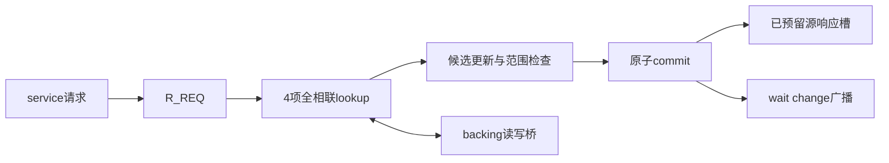

# blackwell_mbarrier_unit

## Description

本模块唯一持有4项对象cache并完成对象原子更新。软件命令、wait探测、TC arrival与TMA complete-tx共用此更新器；等待线程不占住更新流水。对象公式见[mbarrier_object](blackwell_mbarrier_unit.md#object)，接口类型见[mbarrier_command](blackwell_mbarrier_frontend.md#command)，握手见[common](../top/blackwell_async_subsystem_top.md#common-protocol)。

| 信号 / 通道 | 方向 | 类型 / 位宽 | 对端 | 握手或采样条件 |
| --- | --- | --- | --- | --- |
| `service_req` | 入 | [bar_service_req_t](blackwell_mbarrier_frontend.md#command) | barrier frontend | 调用者已预留route/slot返回位置 |
| `service_rsp` | 出 | [bar_service_rsp_t](blackwell_mbarrier_frontend.md#command) | barrier frontend | 原子提交结果，保持到接受 |
| `change` | 出 | [bar_change_t](#change-type) + pulse | wait | 同提交边沿广播新 phase/initialized；不反压 |
| `back_req` | 出 | [bar_back_req_t](blackwell_mbarrier_backing.md#backing-types) | backing | 请求8B装入或写回 |
| `back_rsp` | 入 | [bar_back_rsp_t](blackwell_mbarrier_backing.md#backing-types) | backing | 必须与唯一在途backing操作对应 |
| `flush_req` | 入 | 无payload事件 | 顶层 | 上层已阻止新外部命令 |
| `flush_rsp` | 出 | status_t | 顶层 | 所有dirty写ACK成功后OK |
| `epoch` | 入 | 16bit | 顶层 | 当前CTA生命周期 |
| `stop` | 入 | 1 | 顶层 | 排空指示；不阻止已接受命令派生的service或flush |
| `drained` / `fault` | 出 | 各1 | 顶层 | 事务排空/必须隔离复位的协议故障 |

## Functionality

### 对象编码及原子状态转换

本 CTA SMEM 的 8 B 对齐对象有唯一权威值，驻留时由 unit.cache 拥有，dirty eviction、INVAL、flush 经 backing 完成。有效地址满足 `addr+8≤228 KiB`，软件不得绕开对象服务读写其底层 byte。下列 encoding 为项目选择，供[软件及 producer 接口](blackwell_mbarrier_frontend.md#command)共用。

| bits | 字段 | 范围 |
|---|---|---|
| 19:0、39:20 | pending(P)、expected(E) | 0…1048575、1…1048575 |
| 60:40 | tx(T) | 二补码 −1048575…1048575 |
| 61、62、63 | phase(F)、initialized、保留零位 | 初始化 F=0，invalid 编码全零。 |

用至少 22bit signed 中间值校验 count/byte 增减后才提交。INIT 从显式 operand 建立 P=E=count,T=0,F=0；INVAL 在所有同址引用排空后结束生命周期，等待实际写回 ACK。合法 count 为 1…1048575，bytes 为 0…1048575。读未初始化对象或使用越界地址不能返回成功。

| 提交 | 候选状态 | 完成判定 |
|---|---|---|
| ARRIVE(count) | P'=P−count | 检查候选 P'/T'。 |
| ARRIVE_EXPECT_TX(bytes) | 原子 P'=P−1、T'=T+bytes | 检查候选 P'/T'。 |
| COMPLETE_TX(bytes) | T'=T−bytes | 检查候选 P'/T'。 |

成功且 P'=0、T'=0 时在本次提交沿执行 F'=!F、P'=E，否则保留 F。T 可为负，表示提前完成。计数越界、对象编码或 phase guard 违约触发 fault，对应更新不提交。guard 与更新使用同一旧对象值。

TRY_WAIT 的 expected parity 与当前 F 不同即观察到完成。软件每次进入下一 phase 的 arrival 前须已有该 phase 的一次成功 wait，只使用当前或上一 phase 的 parity。acquire、响应保持及超时见 [wait](blackwell_mbarrier_wait.md#wait-budget)。驱逐对象不取消等待者。

测试 4096 B×4 两轮各翻一次、负 T、COMPLETE_TX 与 arrival 同址连续、计数边界、终止失败不伪造成功、8 B 半行写不改邻对象、dirty eviction 期间 busy 保持，以及 phase 完成与 timeout 同拍。数值依据为[PTX 8.7 mbarrier](https://docs.nvidia.com/cuda/archive/12.8.2/parallel-thread-execution/index.html#parallel-synchronization-and-communication-instructions-mbarrier)。

### 修改广播类型

`bar_change_t={addr:32,phase:1,initialized:1}` 为 34bit，每个有效修改提交沿无反压广播。

### 预留 cache 行与结果位置

每项cache含tag(addr[31:3]，29bit)、object64bit、valid、dirty和busy，共96bit；四项共384bit。busy仅表示当前unit事务拥有该项。

单个R_REQ保存完整199bit service请求；R_OLD/R_NEXT各64bit；R_RESULT保存72bit service响应；2bit替换游标。backing pending记录包含目标cache索引、victim地址和MISS/FLUSH/INVAL原因，不复制对象payload。wait表、producer登记、软件返回槽均不属于本模块。

baseline采用一个事务穿越LOOKUP、UPDATE、COMMIT的串行控制，命中时3拍完成，不承诺每拍一个更新。这样同对象无RAW转发或多提交竞争；后续优化须保持本文可见时序及原子点。FENCE_INIT 由 frontend 在更早 INIT 提交后发外部 ordering，本模块只负责原子对象值。

### 命中与原子更新

边沿g接受请求至R_REQ。g+1锁定命中项并采样R_OLD；g+2形成R_NEXT及status；g+3原子写cache、产生change并将结果交付R_RESULT。响应最早g+4被下游消费。

提交前以扩展位宽检查所有字段。非法候选触发 fault，计数与 phase 保持。INIT直接构造新对象。

route=3的最终更新在UPDATE内原子检查命令携带的绑定phase，具体guard规则见命令对象。检查和计数修改共享同一个旧对象样本与提交点，其他source不能在二者之间翻phase。

QUERY只读取状态，不置dirty；TRY_WAIT归一为QUERY由wait模块解释。修改操作置dirty。每次成功修改广播 change；QUERY不广播。

R_RESULT已预留，source返回背压不得让已提交操作再次执行。记录committed位；只有响应握手后才释放busy和R_REQ。

### 缺失、驱逐与 INIT

lookup miss先选无效项，否则从替换游标开始找非busy项；waiter不pin cache。dirty victim先写回，成功ACK后才能改tag；clean victim直接释放。随后读取目标8B并验证编码，再重入UPDATE。匹配的读MEMORY不安装raw、不生成change，触发 fault。

一个miss在unit内占用唯一事务，其他服务等待；backing返回仍可接受。此停顿只依赖内存返回，不依赖软件wait或软件响应消费。

INIT miss无需读取旧SMEM内容，但仍先保存dirty victim。上层保证本地址无活动引用；新对象直接安装为dirty。对当前cache中仍live的对象再次 INIT 违反生命周期并触发 fault；对不驻留对象，软件承担先INVAL的PTX前提，硬件不建立无限历史表。

从 backing 装入后必须验证 initialized、计数和保留位。访问非法对象或损坏的编码时置 fault，不能据此翻 phase。

### INVAL与flush

frontend只有在该地址无producer、wait、TC事务和held软件结果时才提交INVAL。unit序列化原子清对象，向backing写0并等ACK，然后释放cache项、广播initialized=0并返回OK。

INVAL 写回非 OK 时置 fault；成功应答与地址复用均须实际写回成功。

flush不使对象失效：顺序保存4项dirty数据并等待每笔ACK；成功项清dirty。非 OK 写回应触发 fault，禁止成功 flush。flush响应与service响应各有独立valid；接收flush时unit必须无active service，flush期间不接新service。

drained忽略静态valid/dirty cache，但包含R_REQ/R_RESULT、backing在途及flush响应；正常epoch切换额外要求成功flush。fault 独立于正常 drained。

### 关闭与恢复

驱逐和 flush 仅在写 ACK 成功时清 dirty 或更换 tag。backing 或 ordering 故障由顶层终止本次运行；恢复遵循[隔离复位合同](../top/blackwell_async_subsystem_top.md#common-protocol)。

stop不gate service_req、back_req或flush：这些都可能属于上层已接受的操作。外部新命令由frontend阻止；排空后仍允许必要flush，否则dirty对象永远无法满足epoch切换条件。

同epoch未知back_rsp属于PROTOCOL。同步复位清cache有效位及控制，不清SMEM；仅允许在外部响应已隔离时执行。

正常epoch变更要求drained、全部dirty已成功flush、无 fault；此时清cache valid/dirty/busy及替换游标，保留payload和SMEM内容。不能在存在dirty或在途事务时借epoch变化丢弃权威状态；协议fault必须走隔离复位。

### 断言与验收

同址最多一项有效，busy 项不可替换，每个请求至多一次原子提交和响应。用 5 个对象轮流触发 wait、更新和 dirty miss，核对 4 项 cache 的进展、提交 change 与新对象的一致性、邻半行保持，以及 实际写回成功前禁止复用 victim。
