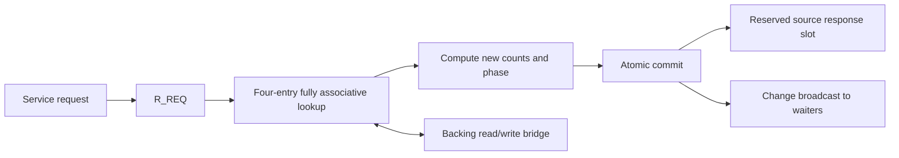

# blackwell_mbarrier_unit

## Description

This module owns the sole four-entry object cache and updates objects atomically. Software commands, wait probes, TC arrival, and TMA complete-tx share the updater. A waiting thread does not occupy the update pipeline. See [mbarrier_object](blackwell_mbarrier_unit.md#object) for object formulas, [mbarrier_command](blackwell_mbarrier_frontend.md#command) for interface types, and [common](../top/blackwell_async_subsystem_top.md#common-protocol) for handshakes.

| Signal / channel | Direction | Type / width | Peer | Sampling condition |
|---|---|---|---|---|
| `service_req` | Input | [bar_service_req_t](blackwell_mbarrier_frontend.md#command) (198 bits) | barrier frontend | Transfer on `service_req.fire`. Caller has reserved the route/slot result position. |
| `service_rsp` | Output | [bar_service_rsp_t](blackwell_mbarrier_frontend.md#command) (68 bits) | barrier frontend | Transfer on `service_rsp.fire`. Atomic commit result, held until accepted. |
| `change` | Output | [bar_change_t](#change-type) (34 bits) | wait | Broadcast new phase/initialized on the commit edge without backpressure. |
| `back_req` | Output | [bar_back_req_t](blackwell_mbarrier_backing.md#backing-types) (97 bits) | backing | Transfer on `back_req.fire`. Request an 8 B fill or writeback. |
| `back_rsp` | Input | [bar_back_rsp_t](blackwell_mbarrier_backing.md#backing-types) (64 bits) | backing | Transfer on `back_rsp.fire`. Must match the sole outstanding backing operation. |
| `flush_req` | Input | Event without payload | Top level | Transfer on `flush_req.fire`. Upstream has stopped new external commands. |
| `flush_rsp` | Output | Event without payload | Top level | Transfer on `flush_rsp.fire`. Signal completion after ACKs for every dirty write. |
| `epoch` | Input | 16 bits | Top level | Level. Current CTA lifetime. |
| `stop` | Input | 1 bit | Top level | Level. Drain indication. Does not block services derived from accepted commands or flush. |
| `drained` | Output | 1 bit | Top level | Level asserted after outstanding work and held transfers drain. |

## Functionality

### Object encoding and atomic state transitions

An 8 B aligned object in this CTA's SMEM has one authoritative value. While resident it belongs to unit.cache. Dirty eviction, INVAL, and flush use backing. Valid addresses satisfy `addr+8≤228 KiB`. Software must not bypass object service to access the underlying bytes. The [software and producer interfaces](blackwell_mbarrier_frontend.md#command) share the project encoding below.

| bits | Fields | Range |
|---|---|---|
| 19:0, 39:20 | pending(P), expected(E) | 0…1048575, 1…1048575 |
| 60:40 | tx(T) | Two's complement −1048575…1048575 |
| 61, 62, 63 | Phase (F), initialized, and reserved zero bits | Initialize F=0. Invalid encodes as all zeros. |

INIT sets P=E=count, T=0, F=0 from its explicit operand. INVAL ends the lifetime after all same-address references drain and waits for the actual writeback ACK. Legal count is 1…1048575 and bytes is 0…1048575. Every access other than INIT targets a live, initialized object. Software supplies counts and byte deltas whose results fit the encoded ranges. Compute pending as unsigned and transaction bytes as signed two's complement, extending the unsigned byte operand before adding or subtracting it. Before each modifying commit, simulation assertions check the candidate counts at extended precision against the ranges above.

| Commit | Candidate state | Completion test |
|---|---|---|
| ARRIVE(count) | P'=P−count | P'=0 and T'=0 |
| ARRIVE_EXPECT_TX(bytes) | Atomically set P'=P−1 and T'=T+bytes | P'=0 and T'=0 |
| COMPLETE_TX(bytes) | T'=T−bytes | P'=0 and T'=0 |

With P'=0 and T'=0, set F'=!F and P'=E on the commit edge. Otherwise retain F. Negative T represents early completion.

TRY_WAIT observes completion when expected parity differs from the current F. Software must successfully wait for that phase before arriving in the next phase and may use only the current or previous phase's parity. See [wait](blackwell_mbarrier_wait.md#wait-budget) for acquire, response retention, and timeout. Eviction does not cancel waiters.

The object follows the phase and count semantics of [PTX 8.7 mbarrier](https://docs.nvidia.com/cuda/archive/12.8.2/parallel-thread-execution/index.html#parallel-synchronization-and-communication-instructions-mbarrier).

### Change broadcast type

`bar_change_t={addr:32,phase:1,initialized:1}` is 34 bits. Broadcast without backpressure on every successful modifying commit edge.

### Cache-line and result reservations

Each cache entry contains tag (addr[31:3], 29 bits), object64, valid, dirty, and busy, for 96 bits/entry and 384 bits total. busy denotes ownership by the unit's current transaction.

One R_REQ stores the complete 198-bit service request. R_OLD/R_NEXT are 64 bits each, R_RESULT holds the 68-bit service response, and the replacement cursor is 2 bits. The pending backing record stores cache index, victim address, and MISS/FLUSH/INVAL reason without duplicating object payload. The wait table, producer registrations, and software return slots belong to their respective modules.

The unit services one transaction at a time through LOOKUP, UPDATE, and COMMIT. A hit takes three cycles. COMMIT atomically updates the object. The front end sends external ordering for FENCE_INIT after earlier INITs commit.

### Hits and atomic updates

Accept a request into R_REQ at g. At g+1 lock the hit entry and sample R_OLD. At g+2 form R_NEXT and the routed result. At g+3 atomically write the cache, generate change, and place the result in R_RESULT. The downstream can consume the response at g+4 at the earliest.

INIT constructs a new object directly. A route=3 COMPLETE_TX uses the old object sampled for its update. The producer is bound to that phase. The unit serializes the decrement and completion test with all arrivals and other byte updates to the same object.

QUERY only reads state and does not set dirty. TRY_WAIT normalizes to QUERY for the wait unit to interpret. Modifying operations set dirty and broadcast change on each successful commit. QUERY does not broadcast.

Reserve R_RESULT so source response backpressure cannot reexecute a committed operation. Record a committed bit. Release busy and R_REQ only after the response handshake.

### Miss, eviction, and INIT

On a lookup miss choose an invalid entry first, otherwise scan from the replacement cursor for a nonbusy entry. Waiters do not pin cache entries. Write back a dirty victim and await a successful ACK before changing its tag. Release a clean victim directly. Then read the target 8 B and route the matched fill to UPDATE. On the fill handshake, simulation asserts that the object is initialized and that the count fields and reserved bit satisfy its encoding.

A miss occupies the unit's sole transaction and other services wait. Backing responses remain acceptable. This stall depends only on memory return, independently of software wait or consumption of software responses.

An INIT miss skips reading old SMEM contents but must first save a dirty victim. Upstream guarantees no active reference to the address. Install the new object directly as dirty. Software issues INVAL before reusing any previously initialized object.

### INVAL and flush

The front end submits INVAL only when the address has no producer, wait, TC transaction, or held software result. The unit serializes the atomic clear, writes zero to backing, waits for the ACK, then releases the entry, broadcasts initialized=0, and returns the routed acknowledgment.

Flush keeps objects valid. Save the dirty entries among the four in order and wait for each ACK. Clear each dirty bit on its writeback acknowledgment. Flush and service responses have independent valid bits. Accept flush only with no active service, and accept no new service during flush.

drained excludes static valid/dirty cache entries but includes R_REQ/R_RESULT, outstanding backing, and flush response. An epoch transition additionally requires flush completion.

### Stop, reset and epoch transition

Eviction and flush clear dirty or replace a tag only after a successful write ACK. See the [common protocol](../top/blackwell_async_subsystem_top.md#common-protocol) for reset and epoch sequencing.

stop does not gate service_req, back_req, or flush. These can belong to operations already accepted upstream. The front end blocks new external commands. Required flush remains available after drain so dirty objects can meet epoch-transition requirements.

Synchronous reset clears cache valid bits and control and preserves SMEM. It requires isolation of external responses.

A normal epoch transition requires drained and completion of a flush covering all dirty entries. Clear cache valid/dirty/busy and the replacement cursor, preserving payload and SMEM. An epoch change cannot discard authoritative dirty data or outstanding transactions.

### Cache invariants

At most one valid entry per address. A busy entry cannot be replaced. Each request commits and responds at most once. A dirty victim remains resident until writeback succeeds.
