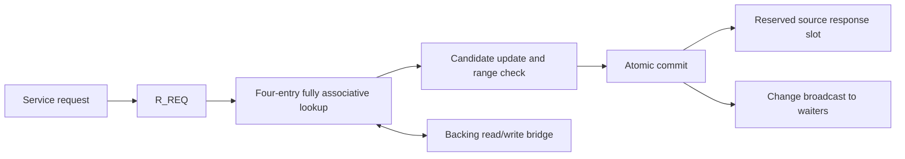

# blackwell_mbarrier_unit

## Description

This module owns the sole four-entry object cache and updates objects atomically. Software commands, wait probes, TC arrival, and TMA complete-tx share the updater. A waiting thread does not occupy the update pipeline. See [mbarrier_object](blackwell_mbarrier_unit.md#object) for object formulas, [mbarrier_command](blackwell_mbarrier_frontend.md#command) for interface types, and [common](../top/blackwell_async_subsystem_top.md#common-protocol) for handshakes.

| Signal / channel | Direction | Type / width | Peer | Handshake or sampling condition |
| --- | --- | --- | --- | --- |
| `service_req` | Input | [bar_service_req_t](blackwell_mbarrier_frontend.md#command) | barrier frontend | Caller has reserved the route/slot result position |
| `service_rsp` | Output | [bar_service_rsp_t](blackwell_mbarrier_frontend.md#command) | barrier frontend | Atomic commit result, held until accepted |
| `change` | Output | [bar_change_t](#change-type) + pulse | wait | Broadcast new phase/initialized on the commit edge without backpressure |
| `back_req` | Output | [bar_back_req_t](blackwell_mbarrier_backing.md#backing-types) | backing | Request an 8 B fill or writeback |
| `back_rsp` | Input | [bar_back_rsp_t](blackwell_mbarrier_backing.md#backing-types) | backing | Must match the sole outstanding backing operation |
| `flush_req` | Input | Event without payload | Top level | Upstream has stopped new external commands |
| `flush_rsp` | Output | status_t | Top level | OK after successful ACKs for every dirty write |
| `epoch` | Input | 16bit | Top level | Current CTA lifetime |
| `stop` | Input | 1 | Top level | Drain indication. Does not block services derived from accepted commands or flush |
| `drained` / `fault` | Output | 1 bit each | Top level | Transactions drained / protocol fault requiring isolated reset |

## Functionality

### Object encoding and atomic state transitions

An 8 B aligned object in this CTA's SMEM has one authoritative value. While resident it belongs to unit.cache. Dirty eviction, INVAL, and flush use backing. Valid addresses satisfy `addr+8≤228 KiB`. Software must not bypass object service to access the underlying bytes. The [software and producer interfaces](blackwell_mbarrier_frontend.md#command) share the project encoding below.

| bits | Fields | Range |
|---|---|---|
| 19:0, 39:20 | pending(P), expected(E) | 0…1048575, 1…1048575 |
| 60:40 | tx(T) | Two's complement −1048575…1048575 |
| 61, 62, 63 | Phase (F), initialized, and reserved zero bits | Initialize F=0. Invalid encodes as all zeros. |

Use at least 22-bit signed intermediates to validate count and byte changes before commit. INIT sets P=E=count, T=0, F=0 from its explicit operand. INVAL ends the lifetime after all same-address references drain and waits for the actual writeback ACK. Legal count is 1…1048575 and bytes is 0…1048575. An uninitialized read or an out-of-range address cannot succeed.

| Commit | Candidate state | Completion test |
|---|---|---|
| ARRIVE(count) | P'=P−count | Check candidate P'/T'. |
| ARRIVE_EXPECT_TX(bytes) | Atomically set P'=P−1 and T'=T+bytes | Check candidate P'/T'. |
| COMPLETE_TX(bytes) | T'=T−bytes | Check candidate P'/T'. |

On success with P'=0 and T'=0, set F'=!F and P'=E on the commit edge. Otherwise retain F. Negative T represents early completion. A count overflow, illegal object encoding, or phase guard violation raises fault and suppresses the update. The guard and update use the same old object value.

TRY_WAIT observes completion when expected parity differs from the current F. Software must successfully wait for that phase before arriving in the next phase and may use only the current or previous phase's parity. See [wait](blackwell_mbarrier_wait.md#wait-budget) for acquire, response retention, and timeout. Eviction does not cancel waiters.

Test four 4096 B transactions per round over two rounds with one flip each, negative T, consecutive same-address COMPLETE_TX and arrival, count limits, failure without false success, 8 B writes preserving the adjacent object, busy throughout dirty eviction, and phase completion coinciding with timeout. Numerical reference: [PTX 8.7 mbarrier](https://docs.nvidia.com/cuda/archive/12.8.2/parallel-thread-execution/index.html#parallel-synchronization-and-communication-instructions-mbarrier).

### Change broadcast type

`bar_change_t={addr:32,phase:1,initialized:1}` is 34 bits. Broadcast without backpressure on every successful modifying commit edge.

### Cache-line and result reservations

Each cache entry contains tag (addr[31:3], 29 bits), object64, valid, dirty, and busy, for 96 bits/entry and 384 bits total. busy denotes ownership by the unit's current transaction.

One R_REQ stores the complete 199-bit service request. R_OLD/R_NEXT are 64 bits each, R_RESULT holds the 72-bit service response, and the replacement cursor is 2 bits. The pending backing record stores cache index, victim address, and MISS/FLUSH/INVAL reason without duplicating object payload. The wait table, producer registrations, and software return slots belong to their respective modules.

The baseline serializes one transaction through LOOKUP, UPDATE, and COMMIT. A hit commits in three cycles. It does not promise one update per cycle. Serialization avoids same-object RAW forwarding and competing commits. Optimizations must preserve visible timing and the atomic point. The front end sends external ordering for FENCE_INIT after earlier INITs commit. This unit owns the atomic object value.

### Hits and atomic updates

Accept a request into R_REQ at g. At g+1 lock the hit entry and sample R_OLD. At g+2 form R_NEXT and status. At g+3 atomically write the cache, generate change, and place the result in R_RESULT. The downstream can consume the response at g+4 at the earliest.

Check every field at extended width before commit. An illegal candidate raises fault and leaves counts and phase unchanged. INIT constructs a new object directly.

For a route=3 final update, UPDATE atomically checks the command's bound phase according to the command object guard rules. The check and count change share one old object sample and commit point. No other source can flip the phase between them.

QUERY only reads state and does not set dirty. TRY_WAIT normalizes to QUERY for the wait unit to interpret. Modifying operations set dirty and broadcast change on each successful commit. QUERY does not broadcast.

Reserve R_RESULT so source response backpressure cannot reexecute a committed operation. Record a committed bit. Release busy and R_REQ only after the response handshake.

### Miss, eviction, and INIT

On a lookup miss choose an invalid entry first, otherwise scan from the replacement cursor for a nonbusy entry. Waiters do not pin cache entries. Write back a dirty victim and await a successful ACK before changing its tag. Release a clean victim directly. Then read and validate the target 8 B before reentering UPDATE. A matching read with MEMORY status raises fault without installing raw data or generating change.

A miss occupies the unit's sole transaction and other services wait. Backing responses remain acceptable. This stall depends only on memory return, independently of software wait or consumption of software responses.

An INIT miss skips reading old SMEM contents but must first save a dirty victim. Upstream guarantees no active reference to the address. Install the new object directly as dirty. Reinitializing a still-live cached object violates lifetime and raises fault. For a nonresident object, software must satisfy the PTX requirement for prior INVAL. Hardware keeps no unbounded history.

After a backing fill, validate initialized, counts, and reserved bits. Access to an illegal object or corrupted encoding raises fault and cannot flip the phase.

### INVAL and flush

The front end submits INVAL only when the address has no producer, wait, TC transaction, or held software result. The unit serializes the atomic clear, writes zero to backing, waits for the ACK, then releases the entry, broadcasts initialized=0, and returns OK.

Non-OK INVAL writeback raises fault. Successful response and address reuse both require successful writeback.

Flush keeps objects valid. Save the dirty entries among the four in order and wait for each ACK. Clear dirty on each success. A non-OK writeback raises fault and precludes a successful flush. Flush and service responses have independent valid bits. Accept flush only with no active service, and accept no new service during flush.

drained excludes static valid/dirty cache entries but includes R_REQ/R_RESULT, outstanding backing, and flush response. A normal epoch transition additionally requires successful flush. fault is independent of normal drained.

### Shutdown and recovery

Eviction and flush clear dirty or replace a tag only after a successful write ACK. A backing or ordering fault terminates the run at the top level. See the [isolated reset contract](../top/blackwell_async_subsystem_top.md#common-protocol) for recovery.

stop does not gate service_req, back_req, or flush. These can belong to operations already accepted upstream. The front end blocks new external commands. Required flush remains available after drain so dirty objects can meet epoch-transition requirements.

An unknown back_rsp in the same epoch is PROTOCOL. Synchronous reset clears cache valid bits and control and preserves SMEM. It requires isolation of external responses.

A normal epoch transition requires drained, successful flush of all dirty entries, and no fault. Clear cache valid/dirty/busy and the replacement cursor, preserving payload and SMEM. An epoch change cannot discard authoritative dirty data or outstanding transactions. A protocol fault requires isolated reset.

### Assertions and acceptance

At most one valid entry per address. A busy entry cannot be replaced. Each request commits and responds at most once. Cycle through five objects with waits, updates, and dirty misses. Check progress with a four-entry cache, agreement of commit change with the new object, preservation of the adjacent half-line, and retention of the victim until writeback succeeds.
