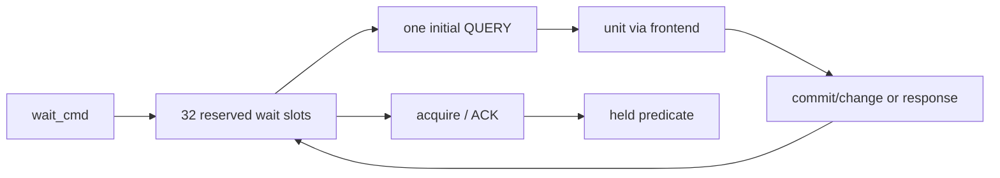

# blackwell_mbarrier_wait

## Description

为 TRY_WAIT.parity 保存至多 32 条未退休观察。对象状态唯一位于[unit](blackwell_mbarrier_unit.md)，等待者不 pin 其 cache。输入操作与返回类型见[命令对象](blackwell_mbarrier_frontend.md#command)。

| 信号 / 通道 | 方向、类型 / 位宽 | 对端 | 握手或采样条件 |
| --- | --- | --- | --- |
| wait_cmd/rsp | 入 [bar_cmd_t](blackwell_mbarrier_frontend.md#command) / 出 [bar_rsp_t](blackwell_mbarrier_frontend.md#command) | barrier frontend | 每条获得一项，完整 id 与 completed/status 保持至响应消费。 |
| probe_req/rsp | 出 [bar_service_req_t](blackwell_mbarrier_frontend.md#command) / 入 [bar_service_rsp_t](blackwell_mbarrier_frontend.md#command) | barrier frontend | QUERY，route=1，slot5。此前已为返回预留存储。 |
| change | 入 [bar_change_t](blackwell_mbarrier_unit.md#change-type) + pulse | 对象 unit | unit 对象提交沿广播，允许所有同址未解决项采样，不施加 backpressure。 |
| acquire_req/rsp | 出 [order_req_t](../top/blackwell_async_subsystem_top.md#ordering) / 入 [order_rsp_t](../top/blackwell_async_subsystem_top.md#ordering) | ordering 服务 | 仅一笔在途，scope=CTA、async→generic、bytes=0。 |
| busy_addr/addr_busy | 入32bit/出 bit，组合 | barrier frontend | 任一非 FREE 项命中该地址。 |
| epoch、stop / drained、fault | 入 u16、bit / 出 bit、bit | 顶层 | 正常 stop 排空，异常通知顶层终止运行。 |

时钟、复位及通道的采样约定见[顶层公共协议](../top/blackwell_async_subsystem_top.md#common-protocol)。

## Functionality

### 等待记录

每项保存 id58、addr32、expected_phase1、armed_tick6、state3、matched1、probe_pending1，共 102 bit，32 项共 3,264 bit。全表共用 6-bit 拍计数器 `tick`，另有 probe、结果和 ordering 的 held 索引与 valid。状态依次为 FREE、PROBE、ARMED 或 MATCHED、ACQUIRE、RESULT。超时从 ARMED 进入 RESULT。

wait_cmd.fire 占槽，最早下一拍发 QUERY。匹配成功、对象已初始化且观察尚未确定时，phase 异于 expected 进入 MATCHED，相同进入 ARMED。超时锁存 OK/false，外围可再发 wait。QUERY 非 OK、未知 slot/id 或非法对象触发 fault。

### ARMED 预算与同沿优先级

每次进入 ARMED 都有 **64 个 ARMED 拍**，适用于省略、零及任意非零 `time_hint`。同步复位将 `tick` 清零，此后每个上升沿模 64 加一，包括 stop 排空期间。进入 ARMED 的沿把沿前 `tick` 存入本项 `armed_tick`。只有沿前已是 ARMED 的项才比较 `tick == armed_tick`，第一次相等正好在进入后的第 64 个上升沿。若该沿仍未匹配且无错误，则超时。QUERY 和 ACQUIRE 的等待时间均在此预算之外。[提示字段](blackwell_mbarrier_frontend.md#command)

验收分别取省略提示、显式 0 和非零提示 641，初次 QUERY 均看到原 phase 且无错误。

| phase 翻转沿 | 结果 |
| --- | --- |
| 第 64 个 ARMED 沿 | change 优先于超时，进入 MATCHED；匹配 acquire ACK 成功后返回 true。 |
| 第 65 个 ARMED 沿 | 第 64 沿已锁存 OK/false；即使响应尚未消费，第 65 沿也保持 false。 |

同沿有效 phase change 优先于初次 QUERY 的旧 phase 和 ARMED 超时。已确定的观察不被后到 phase 或旧 probe 改写。已展示的 probe 必须完成握手并接收成功回应；在展示前已由 change 确定观察时可省略 probe。若 probe 仍在途，保留其槽直至回应。非 OK、非法身份或对象失效按顶层故障合同处理，不产生依赖该事件的成功谓词。

### Acquire 与结果交付

MATCHED 最早在下一沿发 acquire。对同一 id 的匹配 acquire OK，是发布 completed=1 的必要条件；非 OK 报 fault。phase 在沿 c 匹配时 acquire 最早 c+1，ACK 在 a 接受则软件成功最早 a+1。多个 wait 可并存，单笔 ordering 背压不阻塞 producer、其他对象的 change 或先前 QUERY 返回。RESULT 按轮询选择并在背压中保持 id/predicate/status；消费后 FREE。

同步复位清控制，正常 stop 停止新 wait，旧 probe、计时、ordering 和结果继续。授权换 epoch 要求 drained。验收覆盖 32 个等待者、跨四个以上 cache 行、旧 probe 晚到、acquire 背压、连续两次 phase 翻转，以及故障发生时已展示的结果仍保持。
