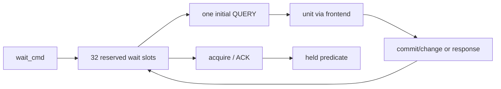

# blackwell_mbarrier_wait

## Description

Holds up to 32 unretired TRY_WAIT.parity observations. The [unit](blackwell_mbarrier_unit.md) exclusively owns object state. Waiters do not pin its cache. See [command objects](blackwell_mbarrier_frontend.md#command) for input and return types.

| Signal / channel | Direction, type / width | Peer | Handshake or sampling condition |
| --- | --- | --- | --- |
| wait_cmd/rsp | Input [bar_cmd_t](blackwell_mbarrier_frontend.md#command) / output [bar_rsp_t](blackwell_mbarrier_frontend.md#command) | barrier frontend | Allocate one entry per command. Hold the full ID and completed/status until response consumption. |
| probe_req/rsp | Output [bar_service_req_t](blackwell_mbarrier_frontend.md#command) / input [bar_service_rsp_t](blackwell_mbarrier_frontend.md#command) | barrier frontend | QUERY, route=1, slot5. Reserve the return position beforehand. |
| change | Input [bar_change_t](blackwell_mbarrier_unit.md#change-type) + pulse | Object unit | Broadcast on the unit's object commit edge. All unresolved matching-address entries may sample without backpressure. |
| acquire_req/rsp | Output [order_req_t](../top/blackwell_async_subsystem_top.md#ordering) / input [order_rsp_t](../top/blackwell_async_subsystem_top.md#ordering) | Ordering service | One outstanding transaction, scope=CTA, async→generic, bytes=0. |
| busy_addr/addr_busy | 32-bit input / bit output, combinational | barrier frontend | Any non-FREE entry matching the address. |
| epoch, stop / drained, fault | Input u16, bit / output bit, bit | Top level | Normal stop drains. A fault notifies the top level to terminate the run. |

The [top-level common protocol](../top/blackwell_async_subsystem_top.md#common-protocol) defines clock, reset, and channel sampling.

## Functionality

### Wait records

Each entry holds id58, addr32, expected_phase1, armed_tick6, state3, matched1, and probe_pending1, totaling 102 bits/entry and 3,264 bits for 32 entries. All entries share the 6-bit cycle counter `tick`. Probe, result, and ordering each have a held index and valid bit. The states are FREE, PROBE, ARMED or MATCHED, ACQUIRE, and RESULT. Timeout takes ARMED directly to RESULT.

wait_cmd.fire allocates an entry. QUERY can issue on the next cycle. For a successful matching reply to an unresolved observation of an initialized object, enter MATCHED if phase differs from expected and ARMED otherwise. Timeout latches OK/false and the surrounding system may issue another wait. Non-OK QUERY, unknown slot/ID, or illegal object raises fault.

### ARMED budget and same-edge priority

Every entry into ARMED gets **64 ARMED cycles**, whether `time_hint` is omitted, zero, or any nonzero value. Synchronous reset zeros `tick`. It then increments modulo 64 on every rising edge, including stop drain. On entry to ARMED, save pre-edge `tick` in the entry's `armed_tick`. Only entries already ARMED before an edge compare `tick == armed_tick`. The first equality occurs on the 64th rising edge after entry. If the entry is still unmatched and error-free at that edge, it times out. QUERY and ACQUIRE wait time is outside this budget. [hint field](blackwell_mbarrier_frontend.md#command)

Run each acceptance case with an omitted hint, explicit zero, and nonzero hint 641. The initial QUERY sees the old phase without error in all three.

| Phase flip edge | Result |
| --- | --- |
| 64th ARMED edge | change wins over timeout. Enter MATCHED and return true after the matching acquire ACK succeeds. |
| 65th ARMED edge | The 64th edge has already latched OK/false. The result stays false on edge 65 even if its response is still pending. |

A valid same-edge phase change takes priority over an old phase from the initial QUERY and over ARMED timeout. Once resolved, a later phase or old probe cannot alter an observation. A presented probe must handshake and receive a successful reply. A change that resolves the observation before the probe is presented can suppress that probe. Retain the slot for an outstanding probe until its reply. Non-OK status, illegal identity, or object invalidation follows the top-level fault contract and cannot produce a true predicate dependent on that event.

### Acquire and result delivery

MATCHED can issue acquire on the next edge. Publishing completed=1 requires a matching OK acquire for the same ID. A non-OK ACK raises fault. If phase matches at c, acquire can issue at c+1. With ACK acceptance at a, software can receive success at a+1. Multiple waits may coexist. Backpressure on the single ordering transaction does not block producers, changes at other objects, or earlier QUERY returns. Select RESULT by round-robin and hold ID/predicate/status under backpressure. Consumption returns the entry to FREE.

Synchronous reset clears control. Normal stop blocks new waits and allows old probes, timing, ordering, and results to continue. Authorized epoch transition requires drained. Test 32 waiters across more than four cache lines, late old probes, acquire backpressure, two consecutive phase flips, and retention of an already presented result on fault.
