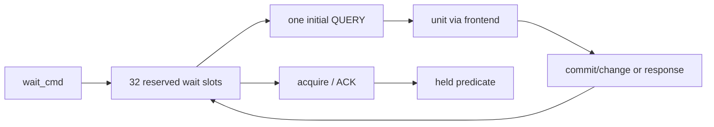

# blackwell_mbarrier_wait

## Description

Holds up to 32 unretired TRY_WAIT.parity observations. The [unit](blackwell_mbarrier_unit.md) exclusively owns object state. Waiters do not pin its cache. See [command objects](blackwell_mbarrier_frontend.md#command) for input and return types.

| Signal / channel | Direction | Type / width | Peer | Sampling condition |
|---|---|---|---|---|
| `wait_cmd` | Input | [bar_cmd_t](blackwell_mbarrier_frontend.md#command) (191 bits) | barrier frontend | On `wait_cmd.fire`, allocate one entry for a TRY_WAIT already accepted by the front end. |
| `wait_rsp` | Output | [bar_rsp_t](blackwell_mbarrier_frontend.md#command) (59 bits) | barrier frontend | On `wait_rsp.fire`, deliver the held ID and predicate. |
| `probe_req` | Output | [bar_service_req_t](blackwell_mbarrier_frontend.md#command) (198 bits) | barrier frontend | On `probe_req.fire`, issue QUERY with route 1 and a reserved return position (5-bit slot). |
| `probe_rsp` | Input | [bar_service_rsp_t](blackwell_mbarrier_frontend.md#command) (68 bits) | barrier frontend | On `probe_rsp.fire`, accept the QUERY result for that slot. |
| `change` | Input | [bar_change_t](blackwell_mbarrier_unit.md#change-type) (34 bits) | Object unit | Broadcast on the unit's object commit edge. All matching-address entries already unresolved before the edge sample without backpressure. |
| `acquire_req` | Output | [order_req_t](../top/blackwell_async_subsystem_top.md#ordering) (163 bits) | Ordering service | On `acquire_req.fire`, issue the single outstanding CTA acquire, async to generic, with zero bytes. |
| `acquire_rsp` | Input | [op_done_t](../top/blackwell_async_subsystem_top.md#identity) (58 bits) | Top-level ordering router | On `acquire_rsp.fire`, accept the matching ordering acknowledgment. |
| `busy_addr` | Input | 32 bits | barrier frontend | Level. Query the reference set by address. |
| `addr_busy` | Output | 1 bit | barrier frontend | Level. Assert for any matching non-FREE entry. |
| `epoch` | Input | 16 bits | Top level | Level identifying the active CTA lifetime. |
| `stop` | Input | 1 bit | Top level | Level closing new external work while accepted obligations drain. |
| `drained` | Output | 1 bit | Top level | Level asserted after outstanding work and held transfers drain. |

The [top-level common protocol](../top/blackwell_async_subsystem_top.md#common-protocol) defines clock, reset, and channel sampling.

## Functionality

### Wait records

Each entry holds id58, addr32, expected_phase1, armed_tick6, state3, matched1, and probe_pending1, totaling 102 bits/entry and 3,264 bits for 32 entries. All entries share the 6-bit cycle counter `tick`. Probe, result, and ordering each have a held index and valid bit. The states are FREE, PROBE, ARMED or MATCHED, ACQUIRE, and RESULT. Timeout takes ARMED directly to RESULT.

On `wait_cmd.fire` at g, allocate a pre-edge FREE slot, set its `probe_pending` bit, and register its index for dispatch. A change on g applies only to previously live unresolved entries. The new entry starts in PROBE and observes the object through its QUERY and subsequent broadcasts. Present exactly one initial QUERY beginning at g+1. Hold valid, route 1, slot and command stable until `probe_req.fire`, including when a broadcast resolves the observation before dispatch. That fire releases the front end's software queue position. The wait slot retains the return reservation through `probe_rsp.fire` for the same route, slot and original ID.

On the reply edge clear `probe_pending`. For an unresolved observation, an initialized reply with phase different from the expected parity enters MATCHED. Equal parity enters ARMED. A qualifying broadcast on this edge has priority as described below.

### ARMED budget and same-edge priority

Every entry into ARMED gets **64 ARMED cycles**, whether `time_hint` is omitted, zero, or any nonzero value. Synchronous reset zeros `tick`. It then increments modulo 64 on every rising edge, including stop drain. On entry to ARMED, save pre-edge `tick` in the entry's `armed_tick`. Only entries already ARMED before an edge compare `tick == armed_tick`. The first equality occurs on the 64th rising edge after entry. If the entry is still unmatched at that edge, it times out. QUERY and ACQUIRE wait time is outside this budget. [hint field](blackwell_mbarrier_frontend.md#command)

| Phase flip edge | Result |
| --- | --- |
| 64th ARMED edge | change wins over timeout. Enter MATCHED and return true after the matching acquire ACK succeeds. |
| 65th ARMED edge | The 64th edge has already latched false. The result stays false on edge 65 even if its response is still pending. |

For an entry already in PROBE or ARMED, a same-address change with initialized=1 and phase different from its expected parity latches a match. This takes priority over an equal-parity QUERY reply or an ARMED timeout on the same edge. A simultaneous QUERY request or reply handshake still takes effect. Later broadcasts and the outstanding QUERY reply preserve the latched match through acquire and result delivery. A timeout latches false through delivery.

### Acquire and result delivery

If a reply or broadcast latches a match at c, the entry can issue acquire at c+1, including while its QUERY is pending. The matching acquire ACK puts the entry in RESULT with completed=1. A timed-out entry reaches RESULT with completed=0. Select among RESULT entries with `probe_pending=0` by round-robin. With acquire ACK at a and QUERY reply at q, the earliest software success transfer is `max(a,q)+1`. Backpressure on acquire or software delivery leaves the reserved probe return available.

Hold a selected result's ID and predicate stable until `wait_rsp.fire`, which coincides with its `sw_rsp.fire` at the front end. That edge frees the slot. It can be allocated on the next edge. Until retirement the entry asserts `addr_busy` for its address, including while a true or false result is stalled.

Synchronous reset clears control. During DRAIN the front end closes external software admission. The wait unit continues accepting `wait_cmd` for previously queued TRY_WAITs when a slot is available. QUERY, phase observation, timeout, acquire and result delivery continue through retirement. An epoch transition requires drain completion.
