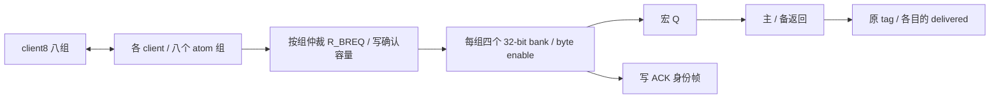

# blackwell_smem_fabric

## Description

共享 SMEM fabric 为 TC、TMA、barrier backing 与外围 LSU 提供八组独立的 16 B atom 端口。模块拥有 32 个 1R1W bank（每个 1,824×32 bit，共 228 KiB）、读返回队列和写确认槽，每方向峰值为 128 B/拍。

| 信号 / 通道 | 方向、类型 / 位宽 | 对端 | 握手或采样条件 |
| --- | --- | --- | --- |
| rd_req[16][8] / rd_rsp[16][8] | 入 [smem_rd_req_t](#transactions) / 出 [smem_rd_rsp_t](#transactions) | TC、TMA、backing、LSU | 每 client 每组一个候选，各组独立 valid/ready。 |
| wr_req[16][8] / wr_ack[16][8] | 入 [smem_wr_req_t](#transactions) / 出 [smem_wr_ack_t](#transactions) | TMA、backing、LSU | 相同组索引，一笔原事务一次 ACK。 |
| live[3] | 入，按接受序的 {valid1,rec2,id58} | MMA engine | 顶层接 engine 的 live，用于 MMA 候选年龄；外部服务不依赖 MMA 是否活跃。 |
| clk、rst_n、epoch_i / drained_o、fault_o | epoch_i 入 u16，时钟、复位为输入 bit，状态为输出 bit | 顶层 | drained 遍历 R_BREQ、宏 Q、主备返回、ACK 及 held。 |

时钟、复位及通道的采样约定见[顶层公共协议](../top/blackwell_async_subsystem_top.md#common-protocol)。

## Functionality

### 存储事务类型

| 类型 | 字段（从高到低） | 位数 |
|---|---|---:|
| `smem_rd_req_t` | tag78, addr32, byte_mask16 | 126 |
| `smem_wr_req_t` | tag78, addr32, byte_mask16, data128 | 254 |
| `smem_rd_rsp_t` | tag78, data128, status4 | 210 |
| `smem_wr_ack_t` | tag78, status4 | 82 |

mask bit b 对应 data[8b+:8]；16 B 原子，写未选 byte 保持，读未选 byte 返回0。tag78 见顶层 memory-routing；成功写 ACK 证明实际写入。对 TMA load（client8），选中字节此时已提交到本 CTA 与 generic 访问共享的 SMEM；消费线程成功等待对应 mbarrier 后即可读取。

`smem_atom_req_t={write:1,tag:78,addr:32,byte_mask:16,data:128}`，255bit；`smem_atom_rsp_t={write:1,tag:78,data:128,status:4}`，211bit，写返回data=0。addr 为16 B对齐逻辑 byte 地址，不能提前进行物理 bank 映射。barrier 8 B 写按原对象地址 bit3 选择 mask=0x00ff/0xff00 和半行。

### 地址映射与组内状态

逻辑 atom 为 16 B 对齐。对任意字节地址 a，物理 bank=(a>>2)&31，word=a>>7；组号=(a>>4)&7，同一 atom 的四个 4 B 子字位于 bank=4×组号+s，s=0…3。矩阵/Tensor Map 的 swizzle 在产生逻辑地址时已完成。fabric 验证组索引并执行物理映射。

数据 SRAM 233,472 B。宏 Q、主返回、备返回各 8×16 B=128 B。每组保留一项未 grant 的 R_BREQ、读写仲裁选择及 RR 指针、三项读身份/有效子字/目的掩码、逐目的 delivered。组内子字同步移动，按整 atom 预留一个返回位置（每组最多三笔），故任何被使能的物理 bank 至多三个在途读。两项写 ACK 身份帧按组独立管理，各组两项 FIFO 保留自己的 tag/status/valid 和先后。该组本沿退休的 credit 可同沿用于新写，慢组占用自己的两项后只挡该组，其他组继续接受。返回类型见[本模块事务字段](#transactions)。

### 请求选择、grant 与返回

- 子字使能由其四位 byte_mask 的 OR 产生。每组每方向每拍最多一个原 atom，需全部启用子字的端口/credit 同时可用才 grant。禁用子字关闭 SRAM 使能，读端拼回零。8 B mbarrier 更新用同组两个子字在一次写沿提交。TMA/LSU 按原 atom 收一笔响应，不接收四个分片 ACK。
- 在组内 R_BREQ 能接新项的沿选择读候选，锁定到 grant。无外围竞争时，连续四个时隙优先 A、A、B、B，缺席类别让给另一类。实现用自由运行 mod-4 相位，在 g−1 选择针对下一 grant 沿 g 的类别，基准 F 对齐相位 0。同类 A 比较 live 年龄、token 中的行组、core 号，再按 half/片；B 由 loader 在组内排好序。已选定但被挡的请求保持，窗口错过后按实际 grant 推演。外围与 MMA 同组竞争时两类按组轮转，类内外围 client 轮询，只有实际接受更新轮询指针。写端按组独立公平选择。
- `rd_req.fire` 把请求收入 R_BREQ。最早下一沿，沿前已锁存的地址、子字使能及身份参与 grant；旧项 grant 时可同沿接替者。在 grant 沿 g 同时扣一个组 credit、采样全部启用的 SRAM 子字，并把 tag、mask 和目的集合记到 Q。g 沿后 Q 有效，g+1 最早转入主/备返回，g+2 最早在客户端 ret_fire。上述两拍从实际 grant 起算。
- 主/备构成深度二的有序返回队列，只有队首对外握手。沿前先算队首是否在本沿完成全部目的，再算队列能否接走旧 Q。只有 Q 为空或本沿能移出旧 Q，且有可用 credit，才允许新 grant。Q 搬出和重新采样可同沿；被阻塞的 Q 关闭宏读使能，保持数据与身份。每组 `granted − fully_delivered = Q.valid + 返回队列占用 ≤ 3`，同沿释放的 credit 可复用，部分交付不释放。返回停顿只沿本组向前传播。
- TMA load 每沿最多提交八个写 atom，store 每沿最多送八个读入 R_BREQ，并接收此前 grant 的八个返回。组间按 token 独立匹配。store 与 MMA A/B 争同组读 grant；load 与 LSU、barrier backing 争写 grant，同组不同 word 可与 MMA 读并行。持续 128 B/拍需八组全获服务且返回 credit 能循环。
- 仅同一 id、同 atom、兼容顺序的 core A 可合并为一个源，至多四个目的，保存各自原 token/mask。每个目的只收自己的 byte 一次；慢目的保持采样值，所有目的收齐才归还源 credit。client6 的 B 每组独立返回一个 16 B atom。FP16/BF16 整 atom 请求的四个 32-bit 子字均使能；该组 loader.ret_fire 即归还其 credit。[出槽重排与四核分发](../tensor_core/blackwell_tc_b_loader.md#delivery)占 loader 槽。
- 写在 wr_req.fire 沿提交并登记 ACK，最早下一沿退休。同沿检查可获准的 R_BREQ 与有 ACK 空间的写候选。若 word 相同且启用的物理 bank 相交，只允许一方访问，另一方保持整笔 atom。每组一位记录冲突优先方向，复位读优先，每次实际解决冲突后让给另一方向。不同 word 或启用 bank 不相交可并行。同 word 同 bank 即使 byte mask 不相交也要串行。返回和 ACK 各按组内顺序交付。

同沿启动同步读、返回侧保留备用寄存器，参考 [Virgo 的 SMEM 读端口](https://github.com/ucb-bar/virgo/blob/dd03a7c87895a937ecbde30daf8aeddb583ec144/src/main/scala/radiance/tile/RadianceSharedMem.scala#L216-L268)。Allegro 用三项 credit 和逐目的交付控制广播。

### 复位与验收

连续在 0、1、2 grant 三笔时，读端常 ready 应在 2、3、4 分别交付。若第 2 沿起队首无法交付，第三笔仍可占 Q，组满后第四笔留在 R_BREQ；恢复沿可同时交付队首、旧 Q 入队、新 grant 采样。暂停一个广播目的时检查已收目的不会重收。对同字连续读写，分别检查读先胜时取得旧值、写先胜后读到新值，以及等待方继续推进。

复位清控制有效位；正常换 epoch 前排空。标签/组索引不匹配、重复返回置 sticky fault。已匹配源 MEMORY 随原事务 status 交付，禁止伪造写成功。对未选 byte、半行 barrier 写、TMA 单组停顿时另七组的请求与 ACK、TMA store 与 MMA 同组争读、LSU 竞争、广播部分交付和 3-credit 耗尽逐项验证。理想 K-major 两个 128 B 半块各在一沿使用八组共 32 个物理 bank；给一组插入八笔外围读，该组服务原来的 64 笔至少需 72 拍。分别计逻辑 atom 数、启用子字数和目的交付数。

## Submodules

| 子模块 | 实例数 | 连接与父模块控制 |
| --- | --- | --- |
| [banked_sram](../base/blackwell_banked_sram.md) | 1 | 八个 atom 组驱动 32 个物理 bank。fabric 控制读使能、仲裁、返回和 ACK。 |
