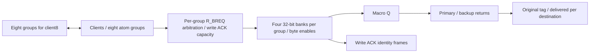

# blackwell_smem_fabric

## Description

The shared SMEM fabric provides eight independent 16 B atom group ports to TC, TMA, barrier backing, and the external LSU. It owns 32 1R1W banks (1,824×32 bits each, 228 KiB total), read return queues, and write ACK slots. Peak bandwidth is 128 B/cycle in each direction.

| Signal / channel | Direction | Type / width | Peer | Sampling condition |
|---|---|---|---|---|
| `rd_req[16][8]` | Input | [smem_rd_req_t](#transactions) (126 bits) | TC, TMA, backing, LSU | On `rd_req.fire`, accept one candidate per client and group on its own handshake. |
| `rd_rsp[16][8]` | Output | [smem_rd_rsp_t](#transactions) (206 bits) | TC, TMA, backing, LSU | On `rd_rsp.fire`, deliver the tagged result on the matching group channel. |
| `wr_req[16][8]` | Input | [smem_wr_req_t](#transactions) (254 bits) | TMA, backing, LSU | On `wr_req.fire`, accept the write in its addressed group. |
| `wr_ack[16][8]` | Output | [smem_wr_ack_t](#transactions) (78 bits) | TMA, backing, LSU | On `wr_ack.fire`, deliver one acknowledgment per original transaction on the same group index. |
| `live[3]` | Input | 61 bits per entry (1-bit valid, 2-bit record, 58-bit ID) | MMA engine | Level. The top connects the engine's live list for MMA candidate age. External service is independent of MMA activity. |
| `clk` | Input | 1 bit | Top level | Rising edge samples synchronous state. |
| `rst_n` | Input | 1 bit | Top level | Sample low on a rising edge to reset control. |
| `epoch_i` | Input | 16 bits | Top level | Level identifying the active CTA lifetime. |
| `drained_o` | Output | 1 bit | Top level | Level covering R_BREQ, macro Q, primary and backup returns, ACKs and held selections. |

The [top-level common protocol](../top/blackwell_async_subsystem_top.md#common-protocol) defines clock, reset, and channel sampling.

## Functionality

### Memory transaction types

| Type | Fields (high to low) | Bits |
|---|---|---:|
| `smem_rd_req_t` | tag78, addr32, byte_mask16 | 126 |
| `smem_wr_req_t` | tag78, addr32, byte_mask16, data128 | 254 |
| `smem_rd_rsp_t` | tag78, data128 | 206 |
| `smem_wr_ack_t` | tag78 | 78 |

Mask bit b selects data[8b+:8] in a 16 B atom. Unselected bytes are preserved on writes and returned as zero on reads. See top-level memory-routing for tag78. A successful write ACK proves actual commit. For TMA loads (client8), selected bytes have committed to this CTA's SMEM shared with generic accesses. A consuming thread can read them after successfully waiting on the corresponding mbarrier.

`smem_atom_req_t={write:1,tag:78,addr:32,byte_mask:16,data:128}` is 255 bits and `smem_atom_rsp_t={write:1,tag:78,data:128}` is 207 bits. Write responses return data=0. addr is a 16 B aligned logical byte address. Physical bank mapping occurs in the fabric. For an 8 B barrier write use original object address bit3 to select mask=0x00ff/0xff00 and the corresponding half-line.

### Address mapping and group state

A logical atom is 16 B aligned. For byte address a, physical bank=(a>>2)&31, word=a>>7, and group=(a>>4)&7. The atom's four 4 B subwords occupy bank=4×group+s, s=0…3. Matrix or Tensor Map address generation has already swizzled the logical address. The fabric maps these addresses to physical banks. Simulation asserts that the group index matches the request port and each enabled byte is in range.

Data SRAM occupies 233,472 B. Macro Q, primary return, and backup return each occupy 8×16 B=128 B. Each group holds one ungranted R_BREQ, read/write selections and RR cursors, three sets of read identity/valid subwords/destination mask, and per-destination delivered bits. Subwords move together. Reserve one return position per whole atom (up to three per group), limiting any enabled physical bank to three outstanding reads. Each group independently manages its two write ACK frames as a two-entry FIFO with tag, valid bit and order. A credit retiring on this edge can accept a new write on the same edge. A slow group blocks only itself once its two entries fill. See the [transaction fields](#transactions) for return types.

### Request selection, grant, and return

- OR the four byte_mask bits of each subword to generate its enable. Each group can grant one original atom per direction per cycle, only when ports and credits are available for every enabled subword. Disable SRAM access for unselected subwords and assemble zeros on read. An 8 B mbarrier update commits two subwords in the same group on one write edge. TMA and LSU receive one acknowledgment per written atom.
- When the group's R_BREQ can take a new entry, select a read and lock it until grant. Without external contention, four consecutive slots prefer A, A, B, B. An absent class yields to the other. Use a free-running mod-4 phase at g−1 to select the class for grant g, with baseline F aligned to phase 0. Among A candidates compare live age, row group in token, core number, then half/piece. The loader orders B within each group. Hold a blocked selection and derive timing from actual grants if a window is missed. When external and MMA reads compete, alternate between these classes per group, and round-robin among external clients. Advance cursors only on actual acceptance. Arbitrate writes fairly and independently per group.
- `rd_req.fire` captures the request in R_BREQ. Starting on the next edge, the registered address, subword enables, and identity participate in grant. A granting old entry can accept its replacement on the same edge. At grant g, consume a group credit, sample every enabled SRAM subword, and record tag, mask, and destinations in Q. Q is valid after g. It can move to the primary/backup return at g+1 and reach client ret_fire at g+2.
- Primary and backup form a depth-two ordered return queue. Only the head handshakes externally. First determine whether the head completes delivery to all destinations on this edge, then whether the queue can take old Q. Permit a new grant only with available credit and either empty Q or guaranteed movement of old Q on this edge. Q can move out and sample again on the same edge. With Q blocked, disable macro read and hold data and identity. Per group, `granted − fully_delivered = Q.valid + return_queue_occupancy ≤ 3`. Reuse credit released on the same edge. Partial delivery does not release credit. A return stall propagates only within its group.
- Per edge a TMA load can commit eight write atoms. A store can submit eight reads into R_BREQ and receive eight returns from prior grants. Match by token independently across groups. Stores compete with MMA A/B for group read grants. Loads compete with LSU and barrier backing for write grants and can run alongside MMA reads to a different word in the same group. Sustained 128 B/cycle requires service in all eight groups and circulating return credits.
- Coalesce only core A reads with the same ID, atom, and compatible ordering. One source can serve up to four destinations. Retain each original token/mask. Each receives its selected bytes once. Preserve the sampled value for slow destinations and return the source credit only after all receive it. For client6, B returns one 16 B atom independently per group. Full-atom FP16/BF16 requests enable all four 32-bit subwords. The group's loader.ret_fire releases its credit. [Slot output reorder and four-core distribution](../tensor_core/blackwell_tc_b_loader.md#delivery) uses a loader slot.
- A write commits and registers its ACK at wr_req.fire. The ACK can retire on the next edge. Compare a grantable R_BREQ and a write candidate with ACK space on the same edge. If their words match and enabled physical banks intersect, allow only one access and hold the other entire atom. One priority bit per group starts with read priority and switches direction after each actual conflict resolution. Different words or disjoint enabled banks may proceed concurrently. Serialize the same bank and word even with disjoint byte masks. Deliver returns and ACKs in order within their respective group streams.

### Reset and acceptance

With grants at 0, 1, and 2 and a continuously ready reader, deliver at 2, 3, and 4 respectively. If the head stalls from edge 2, the third read can still occupy Q. Once full, the fourth stays in R_BREQ. Upon resumption, head delivery, enqueue of old Q, and sampling of a new grant can coincide. A stalled broadcast destination cannot cause duplicate delivery to a served destination. A winning read sees the old word. A read granted after a winning write sees the updated word.

Reset clears control valid bits. Drain before a normal epoch change. Simulation asserts that each read return and write ACK identifies a live request on its original group and retires once per destination. In ideal K-major layout, each 128 B half-block uses all eight groups and 32 physical banks on one edge. Inserting eight external reads in one group extends service of its original 64 requests to at least 72 cycles.

## Submodules

| Submodule | Instances | Connections and parent control |
| --- | --- | --- |
| [banked_sram](../base/blackwell_banked_sram.md) | 1 | Eight atom groups drive 32 physical banks. The fabric controls read enable, arbitration, returns, and ACKs. |
