# blackwell_tc_b_loader

## Description

One loader per backend reads B from SMEM on ordinary or WS MMA misses, assembles a 256 B eight-column block, and delivers it independently to four cores. Two slots may belong to adjacent commands. The [engine descriptors](blackwell_tc_mma_engine.md#matrix-descriptor) define addressing and format. The [engine](blackwell_tc_mma_engine.md#b-residency) owns read permission, partitions, and collector identity.

<a id="types"></a>

| Signal / channel | Direction | Type / width | Peer | Sampling condition |
|---|---|---|---|---|
| `load` | Input | [b_load_t](#types) (132 bits) | MMA engine | On `load.fire`, allocate a stream descriptor. Two positions support cross-command prefetch. |
| `result` | Output | b_result_t = {id:58} (58 bits) | MMA engine | On `result.fire`, return one result per load to the reserved same-ID engine record. |
| `data[4]` | Output | [b_data_t](#types)={id58,block5,data2048} (2,111 bits) | Four cores | Each destination samples its column-ordered block on its own handshake. An unbound core may stall until it receives b_select from the engine. |
| `sm_rd_req[8]` | Output | [smem_rd_req_t](../smem/blackwell_smem_fabric.md#transactions) (126 bits) | SMEM fabric | On `sm_rd_req.fire`, submit the original logical address on its atom group with client 6. |
| `sm_rd_rsp[8]` | Input | [smem_rd_rsp_t](../smem/blackwell_smem_fabric.md#transactions) (206 bits) | SMEM fabric | On `sm_rd_rsp.fire`, match each return by ID, block, piece and part. |
| `live[3]` | Input | 61 bits per entry | MMA engine | Level. Match the full ID and rec from [engine](blackwell_tc_mma_engine.md#engine-ports). |
| `clk` | Input | 1 bit | MMA engine / top level | Rising edge samples synchronous state. |
| `rst_n` | Input | 1 bit | MMA engine / top level | Sample low on a rising edge to reset control. |
| `epoch_i` | Input | 16 bits | MMA engine / top level | Level identifying the active CTA lifetime. |
| `drained_o` | Output | 1 bit | MMA engine / top level | Level asserted after descriptors, presented requests, both slots and held results drain. |

The [top-level common protocol](../top/blackwell_async_subsystem_top.md#common-protocol) defines clock, reset, and channel sampling.

```mermaid
flowchart LR
 L["Load / allocate ID and block number in order"] --> E["Full-atom or generic masked enumeration"]
 E --> SM["Client6 / eight independent R_BREQ groups"]
 SM --> R["16 B return per group / tag match"]
 R --> S["Two 256 B slots / 16 logical rows each"]
 S --> M["Select oldest complete block"]
 M --> X["K and generic pass through / N-major transpose"]
 X --> C["Shared column-ordered payload / independent four-core handshakes"]
 C --> F["Last destination delivery / result"]
```



## Functionality

### Assembly slots and control fields

Index each 256 B slot by 16 logical rows, each containing four 32-bit segments. The two slots total 4,096 bits and distribution reads them directly. Each stores ID, block index j, 2-bit mode, per-row required/sent/completed (up to 16 parts each), 16 row-valid bits, four delivered bits, and stage. Allocation clears valid and progress. Hold mode until release. Physical SMEM banks are 32 bits wide. Four adjacent banks form a group returning one 16 B atom.

<a id="assembly"></a>

### Requests and assembly

After pin acquisition, reserve free slots for (id,j) in acceptance order. Once the earlier command's last block has a slot, the next command can request the other slot for its first block. Let `addr(n,k)` denote the first byte of an FP16/BF16 element computed by [engine](blackwell_tc_mma_engine.md#matrix-descriptor) from the descriptor, major order, and swizzle. c and u range over 0…7 and h over 0/1. For legal `kind::f16` loads with FP16/BF16 B, including WS misses, the B major order selects one of the first two modes. All other legal loads use generic mode.

| Slot mode | Source and token for one row | Write on return handshake |
|---|---|---|
| 0, K-major full atom | Row `p=2c+h`, address `addr(8j+c,8h)`, eight consecutive K elements | `part=0`, write all four segments of W[p] |
| 1, N-major full atom (descriptor MN-major B) | Row `p=2u+h`, address `addr(8j,8h+u)`, eight consecutive columns at a common K | `part=0`, write all four segments of W[p] |
| 2, generic masked | Destination row `p=2c+h` holds the low/high 16 B of column c. Number parts by ascending source atom address. Deduplicate within a piece. Rereads across pieces are allowed | Update only the part's enabled bits/bytes |

Each row in full-atom mode has only part 0, `byte_mask=0xffff`. Both starting address forms fall on an eight-element boundary of the contiguous dimension and allowed swizzles preserve the low four address bits within the atom. Issue 16 requests per block, one per row. Route by `(addr>>4)&7` of the actual address. General legal strides can cause group contention or coincident source addresses across rows. Settle each token independently. Mode 3 is reserved.

Each group prioritizes the older slot, then unsent requests by ascending h, p, part. `token={kind3=0,block5=j,piece4=p,part4}`. Set sent on the `rd_req.fire` edge entering the fabric. Hold a presented selection until accepted. On matching `rd_rsp.fire` set completed and return the group's read credit. For a full-atom return, `W[p].seg[d]=rsp.data[32*d+:32]` for d=0…3, with the four segments sharing one write enable. Eight groups can write up to eight distinct logical rows across both slots on one edge. Each group accepts independently. With skew, update only rows that actually handshake.

Generic mode extracts FP4/FP6 or copies whole bytes according to the descriptor. The part containing the lowest source bit zeroes the high padding bits. Apply `(old & ~bit_en) | (patch & bit_en)` per transaction. Each byte enable is the OR of its bit_en. Write at most one part to a given slot and row per edge. Round-robin among groups returning different parts to that row, advancing the cursor only on actual ret_fire. Unselected returns remain in the fabric. Mark a row valid only after all required parts return. Apply negate at dot consumption.

<a id="delivery"></a>

### Column-ordered output and slot lifetime

Select the oldest complete slot. Let `W[p][l]` be the l-th 16-bit element of its row, counted from the low bits. For the two full-atom modes wire output `data[256*c+16*(8*h+u)+:16]` as follows.

```text
K-major  = W[2*c+h][u]
N-major  = W[2*u+h][c]
```

Generic mode directly outputs `data[256*c+128*h+:128]=W[2*c+h]`. Both slots share one mode selection and output reorder. All four cores see the same eight columns, 32 B each. Each core derives ready from ID, block number, and the old block's consumption watermark. A slot is complete when all 16 rows are valid and all source obligations have settled. Delivery can occur on the edge after the last ret_fire. There is no additional transpose stage.

Set a destination's delivered bit only on data.fire. While a slow core stalls, hold slot identity, mode, and payload and exclude cores that already accepted. On the final destination's acceptance edge, the slot can be reserved for a successor block. First settle delivered/result under the old ID, then install the new owner and clear its progress. Only pre-edge old payload is delivered on that edge. Only returns belonging to the new owner may write its new data. The old last block must already have result space reserved by ID. Backpressure new blocks when neither slot can be freed.

Simulation assertions require each return to identify an issued, outstanding part of a live slot on its assigned group. Normal stop drains accepted obligations. Reset clears control valid bits.

<a id="service"></a>

### Supply window and acceptance

A core consumes a block every four cycles, averaging 64 B/cycle. When the eight requests for each half hit distinct grantable groups, two B grant edges read 256 B. Each block takes 16 requests and 64 physical 32-bit bank reads. Suppose the low half of block j receives grant at g=4j and the high half at g+1. They enter R_BREQ at g−1 and g, return to the slot at g+2 and g+3, and deliver to four ready cores at g+4. Adjacent blocks alternate slots. The first half of block 1 enters R_BREQ at edge 3 as the second half of block 0 writes its slot. For other layouts or contention, count from actual [SMEM grant](../smem/blackwell_smem_fabric.md).

Each destination core accepts a block exactly once, in column order. A stalled delivery holds its data and mode until that core accepts it.
