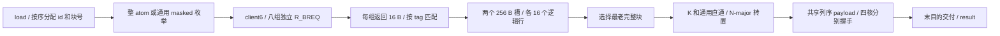

# blackwell_tc_b_loader

## Description

每后端一个 loader，为 miss 的普通/WS MMA 从 SMEM 读 B，将一个八列块装配成 256 B，再向四核分别交付。两个槽可同时属于相邻命令。地址/格式由 [engine 描述符](blackwell_tc_mma_engine.md#matrix-descriptor)定义，读取权、分区及 collector 身份属于 [engine](blackwell_tc_mma_engine.md#b-residency)。

<a id="types"></a>

| 信号 / 通道 | 方向、类型 / 位宽 | 对端 | 握手或采样条件 |
| --- | --- | --- | --- |
| load / result | 入 [b_load_t](#types)={id58,b_desc64,b_type4,kind3,transpose_b1,n_code2}，132 bit / 出 [b_result_t](#types)={id58,status4}，62 bit | MMA engine | 每个 load 恰有一次 result。两个流描述符位置支持跨命令预读；结果在 engine 的同 id 记录有预留空间。 |
| data[4] | 出 [b_data_t](#types)={id58,block5,data2048}，2111 bit | 四个 core | 同一列序 payload 对四核独立握手，线序见下文。engine 分别给 core 送 b_select；尚未绑定的目的可反压。 |
| sm_rd_req[8] / sm_rd_rsp[8] | 出 / 入 [SMEM atom](../smem/blackwell_smem_fabric.md#transactions) | SMEM fabric | 原逻辑地址，按组索引，tag.client=6。按 (id,block,piece,part) 匹配返回。 |
| live[3] | 入，每项 61 bit | MMA engine | 按 [engine](blackwell_tc_mma_engine.md#engine-ports) 的完整 id 与 rec 匹配。 |
| clk、rst_n、epoch_i / drained_o、fault_o | epoch_i 入 u16，时钟、复位为输入 bit，状态为输出 bit | MMA engine、顶层 | drained 包含描述符、已展示请求、两个槽及 held 结果。 |

时钟、复位及通道的采样约定见[顶层公共协议](../top/blackwell_async_subsystem_top.md#common-protocol)。



## Functionality

### 装配槽与控制字段

每槽的 256 B payload 按 16 个逻辑行索引，每行含四个 32-bit 段。两槽共 4,096 bit，分发直接读槽。每槽保存 id、块号 j、2-bit 模式、各行 required/sent/completed（各至多 16 个 part）、16 个行有效位、4-bit delivered 和阶段。分配时清有效位与进度，模式保持到槽释放。物理 SMEM 为 32-bit bank；四个相邻 bank 合成一组，一次返回一个 16 B atom。

<a id="assembly"></a>

### 请求与装配

预检和 pin 成功后，按接受序为 (id,j) 预留空槽。前条末块取得槽后，后条即可为首块申请另一槽。以 `addr(n,k)` 表示 [engine](blackwell_tc_mma_engine.md#matrix-descriptor) 按该条 descriptor、major 和 swizzle 算出的 FP16/BF16 元素首字节。c、u 为 0…7，h 为 0/1。对合法 `kind::f16` 且 B 为 FP16/BF16 的 load（含 WS miss），按 B 的 major 选择前两种模式，其余合法 load 走通用模式。

| 槽模式 | 枚举一行的源与 token | 成功返回的写入 |
|---|---|---|
| 0，K-major 整 atom | 行 `p=2c+h`，地址 `addr(8j+c,8h)`，连续八个 K 元素 | `part=0`，写 W[p] 四段 |
| 1，N-major 整 atom（描述符的 MN-major B） | 行 `p=2u+h`，地址 `addr(8j,8h+u)`，同一 K 的八个连续列元素 | `part=0`，写 W[p] 四段 |
| 2，通用 masked | 目的行 `p=2c+h` 表示列 c 的低/高 16 B。按源 atom 地址升序编 part，片内去重，跨片允许重读 | 仅更新 part 的 bit/byte 使能范围 |

整 atom 模式每行只有 part 0，`byte_mask=0xffff`。两种起址都在元素连续维的八元素边界上，允许的换位保持 atom 内低四位。因此整块发 16 笔请求，各行只请求一次。以实际地址的 `(addr>>4)&7` 路由；一般合法 stride 可造成同组竞争或不同行源地址重合，各 token 独立结算。模式 3 保留。

各组优先较老槽，再按 h、p、part 升序选尚未发出的请求。`token={kind3=0,block5=j,piece4=p,part4}`。在进入 fabric 的 `rd_req.fire` 沿置 sent；已展示未接受的选择保持。匹配 `rd_rsp.fire` 时置 completed 并归还该组的读 credit。整 atom 成功返回时，`W[p].seg[d]=rsp.data[32*d+:32]`，d=0…3，四段共用该笔写使能。八组可在同沿写入两槽中最多八个不同的逻辑行；各组独立接受，错拍时只更新实际握手的行。

通用模式按描述符提取 FP4/FP6 或复制整 byte，含最低源 bit 的 part 补零 padding 高位。每笔执行 `(old & ~bit_en) | (patch & bit_en)`，每 byte 的使能取其 bit_en 的 OR。同槽同行同沿只写一笔；多组返回该行的不同 part 时轮询，按实际 ret_fire 转动指针。未选的返回保持在 fabric。每行所有 required part 成功后才置有效。negate 在 dot 消费时处理。

<a id="delivery"></a>

### 列序输出与生命周期

取最老完整槽，令 `W[p][l]` 为该行自低位起的第 l 个 16-bit 元素。对两种整 atom 模式，输出端 `data[256*c+16*(8*h+u)+:16]` 按下式接线：

```text
K-major  = W[2*c+h][u]
N-major  = W[2*u+h][c]
```

通用模式直接输出 `data[256*c+128*h+:128]=W[2*c+h]`。两槽共用一次模式选择和出槽重排，四核看到相同的八列、每列 32 B 的块。core 以 id、块号和旧块消费水位决定 ready。槽完整条件为 16 行均有效、全部源责任结清且无错误。最后 ret_fire 后，最早下一沿可交付；无额外转置流水级。

每个目的只在 data.fire 置 delivered；慢核暂停时保持同一槽的身份、模式和 payload，已收核不再展示。最后一个目的核接受的同沿可为后继块预留此槽，先按旧 id 结算 delivered/result，再写新 owner 并清新进度；本沿只交付沿前旧 payload，新 owner 的返回才可写入新数据。须确保旧末块 result 已有按 id 的预留位置。两槽都无法释放时反压新块。

非 OK、未知或重复返回触发 fault，不写入装配槽或发布成功块。正常 stop 排空已接受的责任，复位清控制有效位。

<a id="service"></a>

### 供数窗口与验收

core 每 4 拍消费一块，平均需求 64 B/拍。若每半块的八笔分别落在八组且各组均可 grant，两个 B grant 沿即可读完 256 B。每块共 16 笔读、64 次 32-bit bank 读。设块 j 的低半块在 g=4j 获得 grant，高半块在 g+1 获得 grant。两半分别在 g−1、g 进入 R_BREQ，g+2、g+3 返回写槽，四核均 ready 时 g+4 交付。相邻块交替占两槽；块 1 首半在第 3 沿进入 R_BREQ，同沿块 0 后半写槽。其他布局或争用从实际 [SMEM grant](../smem/blackwell_smem_fabric.md) 起算。

- 对两种 major、FP16 和 BF16 以非均匀 16-bit 原始码逐元素比对，跨 N64/128/256、swizzle 相位、panel 及命令边界核对地址、16 个 token 和列序。混排 K、N、通用块，检查反压时只使用最老槽的模式。
- 暂停一个返回组，再单独暂停一个 core，检查源 credit 归还沿、held payload、各目的恰好一次及槽复用。对末返回注错、WS hit/miss、停机排空分别核对结果。
- 通用格式覆盖低位 packing、padding、同一目的行多个 part 同拍到达及一般布局的 bank 冲突，逐字节比对四核数据。
