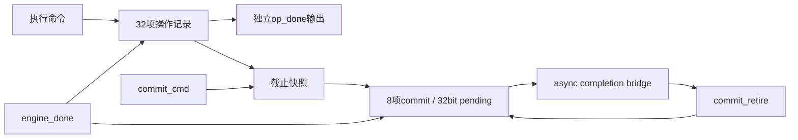

# blackwell_tc_completion_tracker

## Description

用 32 条操作记录接收 MMA 的逐 id 完成，8 条 commit 记录保存同 issuer 的未完成前驱快照。[身份与截止](../top/blackwell_async_subsystem_top.md#identity)定义 issuer 和截止沿。

| 信号 / 通道 | 方向 | 类型 / 位宽 | 对端 | 握手或采样条件 |
| --- | --- | --- | --- | --- |
| `register_op` | 入 | [async_id_t](../top/blackwell_async_subsystem_top.md#identity)，58 | 顶层 MMA 入口 | 与实际TC执行命令原子接受 |
| `engine_done` | 入 | [op_done_t](../top/blackwell_async_subsystem_top.md#identity)，62 | MMA engine | 本 id 的读、算术、实际写 ACK 及资源归还均已结清 |
| `op_done` | 出 | op_done_t，62 | 软件前端 | 单条执行命令的软件完成 |
| `commit_cmd` | 入 | [tc_commit_t](#commit-contract)，90 | 软件前端 | 独立接受与快照资源 |
| `ready_commit` | 出 | [tc_ready_commit_t](#commit-contract)，93 | TC completion bridge | `{commit:90,slot:3}` |
| `commit_retire` | 入 | [tc_commit_retire_t](#commit-contract)，61 | TC completion bridge | `{slot:3,id:58}`；bridge完成返回已消费 |
| `busy_addr/addr_busy` | 入/出 | 32bit/1bit | barrier frontend | 任一valid commit指向该barrier地址即busy |
| `epoch/stop` | 入 | 16/1 | 顶层 | 当前CTA/停止新登记与commit |
| `drained/fault` | 出 | 各1 | 顶层 | 全部操作、commit 和 held 输出退休 / 运行故障 |

## Functionality

register_op fire必须等于该条MMA命令fire。顶层联合执行器ready与本模块ready，不允许在两处分别握手。LD/ST属于独立RF等待域，不登记到本表。

### Commit 通道类型

| 类型/字段 | 位宽 | 定义 |
|---|---:|---|
| `tc_commit_t` | 90 | `{id:async_id_t,barrier_addr:32}`；地址为本 CTA SMEM byte 地址 |
| `tc_ready_commit_t` | 93 | `{commit:tc_commit_t,slot:3}` |
| `tc_commit_retire_t` | 61 | `{slot:3,id:async_id_t}`；最终commit返回消费后回收tracker槽 |

### 登记与完成

操作行含 valid、id58、finished，共 60bit。register_op 与 engine 命令同沿 fire，占一条空行。engine_done 按完整 id 匹配唯一未完成行；成功 fire 设置 finished，并清除各 commit 对该行的 pending 位。该输入已预留记录，独立于更老操作、软件 ready 和 engine 记录的按序回收。异常身份或非 OK 完成按[运行故障](../top/blackwell_async_subsystem_top.md#common-protocol)处理。

在 finished 行间轮询发布 `op_done={id,OK}`，背压锁定 5bit 索引和 valid。普通 done 消费即回收操作行，下一沿可重新登记。已经完成的操作无需后继事件，无论软件何时发 commit 都不再占用依赖存储。

### commit 截止和发出

8 行各含 commit90、pending32、valid 和已发往 bridge 位。保留 8×8 接受先后矩阵、3bit 轮询游标及 held 输出选择。commit 的接受只需独立空槽、当前 epoch 开放和目标地址的生命周期 gate 允许。插入时将所有旧行标为更早，释放时清对应行列。任一有效行的地址命中均置 addr_busy。

commit 在 c 沿捕获沿前 valid、同 epoch、同完整 issuer 且未 finished 的操作。同沿匹配的成功 engine_done 从集合扣除；同沿新 register_op 不加入。旧槽回收后，新身份不继承旧 pending 位。空集合也产生一次 ARRIVE(1)。同 issuer 更早有效 commit 全部 retire 且 pending=0 后才可发出，不同 issuer 间轮询；ready_commit 受阻时保持 id、地址及 slot。

ready_commit.fire 标志已交接。bridge 在软件 commit_done 消费后发 commit_retire；仅匹配原 slot/id 才释放该行。engine_done 在 r 握手后，软件 done 和由此就绪的 commit 最早 r+1 交付。空快照最早 c+1 交付。32 条操作行全满时仍可登记 commit，8 条 commit 行全满时仍可接收之前登记的 engine_done。

正常 stop 阻止新登记，已有结果与 commit 继续退休；drained 条件为两表和 held 输出均空。同步复位清 valid、矩阵、游标与选择。登记时检查 epoch 和 live 操作/commit 的完整 id，重复或错 epoch 的请求不得 joint fire，并置 fault。未知 engine_done 或错误 retire 触发顶层 fault。验收覆盖同沿登记/完成/commit、连续消费超过 32 个 done 后的空快照，以及[不同 issuer 的非空 commit](../top/blackwell_async_subsystem_top.md#mma-nonempty-commit)。
