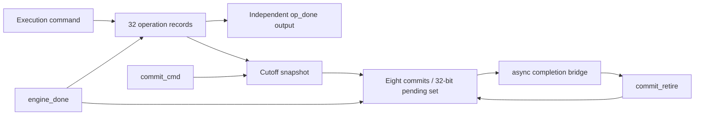

# blackwell_tc_completion_tracker

## Description

The 32 operation records accept MMA completion by ID. Eight commit records snapshot unfinished predecessors of the same issuer. See [Identity and cutoffs](../top/blackwell_async_subsystem_top.md#identity) for the issuer definition and cutoff edges.

| Signal / channel | Direction | Type / width | Peer | Handshake or sampling condition |
| --- | --- | --- | --- | --- |
| `register_op` | Input | [async_id_t](../top/blackwell_async_subsystem_top.md#identity), 58 | Top-level MMA ingress | Atomic acceptance with the actual TC execution command |
| `engine_done` | Input | [op_done_t](../top/blackwell_async_subsystem_top.md#identity), 62 | MMA engine | Reads, arithmetic, actual write ACKs, and resource returns for this ID have all settled |
| `op_done` | Output | op_done_t, 62 | Software front end | Software completion for one execution command |
| `commit_cmd` | Input | [tc_commit_t](#commit-contract), 90 | Software front end | Independent acceptance and snapshot resources |
| `ready_commit` | Output | [tc_ready_commit_t](#commit-contract), 93 | TC completion bridge | `{commit:90,slot:3}` |
| `commit_retire` | Input | [tc_commit_retire_t](#commit-contract), 61 | TC completion bridge | `{slot:3,id:58}`, bridge completion result consumed |
| `busy_addr/addr_busy` | Input/output | 32bit/1bit | barrier frontend | Any valid commit targeting this barrier address asserts busy |
| `epoch/stop` | Input | 16/1 | Top level | Current CTA / stop new registrations and commits |
| `drained/fault` | Output | 1 bit each | Top level | All operations, commits, and held outputs retired / runtime fault |

## Functionality

register_op fire must equal the MMA command fire. The top combines executor ready and tracker ready for a single handshake. LD/ST belongs to the independent RF wait domain and does not register here.

### Commit channel types

| Type/field | Width | Definition |
|---|---:|---|
| `tc_commit_t` | 90 | `{id:async_id_t,barrier_addr:32}`, address is a byte address in this CTA's SMEM |
| `tc_ready_commit_t` | 93 | `{commit:tc_commit_t,slot:3}` |
| `tc_commit_retire_t` | 61 | `{slot:3,id:async_id_t}`, reclaim the tracker slot after the final commit result is consumed |

### Registration and completion

Each operation entry contains valid, id58, and finished (60 bits). register_op fires on the same edge as the engine command and allocates a free entry. engine_done matches one unfinished entry by full ID. Successful fire sets finished and clears that entry's pending bit in every commit. Its record is already reserved, independently of older operations, software ready, or engine record reclamation in order. Invalid identity or non-OK completion follows [runtime fault handling](../top/blackwell_async_subsystem_top.md#common-protocol).

Round-robin among finished entries to publish `op_done={id,OK}`. Lock a 5-bit index and valid under backpressure. Ordinary done consumption reclaims the operation entry, which can register a new operation on the next edge. Completed operations require no later event or dependency storage regardless of when software issues commit.

### Commit cutoff and issue

Each of eight entries holds commit90, pending32, valid, and a sent-to-bridge bit. Retain an 8×8 acceptance-order matrix, a 3-bit round-robin cursor, and a held output selection. Commit acceptance requires only an independently free slot, an open current epoch, and permission from the target address lifecycle gate. At insertion mark all existing entries older. On release clear the corresponding row and column. Assert addr_busy on any valid address match.

At edge c, commit captures pre-edge valid unfinished operations of the same epoch and full issuer. Subtract successful matching engine_done on that edge and exclude a simultaneous new register_op. A new identity reusing an old slot does not inherit its pending bit. An empty set still produces one ARRIVE(1). Issue only when all older valid commits from the same issuer have retired and pending=0. Round-robin across issuers. Hold ID, address, and slot while ready_commit is stalled.

ready_commit.fire records handoff. After software consumes commit_done the bridge issues commit_retire. Release the row only on matching original slot/ID. Following engine_done handshake at r, software done and a newly eligible commit can deliver at r+1. An empty snapshot can deliver at c+1. All 32 occupied operation entries still permit commit registration. All eight occupied commit entries still permit engine_done for registered operations.

Normal stop blocks new registrations while existing results and commits retire. drained requires both tables and held outputs empty. Synchronous reset clears valid bits, matrix, cursors, and selections. At registration check epoch and full ID against live operations/commits. A duplicate or wrong epoch must suppress joint fire and raise fault. Unknown engine_done or wrong retire raises top-level fault. Cover coincident registration/completion/commit, an empty snapshot after consuming more than 32 consecutive done results, and [nonempty commits from different issuers](../top/blackwell_async_subsystem_top.md#mma-nonempty-commit).
