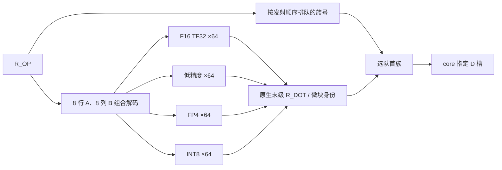

# blackwell_tc_dot_array

## Description

每核一个阵列，将 core.R_OP 的 8 行 A、8 列 B 和 64 个 C cell 送入 64 路完整 dot，结果按 (row×8+col) 排列。一次输入产生一个带原身份的 8×8 微块。[MMA 命令](blackwell_tc_mma_engine.md#mma-command)限定 kind 与类型，[数值规则](blackwell_tc_dot_array.md#numeric-routing)规定特殊值、对齐与最终编码。

| 信号 / 通道 | 方向、类型 / 位宽 | 对端 | 握手或采样条件 |
| --- | --- | --- | --- |
| cmd_i | 入，[mma_cmd_t](blackwell_tc_mma_engine.md#mma-command) | MMA core | core 按 R_OP.tag.id 从 live 记录选控制，cmd_i 与 operand 同一握手，暂停时两者保持 |
| operand | 入通道，`{tag:tile_tag_t,data:tc_operand_t}` | MMA core | [core](blackwell_tc_mma_core.md) 拥有 R_OP；832 B 准备数据和单个 76-bit 身份 |
| result | 出通道，`{tag:tile_tag_t,cell[64]:bits32}` | MMA core | FP32/S32，微块整体握手，暂停时整组保持 |
| empty_o | 出，1bit | MMA core | 所有原生级和对应 tag 都空 |

时钟、复位及通道的采样约定见[顶层公共协议](../top/blackwell_async_subsystem_top.md#common-protocol)。

## Functionality

### 展开行列向量与选择算术族

R_OP 每片提供 8 个 A 行向量和 8 个 B 列向量，每个原始向量为 256 bit，元素按逻辑 K 从低位起排列。阵列按本片 dtype 对每行、每列各做一次组合解码，连同该行或列使用的 scale 一起广播。第 (r,c) 路只接收已解码的 A[r]、B[c] 和本格 C[8r+c]。乘积、两因子组合、特殊值归并、C 处理及归约均在该路内完成。各族解码字段和位宽见下表所链的 req 定义。字段拼接按从高到低书写，向量的元素 0 和 scale 组 0 均占低位。浮点元素的 class2 编码为 0=零、1=有限非零、2=Inf、3=NaN，零、Inf、NaN 的 sig 和 e 在广播线上置零。

组合解码前，非整数 negate 翻转元素原始编码的符号位。低精度取容器实际 sign 位，native FP4 对选中 nibble 的 bit3 操作。两因子的 g 只按 [scale 布局](blackwell_tc_scale_b_snapshot.md#scale-layout)计算。i8 的 overflow 是叶局部诊断，cell 取 result32。

从 R_OP 到 S0，行列解码和操作数隔离均为组合逻辑，共用 operand 握手。各族在行、列广播端隔离送往本族 S0 的 A、B 和 scale。仅当 `operand.valid` 且 `cmd_i.kind` 属于该族时，这些输入取本片的解码值，否则钳为零。选择独立于 ready，反压期间选中族持续看到同一片。仅在 `operand.fire` 沿，选中族的 64 路一同捕获 S0。已进入各族的微块及 tag 按各级原有的 valid/ready 推进。

四族的流水数据寄存器单核合计 **46264 B**，有效位、tag 和顺序 FIFO 另计。输出只有 64×32bit cell 和一份 tag。

### 发射顺序、结果选择与背压

输入 fire 于 l 捕获选定族的第一级，原生末级在 l+P−1 沿后最早可见。各族独立弹性保持，无停顿 II=1；输入 ready 只需选中族 64 lane 和顺序记录有空间。发射 FIFO 只保存族号，深度等于四族原生级数之和。入 dot 同沿入队；队首选择唯一结果端口，只有对应族末级可在 result.fire 同沿出队。不同族可在相邻沿发射，即使较短流水先算完也按发射顺序交付。empty_o 用于排空，复位同时清各级及 FIFO。

result.ready 取决于指定 (slot,generation,row) 是否可捕获。D 槽受阻时同一微块留在末级，剩余空级可继续吸收输入，满后背压传至 R_OP。同步复位清 valid，不清 payload。

### 验收

比较 33 个形状和全部模式。连续发六级低精度、三级整数、五级 FP16/TF32；暂停队首结果而让短族先就绪。检查在途族号数等于各族 valid 微块数，结果按原 tag 有序交付，D 反压解除后无重复/遗失。单族的原生边沿和 payload 容量分别核对。广播接线用非对称 INT8 微块检查：仅 k=0 非零，A[r,0]=r+1、B[c,0]=c+9、C[8r+c]=100r+c，逐格检查 `(r+1)×(c+9)+100r+c`。

连续改变输入数据并切换算术族，检查未选中族的 S0 行列输入为零，已发微块仍按原 tag 交付。选中族入口受阻时，解码值保持到握手沿。

### 数值定义归属

各族输入编码、定点归约与原生级数见下表的叶模块。浮点特殊值与最终编码见 [FP32 pack](../dot/blackwell_dot_fp32_pack.md#numeric-contract)。微块 tag 与 64 路数据同沿前进。

## Submodules

四种算术族每核各实例化 64 路，按下表接收控制。阵列用一个 [fifo](../base/blackwell_fifo.md) 保存发射顺序（19 项，每项 2 bit）。

| kind → 算术叶 | 组合控制 | P / Ldot | payload / 核 |
|---|---|---:|---:|
| f16、tf32 → [f16tf32_dot](../dot/blackwell_f16tf32_dot.md) | 按 FP16/BF16/TF32 解码行列，传 scale_input_d | 5 / 4 | 14368 B |
| f8f6f4、mxf8f6f4 → [f4f6f8_dot](../dot/blackwell_f4f6f8_dot.md) | 按 dtype 3…7 解码；MX 时解码 SA[r,0]/SB[c,0] | 6 / 5 | 19944 B |
| mxf4、mxf4nvf4 → [fp4_dot](../dot/blackwell_fp4_dot.md) | 按 UE8M0 2X / UE4M3 4X 解码并分配各组 scale | 5 / 4 | 6376 B |
| i8 → [int8_dot](../dot/blackwell_int8_dot.md) | 按各侧 dtype 扩展至 signed9，saturate=int_sat | 3 / 2 | 5576 B |
