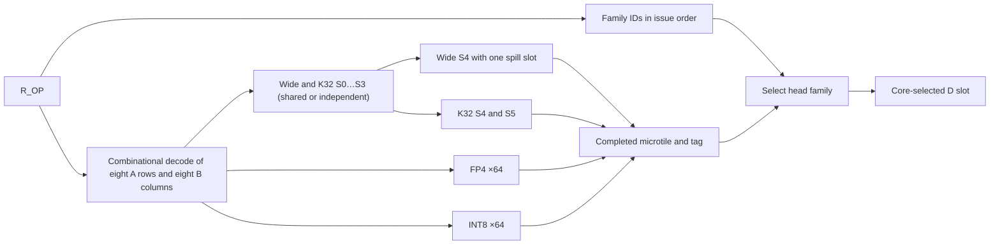

# blackwell_tc_dot_array

## Description

One array per core feeds eight A rows, eight B columns, and 64 C cells from core.R_OP to 64 complete dot lanes. Order results by (row×8+col). One input produces one 8×8 microtile with its original identity. The [MMA command](blackwell_tc_mma_engine.md#mma-command) defines legal kinds and types. The [arithmetic rules](blackwell_tc_dot_array.md#numeric-routing) define special values, alignment, and final encoding.

| Signal / channel | Direction, type / width | Peer | Handshake or sampling condition |
| --- | --- | --- | --- |
| cmd_i | Input, [mma_cmd_t](blackwell_tc_mma_engine.md#mma-command) | MMA core | The core selects control from its live record by R_OP.tag.id. cmd_i handshakes with the operand. Hold both during stalls |
| operand | Input channel, `{tag:tile_tag_t,data:tc_operand_t}` | MMA core | [core](blackwell_tc_mma_core.md) owns R_OP, with 832 B of prepared data and one 76-bit identity |
| result | Output channel, `{tag:tile_tag_t,cell[64]:bits32}` | MMA core | FP32/S32. The entire microtile handshakes and holds together under backpressure |
| empty_o | Output, 1 bit | MMA core | All native stages and matching tags empty |

The [top-level common protocol](../top/blackwell_async_subsystem_top.md#common-protocol) defines clock, reset, and channel sampling.

## Functionality

### Expand row and column vectors and select the arithmetic family

R_OP supplies eight A row vectors and eight B column vectors per microtile. Each raw vector is 256 bits with elements packed from the low bits in logical K order. The array combinationally decodes each row and column once using the microtile dtype, then broadcasts it with the relevant scale. Lane (r,c) receives only decoded A[r], B[c], and C[8r+c]. The lane computes products, combines the two factors, resolves special values, processes C, and reduces. See the linked req definitions in the table for decoded fields and widths by family. Concatenations are written high to low. Vector element 0 and scale group 0 occupy the low bits. Floating-point class2 encodes 0=zero, 1=finite nonzero, 2=Inf, and 3=NaN. Drive sig and e to zero on the broadcast wires for zero, Inf, or NaN.

Before combinational decode, noninteger negate flips the sign bit of the raw element. Use the actual sign bit in the low-precision container and bit3 of the selected nibble for native FP4. Compute g for both factors only as specified in [scale layout](blackwell_tc_scale_b_snapshot.md#scale-layout). i8 overflow is a leaf-local diagnostic. The cell uses result32.

Row/column decode and operand isolation between R_OP and S0 are combinational and share the operand handshake. Each family's row and column broadcast gates its A, B, and scale inputs to S0. Drive decoded values only when `operand.valid` and `cmd_i.kind` selects that family. Otherwise clamp the inputs to zero. Selection is independent of ready, so the selected family sees the same microtile throughout backpressure. All 64 selected lanes capture S0 only on `operand.fire`. In-flight microtiles and tags advance with the existing per-stage valid/ready.

### Floating-point storage

The top-level [`SHARE_FP_DOT_ADDER_TREE`](../top/blackwell_async_subsystem_top.md) selects how wide (F16/TF32) and K32 use S0…S3. In shared mode a family bit travels with each tag and selects the tail at S3. Wide uses the lower half of the K32 pair adders and group trees. In independent mode each of these two families has its own front stages and adders.

| Per core, 64 cells | Shared | Independent |
|---|---:|---:|
| Wide and K32 data in S0…S3, bits per cell | 584 + 490 + 503 + 163 | 584 + 489 + 270 + 44 (wide), 567 + 490 + 503 + 163 (K32) |
| Tail data, bits per cell | Wide 32 + spill 32, K32 45 + 32 | Same |
| Wide and K32 data registers | 15,048 B | 26,008 B |
| Data registers across all four families | 23,584 B | 34,544 B |
| Wide and K32 tags (76 bits per slot) | 608 bits | 912 bits |
| Wide and K32 stage control | 8 valid + 4 mode bits | 12 valid bits |
| Issue-order FIFO capacity (2-bit family ID per microtile) | 16 entries | 19 entries |

The data totals exclude tags, control and FIFO storage. The FIFO bounds total accepted work, including any microtile in the spill slot.

### Issue order, result selection, and backpressure

On `operand.fire`, all 64 selected lanes capture S0 and the [issue-order FIFO](../base/blackwell_fifo.md) records the family. Admission requires space in both the selected path and the FIFO. With the array initially empty and the result sink continuously ready, either configuration accepts a stream of wide and K32 microtiles at one per cycle. For an isolated microtile issued at edge l, the result becomes visible after l+Ldot and can transfer at l+P, using the timing in the submodule table.

If an older K32 result takes the output when a wide result completes, the wide result can enter its one-entry spill slot. Shared mode also permits spilling during downstream stalls. An isolated wide result bypasses the slot. The oldest wide result is always selected first.

The FIFO head selects the output family. Only `result.fire` retires that microtile and removes its FIFO entry. The core asserts `result.ready` when the destination slot, generation and row can accept the result. While `result.valid && !result.ready`, the output tag and all 64 cells stay stable. Empty stages can continue accepting work until backpressure reaches R_OP. Synchronous reset clears stage and FIFO validity and preserves stage payloads. `empty_o` indicates drain.

### Acceptance

In both configurations, check sustained wide/K32 issue with the sink ready, each family's isolated latency after drain, and synchronous reset at full blocked capacity.

Compare all 33 shapes and every mode. Issue six-stage low precision, three-stage integer, and five-stage FP16/TF32 consecutively. Stall the head result while the shorter family becomes ready first. Check that queued family IDs equal the number of valid microtiles in the pipelines, results deliver in original tag order, and lifting D backpressure causes no loss or duplication. Check native edges and payload capacity for each family. Verify broadcast wiring with an asymmetric INT8 microtile. Only k=0 is nonzero, A[r,0]=r+1, B[c,0]=c+9, and C[8r+c]=100r+c. Check `(r+1)×(c+9)+100r+c` in every cell.

Continuously vary input data and switch families. Check that unselected S0 row/column inputs stay zero and that issued microtiles deliver with their original tags. A blocked selected input holds its decoded values through the handshake edge.

### Arithmetic specification ownership

The leaves below specify each family's input encoding, fixed-point reduction, and native stage count. See [FP32 pack](../dot/blackwell_dot_fp32_pack.md#numeric-contract) for floating-point special values and final packing. Microtile tags and all 64 data lanes advance on the same edge.

## Submodules

| Kind → arithmetic leaf | Combinational control | P / Ldot |
|---|---|---:|
| f16, tf32 → [f16tf32_dot](../dot/blackwell_f16tf32_dot.md) | Decode rows and columns as FP16/BF16/TF32 and pass scale_input_d | 5 / 4 |
| f8f6f4, mxf8f6f4 → [f4f6f8_dot](../dot/blackwell_f4f6f8_dot.md) | Decode dtype 3…7. In MX mode decode SA[r,0]/SB[c,0] | 6 / 5 |
| mxf4, mxf4nvf4 → [fp4_dot](../dot/blackwell_fp4_dot.md) | Decode UE8M0 2X or UE4M3 4X and distribute group scales | 5 / 4 |
| i8 → [int8_dot](../dot/blackwell_int8_dot.md) | Extend each side to signed9 according to dtype, saturate=int_sat | 3 / 2 |
