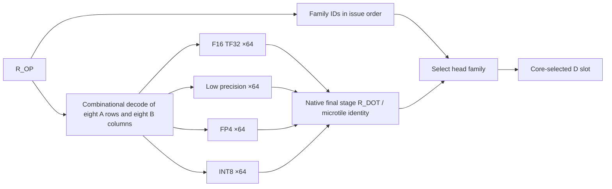
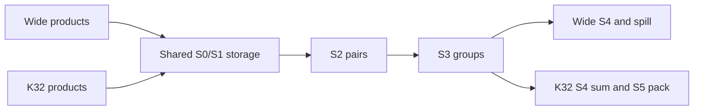
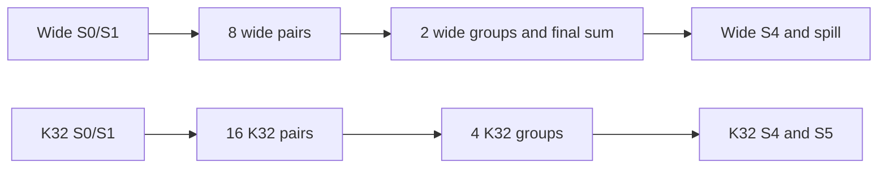

# blackwell_tc_dot_array

## Description

One array per core feeds eight A rows, eight B columns, and 64 C cells from core.R_OP to 64 complete dot lanes. Order results by (row×8+col). One input produces one 8×8 microtile with its original identity. The [MMA command](blackwell_tc_mma_engine.md#mma-command) defines legal kinds and types. The [arithmetic rules](blackwell_tc_dot_array.md#numeric-routing) define special values, alignment, and final encoding.

| Signal / channel | Direction, type / width | Peer | Handshake or sampling condition |
| --- | --- | --- | --- |
| cmd_i | Input, [mma_cmd_t](blackwell_tc_mma_engine.md#mma-command) | MMA core | The core selects control from its live record by R_OP.tag.id. cmd_i handshakes with the operand. Hold both during stalls |
| operand | Input channel, `{tag:tile_tag_t,data:tc_operand_t}` | MMA core | [core](blackwell_tc_mma_core.md) owns R_OP, with 832 B of prepared data and one 76-bit identity |
| result | Output channel, `{tag:tile_tag_t,cell[64]:bits32}` | MMA core | FP32/S32. The entire microtile handshakes and holds together under backpressure |
| empty_o | Output, 1 bit | MMA core | All native stages and matching tags empty |

The [top-level common protocol](../top/blackwell_async_subsystem_top.md#common-protocol) defines clock, reset, and channel sampling.

## Functionality

### Expand row and column vectors and select the arithmetic family

R_OP supplies eight A row vectors and eight B column vectors per microtile. Each raw vector is 256 bits with elements packed from the low bits in logical K order. The array combinationally decodes each row and column once using the microtile dtype, then broadcasts it with the relevant scale. Lane (r,c) receives only decoded A[r], B[c], and C[8r+c]. The lane computes products, combines the two factors, resolves special values, processes C, and reduces. See the linked req definitions in the table for decoded fields and widths by family. Concatenations are written high to low. Vector element 0 and scale group 0 occupy the low bits. Floating-point class2 encodes 0=zero, 1=finite nonzero, 2=Inf, and 3=NaN. Drive sig and e to zero on the broadcast wires for zero, Inf, or NaN.

Before combinational decode, noninteger negate flips the sign bit of the raw element. Use the actual sign bit in the low-precision container and bit3 of the selected nibble for native FP4. Compute g for both factors only as specified in [scale layout](blackwell_tc_scale_b_snapshot.md#scale-layout). i8 overflow is a leaf-local diagnostic. The cell uses result32.

Row/column decode and operand isolation between R_OP and S0 are combinational and share the operand handshake. Each family's row and column broadcast gates its A, B, and scale inputs to S0. Drive decoded values only when `operand.valid` and `cmd_i.kind` selects that family. Otherwise clamp the inputs to zero. Selection is independent of ready, so the selected family sees the same microtile throughout backpressure. All 64 selected lanes capture S0 only on `operand.fire`. In-flight microtiles and tags advance with the existing per-stage valid/ready.

The elaboration parameter `SHARE_FP_DOT_ADDER_TREE` defaults to 1 and passes from the subsystem top through each MMA core. Shared mode accepts wide and K32 requests into one elastic S0…S3 path per array. One registered family bit follows each of the four tags. S2 has 16 signed29 pair adders per cell and S3 has four signed31 four-input trees. Wide uses their low half. Wide completes the final addition before S3 and packs in S4. K32 completes its final addition in S4 and packs in S5. The wide S4 output has a bypassable one-entry spill slot. Its oldest entry retires first. Under continuous output ready this absorbs a low-to-wide completion collision. Under sustained stalls only available slots accept new data.

With parameter 0 each family has its own S0…S3 slots, pair adders, group trees and tail. Both modes use the same arithmetic and ordered result interface. Isolated wide and K32 results transfer at issue+5 and issue+6 respectively. Each mode accepts consecutive wide/K32 requests every cycle with the result sink continuously ready and the array initially empty. The output carries 64×32-bit cells and one tag.

### Floating-point storage

| Per core, 64 cells | Shared | Independent |
|---|---:|---:|
| FP data in S0…S3, bits per cell | 584 + 490 + 503 + 163 | 584 + 489 + 270 + 44 and 567 + 490 + 503 + 163 |
| FP tail data, bits per cell | Wide 32 + spill 32, K32 45 + 32 | Same |
| Total FP data | 15,048 B | 26,008 B |
| All four families, data | 23,584 B | 34,544 B |
| FP tags (one 76-bit tag per physical slot) | 608 bits | 912 bits |
| FP occupancy and mode control | 8 valid + 4 mode bits | 12 valid bits, mode fixed per path |
| Issue-order payload | 16 × 2 bits | 19 × 2 bits |

Totals exclude order pointers/count and the separate K64/INT8 tag and valid chains. Both configurations bypass the wide spill on an isolated wide result. In independent mode an empty spill accepts a blocked wide completion when an older K32 result takes the port. This permits consecutive wide issues after that collision. The 19-entry order FIFO limits total accepted work even with the spill occupied. Shared mode can fill the spill during downstream stalls as well.

### Issue order, result selection, and backpressure

Input fire at l captures the selected family's first stage. Its native last stage is visible after l+P−1 at the earliest. In independent mode each family holds independently. Shared mode couples the wide and K32 front stages and uses the registered S3 mode to select the ready tail. Input ready requires only space in all 64 selected lanes and the order record. The issue FIFO stores family IDs only and has depth 16 in shared mode (4 common + 2 wide + 2 K32 + 5 FP4 + 3 INT8 slots), or 19 in independent mode. Enqueue on dot issue. The head selects the sole result port. Only the corresponding family's final stage can dequeue on result.fire. Different families may issue on adjacent edges. Even if a shorter pipeline finishes first, deliver in issue order. empty_o indicates drain. Reset clears all stages and the FIFO together.

result.ready depends on whether the selected (slot,generation,row) can capture. If D stalls, retain that microtile in the final stage. Empty stages may still absorb inputs until backpressure reaches R_OP. Synchronous reset clears valid and preserves payload.

### Acceptance

On the RTX 5080 verification host, run `test/dot/run.sh` to elaborate both configurations, check instance counts and compare every returned cell with its expected word. Set `MMA_SIM_VECTORS` to an exported raw-bit vector file to prepend model cases to the built-in regression. The final directed windows check consecutive wide/K32 acceptance with the sink ready, each native latency after drain, and synchronous reset at full blocked capacity.

Compare all 33 shapes and every mode. Issue six-stage low precision, three-stage integer, and five-stage FP16/TF32 consecutively. Stall the head result while the shorter family becomes ready first. Check that queued family IDs equal the number of valid microtiles in the pipelines, results deliver in original tag order, and lifting D backpressure causes no loss or duplication. Check native edges and payload capacity for each family. Verify broadcast wiring with an asymmetric INT8 microtile. Only k=0 is nonzero, A[r,0]=r+1, B[c,0]=c+9, and C[8r+c]=100r+c. Check `(r+1)×(c+9)+100r+c` in every cell.

Continuously vary input data and switch families. Check that unselected S0 row/column inputs stay zero and that issued microtiles deliver with their original tags. A blocked selected input holds its decoded values through the handshake edge.

### Arithmetic specification ownership

The leaves below specify each family's input encoding, fixed-point reduction, and native stage count. See [FP32 pack](../dot/blackwell_dot_fp32_pack.md#numeric-contract) for floating-point special values and final packing. Microtile tags and all 64 data lanes advance on the same edge.

## Submodules

Each core serves the four instruction families across 64 cells using the configuration above. One [fifo](../base/blackwell_fifo.md) records issue order (16 or 19 entries, 2 bits each).

| Kind → arithmetic leaf | Combinational control | P / Ldot | Payload per core |
|---|---|---:|---:|
| f16, tf32 → [f16tf32_dot](../dot/blackwell_f16tf32_dot.md) | Decode rows and columns as FP16/BF16/TF32 and pass scale_input_d | 5 / 4 | 11,352 B + 256 B wide spill (independent) |
| f8f6f4, mxf8f6f4 → [f4f6f8_dot](../dot/blackwell_f4f6f8_dot.md) | Decode dtype 3…7. In MX mode decode SA[r,0]/SB[c,0] | 6 / 5 | 14,400 B (independent) |
| mxf4, mxf4nvf4 → [fp4_dot](../dot/blackwell_fp4_dot.md) | Decode UE8M0 2X or UE4M3 4X and distribute group scales | 5 / 4 | 5,264 B |
| i8 → [int8_dot](../dot/blackwell_int8_dot.md) | Extend each side to signed9 according to dtype, saturate=int_sat | 3 / 2 | 3,272 B |
