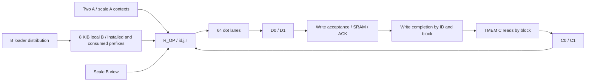

# blackwell_tc_mma_core

## Description

Core i handles global rows 32i…32i+31 and all N columns. Issue order is (cmd,j,r), with four eight-row groups r in each block j. The core owns A, B, C, D, scale A, R_OP, and local write accounting. All four cores use the [engine](blackwell_tc_mma_engine.md) for command order and partition selection.

| Signal / channel | Direction, type / width | Peer | Handshake or sampling condition |
| --- | --- | --- | --- |
| prepare / b_select | Input [prepare_t](blackwell_tc_mma_engine.md#engine-ports) / [b_select_t](blackwell_tc_mma_engine.md#engine-ports), 449/63 bits | MMA engine | From the engine. Bind by rec, ID, and bank and initialize only this command. Normal b_select follows prepare. |
| first_id / first_ready / launch | Input {valid1,id58} / output bit / input bit | MMA engine | Check first microtile of selected new ID, previous final microtile loaded, old R_OP able to issue, and dot family eligibility. Shared launch loads the first microtile on all four cores on one edge. |
| input_free[3] / writes_done[3] / local_done | Output, 1 bit / 1 bit per rec, plus one op_done_t62 | MMA engine | Sample input release and write completion levels per rec. Final handshake carries original ID. |
| live[3] / older_writes_clear[3] | Input, 61 / 4 bits per entry | MMA engine | live={valid1,rec2,id58}. The permissions cover A, scale A, scale B, and offset-overlapping C/D respectively. The engine uses the scale B permission. [engine interface](blackwell_tc_mma_engine.md#engine-ports) |
| data | Input [b_data_t](blackwell_tc_b_loader.md#types), 2111 bits | B loader | Loader destination for this core. Match b_select by ID/j. Write the block only on fire. Pack eight consecutive 32 B logical columns from the low bits in column order. |
| sm_rd_req/sm_rd_rsp[8], tm_rd_req/tm_rd_rsp, tm_wr_req/tm_wr_ack[128] | Request outputs, response inputs. SMEM reads 126/210 bits, TMEM reads 108/210 and writes 236/82 bits | SMEM, TMEM fabric | client=i. Index SMEM by 16 B atom group and TMEM by lane. Retain tag through delivery. |
| sb_query / sb_view, operand / cmd_i / result / empty_o | Query output/view input 72/257 bits. operand/cmd_i outputs 6732/446 bits. result/empty_o inputs 2124/1 bits | scale B snapshot, dot array | Combinational scale lookup by ID. Select arithmetic control by R_OP.tag.id and handshake with the input. |
| clk, rst_n, epoch_i / idle_o, drained_o, fault_o | epoch_i input u16, clock and reset bit inputs, status bit outputs | MMA engine, top level | Reset clears control and valid bits. The engine has authority to clear static B residency. |

The [top-level common protocol](../top/blackwell_async_subsystem_top.md#common-protocol) defines clock, reset, and channel sampling.

## Functionality

### Input contexts and local state

Each input context has A=1 KiB (four 256 B row groups) and scale A=128 B. B has 16 128-bit pieces ×32 blocks. C and D each have two 1 KiB slots of 32 rows ×8 columns. A/B/C/D total 14,336 B per core. One R_OP holds tc_operand_t={a[8][32 B],b[8][32 B],c[64][32 bit],sa[8][4 B],sb[8][4 B]}, 832 B. Order r/c results by 8×r+c and zero unused scale bytes. Its separate 76-bit tile_tag_t={id58,core2,block6,row2,generation8} uses generation=block//2. Allocate the two input banks independently of the three command records. Keep write address, mask, and pending state under the original ID through its tail. A new input cursor cannot reconstruct control for an old result.

### A, B, and final reads

Sample A according to the [engine matrix descriptor](blackwell_tc_mma_engine.md#matrix-descriptor) or [TMEM layout](../tmem/blackwell_tmem_fabric.md#tmem-layout) and pack 32 B per row in logical K order. SMEM A follows the B loader for FP4/FP6 extraction, padding, and zero extension. For ordinary E2M1 in TMEM A, extract byte[5:2] into destination byte[3:0] and clear the high four bits. For FP6 take the low six bits and clear the high two. Native FP4 remains in contiguous nibbles. Preserve other input encodings and leave negate to the dot array. Each 16 B A destination piece enumerates up to 16 source atoms independently, deduplicating within a piece and permitting rereads across pieces. `token={kind3=1,block5,piece4,part4}`. Piece number f=2×local_row+half, block=f//16, piece=f%16, and part numbers follow increasing source address.

Per input context, A required/sent/completed each use up to 64×16 bits and piece valid uses 64 bits. Lock held requests separately per bank. Each A piece accepts one source return per edge, choosing the lowest bank index and holding unselected responses. Different pieces can write concurrently. Use the loader's patch/bit_en rules. The command's source set is finite, so unlimited new low-bank traffic cannot starve a high bank. A uses either SMEM or TMEM exclusively. For TMEM prioritize held requests, then C, scale A, and A. Only A requests SMEM. Within each group order candidates by command age, row group, half, piece, and part. Set sent only on req_fire and completed only on matching ret_fire.

TMEM delivers each atom on its request lane. All parts of a nontransposed A piece use one lane. A transposed piece covers 16 consecutive bytes of 8-, 16-, or 32-bit containers and spans at most 16 consecutive lanes. Native packed FP4 uses nontransposed A. The two scale rows sharing a token prefix use adjacent lanes. Thus lane L need only compare the destination token prefix against valid returns on the preceding 15 physical lanes, including across partition boundaries. The lowest lane for each destination can fire on the same edge. Each accepted return still undergoes the ID, client, status, token, lane and outstanding-request checks.

For scale A use the [common snapshot scale formula](blackwell_tc_scale_b_snapshot.md#scale-layout) with x=32i+local_row, source lane=x%32, and column=base+x//32. Each row uses at most one source atom. Copy selected bytes s…s+V−1 to g=0…V−1 in the row and zero the rest. Use token kind3, block0, piece=local_row//2, part=local_row%2. needed/sent/completed are 32 bits each. Only a successful return sets valid. If TMEM A/scale sources overlap this command's D, sample them completely before its first issue.

C reads use kind2, block=j, piece=local_row//2, and part=3×(local_row%2)+word_slice. word_slice0…2 covers eight unaligned cells. Each of the two C slots has up to 32×3 bits each for needed/sent/completed. On each free lane request port the core selects the earliest needed eligible C read. Only a successful matching return sets completed. Non-OK status or an unknown token raises fault.

Set A_ready[r] only after all 16 destination pieces for row group r succeed. Do not issue a source read before its dependency clears and pin succeeds. Scaled instructions wait for their full scale. If this command's D can overwrite its own TMEM A/scale, all four cores must finish snapshotting the affected sources before launch. The engine combines first_ready across cores so a cross-core write cannot precede a slow core's sample.

To reuse a newly released A bank, when prepare.valid is asserted and the core has independent space, form the first SMEM A group candidates combinationally from the prepare payload. They can enter fabric.R_BREQ on prepare.fire. prepare.ready depends only on local capacity, independently of SMEM ready. Merge pieces accepted on this edge into the initial mask. Latch presented but unaccepted selections by group under the original rec for the next edge, preventing loss or duplicate issue. Subsequent requests use registered records.

After binding B to base_part, physical block p=8×base_part+j. Pre-edge installed counts consecutive successfully installed blocks, or J on a hit. Accept data only for the next j=installed. Write the whole block in [loader output wire order](blackwell_tc_b_loader.md#delivery) and consume directly by column. For an overlap with a physical range still consumed by an older live ID, assert ready only when p−old_base_block < old_consumed. old_consumed reaches j+1 only after old op_load(j,3), with no same-edge bypass of the new watermark. Combinational reads and writes of different blocks can coincide. Old R_OP already holds its copy. Assert input_free after this command's final op_load and settlement of all source reads and control for that bank. Retain the record's write tail.

### C dependencies and R_OP issue

Tag each C slot with (id,j) and use needed/sent/completed for up to three words per row. Look ahead two blocks in execution order. From empty, bind blocks 0/1 of the oldest command. Each op_load(j,3) copies the old data to R_OP and can reserve the slot for the block two positions ahead and issue its first read on the same edge. Every J is even, so the last two slots pass to blocks 0/1 of the next command. If the successor is not prepared, release the slot and reserve later. Reservation and old op_load are independent of new read ready. Check held requests and returns by full ID/token. input_d=0 binds and injects zero.

For block j with the same Dbase and input_d=1, check local write completion for each older record covering that block. Issue the read only after writes_closed[id,j] and successful retirement of every actual pending write. A disjoint read can proceed. Offset overlap and cross-core A/scale sources use the engine's conservative older_writes_clear. Only a successful ACK clears actual write pending. A fully write-disabled block closes when its last result is captured, leaving the stored value available to read.

The read enable for a local B block and the 2048-bit write enable for `R_OP.b` both equal `op_load && r==0`, where `op_load` denotes an actual load on this edge and `r` is the incoming microtile's row group. The first group of each `(id,j)` reads 256 B from the installed physical block. The next three groups load only their A, C, scale, and tag and reuse `R_OP.b`. Even if the previous microtile has issued and R_OP.valid is temporarily 0, hold B until the next first-group load. The first group of a new instruction always loads B, even on a WS hit to the same physical block. When old `dot_fire` coincides with loading a new block's first group, the dot samples pre-edge B and the new B supplies the new microtile after the edge.

op_load requires A_ready[r], installed>j, valid C owned by (id,j), required scale ready, and R_OP empty or able to issue this edge. The first microtile also requires launch. For any family the previous final dot_fire can coincide with the next first op_load. The new R_OP carries its own ID/mode. The array selects results in issue order. All four cores load their first microtile together and can stall independently afterward.

### D writeback and completion

A D result may enter only slot=j%2 that was empty before the edge or a slot matching the original (id,j,generation) that has not yet received r. Once all four microtiles arrive, write the actual lanes/words. An ordinary unaligned block needs up to three frames. token={kind3=0,block5,word_slice3,lane_local5}. Each live rec maintains writes_closed for up to 32 blocks and 32×3×32 pending bits, set/cleared on actual wr_fire/ack.fire. Skip fully disabled writes. New writes at the same column base wait for overlapping older blocks to close and settle. Offset overlap waits for all relevant older writes. Reuse D payload after its final write acceptance. ACK clears the original rec's bit. Normal writes_done requires all blocks closed and all pending bits clear.

Each rec counts microtiles from R_OP load to result capture (up to R_OP plus six stages, seven entries, 3 bits). Combine concurrent increment and decrement. local_done waits for this ID's inputs to close, read responses to drain, in-flight count to reach zero, and writes to finish. The shared output selects the oldest eligible settled, unreported rec on this core. Lock ID/status under backpressure. After fire keep it marked reported until rec changes owner. Unknown, duplicate, or non-OK returns raise fault. stop/epoch follow the top-level drain contract.

Each core retains its unconsumed B block. Its earliest overwrite is the edge after its final `op_load(j,3)`, even if the other cores have advanced. It reads B once per block and reuses the registered value for all four issues. See the [top-level N128 timing example](../top/blackwell_async_subsystem_top.md#cycles) for the C-read and D-write dependencies.

## Submodules

| Submodule | Instances | Connections and parent control |
| --- | --- | --- |
| [tc_dot_array](blackwell_tc_dot_array.md) | 1 | The core issues from R_OP and sends each tagged result microtile to the matching generation of its D slot. |
