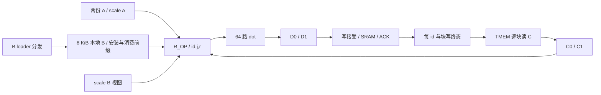

# blackwell_tc_mma_core

## Description

核 i 负责全局行 32i…32i+31、全部 N 列。发射顺序为 (cmd,j,r)，每块 j 有四个八行组 r。核拥有 A、B、C、D、scale A、R_OP 及本核写记账；四核共用 [engine](blackwell_tc_mma_engine.md) 的命令序和分区决定。

| 信号 / 通道 | 方向、类型 / 位宽 | 对端 | 握手或采样条件 |
| --- | --- | --- | --- |
| prepare / b_select | 入 [prepare_t](blackwell_tc_mma_engine.md#engine-ports) / [b_select_t](blackwell_tc_mma_engine.md#engine-ports)，449/63 bit | MMA engine | 来自 engine，按 rec、id 和 bank 绑定，仅初始化本条。正常 b_select 需先 prepare。 |
| first_id / first_ready / launch | 入 {valid1,id58} / 出 bit / 入 bit | MMA engine | 检查所选新 id 的首片、上条末片已装载、旧 R_OP 可出、dot 族门限。四核 launch 同沿装首片。 |
| input_free[3] / writes_done[3] / local_done | 出，各 rec 1 bit / 1 bit，另有单路 op_done_t62 | MMA engine | 每 rec 的输入释放和写终结按电平采样，最终握手带原 id。 |
| live[3] / older_writes_clear[3] | 入，每项 61 / 4 bit | MMA engine | live={valid1,rec2,id58}；许可位分别对应 A、scale A、scale B、偏移交叠 C/D。scale B 许可在 engine 使用。[engine 接口](blackwell_tc_mma_engine.md#engine-ports) |
| data | 入 [b_data_t](blackwell_tc_b_loader.md#types) 2111 bit | B loader | loader 的本核目的口，按 id/j 匹配 b_select。实际 fire 才写块，八个连续的 32 B 逻辑列按列号从低位排起。 |
| sm_rd_req/sm_rd_rsp[8]；tm_rd_req/tm_rd_rsp、tm_wr_req/tm_wr_ack[128] | 请求出、回复入，SMEM 读 126/210 bit，TMEM 读 108/210、写 236/82 bit | SMEM、TMEM fabric | client=i。SMEM 按 16 B atom 组号，TMEM 按 lane，tag 保持到交付。 |
| sb_query / sb_view；operand / cmd_i / result / empty_o | 查询出/视图入 72/257 bit；operand/cmd_i 出，6732/446 bit；result/empty_o 入，2124/1 bit | scale B snapshot、dot array | 组合读取指定 id 的 scale；按 R_OP.tag.id 选算术指令控制并随输入握手。 |
| clk、rst_n、epoch_i / idle_o、drained_o、fault_o | epoch_i 入 u16，时钟、复位为输入 bit，状态为输出 bit | MMA engine、顶层 | reset 清控制与有效位；清静态 B 驻留的权限归 engine。 |

时钟、复位及通道的采样约定见[顶层公共协议](../top/blackwell_async_subsystem_top.md#common-protocol)。

## Functionality

### 输入上下文与本地状态

每个输入上下文 A=1 KiB（四个 256 B 行组）、scale A=128 B。B=16 个 128-bit piece ×32 块；C/D 各两个 1 KiB 槽，每槽 32 行×8 列。每核 A/B/C/D 合计 14,336 B。R_OP 一项 tc_operand_t={a[8][32 B],b[8][32 B],c[64][32 bit],sa[8][4 B],sb[8][4 B]}，832 B，r/c 结果按 8×r+c 排列，未用 scale 字节置零；外加 tile_tag_t={id58,core2,block6,row2,generation8} 共 76 bit，generation=block//2。两输入 bank 与三个命令记录分别分配；尾部保留原 id 的写地址、mask 和 pending，不能用新输入游标重建旧结果的控制。

### A、B 与末次读取

A按[engine矩阵描述符](blackwell_tc_mma_engine.md#matrix-descriptor)或[TMEM布局](../tmem/blackwell_tmem_fabric.md#tmem-layout)采样，以逻辑K排列每行32 B。SMEM A的FP4/FP6提取、padding和扩展零规则与B loader一致。TMEM A的普通E2M1从byte[5:2]提取后放入目的byte[3:0]，高4bit清零；FP6取低6bit、高2bit清零；native FP4仍按连续nibble存放。其余输入编码保持，negate交给dot。A的每个16 B目的片独立枚举最多16个源atom，片内去重，跨片可重读；`token={kind3=1,block5,piece4,part4}`，片号f=2×local_row+half，block=f//16、piece=f%16，part为源地址递增编号。

每输入上下文的 A required/sent/completed 各最多64×16bit、片valid64bit；held请求另按bank锁定。每A片同沿只接受一个源返回，取最低bank号，未选响应保持；不同片可并行写。采用loader相同patch/bit_en规则；本命令源集合有限，不因低bank新无限流量饿死高bank。A来自SMEM或TMEM二选一，不同时驱动两个源。TMEM请求held优先，其次C、scale A、A；SMEM只有A候选，同组按命令年龄、行组、half、片、part 升序。sent只在req_fire，completed只在匹配ret_fire置位。

scale A按[snapshot中的公共scale公式](blackwell_tc_scale_b_snapshot.md#scale-layout)，x=32i+local_row，source lane=x%32、column=base+x//32。每行最多一个源atom，selected s…s+V−1字节写入该行g=0…V−1；其余清零。token kind3、block0、piece=local_row//2、part=local_row%2。needed/sent/completed各32bit；仅成功返回能置有效位。TMEM A/scale 源与本条 D 重叠时须在本条首发前完整采样。

C读kind2，block=j、piece=local_row//2、part=3×(local_row%2)+word_slice；word_slice0…2覆盖非对齐8个cell。两个C槽各自needed/sent/completed最多32×3bit。本核在每个空闲 lane 请求口从满足依赖的 C 中选最早待用的一笔。仅成功匹配的返回可置 completed；非 OK 或未知 token 报 fault。

行组 r 的 16 个目的片全部成功才置 A_ready[r]。源依赖或 pin 尚未消除时禁止发出该项读。scaled 指令等本条完整 scale；自身 TMEM A/scale 可能被本条 D 覆盖时，四核全部相关源需完成快照才可 launch。engine 汇合各核 first_ready，跨核写不会跑在慢核采样前面。

为复用刚释放的 A bank，若 prepare.valid 且本核已有独立空位可接收，则首组 SMEM A 候选可由 prepare 载荷组合形成，在 prepare.fire 同沿进入 fabric.R_BREQ。prepare.ready 仅看本核容量，不依赖 SMEM ready。初始化掩码时合入本沿已接受片；已展示未接受的按组锁存到原 rec，下一沿继续，从而避免漏发或重发。普通后续请求按已登记记录发出。

B 绑定 base_part 后，物理块 p=8×base_part+j，沿前 installed 表示已成功安装的连续块数，hit 时为 J。data 只接受下一块 j=installed，按 [loader 输出线序](blackwell_tc_b_loader.md#delivery)整块写入，core 直接按列消费。与 live 中更老 id 尚在消费的物理范围重叠时，只有 p−old_base_block < old_consumed 才置 ready。old_consumed 仅在旧 op_load(j,3) 后变为 j+1，同沿不用新水位旁路。不同块组合读与写可并行。旧 R_OP 已持有数据副本。在本条最后一次 op_load 且该 bank 全部源读及控制已结清后置 input_free；记录内的写尾保留。

### C 依赖和 R_OP 发射

C 槽带 (id,j)、每行最多三个 word 的 needed/sent/completed。按执行序列向前看两块。空机先绑定最老命令块 0/1；每次 op_load(j,3) 把旧数据复制入 R_OP，并可同沿给相隔两块的后继预留该槽和发其首读。所有 J 都是偶数，末两次分别接后条块 0/1。后继尚未 prepare 时先释放，等可用时再预留。预留与旧 op_load 不依赖新读 ready，held 请求和返回用完整 id/token 检查。input_d=0 绑定并注零。

同 Dbase 且 input_d=1 的块 j 对每条更老且覆盖该块的记录逐一检查本核写终态。只在 writes_closed[id,j] 且对应实际 pending 全清且成功后发读。没有交叠即可读；偏移重叠或跨核的 A/scale 源使用 engine 的保守 older_writes_clear。只有成功 ACK 清实际写 pending。全禁写块在最后结果捕获时关闭，存储原值可读。

每核本地 B 块的读使能和 `R_OP.b` 的 2048-bit 写使能均为 `op_load && r==0`，其中 `op_load` 表示本沿实际装片，`r` 取待装微块的行组号。每个 `(id,j)` 的首组从已安装的物理块读 256 B；后三组只装本片的 A、C、scale 和 tag，沿用 `R_OP.b`。即使前一片已发射、R_OP.valid 暂时为 0，B 数据仍保持到下次首组装入。换指令时首组照常装 B，包括 WS 命中同一物理块的情况。旧片 `dot_fire` 与新块首组装入同沿时，dot 采样沿前的 B，新 B 在沿后供新片使用。

op_load 要求 A_ready[r]、installed>j、C owner=(id,j) 且有效、必要 scale 就绪，以及 R_OP 空或本沿可输出；首片另需 launch。前条末片 dot_fire 与后条首片 op_load 可同沿，适用于全部算术族；后条 R_OP 自带 id/mode。阵列按发射顺序选回结果。四核首片同沿装入，其后允许各核独立停顿。

### D 写回、完成与验证

D 输出只能落入沿前已空的 slot=j%2，或匹配原 (id,j,generation) 且未收过该 r 的槽。四片收齐后按真实 lane/word 写回；普通非对齐块最多三帧。token={kind3=0,block5,word_slice3,lane_local5}。每个 live rec 维护最多 32 块的 writes_closed 和 32×3×32 个 pending 位，按实际 wr_fire/ack.fire 置/清。全禁写省略写。相同列基址的新写须等重叠旧块关闭并结清，偏移交叠等较老有关写全部结清。D 最后写接受后即可复用 payload，ACK 清原 rec 的位。正常 writes_done 要求所有块关闭且 pending 全清。

每 rec 从 R_OP 装载到结果捕获维护在途微块计数（最多 R_OP 加最深 6 级，共 7 项，3 bit）；同沿增减合并。local_done 等本 id 输入关闭、读响应排空、在途数为零、写终结。共享出口选本核已结清且未报告的最老合格 rec，背压锁住 id/status；fire 后记已报直到该 rec 换 owner。未知、重复或非 OK 返回置 fault。stop/epoch 遵循顶层排空合同。

令旧 N256 和新 N256 复用同一 B 范围，暂停一核的末次 op_load。该核必须保持尚未消费的字节，到实际 `op_load(j,3)` 的下一沿才接受覆盖。验收时为不同 B 块填不同值，在首组发射与第二组装入之间插入空拍，核对四次发射的 B 和 tag，并检查每块只有一次本地 B 读使能和一次 `R_OP.b` 写使能。完整 N128 指令每核发 64 片、读 16 块，四核本地 B 读取量共 16 KiB。R_OP、D 槽及写端口分别施加背压，验证载荷保持和每块的实际写集合。另测 TMEM A/scale 自覆盖、偏移重叠及全禁写。

在[顶层同址累加基准](../top/blackwell_async_subsystem_top.md#cycles)中每次只推迟一个事件，其余输入和槽位均及时就绪。把旧块 0 的成功 ACK 推迟至 64，后条 C0 最早 65 grant。只推迟旧末块 ACK 至 80，后条仍在 64 首发。只推迟 C1 的最后返回至 70，后条块 1 最早在 72 首发。另推迟旧 D 末笔写接受，核对 payload 释放沿和旧 ACK 的归属。[非均匀复算向量](../top/blackwell_async_subsystem_top.md#mma-vectors)

## Submodules

| 子模块 | 实例数 | 连接与父模块控制 |
| --- | --- | --- |
| [tc_dot_array](blackwell_tc_dot_array.md) | 1 | core 以 R_OP 发片，将返回的带 tag 微块送到对应代的 D 槽。 |
