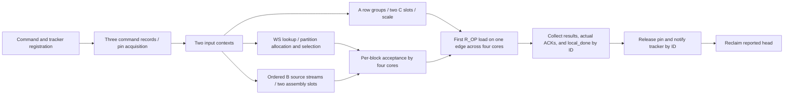

# blackwell_tc_mma_engine

## Description

One engine per SM manages three ordered MMA command records, four [cores](blackwell_tc_mma_core.md), a shared [B loader](blackwell_tc_b_loader.md#types), and [scale B snapshot](blackwell_tc_scale_b_snapshot.md). Reclaim records in acceptance order and notify completion as each ID finishes. Release either input context once its sources have been used for the last time and issued reads have settled. The engine coordinates first-microtile loading across four cores. Each core advances independently afterward.

<a id="engine-ports"></a>

| Signal / channel | Direction | Type / width | Peer | Sampling condition |
|---|---|---|---|---|
| `cmd` | Input | [mma_cmd_t](#mma-command) (446 bits) | Warp front end | On `cmd.fire`, register atomically with tracker.register_op. |
| `done` | Output | [op_done_t](../top/blackwell_async_subsystem_top.md#identity) (58 bits) | TC tracker | On `done.fire`, report a terminal, unreported ID and hold its selection under backpressure. |
| `pin_req` | Output | 61 bits | TMEM manager | On `pin_req.fire`, request the [fixed user](../tmem/blackwell_tmem_manager.md#management-types) for the physical record in command order. |
| `pin_rsp` | Input | 58 bits | TMEM manager | On `pin_rsp.fire`, record pin acquisition for the returned ID. |
| `unpin` | Output | 61 bits | TMEM manager | On `unpin.fire`, release the settled ID’s reference. |
| `live_o[3]` | Output | 61 bits per entry (1-bit valid, 2-bit record, 58-bit ID) | SMEM/TMEM fabrics and engine children | Level. Acceptance order, oldest at the head. |
| `tc_smem_req` | Output | [smem_rd_req_t](../smem/blackwell_smem_fabric.md#transactions) (126 bits) | SMEM fabric | Eight independent group handshakes per engine port. Ports 0…3 serve the cores. Port 4 serves the B loader and maps to fabric client 6. |
| `tc_smem_rsp` | Input | [smem_rd_rsp_t](../smem/blackwell_smem_fabric.md#transactions) (206 bits) | SMEM fabric | On the addressed port’s handshake, accept the matching return by group and tag. |
| `tc_rd_req` | Output | [tmem_rd_req_t](../tmem/blackwell_tmem_fabric.md#transactions) (108 bits) | TMEM fabric | 128 independent lane handshakes per client. Clients 0…3 serve the cores and client 4 serves scale B. Each core selects its C reads locally. |
| `tc_rd_rsp` | Input | [tmem_rd_rsp_t](../tmem/blackwell_tmem_fabric.md#transactions) (206 bits) | TMEM fabric | On the addressed port’s handshake, accept the tagged return on its lane. |
| `tc_wr_req` | Output | [tmem_wr_req_t](../tmem/blackwell_tmem_fabric.md#transactions) (236 bits) | TMEM fabric | On each lane handshake, issue the write from core client 0…3. Read-only scale client 4 holds write valid low. |
| `tc_wr_ack` | Input | [tmem_wr_ack_t](../tmem/blackwell_tmem_fabric.md#transactions) (78 bits) | TMEM fabric | On the addressed port’s handshake, accept the acknowledgment of the original write. |
| `clk` | Input | 1 bit | Top level | Rising edge samples synchronous state. |
| `rst_n` | Input | 1 bit | Top level | Sample low on a rising edge to reset control. |
| `epoch_i` | Input | 16 bits | Top level | Level identifying the active CTA lifetime. |
| `stop_i` | Input | 1 bit | Top level | Level closing new commands. Accepted IDs continue to completion. |
| `idle_o` | Output | 1 bit | Top level | Level indicating idle execution. |
| `drained_o` | Output | 1 bit | Top level | Level asserted when the scheduler has no live records and all cores, the loader and the snapshot are drained. |

The following internal channels connect the command scheduler to the execution units. Directions are relative to the scheduler.

| Signal / channel | Direction | Type / width | Peer | Sampling condition |
|---|---|---|---|---|
| `prepare[4]` | Output | [prepare_t](#engine-ports) (449 bits) | Four cores | On `prepare.fire`, bind each core independently to a record (0…2), input bank and command. |
| `b_select[4]` | Output | [b_select_t](#engine-ports) (63 bits) | Four cores | On `b_select.fire`, select the base partition, size and reuse flag for the ID at each core. |
| `first_id` | Output | 59 bits (valid and 58-bit ID) | Four cores | Level. Identify the oldest eligible unlaunched command. |
| `launch` | Output | 1 bit | Four cores | Pulse to load the first microtile on all four cores together. |
| `first_ready[4]` | Input | 1 bit per core | Four cores | Level. Evaluate the selected ID, available operands, issue order and R_OP space independently of launch. |
| `input_free` | Input | 4 × 3 bits | Four cores | Level. Sample source release per core and record. |
| `writes_done` | Input | 4 × 3 bits | Four cores | Level. Sample settlement of actual writes per core and record. |
| `local_done[4]` | Input | op_done_t (58 bits per core) | Four cores | On `local_done.fire`, accept completion by ID. |
| `older_writes_clear[3]` | Output | 4 bits per record | Four cores | Level. Gate TMEM A, scale A, scale B and offset-overlapping C/D against older unsettled writes. Write-after-write waits only for prior writes to settle. The engine gates snapshot.start with the scale B permission. |
| `start` | Output | prepare_t (449 bits) | Scale B snapshot | On `start.fire`, start the permitted scale B snapshot. |
| `release` | Output | async_id_t (58 bits) | Scale B snapshot | On `release.fire`, release the matching snapshot. |
| `ready` | Input | 3 bits | Scale B snapshot | Level. Read snapshot availability by record. |
| `quiescent` | Input | 3 bits | Scale B snapshot | Level. Sample before releasing the input context. |
| `load` | Output | [b_load_t](blackwell_tc_b_loader.md#types) (132 bits) | B loader | On `load.fire`, start one load per miss. Data goes directly from loader to cores. |
| `result` | Input | [b_result_t](blackwell_tc_b_loader.md#types) (58 bits) | B loader | On `result.fire`, record that every core accepted the load’s final block. |



## Functionality

Match requests and results by the full 58-bit ID. Array indices select wiring only. [Top-level handshake](../top/blackwell_async_subsystem_top.md#common-protocol)

<a id="mma-command"></a>

### MMA commands and legal combinations

[Supported PTX](../../proposals/supported_ptx.md) defines instruction scope. One thread issues one `cta_group::1` MMA. The front end supplies the normalized `mma_cmd_t` below. M=128, kind determines K, and D and C share a TMEM base address. `enable-input-d` is a runtime predicate.

#### Normalized interface

`mma_cmd_t` is **446 bits**. Pack the table from high to low. Low array indices occupy low bits.

| Fields | bit | Semantics |
|---|---:|---|
| id | 58 | [Asynchronous identity](../top/blackwell_async_subsystem_top.md#identity) |
| kind | 3 | 0 f16, 1 tf32, 2 f8f6f4, 3 i8, 4 mxf8f6f4, 5 mxf4, 6 mxf4nvf4 |
| a_type, b_type | 4+4 | 0 FP16, 1 BF16, 2 TF32, 3 E4M3, 4 E5M2, 5 E3M2, 6 E2M3, 7 E2M1, 8 S8, 9 U8 |
| n_code | 2 | 0→64, 1→128, 2→256, 3 invalid |
| a_from_tmem, ws, input_d | 1 bit each | A source, instruction form, whether to read C |
| transpose_a, transpose_b, negate_a, negate_b, int_sat | 1 bit each | Major order, sign modifiers, integer saturation |
| scale_input_d | 4 | Exponent for scaling C by a negative power of two, 0 for identity |
| collector_op, collector_buffer | 2+2 | op=0 discard, 1 fill, 2 use, 3 lastuse. Ordinary A uses buffer=0. WS B uses buffer=b0…b3 |
| disable_lane_mask | 128 | Physical lane write-disable bits, 1 preserves old D |
| scale_type, scale_vec, scale_a_id, scale_b_id | 1+2+2+2 | type=0 UE8M0, 1 UE4M3, vec=0 none, 1 1X, 2 2X, 3 4X |
| a_ref, b_desc | 64 each | For SMEM A, a_ref is a descriptor. For TMEM A, the upper 32 bits of a_ref are zero and the lower 32 bits are taddr. B always uses [SMEM descriptor](blackwell_tc_mma_engine.md#matrix-descriptor) |
| d_tmem, scale_a, scale_b | 32 each | See [scale layout](blackwell_tc_scale_b_snapshot.md#scale-layout) for taddr, scale addresses, and IDs |

The front end supplies the supported M/N/K, dense form, D dtype, reserved-bit values and operand combinations. Simulation assertions check these preconditions on the raw descriptor before narrowing.

#### Command preconditions

The supplied kind, N, dtype, ordinary/WS form, scale, and modifiers satisfy the [dense MMA support table](../../proposals/supported_ptx.md#dense-mma). Expand SMEM major order and containers according to [matrix descriptor](#matrix-descriptor) and TMEM sources according to [TMEM layout](../tmem/blackwell_tmem_fabric.md#tmem-layout).

- `input_d=0` injects +0. The dot adapter applies floating-point negate. The i8 path passes both signedness controls and the final saturation bit. Compute microtiles even for write-disabled lanes. An empty destination set closes its write obligation after all valid microtiles arrive.
- Unscaled commands have all scale fields zero. For scaled commands both taddr upper halves are zero. For 1X the ID is 0…3, for 2X it is 0 or 2, and for 4X it is 0. Omitted WS operands and operands verified equivalent to no mask and zero offset normalize to the same command.
- Every TMEM cell the instruction accesses belongs to a live allocation. Simulation assertions check the expanded addresses against SMEM bounds or the live TMEM allocation at the corresponding access. Fetch A for the row group, B/C for the column block, and the required scale. Read C before the first overwrite of old data in its output block.

[PTX 8.7 Table 39](https://docs.nvidia.com/cuda/archive/12.8.2/parallel-thread-execution/index.html#tcgen05-kind-shapes) · [Table 54](https://docs.nvidia.com/cuda/archive/12.8.2/parallel-thread-execution/index.html#tcgen05-mma-scale-valid-comb-detail)

<a id="matrix-descriptor"></a>

### Matrix descriptors and address generation

`matrix_desc_t` is 64 bits and uses the relative-stride layout of [PTX 8.7 tcgen05 descriptor](https://docs.nvidia.com/cuda/archive/12.8.2/parallel-thread-execution/index.html#tcgen05-matrix-descriptors). The formulas below are the complete address functions for supported project layouts. Use 64-bit extended precision for address addition. See below for signed differences in pattern recovery. Legal descriptors produce addresses within SMEM bounds before narrowing.

#### Encoding

| bit | Fields | Decode |
|---|---|---|
| 13:0 | start | Byte start address = field<<4 |
| 15:14 | reserved | 0 |
| 29:16 | LBO | Leading byte offset = field<<4 |
| 31:30 | reserved | 0 |
| 45:32 | SBO | Stride byte offset = field<<4 |
| 48:46 | fixed | 001 |
| 51:49 | base | Swizzle base offset = field<<7 |
| 60:52 | reserved | 0 |
| 63:61 | mode | 0 disables swizzle, 1 selects 128 B/32 B atomic, 2 selects 128 B, 4 selects 64 B, 6 selects 32 B. Others invalid |

Use the PTX 8.7 descriptor encoding. With swizzle disabled, base must be 0. For nonzero swizzle, base is the 128 B phase of the repeating pattern's origin and is retained as the subblock start moves. It does not replace the subblock offset. Modes 1/2, 4, and 6 have periods of 512/1024, 512, and 256 B respectively. Retain the full 3-bit base encoding (times 128). The recovered pattern below must be nonnegative. For shorter periods, phase encodings one period apart may describe the same permutation. Each expanded 16 B source atom must lie within the 228 KiB SMEM.

#### Address function

Let `r` be the logical M/N row and `z` the physical byte coordinate along K. For MN-major pass `r=MN physical byte coordinate, z=K element index`. First form these coordinates from transpose and packing, then apply the formulas below.

```text
W = {mode0:16, mode1:128, mode2:128, mode4:64, mode6:32}
X = {mode0:0,  mode1:0x60,mode2:0x70,mode4:0x30,mode6:0x10}
if K_major:
    o = (r % 8)*W + (r // 8)*SBO
    o += (z % 16) + (z // 16)*LBO if mode==0 else z
elif mode==0:
    o = (r % 16) + (r // 16)*SBO + (z % 8)*16 + (z // 8)*LBO
else:
    H = 4 if mode==1 else 8
    o = (r % W) + (r // W)*LBO + (z % H)*W + (z // H)*SBO
if mode==0:
    addr = start + o
else:
    period = {mode1:512, mode2:1024, mode4:512, mode6:256}[mode]
    pattern = floor((start - base) / period)*period + base
    delta = start - pattern
    u = base + delta + o
    addr = pattern - base + (u XOR ((u >> (2 if mode==1 else 3)) AND X))
```

`start` is the submatrix origin in canonical unswizzled coordinates. Compute intermediate differences for `start−base` in extended signed precision, with floor toward negative infinity. Legal descriptors yield a nonnegative pattern. Add subblock delta **before** XOR. Do not compute `start+swizzle(o)`. The project's position-dependent swizzle is equivalent to applying the corresponding XOR to absolute `start+o`. The absolute coordinate already includes base phase. Do not apply it twice. This order agrees with address addition followed by swizzle in [NVIDIA CuTe swizzle pointer](https://github.com/NVIDIA/cutlass/blob/main/include/cute/pointer_swizzle.hpp). Keep both base and start in collector identity.

TMA's [SMEM panel layout](../tma/blackwell_tma_setup.md#tensor-map) applies the same absolute-coordinate swizzle. With 128 B swizzle, stage=0, K-major, SBO=1024, start=32, and n=2/k_local=0, the result is `swizzle(32+256)=256`. For a nonzero phase with stage=128, base=128, and start=160, the same element gives `swizzle(416)=400`. Compute the byte address before SMEM's 4 B interleaved bank mapping. Matrix swizzle and physical bank routing are separate operations.

#### Effective fields and major order

For SMEM A/B let e be the element index in the contiguous dimension. FP16/BF16, TF32, i8, and FP8 use bit_offset=e×bits. For 4/6-bit types in f8f6f4/mxf8f6f4, each 16-element group occupies one 16 B container and bit_offset=128×floor(e/16)+(e%16)×bits. The first 8 B or 12 B contain data. Ignore the remaining bytes. Native FP4 uses bit_offset=4e. Adjacent nibbles share a byte with the lower index in the low nibble. Assemble 6-bit fields crossing a byte boundary in little-endian bit order.

For K-major use e=k, r=m or n, and z=floor(bit_offset/8). For MN-major use e=m or n, r=floor(bit_offset/8), and z=k. Apply the address function to each covered byte. Merge fields in one atom into the actual mask. PREP uses these addresses to assemble logical A rows or B columns. See [core](blackwell_tc_mma_core.md) for the resulting encoding. [TMEM layout](../tmem/blackwell_tmem_fabric.md#tmem-layout) defines TMEM A containers.

K-major SMEM operands may use the listed swizzles. For MN-major SMEM operands use the actual storage type-size in Table 51. Transposed 32-bit TF32 requires mode1. Transposed 8/16-bit forms allow mode0/2/4/6. Packed 4/6-bit SMEM inputs support only K-major. TMEM A's 8-bit container uses the TMEM layout independently of SMEM physical type-size. Native FP4 forbids transpose. The front end preserves the instantiated descriptor's actual LBO/SBO, start, base, and swizzle. It must not rewrite addresses to fit N or a performance target. [PTX 8.7 Tables 49 and 51](https://docs.nvidia.com/cuda/archive/12.8.2/parallel-thread-execution/index.html#tcgen05-matrices-valid-type-size-majorness-swizzle)

#### PREP baseline layout

The ideal B source is K-major, with 4 KiB aligned start, mode0, LBO=128 B, and SBO=256 B. The 16 source atoms of 16 B per eight-column block form two 128 B halves, each covering all eight atom groups. For column n and byte z=0…31 in its K container:

`addr=start+(n//8)*256+(n%8)*16+(z//16)*128+z%16`.

The engine sends the original b_desc, b_type, kind, and transpose_b with load. For FP16/BF16 MN-major V, the loader enumerates eight successive columns at each K using [full-atom assembly and output wire order](blackwell_tc_b_loader.md#assembly). Compute SMEM grants from actual group indices for each layout. Each core reads installed B on a block's first-group load and supplies the next three groups according to the [core R_OP reuse rules](blackwell_tc_mma_core.md#r-op-b-reuse). Apply the layout before physical bank mapping.

### Command registration, first issue, and completion

Each record stores cmd, order, pin ownership, optional input bank, per-core prepare/select/local_done handshakes, and loader/snapshot start/result/release state. Allocate the lowest free rec and retire from the age-ordered head. Reserve result space before each child request. A stalled old done can fill at most the three records. Accepted younger commands can still issue. Once all four cores report terminal write state for an ID, it satisfies conservative write waits. Each core derives same-address block permission from actual ACKs.

1. For a command accepted at edge c, advance its record to pin eligibility at c+1. The earliest pin request handshake is c+2. The scheduler requests pins in command order. The third command can acquire its pin before binding a data bank. Allocate a free input bank (0/1) to the oldest command awaiting preparation and send prepare. For a scaled source overlapping old D, snapshot start waits for that domain's older_writes_clear. Start A/scale reads for the two contexts, prepare C, and look up B. See [core](blackwell_tc_mma_core.md) for source overlaps and actual ACK requirements.
2. Pass miss descriptors to the loader in program order. Once the previous final block has an assembly slot, the successor can read its source into the other free slot. Actual partition allocation occurs in order after pin acquisition. Reusing the same physical range waits for the previous install to finish. Each core then uses its old-block consumption watermark to determine the overwrite edge while the previous D write tail continues. Source fetch for a new block can precede destination selection. Deliver the four b_select handshakes independently. A core writes a block for the ID only after both prepare and select bind.
3. first_id selects the oldest command in program order that has not launched its first microtile. Assert launch when the ID holds its pin, all cores have prepare/select, required snapshots are ready, and all four first_ready signals are true. For first-block B use actual per-core acceptance. launch loads R_OP and may coincide with old R_OP issue. After the single launch each core advances its own cursor.
4. After all four cores report input_free and any required snapshot is quiescent, release the snapshot and input bank. Old D control can remain live. Each core's local_done waits only for its own ID. Once all started cores report local_done and loader/result, snapshot, and control channels settle, request unpin. Select the shared unpin from ready entries and hold under backpressure. Latch terminal state for this ID on its final resource return edge. The earliest tracker delivery is the next edge. Exclude obligations that never started. stop continues all live IDs. Simulation assertions require each child completion to identify an outstanding obligation of the original record.

### Notification by ID and reclamation in order

Each rec has terminal and reported bits cleared at allocation. The single done port selects the oldest eligible entry satisfying valid && terminal && !reported. Lock the selection and hold the ID under backpressure. Set reported for the matching rec only on done.fire. With continuous ready, different IDs may notify on consecutive edges. While waiting for reclamation, a reported record cannot start work or unpin again. Retain its old write completion state for dependency checks.

Reclaim at most one head per edge if already reported or delivering the head's done on this edge. Reclamation creates no tracker event and may coincide with another ID's done.fire. Settle by pre-edge identity and reinitialize on reuse. If the head is unfinished, a younger reported record still occupies a command slot. Backpressure new instructions when all three fill. Continue notification and reclamation after stop. A held done or any valid command record deasserts drained. Each ID generates exactly one completion notification.

For consecutive N128 bank reuse, suppose the first two instructions issue at 0 and 64. After instruction 0's last op_load at 62, its input_free bits become visible on all four cores. Instruction 2 already holds its pin. At 63 it can handshake prepare and bypass its first A request into R_BREQ on that edge for first grant at 64. Instructions without a snapshot incur no extra release cycle for bank reuse. Instruction 1's launch and instruction 2's prepare use different channels. If commands arrive late, include ingress stalls in the measurement.

<a id="b-residency"></a>

### B residency, read ownership, and replacement

resident[4] is shared within CTA/epoch and indexed by b0…b3. Each entry stores valid, a 90-bit key={epoch16,b_desc64,b_type4,kind3,transpose_b1,n_code2}, base_part2, size_code2, and the last owner's full id58. Each has two LRU bits. Residency control totals 620 bits (4×153+8). Retain no history for evicted names. Each executor latches base/J, name, and owner ID in its own record. Physical snapshot and input banks do not participate in the key.

- Fill, discard, and ordinary forms always fetch from source. Use/lastuse reuse only a complete matching key under the same name. If an older installation of that key is in flight, wait for publication and look up again. A miss rereads normally. On a hit transfer ownership to this ID, update MRU, and send reuse select. Revalidate the selection before first issue. From hit selection to four-core launch, no successor selection can revoke it. Lastuse closes the version to new lookups when it transfers read ownership.
- A single allocator requests contiguous runs of 1/2/4 partitions in order. Replacing a name with fill/discard invalidates the old entry at replacement start. Choose the lowest contiguous free run. If none fits, evict one actual LRU entry per edge and retry on the next. Each core's consumption watermark protects bytes the old instruction still needs even if its temporary range has already been reassigned. Each command has at most one installation in flight. A successor reservation cannot preempt a range whose installation is incomplete.
- A loader result handshake for a WS fill/use miss publishes a complete four-core entry and sets MRU. A lastuse reload is private to this instruction and is released afterward. Ordinary/discard uses a temporary range. Only the matching current owner can invalidate the entry. A final use or late completion cannot clear a later same-name installation. Normal lastuse retains its bound read right. Closing lookup prevents successor hits on that version. Recheck this instruction's bound version for first issue.

### Timing and acceptance

The cold path follows actual availability of the first required row group, first B block, C0, scale, and R_OP space. A hit skips B load/data. If the last required input is captured at h, first R_OP can load at h+1 and first dot can issue at h+2. [Cross-module cycle baseline](../top/blackwell_async_subsystem_top.md#cycles)

Each core reads only installed blocks it has permission to use.

## Submodules

| Submodule | Instances | Connections and parent control |
| --- | --- | --- |
| `blackwell_tc_mma_control` | 1 | The scheduler owns command records, input-bank assignment and B residency. It issues work to the execution units and reports completed IDs to the tracker. |
| [tc_mma_core](blackwell_tc_mma_core.md) | 4 | Independent fills, computation, and writeback. The engine selects the first microtile and input context and collects IDs and terminal write state from all cores. |
| [tc_b_loader](blackwell_tc_b_loader.md) | 1 | The engine dispatches misses. The loader delivers the same eight-column block independently to all four cores. |
| [tc_scale_b_snapshot](blackwell_tc_scale_b_snapshot.md) | 1 | Snapshot using the input bank assigned by the engine. All four cores query by ID. |
