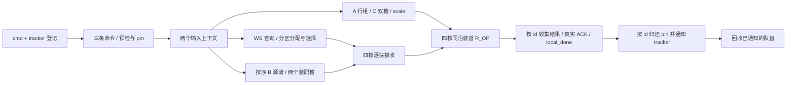

# blackwell_tc_mma_engine

## Description

每 SM 一个 engine 管理三个有序 MMA 命令记录、四个 [core](blackwell_tc_mma_core.md)、共享 [B loader](blackwell_tc_b_loader.md#types) 和 [scale B snapshot](blackwell_tc_scale_b_snapshot.md)。记录按接受顺序回收，完成按各 id 的收尾进度通知，两个输入上下文在对应源末次使用且已发读取结清后释放。engine 统一决定四核何时装入指令首片，core 在其后独立推进。

<a id="engine-ports"></a>

| 信号 / 通道 | 方向 | 类型 / 位宽 | 对端 | 握手或采样条件 |
| --- | --- | --- | --- | --- |
| cmd / done | 入 / 出 | [mma_cmd_t](#mma-command) (446) / [op_done_t](../top/blackwell_async_subsystem_top.md#identity) (62) | warp 前端、TC tracker | cmd.fire 与 register_op.fire 同沿；done 从所有已收尾且未通知的记录中选择，背压锁住选中的 id/status。 |
| pin_req / pin_rsp / unpin | 出 / 入 / 出 | 61 / 62 / 61 bit | TMEM manager | [固定使用者](../tmem/blackwell_tmem_manager.md#management-types)取物理 rec 号，按 id 结算；依命令序申请，背压保持。 |
| prepare[4] / b_select[4] | 出 | [prepare_t](#engine-ports) (449) / [b_select_t](#engine-ports) (63) | 四个 core | prepare_t={rec:2,bank:1,cmd:446}，449 bit，rec=0…2。b_select_t={id:58,base_part:2,n_code:2,reuse:1}，63 bit。四路各自握手。 |
| first_id / launch / first_ready[4] | 出 / 出 / 入 | {valid1,id58} / bit / bit[4] | 四个 core | first_id 为电平，launch 为四核共用脉冲。first_ready 根据所选 id、实际操作数、旧输入顺序及 R_OP 空间组合产生，独立于 launch。 |
| input_free / writes_done / local_done | 入 | 前两者各 bit[4][3]，local_done 为 op_done_t[4] | 四核 | 按 rec 采样源责任结束和全部实际写 ACK，local_done 按 id 握手。 |
| live[3] | 出 | 每项 {valid1,rec2,id58} | core、loader、snapshot、SMEM/TMEM fabric | 按接受序排列，队首最老。上述执行模块的 fault 汇入顶层。 |
| older_writes_clear[3] / start / release / ready / quiescent | 出 / 出 / 出 / 入 / 入 | 4 bit/rec，prepare_t，id58，后两者各 bit[3] | core、scale B snapshot | 每 rec 四个许可位，分别针对 TMEM A、scale A、scale B、偏移重叠 C/D。如果任一较老记录的 D 区间与该域相交且其四核写未终结，相应位置 0；无写责任或不相交为 1。写后写只要求旧写终结。scale B 许可由 engine 直接约束 snapshot.start。 |
| load / result | 出 / 入 | [b_load_t](blackwell_tc_b_loader.md#types) (132) / [b_result_t](blackwell_tc_b_loader.md#types) (62) | B loader | 每个 miss 一次 load，result 代表末块全部分发成功。loader.data[4] 直接送 core；分区选择由 b_select 完成。 |
| SMEM、TMEM atom | 出请求 / 入响应 | [SMEM 读事务](../smem/blackwell_smem_fabric.md#transactions)、[TMEM 读写事务](../tmem/blackwell_tmem_fabric.md#transactions) | 两 fabric | B client6 和 core A client0…3 每 client 各 8 路 SMEM rd_req/rd_rsp；TMEM core client0…3、scale client4 各 128 路。SMEM 按 live 判断 A 候选年龄。TMEM 由各核在本地 lane 口选择待用的 C。 |
| clk / rst_n / epoch_i / stop_i / idle_o / drained_o / fault_o | 前四入，后三出 | epoch_i 为 u16，其余为 bit | 顶层 | stop 封闭新命令，已接受的 id 继续收尾。idle、drained 与 fault 按顶层采样。 |



## Functionality

请求与结果 按完整 58-bit id 匹配。数组下标只选接线。[顶层握手](../top/blackwell_async_subsystem_top.md#common-protocol)

<a id="mma-command"></a>

### MMA 命令与合法组合

[支持的 PTX](../../proposals/supported_ptx.md)规定指令范围。单个线程发出一条 `cta_group::1` MMA。前端预检 PTX 拼写和原始 instruction descriptor，向 engine 提交下表的 `mma_cmd_t`。M=128，K 由 kind 决定，D 与 C 共用 TMEM 起址。`enable-input-d` 是运行时谓词。

#### 归一化接口

`mma_cmd_t` 共 **446bit**。下表从高到低打包，数组低索引占低位。

| 字段 | bit | 语义 |
|---|---:|---|
| id | 58 | [异步身份](../top/blackwell_async_subsystem_top.md#identity) |
| kind | 3 | 0 f16、1 tf32、2 f8f6f4、3 i8、4 mxf8f6f4、5 mxf4、6 mxf4nvf4 |
| a_type, b_type | 4+4 | 0 FP16、1 BF16、2 TF32、3 E4M3、4 E5M2、5 E3M2、6 E2M3、7 E2M1、8 S8、9 U8 |
| n_code | 2 | 0→64，1→128，2→256，3 非法 |
| a_from_tmem, ws, input_d | 各1 | A 来源、指令形式、是否读取 C |
| transpose_a, transpose_b, negate_a, negate_b, int_sat | 各1 | major 选择、符号修饰、整数饱和 |
| scale_input_d | 4 | C 的 2 的负幂缩放指数，0 为恒等 |
| collector_op, collector_buffer | 2+2 | op=0 discard、1 fill、2 use、3 lastuse。普通 A 的 buffer=0；WS B 的 buffer=b0…b3 |
| disable_lane_mask | 128 | 物理 lane 禁写位，1=保持 D 原值 |
| scale_type, scale_vec, scale_a_id, scale_b_id | 1+2+2+2 | type=0 UE8M0、1 UE4M3；vec=0 none、1 1X、2 2X、3 4X |
| a_ref, b_desc | 各64 | A 为 SMEM 时 a_ref 为 descriptor；A 为 TMEM 时 a_ref 高32位为0、低32位为 taddr。B 恒为 [SMEM descriptor](blackwell_tc_mma_engine.md#matrix-descriptor) |
| d_tmem, scale_a, scale_b | 各32 | taddr，scale 地址及 id 的含义见[scale 布局](blackwell_tc_scale_b_snapshot.md#scale-layout) |

前端在缩窄命令前检查 M/N/K、稀疏控制、D dtype、保留位和操作数组合。范围外 PTX 返回 UNSUPPORTED，范围内格式的非法编码返回 INVALID，地址越界返回 RANGE。

#### 命令预检

CHECK 按 [dense MMA 支持表](../../proposals/supported_ptx.md#dense-mma) 核对 kind、N、dtype、普通/WS、scale 和修饰符。SMEM major 与容器按[矩阵描述符](#matrix-descriptor)展开，TMEM 源按 [TMEM 布局](../tmem/blackwell_tmem_fabric.md#tmem-layout)展开。

- `input_d=0` 注入 +0。dot 适配器执行浮点 negate，i8 传递两侧 signedness 和最终饱和位。禁写 lane 的微块仍计算；零目的集合在收齐有效片时关闭写责任。
- 非 scaled 命令的 scale 字段均为 0。scaled 命令检查两个 taddr 高 16 位为 0，1X 的 id 为 0…3，2X 为 0 或 2，4X 为 0。WS 操作数省略或经前端校验等效于无掩码、零偏移时，均归一化为同一命令。
- 所有实际 TMEM cell 须已分配。首个副作用前完成指令和地址预检，每次取数检查本行组 A、本列块 B/C 及必要 scale。C 在各自输出块第一次覆盖旧数据前读出。活动事务出错按顶层合同终止本次运行。

[PTX 8.7 表39](https://docs.nvidia.com/cuda/archive/12.8.2/parallel-thread-execution/index.html#tcgen05-kind-shapes) · [表54](https://docs.nvidia.com/cuda/archive/12.8.2/parallel-thread-execution/index.html#tcgen05-mma-scale-valid-comb-detail)

<a id="matrix-descriptor"></a>

### 矩阵描述符与地址生成

`matrix_desc_t`为64bit，使用 [PTX 8.7 tcgen05 descriptor](https://docs.nvidia.com/cuda/archive/12.8.2/parallel-thread-execution/index.html#tcgen05-matrix-descriptors) 的相对stride布局。以下公式是本项目支持布局的完整地址函数；地址加法以64bit扩展精度进行；恢复 pattern 的有符号差另见下文。完成后检查 SMEM 范围，不允许截断回绕。

#### 编码

| bit | 字段 | 解码 |
|---|---|---|
| 13:0 | start | 字节起址=字段<<4 |
| 15:14 | reserved | 0 |
| 29:16 | LBO | leading byte offset=字段<<4 |
| 31:30 | reserved | 0 |
| 45:32 | SBO | stride byte offset=字段<<4 |
| 48:46 | fixed | 001 |
| 51:49 | base | swizzle基偏移=字段<<7 |
| 60:52 | reserved | 0 |
| 63:61 | mode | 0无swizzle；1为128B/32B atomic；2为128B；4为64B；6为32B；其余非法 |

本版固定 PTX 8.7 descriptor 编码。无swizzle要求base=0。非零 swizzle 的 base 是 repeating pattern 起点的 128 B 相位，随子块 start 移动保留；不是子块偏移的替代值。mode1/2、4、6 的周期分别为 512/1024、512、256 B；base 保留完整 3bit 编码（乘128），下文恢复的 pattern 必须非负；较短周期下相差一个周期的 phase 编码可表示同一换位。实际展开的每个 16 B 源原子必须落在 228 KiB SMEM 内。

#### 地址函数

令`r`为M/N维逻辑行号，`z`为K维物理字节坐标；在MN-major时传入`r=MN物理字节坐标,z=K元素号`。先根据转置和数据packing形成这两个坐标，然后：

```text
W = {mode0:16, mode1:128, mode2:128, mode4:64, mode6:32}
X = {mode0:0,  mode1:0x60,mode2:0x70,mode4:0x30,mode6:0x10}
if K_major:
    o = (r % 8)*W + (r // 8)*SBO
    o += (z % 16) + (z // 16)*LBO if mode==0 else z
elif mode==0:
    o = (r % 16) + (r // 16)*SBO + (z % 8)*16 + (z // 8)*LBO
else:
    H = 4 if mode==1 else 8
    o = (r % W) + (r // W)*LBO + (z % H)*W + (z // H)*SBO
if mode==0:
    addr = start + o
else:
    period = {mode1:512, mode2:1024, mode4:512, mode6:256}[mode]
    pattern = floor((start - base) / period)*period + base
    delta = start - pattern
    u = base + delta + o
    addr = pattern - base + (u XOR ((u >> (2 if mode==1 else 3)) AND X))
```

`start` 是 canonical 未换位坐标中的子矩阵起点。`start−base` 的中间差用有符号扩展精度计算，floor 向负无穷；恢复的 pattern<0 则 RANGE。子块 delta 必须在 XOR **之前**加入，不能计算 `start+swizzle(o)`。本项目采用 position-dependent swizzle：上述式也等价于对绝对 `start+o` 做相应 XOR；base 相位已在绝对坐标内，不能再叠加一次。此组合次序与 [NVIDIA CuTe swizzle pointer](https://github.com/NVIDIA/cutlass/blob/main/include/cute/pointer_swizzle.hpp) 的地址加法后换位一致。base 与 start 均保留在 collector 身份内。

TMA 的 [SMEM panel 布局](../tma/blackwell_tma_setup.md#tensor-map) 使用相同的绝对坐标换位。128 B swizzle 下，stage=0、K-major、SBO=1024、start=32，n=2/k_local=0 得 `swizzle(32+256)=256`；不能得到旧式的 320。非零 phase 示例 stage=128、base=128、start=160，同一元素得 `swizzle(416)=400`。字节地址计算先于 SMEM 的 4 B 交错 bank 映射；矩阵换位和物理 bank 路由是两个不同步骤。

#### 有效字段与 major

对 SMEM A/B，令 e 为 contiguous 维的元素编号。FP16/BF16、TF32、i8 和 FP8 的 bit_offset=e×bits。f8f6f4/mxf8f6f4 的 4/6-bit 类型每 16 个元素占一个 16 B 容器，bit_offset=128×floor(e/16)+(e%16)×bits。前 8 B 或 12 B 为有效数据，其余 byte 不参与计算。native FP4 的 bit_offset=4e，相邻 nibble 在同一字节，小索引在低半字节。跨 byte 的 6-bit 字段按小端位序拼接。

K-major 用 e=k、r=m 或 n、z=floor(bit_offset/8)。MN-major 用 e=m 或 n、r=floor(bit_offset/8)、z=k。地址函数逐一应用到覆盖的所有 byte；同 atom 的不同字段合并为实际 mask。PREP 根据这些地址将元素装配成逻辑行 A 或逻辑列 B，排列后的编码见 [core](blackwell_tc_mma_core.md)。TMEM A 的容器由 [TMEM 布局](../tmem/blackwell_tmem_fabric.md#tmem-layout) 定义。

K-major 的 SMEM operand 可用已列 swizzle；MN-major 的 SMEM operand 按表 51 用其实际存储 type-size 检查。32bit TF32 转置限 mode1；8/16bit 转置允许 mode0/2/4/6；4/6bit 打包的 SMEM 输入只接受 K-major。TMEM A 的 8-bit 容器另按 TMEM 布局寻址，不能据此改变 SMEM 的物理 type-size。native FP4 禁止转置。前端须保留实例化 descriptor 的真实 LBO/SBO、start、base 和 swizzle，而非根据 N 或性能目标重写地址。[PTX 8.7 表49、表51](https://docs.nvidia.com/cuda/archive/12.8.2/parallel-thread-execution/index.html#tcgen05-matrices-valid-type-size-majorness-swizzle)

#### PREP 基准布局

理想 B 源 K-major、start 按 4 KiB 对齐、mode0、LBO=128 B、SBO=256 B。每八列块需要的 16 个 16 B atom 分为两个各 128 B 的半块，每半块覆盖八个 atom 组。对列 n 和其 K 容器中的 byte z=0…31：

`addr=start+(n//8)*256+(n%8)*16+(z//16)*128+z%16`。

engine 将原始 b_desc、b_type、kind 和 transpose_b 随 load 交付。loader 对 FP16/BF16 的 MN-major V 按 K 枚举八个连续列，使用[整 atom 装配和输出线序](blackwell_tc_b_loader.md#assembly)。各布局的 SMEM grant 按实际组号计算。各核在每块首组装入时读取已安装的 B，随后按 [core 的 R_OP 复用规则](blackwell_tc_mma_core.md#r-op-b-reuse)供给其余三组。验收用不同 (n,k) 的字节标识核对两种 major、每个允许的 swizzle、FP6 跨 byte、FP4 相邻 nibble 和 padding mask；布局检查先于物理 bank 映射。

### 命令登记、首片发射与完成

每记录保存 cmd、顺序、是否已取得 pin、可选输入 bank、四核 prepare/select/local_done 握手位、loader 与 snapshot 的启动/结果/释放状态。记录分配最低空 rec，退休从年龄队首删除。每个子请求均先预留结果接收位置。老 done 被挡最多耗尽三条记录，已接受的年轻指令仍可发射。四核写终态全部有效后，该 id 即可满足保守等待条件；逐块同址许可由 core 按实际 ACK 生成。

1. CHECK 检查全部字段及展开地址。成功后 PIN，第三条允许先完成 CHECK/PIN 而暂不绑定数据 bank。已登记后发现非法地址或 pin 协议违约时触发 fault。按序给最老待准备命令分配空输入 bank（0/1），发送 prepare，scaled 且源与老 D 重叠时，快照 start 等本域 older_writes_clear。开始读取两个上下文的 A/scale、准备 C、查 B。源重叠和真实 ACK 规则见 [core](blackwell_tc_mma_core.md)。
2. miss 按程序序把描述符交给 loader；前条最后一个块已有装配槽时，后条即可在第二个空槽读源。实际分配在 pin 成功后按序进行，重用同一物理范围须等前一次安装完成。其后各核按旧块消费水位决定覆盖沿，旧指令的 D 写尾可继续。新块的源取数可早于选址。四核 b_select 独立送达；core 只在准备及选择均已绑定后写该 id 的块。
3. first_id 选程序序中尚未发过首片的最老正常命令。launch=该 id 已预检/pin、四核均已 prepare/select、必要快照 ready、四路 first_ready 全真。首片 B 以各核实际接受为准。launch 沿装 R_OP，可与旧 R_OP 发射同沿。一次 launch 后四核按各自游标执行。
4. 四核均报告 input_free 且必要快照 quiescent 后，release 快照，释放输入 bank；其旧 D 控制仍可存活。每核 local_done 只待本 id 结清。收到全部已启动核 local_done 且 loader/result、快照及控制通道结清后，即可申请 unpin；共享 unpin 从已就绪项中选择，受阻保持。最后资源交还沿锁存本 id 的成功终态，最早下一沿可交付 tracker。未启动的责任不参加等待。stop 继续推进所有 live id；unknown/duplicate id 置 fault，不改其他记录。

### 按 id 通知与按序回收

每 rec 保存 terminal、reported 两位，分配时清零。单口 done 在 valid && terminal && !reported 中选最老合格项。受阻锁定选择并保持 id/status；仅在 done.fire 沿置匹配 rec 的 reported。端口持续 ready 时可逐沿通知不同 id。成功状态为 OK。已通知的记录在等待回收期间不再发起工作或重复 unpin，仍保留依赖检查所需的旧写终态。

每沿最多回收一个队首，条件为已 reported 或本沿正交付该队首的 done。回收没有 tracker 事件，可与另一 id 的 done.fire 同沿。按沿前身份结算，复用时重新初始化。队首未收尾时，已通知的年轻记录继续占命令槽，三槽满时反压新指令。stop 后继续通知并回收；held done 或任何有效命令记录均使 drained 为 0。验收同时就绪、held 期间新项就绪及不同 id 交错完成时，每 id 恰好通知一次。

连续 N128 的 bank 复用要求：设前两条从 0、64 发射。第 62 沿条 0 末次 op_load 后，四核 input_free 对应位可见；条 2 已预检/pin。在 63 沿可给条 2 握手 prepare，并以同沿首 A 请求旁路填 R_BREQ，64 沿首 grant。未用快照的指令回收 bank 无额外 release 等待拍。条 1 的 launch 与条 2 的 prepare 为不同通道。若命令未提前到达，入口停顿如实进入测量。

<a id="b-residency"></a>

### B 驻留、读取权与替换

resident[4] 由 CTA/epoch 共享，以 b0…b3 索引。每项保存 valid、90-bit key={epoch16,b_desc64,b_type4,kind3,transpose_b1,n_code2}、base_part2、size_code2、最近取得所有权的完整 id58，另有每项 2 bit LRU。驻留控制共 620 bit（4×153+8）；不保存已淘汰名字的历史。执行者在自己的记录锁存 base/J、名字和 owner id。快照与输入数据的物理 bank 不参与 key。

- fill/discard/普通强制从源取。use/lastuse 只复用同名完整 key，若有该 key 的更老安装在途，等发布后重新查；miss 正常重读。命中时把 owner 转给本次 id 并更新 MRU，再下发 reuse select。首发前复核该选择；从命中选择起至四核 launch，后继选择不能撤销它。lastuse 在转交读取权时关闭该版本的新查找。
- 一个分配者依序申请连续 1/2/4 分区。同名 fill/discard 开始替换时撤销旧项。选最低连续空区；不足则每沿实际淘汰一个 LRU 项，下一沿重试。旧指令仍待读的字节由 core 的消费水位保护，其已绑定的临时范围也可提前重分配。每条命令最多一份在途安装，后继预留不可抢占尚未安装完的范围。
- result 成功时，WS fill/use 的 miss 才发布四核完整项并设 MRU。lastuse 的重装供本条私用，结束后释放；普通/discard 使用临时范围。只有仍持有对应 owner 的命令可以撤销该项。最后使用或迟到完成不得清掉后来的同名安装。正常 lastuse 保留本条读取权；关闭查找指该版本不再对后继命中，本条首发按已绑定版本复核。
- 非 OK 数据返回或协议违约经 fault 终止本次运行。错误事件不能发布完整 resident、解除同址写依赖或产生成功 done。[顶层故障合同](../top/blackwell_async_subsystem_top.md#common-protocol)

### 周期与验收

冷路径以所需首行组、首 B 块、C0、scale 和 R_OP 容量的实际到达为准；hit 跳过 B load/data。任一沿 h 最后一个必需输入被捕获，最早 h+1 装首 R_OP、h+2 首 dot。稳态交接分别观察 launch、local_done、unpin 和 tracker 握手。[跨模块周期基准](../top/blackwell_async_subsystem_top.md#cycles)

验收三槽满时的入口反压。每次 cmd.fire 同沿登记 tracker。连续三条正常命令各 launch 一次。插入末 ACK 推迟、部分分发暂停、同名 fill→use→lastuse、旧 owner 迟到完成和 stop。WS 覆盖 N64 四份、N128 两份、N256 一份及混合尺寸，核对最低连续空区、碎片和 LRU。四核只读取各自已安装且获授权的块，每个已接受命令恰好结束一次。

## Submodules

| 子模块 | 实例数 | 连接与父模块控制 |
| --- | --- | --- |
| [tc_mma_core](blackwell_tc_mma_core.md) | 4 | 独立装填、计算和写回。engine 选首片及输入上下文，汇合各核的 id 和写终态。 |
| [tc_b_loader](blackwell_tc_b_loader.md) | 1 | engine 派发 miss，loader 将同一八列块分别交给四核。 |
| [tc_scale_b_snapshot](blackwell_tc_scale_b_snapshot.md) | 1 | 按 engine 分配的输入 bank 取快照，四核按 id 查询。 |
