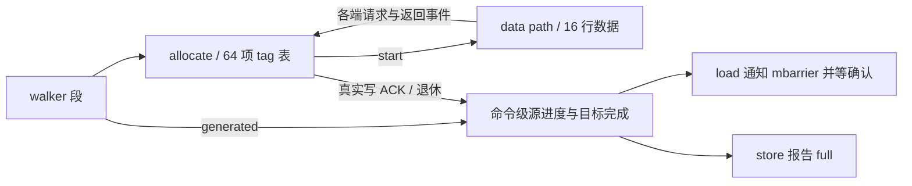

# blackwell_tma_completion_tracker

## Description

按 unit 已分配的通用 ticket 跟踪数据命令，所有未完成命令共享 64 个段 tag。每段由 {tag,phase} 匹配返回，长期状态独立于 setup 槽。

| 通道及方向 | 类型 / 位宽 | 对端 | 握手或采样条件 |
| --- | --- | --- | --- |
| begin / owner_view[18] 入 | ticket5 / [tma_owner_view_t](blackwell_tma_unit.md#owner-view)[18] | TMA unit | begin 为指定 ticket 初始化一次进度，可与其他命令的 allocate/retire 同沿。按 ticket 组合读取身份、方向、绑定成功位和逻辑字节数。 |
| allocate / generated 入 | [tma_segment_t](blackwell_tma_request_generator.md#segment) / [tma_finish_t](#transfer-types) | walker | 末段 allocate.fire 同沿分配并置该 ticket 的 generated；仅关闭标记独立握手。关闭后禁止再分配该 ticket 的段。 |
| start / tag_view[64] 出 | [tma_start_t](#transfer-types) / [tma_tag_t](#transfer-types) 组合视图 | data path | start 交付本段及 key。view 取沿前值，各事件按 key 寻址。 |
| event[20] / data_ref[64] 入 | [tma_xfer_event_t](#transfer-types) / 每项 1 bit 电平 | data path | 一次总线 fire 同沿登记一次事件；data_ref 指该 tag 仍被数据通路引用。 |
| ticket_busy / target_visible 出 | 每通用 ticket 各一位 | TMA unit | busy 从 begin 到 finish.fire。generated 且所有段目标均收到必要 ACK 时置 target_visible。源进度、目标可见和对象确认分别解除相应依赖。 |
| progress / finish 出 | [tma_progress_t](#transfer-types) / tma_finish_t | TMA unit | 向 unit 交付一次 source、一次 full 和最终结果，受阻保持。 |
| producer_done 出 / producer_rsp 入 | [bar_producer_done_t](../mbarrier/blackwell_mbarrier_frontend.md#command) / op_done_t | barrier frontend（经 unit） | 每条已 bind 的 load 一次交付及一次匹配确认。 |
| drained / fault 出 | 各 1 bit | TMA unit | 已无事务、held 和命令责任 / sticky 协议错。 |

## Functionality

### ticket 与段身份

- `key={tag:u6,phase:u1}`，tag 为本表索引。GMEM class0 携带 key，descriptor 用独立 class1；总线编码归 [unit](blackwell_tma_unit.md#gmem-types)。SMEM client8 的 `token={6'b0,tag6,group3,phase1}` 共 16 bit，完整 mem_tag 另含命令 id 和 client。组号须与实际端口相符。4-bit 数据槽号只用于 data path 内部。
- `tma_start_t={key7,segment193}`，200 bit。`tma_xfer_event_t={key7,kind3,group3}`，13 bit。kind 0…5 为 GMEM_REQ、GMEM_RSP、SMEM_REQ、SMEM_RSP、LOCAL_ZERO、NO_ACCESS。lane 0/1 为 GMEM 请求/成功回应，2+g / 10+g 为组 g 的请求/成功回应，18/19 为本地事件。非 SMEM 事件 group=0。
- `tma_progress_t={ticket5,boundary2}`，7 bit，0/1/2 表示 descriptor/source/full；descriptor 由 cache/setup 报告。`tma_finish_t={ticket5}`，5 bit，用于空枚举关闭或命令最终交接。

### 分配、确认与退休

每项 `tma_tag_t` 如下。等待 L2 所需的目标地址和 mask 可由表内短字段还原。GMEM 行地址仅随 start 交付一次；store 需要的目标行地址由 data path 保存在其数据槽旁。

| 控制字段 | bit | 用途 |
|---|---:|---|
| state / phase / ticket | 3 / 1 / 5 | FREE、START、SOURCE、TARGET、RETIRE。每次退休翻转 phase；ticket 直接索引 owner_view 与该 ticket 的进度状态。 |
| smem_sector[17:7] / soff / goff / xor_group / logical_bytes / oob | 11 / 7 / 7 / 3 / 8 / 1 | CTA 内 sector 索引；补低七位零恢复基址。用 [segment 字节公式](blackwell_tma_request_generator.md#segment) 生成有效组、每组 mask 和 GMEM 字节位置。 |
| gmem_sent / gmem_done / smem_sent / smem_done | 1 / 1 / 8 / 8 | 请求与对应终结回应分别置位；各方向的有效期见下文。 |
| source_done / target_done | 1 / 1 | 每段的源和目标各结算一次。 |

段表共 64×66 bit。长期状态按通用 ticket 直接索引。每项用 7-bit pending_source、pending_target、live_tags 分别计尚欠的源、目标和未退休段（各至多 64）；保留 generated、source/full/finish 和 producer 握手状态。它们由 tracker 唯一更新，unit.ticket 仅锁存已交付的进度/最终结果；total_bytes、策略和完整 id 取 unit 的 owner_view。allocate 增三计数，首次源/目标结算和 tag 退休各自减一，同沿按 ticket 合并增减。空表可用不等于命令已完成。

1. **分配。** allocate.fire 写 START 并占一个 tag 及共享弹性 start 口；start 可同拍送旧收新。末段同时置 generated。纯关闭标记不占 tag，即使段表已满也可由 generated 接口消费。LOCAL_ZERO/NO_ACCESS 按实际派发的 key 结算。
2. **源完成。** 正常 load 在 GMEM 返回被 RAM 接收时完成源读；OOB load 在 LOCAL_ZERO 建立零行时完成。store 在所有有效组返回写入预留行后完成源读。NO_ACCESS 使 OOB store 两侧同时终结。每段首次 source_done 使本 ticket 的 pending_source 减一并准许目标发送。generated 且全部段源已终结即可发布 source progress。
3. **逐组确认。** 由 live key 查 tag.ticket，再取匹配命令的 id、方向，仅接受该 owner 已 sent 且未 done 的回应。load 用该 tag 的路由字段恢复必需组掩码，各组成功 ACK 分别置 done；store 以本段一次成功 GMEM 写 ACK 置 done。八组可同沿确认不同 tag，或在某行尚有一组未提交时先确认其余组。先按 tag 归并同沿事件，再按 ticket 分别求和更新各自的计数器。槽已复用也按旧 key 结算。store 的 GMEM WRITE.fire 证明其源组均已交付，此后源地址、offset、xor 和源组位图失效。等待写 ACK 只需 key/owner、状态、段长度和 GMEM sent/done；旧源位可保留物理值，校验/排空只检查仍有效的责任。
4. **退休。** 正常段要求两侧均终结、所有必要目标已提交且已确认。进入 RETIRE 后，须 start 无该 key、data_ref[tag]=0 且全部 sent 已有 done，才允许退休；每沿最多选一个就绪项，轮询，翻转 phase 并清为 FREE，下一沿可重用 tag。目标写被接受时即可释放数据槽。data_ref 为沿前电平，覆盖已持有的行、请求与 RD/Q/R_OUT 引用。
5. **命令完成。** 该 ticket 已关闭、source 已报告、live_tags=0 且无 held 引用时，store 可报告 full。每笔实际目标写的 ACK 已结清该笔写的可见性，规格见 [SMEM client8](../smem/blackwell_smem_fabric.md#transactions) 和 [GMEM WRITE](blackwell_tma_unit.md#gmem-types)。全 OOB store 没有目标写，OOB load 的零填也要收齐实际 SMEM 写 ACK。已绑定 load 提交一次 producer_done，携 total_bytes 和 OK，收到 producer_rsp 才报告 full。producer 端口一次一笔，在合格 ticket 间公平选择，受阻保持 id 和载荷。同址同 phase 的 producer 由 frontend 串行提交，真实别名与显式 fence 由 unit 检查。finish.fire 将最终状态交给 unit，子引用释放且软件响应结束后才复用 ticket。

### 错误、排空与验收

两个独立 load 绑定同一 phase。分别延迟 A 的末 SMEM ACK 或 producer_rsp；B 在资源就绪时仍可发首读。phase 须等两笔实际字节和 arrival 都结清。双 16 KiB panel 的交接沿见 [unit](blackwell_tma_unit.md#copy-overlap)。

数据端检查非 OK、未知、重复、错代、错方向或错组响应，触发[顶层故障](../top/blackwell_async_subsystem_top.md#common-protocol)。故障事件不作为正常段进度。正常 stop 仍完成已接受的 ticket。同步复位清 tag valid、phase、计数与 held；正常换 epoch 要求 drained。

验收时让旧段七组先 ACK、末组延迟，复用其数据槽并保持旧 tag 在途直至末 ACK。对写入两个不相邻 GMEM 行的 store，分别推迟任一行的 ACK，检查 .read 可先完成，full 须等两笔 ACK。覆盖 64 tag 满、同沿多组 ACK、全 OOB 和 producer_rsp 延迟。末写返回 MEMORY 时只触发 fault，已成功提交的写保留。
