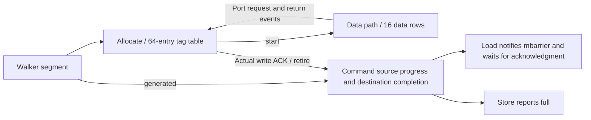

# blackwell_tma_completion_tracker

## Description

Track data commands by the general-purpose ticket already allocated by the unit. All unfinished commands share 64 segment tags. Match each segment return by {tag,phase}. Long-lived state is independent of setup slots.

| Signal / channel | Direction | Type / width | Peer | Sampling condition |
|---|---|---|---|---|
| `begin` | Input | 5 bits | TMA unit | Initialize progress once on admission of the ticket. Another ticket may allocate or retire on that edge. |
| `owner_view[18]` | Input | [tma_owner_view_t](blackwell_tma_unit.md#owner-view) (189 bits per ticket) | TMA unit | Level. Read identity, direction, binding and logical byte count by ticket. |
| `allocate` | Input | [tma_segment_t](blackwell_tma_request_generator.md#segment) (193 bits) | walker | On `allocate.fire`, allocate an ordinary segment. The final segment also closes this ticket. |
| `generated` | Input | [tma_finish_t](#transfer-types) (5 bits) | walker | On `generated.fire`, close an empty enumeration without allocating a tag. |
| `start` | Output | [tma_start_t](#transfer-types) (200 bits) | data path | On `start.fire`, deliver the segment and its transaction key. |
| `tag_view[64]` | Output | [tma_tag_t](#transfer-types) (66 bits per tag) | data path | Level. Use pre-edge tag state to resolve each event by key. |
| `event[20]` | Input | [tma_xfer_event_t](#transfer-types) (13 bits per event) | data path | Register each valid event on the corresponding transfer edge. |
| `data_ref[64]` | Input | 1 bit per tag | data path | Level. Sample outstanding data-path references before tag reuse. |
| `ticket_busy` | Output | 1 bit per general ticket | TMA unit | Level. Assert from begin through `finish.fire`. |
| `target_visible` | Output | 1 bit per general ticket | TMA unit | Level. Assert after generation and all required target ACKs. |
| `progress` | Output | [tma_progress_t](#transfer-types) (7 bits) | TMA unit | On `progress.fire`, publish source and full progress once each. Hold until accepted. |
| `finish` | Output | tma_finish_t (5 bits) | TMA unit | Hold the ticket number stable until `finish.fire`. Transfer it once on normal completion. |
| `producer_done` | Output | [bar_producer_done_t](../mbarrier/blackwell_mbarrier_frontend.md#command) (90 bits) | Barrier front end (via unit) | On `producer_done.fire`, notify once for the bound load. |
| `producer_rsp` | Input | op_done_t (58 bits) | Barrier front end (via unit) | On `producer_rsp.fire`, settle the matching object update. |
| `drained` | Output | 1 bit | TMA unit | Assert when no transactions, held selections or command obligations remain. |

## Functionality

### Ticket and segment identity

- `key={tag:u6,phase:u1}`, with tag indexing this table. GMEM class0 carries the key. Descriptors use separate class1. [unit](blackwell_tma_unit.md#gmem-types) defines the bus encoding. For SMEM client8, `token={6'b0,tag6,group3,phase1}` is 16 bits. Full mem_tag also contains command ID and client. Group must match the physical port. The 4-bit data slot index stays inside the data path.
- `tma_start_t={key7,segment193}` is 200 bits and `tma_xfer_event_t={key7,kind3,group3}` is 13 bits. Kinds 0…5 are GMEM_REQ, GMEM_RSP, SMEM_REQ, SMEM_RSP, LOCAL_ZERO, and NO_ACCESS. Lanes 0/1 carry GMEM requests/successful replies, 2+g / 10+g carry requests/successful replies for group g, and 18/19 carry local events. Non-SMEM events use group=0.
- `tma_progress_t={ticket5,boundary2}` is 7 bits. Values 0/1/2 mean descriptor/source/full. Cache/setup reports descriptor progress. `tma_finish_t={ticket5}` contains only the 5-bit ticket number. On `generated` it identifies an empty enumeration. On `finish` it identifies a normally completed command.

### Allocation, acknowledgment, and retirement

Each `tma_tag_t` entry is defined below. Compact table fields reconstruct destination addresses and masks while waiting for L2. The GMEM line address transfers only once with start. The data path stores a store's destination line address beside its data slot.

| Control fields | bit | Purpose |
|---|---:|---|
| state / phase / ticket | 3 / 1 / 5 | FREE, START, SOURCE, TARGET, RETIRE. Toggle phase on each retirement. ticket directly indexes owner_view and the ticket's progress state. |
| smem_sector[17:7] / soff / goff / xor_group / logical_bytes / oob | 11 / 7 / 7 / 3 / 8 / 1 | Sector index inside the CTA. Append seven zero low bits to recover the base. Use the [segment byte formula](blackwell_tma_request_generator.md#segment) to generate active groups, masks, and GMEM byte positions. |
| gmem_sent / gmem_done / smem_sent / smem_done | 1 / 1 / 8 / 8 | Set bits separately on requests and their terminal responses. Direction-specific lifetimes are defined below. |
| source_done / target_done | 1 / 1 | Settle source and destination once each per segment. |

The segment table occupies 64×66 bits. Index long-lived state directly by general-purpose ticket. Each entry uses 7-bit pending_source, pending_target, and live_tags for outstanding sources, destinations, and unretired segments respectively (up to 64 each). Retain generated, source/full/finish, and producer handshake state. Only the tracker updates them. unit.ticket latches delivered progress/final results and its owner_view supplies total_bytes, policy, and full ID. Allocation increments all three counts. First source settlement, target settlement, and tag retirement decrement their respective counts. Combine same-edge changes by ticket. Free table capacity does not imply command completion.

1. **Allocation.** allocate.fire writes START, occupies a tag, and takes the shared elastic start port. start can send old and accept new on one edge. The last segment also sets generated. A close-only marker consumes no tag and can handshake on generated even when the table is full. Settle LOCAL_ZERO/NO_ACCESS using the actually dispatched key.
2. **Source completion.** A normal load finishes its source read when RAM accepts the GMEM return. An OOB load finishes it when LOCAL_ZERO establishes the zero row. A store finishes source reads after all active group returns write the reserved row. NO_ACCESS closes both sides of an OOB store together. First source_done per segment decrements its ticket's pending_source and enables destination issue. Publish source progress once generated and all segment sources have finished.
3. **Group acknowledgments.** Look up tag.ticket by live key and read command ID/direction from the matching owner. Accept replies only for its sent, unfinished requests. For a load reconstruct the required group mask from the tag's routing fields and mark each successful group ACK done independently. A store marks done on its one successful GMEM write ACK. Eight groups can acknowledge different tags on one edge. Groups already submitted may acknowledge while one group of a row still awaits submission. Combine same-edge events by tag first, then sum and update each ticket's counters. Settle by original key even after data slot reuse. A store's GMEM WRITE.fire proves all source groups have delivered. Afterward its source address, offset, xor, and source group bitmaps are invalid. Waiting for the write ACK needs only key/owner, state, segment length, and GMEM sent/done. Old source bits may retain physical values. Check only still-valid obligations for validation and drain.
4. **Retirement.** A normal segment needs both sides finished and all required destinations submitted and acknowledged. In RETIRE, require start to have no reference to the key, data_ref[tag]=0, and done for all sent requests. Round-robin selects at most one eligible entry per edge, toggles phase, and clears it to FREE. The tag can be reused on the next edge. Destination write acceptance can release the data slot earlier. data_ref is a pre-edge level covering held rows, requests, and RD/Q/R_OUT references.
5. **Command completion.** A store can report full when the ticket is closed, source is reported, live_tags=0, and no held reference remains. Each actual destination write ACK establishes visibility for its write as specified in [SMEM client8](../smem/blackwell_smem_fabric.md#transactions) and [GMEM WRITE](blackwell_tma_unit.md#gmem-types). An all-OOB store has no destination writes. Zero-filled OOB loads still require all actual SMEM write ACKs. A bound load sends one producer_done with its ID and total_bytes and reports full only after producer_rsp. The producer port handles one transaction at a time, fairly selects eligible tickets, and holds ID/payload under backpressure. The front end serializes producers for the same address and phase. The unit checks real aliasing and explicit fences. Reuse the ticket only after child references release and the software response finishes.

### Drain and acceptance

Two independent loads can bind the same phase. While one awaits its final SMEM ACK or producer_rsp, the other can issue its first read as soon as resources permit. The phase waits for both byte contributions and all required arrivals.

Simulation asserts that each reply identifies a live sent request with matching generation, direction and group, and that each request settles once. Normal stop completes accepted tickets. Synchronous reset clears tag valid, phase, counters, and held state. Normal epoch change requires drained.
