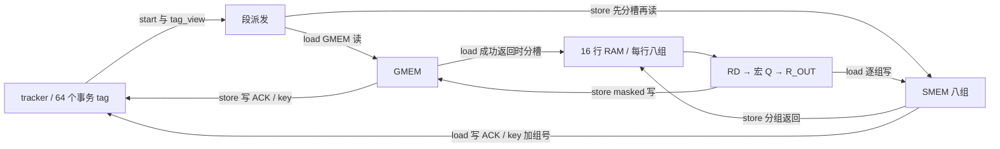

# blackwell_tma_data_path

## Description

在一条 128 B GMEM 行和八组 16 B SMEM atom 之间搬运，16 行 RAM、RD/Q/R_OUT 及各外部端口由所有在途 ticket 共用。访问方向和缓存策略由段所属 ticket 决定。

| 通道及方向 | 类型 / 位宽 | 对端 | 握手或采样条件 |
| --- | --- | --- | --- |
| start / tag_view[64] / owner_view[18] 入 | [tma_start_t](blackwell_tma_completion_tracker.md#transfer-types) / [tma_tag_t](blackwell_tma_completion_tracker.md#transfer-types)[64] / [tma_owner_view_t](blackwell_tma_unit.md#owner-view)[18] | tracker、TMA unit | start.segment.ticket 指派新段；其后以 live key → tag.ticket 取得命令 id、方向和策略，原 setup 槽可被复用。 |
| event[20] / data_ref[64] 出 | [tma_xfer_event_t](blackwell_tma_completion_tracker.md#transfer-types) / 每项 1 bit | tracker | 正常 memory fire 同沿按 key 报告事件。data_ref 表示行或 held/流水引用。 |
| gmem_req 出 / gmem_rsp 入 | [gmem_req_t / gmem_rsp_t](blackwell_tma_unit.md#gmem-types) | GMEM（经 unit） | class0，读返回和写 ACK 路由到事务 key。可各自每拍一笔。 |
| smem_req[8] 出 / smem_rsp[8] 入 | [smem_atom_req_t](../smem/blackwell_smem_fabric.md#transactions) / [smem_atom_rsp_t](../smem/blackwell_smem_fabric.md#transactions) | SMEM fabric | client8 的 lane g 固定接物理组 g，按原 key 和组独立应答。 |
| drained / fault 出 | 各 1 bit | TMA unit | 行、held、流水已空 / 运行故障。 |

## Functionality

### 行目录与数据槽

| 存储 | 组织 | payload |
|---|---|---:|
| 数据 RAM | [8 个 1R1W bank](../base/blackwell_banked_sram.md)，每 bank 为 16×16 B，每 word 16 位 byte enable；4-bit 数据槽号选 word | 2,048 B |
| 宏 Q / R_OUT | 各保持一行和独立 valid | 128 B / 128 B |
| **合计** | 两个方向共用 | **2,304 B** |

控制单列。每个行目录项保存 valid、owner key、claimed、zero；store 另保留本行目标 gmem_line[63:7] 和 ordinal，直至写请求被接受。SMEM 的 sector、两端 offset、长度和 xor_group 由 owner 的 tag_view 取得。每个实际发出的 store 源读都先占有该行，行及各组真实返回的事件位置已预留。store 源返回在 16 项目录中匹配唯一 owner 以选中本地 word；load 写 ACK 和 store 写 ACK 直接索引 tag 表。其余控制为 load 读请求保持寄存器（key、行地址，mask 由 live 字段生成）、各组 store 源读的 held 选择、轮询指针及 RD/Q/R_OUT 的 key、槽号、组 pending。store 的 1,024-bit 写数据直接来自 R_OUT。槽号始终留在本模块内。

### Load 的 GMEM 返回与 SMEM 写入

1. **读源。** 对 in-bounds 段，start.fire 把行地址和 key 锁入一项可同拍送旧收新的读请求寄存器。发出的请求可连续使用不同 tag，表项在 L2 等待期间记录如何散射返回字节。收到回应先核对 class、live key、方向、sent 且未 done。
2. **接收并分槽。** 匹配的正常读返回只在有沿前空槽、RAM 能写、对应事件可登记时 ready。fire 沿取最低空槽，写 owner 与有效字节，同沿送 GMEM_RSP，源完成。依据 [segment 公式](blackwell_tma_request_generator.md#segment) 将 GMEM lane `goff+j` 写入换位后的组和 byte lane。全 OOB load 用 start.fire 同沿申请一行、置 zero 并发 LOCAL_ZERO；不读 GMEM，目标仍按 mask 写零。零行与正常返回竞争同一分配口时，在可服务的候选间轮询，每沿最多建一行。
3. **向 SMEM 交付。** RD 在已有数据、source_done、未 claimed 的行间轮询，选中时置 claimed。即使最老的读仍被 GMEM 持有，已就绪的年轻行也可排出。单命令内由 walker 切出的 load 段只写各自的有效 byte，落在同一 word 的段各带自己的 mask。R_OUT 的 pending 初值为 mask 非空的组；每组 write.fire 后清该位，未接受组继续保持原数据。**最后一组 write.fire 沿归还数据槽，下一沿可分配给另一 key。**
4. **接受确认。** 早到、晚到的写 ACK 均按其原 ticket 的命令 id、key、组和 tag_view 的 sent/done 判定。第二条 load 发读时，第一条的返回仍可分槽、写 SMEM 和结算。成功 ACK 的接受只需其预留事件 lane。即使旧槽已改写，仍能完成旧 tag。

### Store 的分组源读与 GMEM 写入

start.fire 为正常段绑定一个沿前空槽，保存目的行地址。最早下一沿，八组可各自向 SMEM 发一次有效读请求；每组在有候选的 ticket 间轮询，同 ticket 选最小 ordinal，锁住被选请求到 fire。各组返回可同沿投向不同 owner 的槽。匹配读返回时写本组有效字节并登记 SMEM_RSP；最后必需组被捕获后 source_done 成立。generated 且所有段到达源边界后可满足 group.read，后续写背压仍由本模块承受。

目标 RD 在**源已齐**且未 claimed 的 ticket 间轮询，同 ticket 选最小 ordinal。R_OUT 依据 goff 和 SMEM 布局逆向拼成一笔 masked GMEM 写。**GMEM WRITE.fire 沿归还数据槽**；GMEM 未接受时保持 key、地址、data、mask 和槽引用。此处 fire 指实际 GMEM 请求端口选中该数据请求并握手。之后的写 ACK 只查原 tag，返回成功才置本段目标完成。全 OOB store 在 start.fire 发 NO_ACCESS，两侧直接终结，免分配数据槽。

### 共用流水、反压与排空

行分配口在有资格的 store.start、零填和成功 GMEM 读返回之间轮询。每个 payload bank 单写口：load 返回需一次获准全部有效 bank；store 源响应逐组写既有行。两类同时争写时在可接受的类间轮转，给等待的整行返回一次完整写机会。RD 从已备齐、未 claimed 的行中公平选取，store 的 ordinal 比较仅在同一个 ticket 内有效。SMEM 每组在 load 目标写与 store 源读间公平轮询，锁到 fire；GMEM 数据口在 load 读与 store 的 R_OUT 写之间同样仲裁，再与 descriptor 仲裁。保留既有一个请求/组/沿、一条 GMEM 请求/沿。ACK 不申请数据槽或 RAM 写口。GMEM 按 unit 的可反压返回合同接入；SMEM store 源读必须先占行。

混向交接须避免 GMEM 队首 load 返回等数据槽、已占槽的 store 又等 GMEM 写请求的环。以 U 计已展示 GMEM READ 至返回的正常 load 数，含 held 请求。第一笔 store 分槽前要求空行数至少为 U+1。存在 store 行期间，每笔新增 load 在首次展示请求时预留一行返回容量；store 或零填仅可用扣除 U 后的空行。请求或行同沿新增按合计检查。成功返回将一个预留换成一条实占行；RAM 写口公平接入。纯 load 允许 64 个未返回段共用 16 行，待驻留 load 写入 SMEM 释放真实空间后再接入首笔 store。公平服务已承诺的回复和驻留行；不以新的 GMEM 握手作为接受 SMEM 写 ACK 的条件。

- RD 锁定行后下一沿最早采样同步宏，Q 保持到 R_OUT 接收。零行关闭宏读并随相同级数传递零标志。Q 与 R_OUT 各可送旧收新；同 bank 同 word 的读写若冲突保留已预约读，反压冲突源。held/Q/R_OUT 的 owner 始终随数据移动。
- 数据槽满可拉低 gmem_rsp.ready；外围需保持该拍的 valid、ID、data、status 到 fire。**释放已驻留的 load 行只依赖该行的 SMEM 写接受**，SMEM 写 ACK 有独立的完成事件入口。共用 GMEM 返回口上，队首被阻可推迟后面的 descriptor，驻留行的排出不等待 descriptor 或新的 GMEM 回应。不可暂停的返回链路需按 [顶层外存合同](../top/blackwell_async_subsystem_top.md#common-protocol) 提供接入侧 credit。
- 非 OK 内存返回可在无空数据槽时接收并报 fault，不写 RAM、不产生正常完成事件。未知、重复或错代回应同样终止运行。正常 stop 排空已接受 ticket。同步复位遵循顶层隔离条件。

### 逐拍合同与验收

令 a 为 tracker.allocate.fire；以下为全行、无争用，GMEM 在请求后下一沿响应的测试夹具。tag、槽均从沿前空项选择，归还项最早下一沿重新分配。

| 边沿事件 | load | store |
|---|---|---|
| 预留 tag / start | a / a+1，准备读请求 | a / a+1，预留数据槽 |
| 源请求与捕获 | a+2 GMEM READ；a+3 返回、分槽并写 RAM | a+2 进 R_BREQ，a+3 grant 并采样 SMEM，a+5 八组返回写入已预留槽 |
| RD 选行 / 宏采样 / Q→R_OUT | a+4 / a+5 / a+6 | a+6 / a+7 / a+8 |
| 目标接受并释放数据槽 | a+7 最后一组 SMEM 写 fire | a+9 GMEM WRITE.fire |
| 最后成功 ACK / 最早 tag 退休 | a+8 / a+9 | a+10 / a+11 |

64 个满段在 a=0…63 分配 tag 时，load 在 7…70、store 在 9…72 各可连续交付 64 行，末 ACK 分别在 71、73，最早末 tag 退休在 72、74。命令的进度和完成通知另行握手，已绑定 load 还要等待 producer_rsp。每方向峰值为 128 B/拍，实际完成时间由有效 mask、仲裁、外围返回和确认决定。

| 边界用例 | 应观察到的行为 |
|---|---|
| 连发 64 个读后才开始返回，暂停 SMEM 目标 | 前 16 个成功返回各占一槽，第 17 个 held 不变；让最老读最后返回，已就绪行仍能排出，恢复后逐字节、逐目标各一次。 |
| load 的七组已写且早 ACK，第八组延迟 | 第八组接受前保留旧数据，接受后可复用其槽；扣住第八个 ACK，旧 tag 以及本命令 barrier 继续等待。 |
| store 的 GMEM 写或 ACK 停顿 | 写未接受时整行稳定，接受后可用原槽接下一段；旧 ACK 延后仅挡旧事务退休与 full，全部源已齐的 .read 可放行。 |
| 数据槽满时到达 MEMORY | 该返回无需空行即可报告 fault，不能触发 producer 成功或新写。 |

验收另覆盖八组乱序返回、同沿多 tag 的 ACK、短段和 OOB 填零、错误/重复 tag、descriptor 共用返回口。正式 RTL 需重放这些边沿。

## Submodules

| 子模块 | 实例数 | 连接与父模块控制 |
| --- | --- | --- |
| [banked_sram](../base/blackwell_banked_sram.md) | 1 | 八个 16 B 组构成一行，16 行共用。data path 管理 slot、宏读使能和输出停顿。 |
