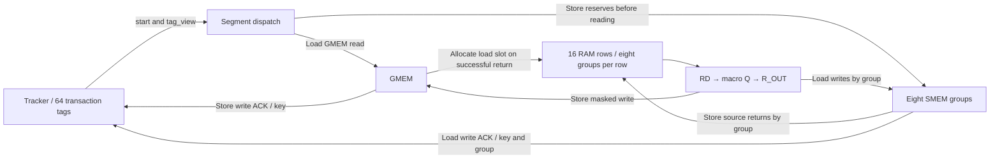

# blackwell_tma_data_path

## Description

Moves data between a 128 B GMEM line and eight 16 B SMEM atom groups. All active tickets share 16 RAM rows, RD/Q/R_OUT, and external ports. Each segment's owner ticket determines direction and cache policy.

| Signal / channel | Direction | Type / width | Peer | Sampling condition |
|---|---|---|---|---|
| `start` | Input | [tma_start_t](blackwell_tma_completion_tracker.md#transfer-types) (200 bits) | Tracker | On `start.fire`, bind the segment and transaction key to its owner ticket. |
| `tag_view[64]` | Input | [tma_tag_t](blackwell_tma_completion_tracker.md#transfer-types) (66 bits per tag) | Tracker | Level. Use the live key to read its ticket. |
| `owner_view[18]` | Input | [tma_owner_view_t](blackwell_tma_unit.md#owner-view) (189 bits per ticket) | TMA unit | Level. Read the command ID, direction and policy after setup slot reuse. |
| `event[20]` | Output | [tma_xfer_event_t](blackwell_tma_completion_tracker.md#transfer-types) (13 bits per event) | tracker | Report the key on the corresponding memory handshake or local zero/no-access event edge. |
| `data_ref[64]` | Output | 1 bit per tag | tracker | Level. Assert while a RAM row, held transfer or pipeline stage references the tag. |
| `gmem_req` | Output | [gmem_req_t](blackwell_tma_unit.md#gmem-types) (1,292 bits) | GMEM (via unit) | On `gmem_req.fire`, issue a class-0 transaction, up to one per cycle. |
| `gmem_rsp` | Input | [gmem_rsp_t](blackwell_tma_unit.md#gmem-types) (1,037 bits) | GMEM (via unit) | On `gmem_rsp.fire`, accept a read return or write ACK by key, up to one per cycle. |
| `smem_req[8]` | Output | [smem_atom_req_t](../smem/blackwell_smem_fabric.md#transactions) (255 bits) | SMEM fabric | On `smem_req.fire`, issue independently on client 8 port g to SMEM group g. |
| `smem_rsp[8]` | Input | [smem_atom_rsp_t](../smem/blackwell_smem_fabric.md#transactions) (211 bits) | SMEM fabric | On `smem_rsp.fire`, accept each group’s return by original key and group. |
| `drained` | Output | 1 bit | TMA unit | Assert when all RAM rows, held selections and pipeline stages are empty. |
| `fault` | Output | 1 bit | TMA unit | Sticky runtime fault level, cleared by isolated reset. |

## Functionality

### Row directory and data slots

| Storage | Organization | payload |
|---|---|---:|
| Data RAM | [Eight 1R1W banks](../base/blackwell_banked_sram.md), each bank is 16×16 B with 16 byte enables per word. A 4-bit slot index selects the word | 2,048 B |
| Macro Q / R_OUT | Each holds one row with its own valid bit | 128 B / 128 B |
| **Total** | Shared between both directions | **2,304 B** |

Account for control separately. Each row directory entry holds valid, owner key, claimed, and zero. A store also retains destination gmem_line[63:7] and ordinal until write request acceptance. Read SMEM sector, source/destination offsets, length, and xor_group from the owner's tag_view. Each issued store source read has already reserved its row and event positions for actual group returns. Match a store source return against the unique owner in the 16-entry directory to select its local word. Load and store write ACKs index the tag table directly. Other control comprises a held load read request (key and line address, with mask derived from live fields), held store source read selections per group, round-robin pointers, and key, slot, and group pending in RD/Q/R_OUT. The 1,024-bit store write payload comes directly from R_OUT. The slot index stays local.

### Load GMEM returns and SMEM writes

1. **Source read.** For an in-bounds segment, start.fire latches line address and key in a one-entry read request register that can send old and accept new on the same edge. Consecutive requests may use different tags. Each entry retains how to scatter returned bytes while waiting for L2. On reply verify class, live key, direction, sent, and unfinished status first.
2. **Receive and allocate.** Assert ready for a matched normal read return only with a pre-edge free slot, RAM write capacity, and room to record the event. On fire take the lowest free slot, write owner and valid bytes, report GMEM_RSP on the same edge, and finish the source. Use the [segment formula](blackwell_tma_request_generator.md#segment) to write GMEM lane `goff+j` to its swizzled group and byte lane. An all-OOB load requests a row on start.fire, sets zero, and emits LOCAL_ZERO. It skips GMEM reads but still writes masked zeros to the destination. Round-robin among serviceable zero rows and normal returns competing for the allocator. Create at most one row per edge.
3. **Deliver to SMEM.** RD round-robins among unclaimed rows with data and source_done, setting claimed on selection. A ready younger row may drain even while GMEM holds the oldest read. Each walker-generated load segment writes only its valid bytes. Segments sharing a word retain independent masks. Initialize R_OUT.pending with groups having nonempty masks. Clear a group on write.fire and hold original data for groups still pending. **Release the slot on the final group write.fire. Another key can allocate it on the next edge.**
4. **Accept acknowledgments.** Check early and late write ACKs against original ticket ID, key, group, and tag_view sent/done. While the second load issues reads, the first load's returns can still allocate slots, write SMEM, and settle. Accepting a successful ACK needs only its reserved event lane. The old tag can complete even after its old slot is overwritten.

### Store group source reads and GMEM writes

For a normal segment start.fire binds a pre-edge free slot and saves the destination line address. Starting on the next edge each active group may send a source read to SMEM. Within each group round-robin across eligible tickets and choose the lowest ordinal within one ticket. Lock each selection to fire. Different groups can return to different owners' slots on one edge. On a matched read return write the group's valid bytes and record SMEM_RSP. source_done follows capture of the last required group. Once generated and all segments reach the source boundary, group.read can succeed. The data path still absorbs destination write backpressure.

A valid, unclaimed store row is eligible for RD once its segment's source_done is set. This happens when the last required SMEM group return writes that row, even if other segments of the same ticket still have outstanding reads. RD selects fairly among tickets with eligible rows, selects the lowest ordinal among that ticket's eligible rows, and marks the selected row claimed. R_OUT reverses the SMEM mapping using goff and builds one masked GMEM write. **Release the slot on GMEM WRITE.fire**. Until GMEM accepts, hold key, address, data, mask, and slot reference. Fire means the actual GMEM request port selected and handshook the data request. The later write ACK looks up only the original tag. Only a successful return marks destination completion. An all-OOB store emits NO_ACCESS on start.fire, finishes both sides, and allocates no data slot.

### Shared pipeline, backpressure, and drain

The row allocator round-robins among eligible store.start, zero fills, and successful GMEM read returns. Each payload bank has one write port. A load return requires all selected banks together. Store source responses write existing rows by group. When both compete, alternate between serviceable classes and give a waiting full-line return a complete write opportunity. RD fairly selects ready unclaimed rows. Compare store ordinals only within a ticket. Each SMEM group fairly arbitrates a load destination write against a store source read and locks until fire. The GMEM data port similarly arbitrates load reads and R_OUT store writes before competing with descriptors. Retain one request/group/edge and one GMEM request/edge. ACKs need no data slot or RAM write port. Use the unit's backpressurable GMEM return contract. Reserve a row before every store SMEM source read.

Prevent a mixed-direction cycle in which the head GMEM load return waits for a slot while a resident store waits to issue a GMEM write. Let U count normal loads from first presentation of GMEM READ to return, including held requests. Before allocating the first store require at least U+1 free rows. While a store row exists, each new load reserves return capacity when first presenting its read. Stores and zero fills may use only free rows remaining after subtracting U. Check the aggregate of requests and rows newly added on the same edge. A successful return converts one reservation to an occupied row and gets fair access to RAM writes. Pure loads can have 64 outstanding segments sharing 16 rows. Admit the first store once resident loads write SMEM and release sufficient space. Fairly service promised replies and resident rows. Accept SMEM write ACKs independently of new GMEM handshakes.

- After RD locks a row, the earliest synchronous macro sample is the next edge. Q holds until R_OUT accepts. A zero row disables macro read and passes its zero flag through the same stages. Q and R_OUT can each send old and take new simultaneously. A write conflicting with a reserved read to the same bank and word stalls at its source. Owner moves with data through held/Q/R_OUT.
- When slots fill, deassert gmem_rsp.ready. The external producer must hold valid, ID, data, and status until fire. **Releasing a resident load row depends only on acceptance of that row's SMEM writes**. SMEM write ACKs have independent completion event inputs. A stalled head on the shared GMEM return can delay a later descriptor. Draining resident rows is independent of descriptors and new GMEM responses. A nonstallable return link must provide ingress credits per the [top-level external memory contract](../top/blackwell_async_subsystem_top.md#common-protocol).
- A non-OK memory response can be consumed without a free slot and raises fault without writing RAM or generating normal completion. Unknown, duplicate, or wrong-generation replies also terminate the run. Normal stop drains accepted tickets. Synchronous reset follows top-level isolation conditions.

### Cycle timing and acceptance

Let a denote tracker.allocate.fire. The timing below assumes full lines, no contention, and GMEM responding one edge after request. Choose tags and slots from pre-edge free entries. A returned entry can be reallocated on the next edge.

| Edge event | load | store |
|---|---|---|
| Reserve tag / start | a / a+1, prepare read request | a / a+1, reserve data slot |
| Source request and capture | a+2 GMEM READ, a+3 return, allocate slot, and write RAM | a+2 enter R_BREQ, a+3 grant and sample SMEM, a+5 eight group returns write the reserved slot |
| RD select / macro sample / Q→R_OUT | a+4 / a+5 / a+6 | a+6 / a+7 / a+8 |
| Destination acceptance and slot release | a+7 last SMEM group write fire | a+9 GMEM WRITE.fire |
| Final successful ACK / earliest tag retirement | a+8 / a+9 | a+10 / a+11 |

With 64 full segments allocated tags at a=0…63, loads can deliver 64 consecutive lines at 7…70 and stores at 9…72. For a single 64-segment store, the first row enters RD at 6 and issues its GMEM write at 9 while later segments of the same ticket are still reading SMEM. The last ACKs are at 71 and 73 respectively and the earliest final tag retirements at 72 and 74. Command progress and completion have separate handshakes. A bound load additionally waits for producer_rsp. Peak bandwidth is 128 B/cycle per direction. Actual completion depends on effective masks, arbitration, external returns, and acknowledgments.

| Boundary case | Expected behavior |
|---|---|
| 64 reads outstanding, SMEM destination stalled | The first 16 successful returns occupy one slot each and the 17th stays held. Ready rows can drain before the oldest read returns. Each selected byte is delivered once to its destination. |
| Seven load groups have written and ACKed early, eighth group delayed | Retain the old data until the eighth group accepts, then allow slot reuse. While its eighth ACK is held, the old tag and command barrier remain pending. |
| Store GMEM write or ACK stalls | Before write acceptance hold the full row stable. After acceptance reuse the slot for another segment. A late old ACK delays old transaction retirement and full only. A .read whose sources have all completed can proceed. |
| MEMORY status arrives with all slots occupied | Report fault without a free row. The response cannot trigger producer success or a new write. |

## Submodules

| Submodule | Instances | Connections and parent control |
| --- | --- | --- |
| [banked_sram](../base/blackwell_banked_sram.md) | 1 | Eight 16 B groups form a row, with 16 shared rows. The data path controls slot allocation, macro read enable, and output stalls. |
