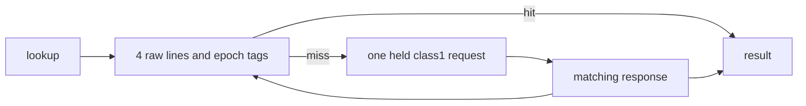

# blackwell_tma_descriptor_cache

## Description

Supplies the unit with read-only project [Tensor Map](blackwell_tma_setup.md#tensor-map) for this CTA/epoch. Demand and explicit prefetch.tensormap share the same resources. Prefetch handles descriptors only. One miss creates exactly one GMEM line read. The image is read-only throughout the epoch.

| Signal / channel | Direction | Type / width | Peer | Sampling condition |
|---|---|---|---|---|
| `lookup` | Input | [tma_desc_req_t](#descriptor-types) (128 bits) | TMA unit | On `lookup.fire`, capture the aligned descriptor address and ticket. |
| `result` | Output | [tma_desc_rsp_t](#descriptor-types) (1,033 bits) | TMA unit | On `result.fire`, deliver ticket, status and raw descriptor. Hold until consumed. |
| `gmem_req` | Output | gmem_req_t (1,292 bits) | GMEM (via unit) | On `gmem_req.fire`, issue READ128 with a full mask and class 1, tag 0 and the miss owner’s phase. |
| `gmem_rsp` | Input | gmem_rsp_t (1,037 bits) | GMEM (via unit) | On `gmem_rsp.fire`, accept the matching miss return under the [unit return protocol](blackwell_tma_unit.md#gmem-types). |
| `epoch` | Input | 16 bits | TMA unit | Sample the new epoch after outstanding work drains to invalidate descriptor lines. |
| `drained` | Output | 1 bit | TMA unit | Level asserted after outstanding work and held transfers drain. |
| `fault` | Output | 1 bit | TMA unit | Sticky GMEM or protocol error level. |

The [top-level common protocol](../top/blackwell_async_subsystem_top.md#common-protocol) defines clock, reset, and channel sampling.

## Functionality

### Lookup and replacement

Four 128 B raw lines each hold addr[63:7], epoch16, and valid. Fill the lowest empty entry first, otherwise use a 2-bit round-robin replacement cursor. This module owns one lookup/miss owner, one phase bit, and one held 128 B result with ticket/status/valid. The unit does not duplicate the cache or miss table.

Accept lookup at t and compare tags at t+1. On a hit, latch raw/ticket when result is empty or sending its old value on that edge. The next lookup can replace the owner on the same edge. The first result can deliver at t+2 and consecutive hits have II=1. A stalled result still allows a free lookup owner to be occupied, then applies backpressure. A miss uses the sole class1 identity and retains victim/address until the matching response can populate result. On success fill the line. Non-OK raises runtime fault and preserves the original victim. Toggle phase only on response fire. Each miss issues exactly one GMEM read, including under backpressure.

Synchronous reset clears valid/owner/result/fault without initializing raw. During stop accept lookups derived from old tickets and drain returns. An unknown/duplicate GMEM ID sets sticky protocol fault without writing a line or changing the real owner.

### Descriptor requests and results

`tma_desc_req_t={ticket:5,id:58,addr:64,prefetch:1}` is 128 bits and `tma_desc_rsp_t={ticket:5,raw:1024,status:4}` is 1033 bits. Pack fields from high to low.
