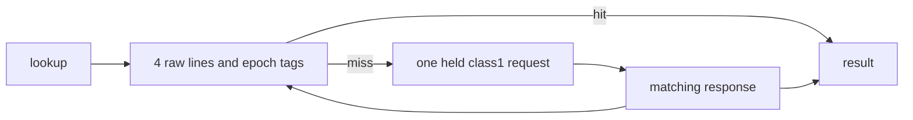

# blackwell_tma_descriptor_cache

## Description

Supplies the unit with read-only project [Tensor Map](blackwell_tma_setup.md#tensor-map) for this CTA/epoch. Demand and explicit prefetch.tensormap share the same resources. Prefetch handles descriptors only. One miss creates exactly one GMEM line read. The image is read-only throughout the epoch.

| Signal / channel | Direction, type / width | Peer | Handshake or sampling condition |
| --- | --- | --- | --- |
| lookup, result | Input [tma_desc_req_t](#descriptor-types), output [tma_desc_rsp_t](#descriptor-types) | TMA unit | Parameters map to an aligned address. Hold ticket/status/raw until unit fire. |
| gmem_req/rsp | Output gmem_req_t, input gmem_rsp_t | GMEM (via unit) | READ128 with all mask bits set. The 9-bit ID uses class=1, tag=0, and the current sole miss owner's phase. Drive ready per the [unit return handshake](blackwell_tma_unit.md#gmem-types). |
| epoch, drained, fault | Input u16, output bit, output bit | TMA unit | A normal epoch transition clears valid only after outstanding work drains. fault covers GMEM errors and protocol violations. |

The [top-level common protocol](../top/blackwell_async_subsystem_top.md#common-protocol) defines clock, reset, and channel sampling.

## Functionality

### Lookup and replacement

Four 128 B raw lines each hold addr[63:7], epoch16, and valid. Fill the lowest empty entry first, otherwise use a 2-bit round-robin replacement cursor. This module owns one lookup/miss owner, one phase bit, and one held 128 B result with ticket/status/valid. The unit does not duplicate the cache or miss table.

Accept lookup at t and compare tags at t+1. On a hit, latch raw/ticket when result is empty or sending its old value on that edge. The next lookup can replace the owner on the same edge. The first result can deliver at t+2 and consecutive hits have II=1. A stalled result still allows a free lookup owner to be occupied, then applies backpressure. A miss uses the sole class1 identity and retains victim/address until the matching response can populate result. On success fill the line. Non-OK raises runtime fault and preserves the original victim. Toggle phase only on response fire. Test three consecutive hits from distinct tickets, a miss after a stalled result, and a held miss issuing exactly once.

Synchronous reset clears valid/owner/result/fault without initializing raw. During stop accept lookups derived from old tickets and drain returns. An unknown/duplicate GMEM ID sets sticky protocol fault without writing a line or changing the real owner. Cover four-way replacement, hit after hint, demand hit after a legal hint miss, simultaneous old result consumption and new request acceptance, address reuse across epochs, and run termination on MEMORY.

### Descriptor requests and results

`tma_desc_req_t={ticket:5,id:58,addr:64,prefetch:1}` is 128 bits and `tma_desc_rsp_t={ticket:5,raw:1024,status:4}` is 1033 bits. Pack fields from high to low.
