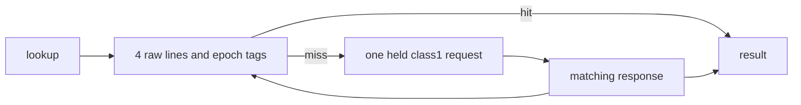

# blackwell_tma_descriptor_cache

## Description

向 unit 提供本 CTA/epoch 的只读项目 [Tensor Map](blackwell_tma_setup.md#tensor-map)。demand 与显式 prefetch.tensormap 使用同一资源；prefetch 只处理 descriptor，一次 miss 只创建一笔 GMEM 行读取。映像在该 epoch 内只读。

| 信号 / 通道 | 方向、类型 / 位宽 | 对端 | 握手或采样条件 |
| --- | --- | --- | --- |
| lookup、result | 入 [tma_desc_req_t](#descriptor-types)、出 [tma_desc_rsp_t](#descriptor-types) | TMA unit | 参数已映射为对齐地址，ticket/status/raw 保持至 unit fire。 |
| gmem_req/rsp | 出 gmem_req_t、入 gmem_rsp_t | GMEM（经 unit） | READ128，mask 全 1，9-bit ID 中 class=1、tag=0，phase 来自当前唯一 miss owner，按 [unit 的返回握手](blackwell_tma_unit.md#gmem-types) 给出 ready。 |
| epoch、drained、fault | 入 u16、出 bit、出 bit | TMA unit | 正常 epoch 切换只在无在途时清 valid；fault 涵盖 GMEM 错误与协议违约。 |

时钟、复位及通道的采样约定见[顶层公共协议](../top/blackwell_async_subsystem_top.md#common-protocol)。

## Functionality

### 查找与替换

4×128 B raw line，各有 addr[63:7]/epoch16/valid。优先填最低空项，否则 2bit 轮询替换。一项 lookup/miss owner、一个 phase bit、一项 128 B held result 及 ticket/status/valid，均属于本模块。unit 不复制 cache/miss 表。

沿 t 接受 lookup，t+1 比较 tag 并在 result 空或同沿送旧时锁存 hit 的 raw/ticket。该沿即可由下一 lookup 替换 owner；第一个 result 最早 t+2 交付，连续 hit 的 II=1。result 受阻仍可占用空的 lookup owner，再满就反压。miss 使用唯一 class1 身份，持有 victim/address 直到 matching response 可填入 result；成功填 line，非 OK 报运行故障，保持 victim 原值。响应 fire 才翻转 phase。测试连续三个不同 ticket 命中、结果暂停后 miss、一个 held miss 只发一次。

同步复位清 valid/owner/result/fault，不初始化 raw。stop 下接受旧 ticket 派生的 lookup 并排空返回。未知/重复 GMEM ID 触发 sticky 协议 fault，不写 line、不更改真实 owner。验收四路轮换、hint 后 hit、合法 hint miss 后 demand 命中、同沿消费旧结果并接新请求、旧 epoch 地址重用及 MEMORY 终止运行。

### 描述符请求与结果

`tma_desc_req_t={ticket:5,id:58,addr:64,prefetch:1}`，128bit；`tma_desc_rsp_t={ticket:5,raw:1024,status:4}`，1033bit。按字段从高到低打包。
