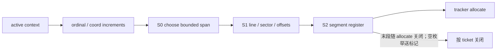

# blackwell_tma_request_generator

## Description

单 walker 按 FIFO 顺序从 setup 的 ARMED 槽取命令，给 tracker 生成段。S0 接受一段即推进相应游标，S1/S2 可同时含不同 ticket。[地址算法](blackwell_tma_setup.md#tensor-map) · [段定义](#segment)

| 信号 / 通道 | 方向、类型 / 位宽 | 对端 | 握手或采样条件 |
| --- | --- | --- | --- |
| head / context；walk_start / slot_release | 入 [tma_context_ref_t](blackwell_tma_setup.md#context) / [tma_context_t](blackwell_tma_setup.md#context)；两路出 tma_context_ref_t | TMA unit、setup | head 是已 arm、begin 且绑定成功（若需要）的 FIFO 队首。首段 S0.fire 脉冲 walk_start。单段可与 slot_release 同沿，setup 以释放为最终状态；末段或关闭标记 S0.fire 同沿发一次释放脉冲，unit/setup 必接。 |
| segment / generated | 出 [tma_segment_t](#segment) / [tma_finish_t](blackwell_tma_completion_tracker.md#transfer-types) | tracker | 普通段由 S2 送 allocate；末段 allocate.fire 在 tracker 内同时关闭该 ticket。空枚举用同一流水传递仅关闭标记，经 generated 握手，不申请 tag。二者均按 ticket 恰好关闭一次。 |
| drained / fault | 出 bit / bit | TMA unit | 游标、三个弹性级和 held generated 空 / sticky 身份故障。 |

时钟、复位及通道的采样约定见[顶层公共协议](../top/blackwell_async_subsystem_top.md#common-protocol)。

## Functionality

### S0 接受与游标推进

S0 空或旧项本沿前移即可收新段。首段直接从队首参数计算；后续段用单套坐标增量。S0 保存 ticket、末段/仅关闭、ordinal、有效长度、方向、OOB、两端已算地址和 swizzle 控制；S1 和 S2 仅用本级输入。受阻保持全部字段。A 的末段在 f 入 S0，B 的首段可在 f+1 入 S0，即使 A 被后级反压过也以实际空位判定。

| 级 | 本段计算 | 输出 |
|---|---|---|
| S0 | 依据当前坐标求换位前 SMEM 地址 x；有效 GMEM 首址为 a。在 remaining、逻辑行尾、panel 尾、SMEM sector 尾、有效 GMEM 行尾和下一处 OOB 性质变化中取最短距离，再限至 128 B。linear 只取适用边界。 | 最长同性质非空前缀 n，合法 FP16 始终保留完整元素 |
| S1 | 对有效段取 128 B 对齐的 GMEM 行及偏移，对所有段取 SMEM sector 和起始偏移。panel 步进见 [setup](blackwell_tma_setup.md#tensor-map)。 | 两端基址、偏移、换位选择及 n |
| S2 | 保存 segment 或关闭标记。若一段在 f 进 S0，无停顿时 f+1 进 S1、f+2 进 S2、f+3 交给 tracker。 | 每沿最多交付一个 token，包括最后一段；无额外命令结束时隙。 |

### 尾段与空枚举

非空命令在最后一次 S0.fire 归还 setup 槽，旧 ticket 随段留在 S1/S2，末段 allocate.fire 同沿关闭枚举。空命令送一枚仅关闭标记，S0 接受时同样释放上下文。每条命令只关闭一次。正常 stop 继续处理已接受命令。

### 复位与边界条件

清 valid、游标有效、结果与 fault；数据端响应独立排空。验证 S0/S1/S2 各自停止、末段与相邻命令交接、输出稳定及 ordinal 无重叠，跨 GMEM 行、全/部分 OOB、非单调维度 stride、不同地址落到同一 SMEM bank、64 个 tag 满后恢复，以及 load 在等待 GMEM 返回期间继续发出后续段。

### Segment 类型

`tma_segment_t` 共 **193 bit**。每段覆盖一个换位前 SMEM sector，in-bounds 段同时落在一条 GMEM 行。字段按下表从高到低打包。

| 字段 | bit | 含义 |
|---|---:|---|
| ticket、ordinal | 5、64 | 原操作引用、首个逻辑 byte 序号 |
| gmem_line、goff | 64、7 | 对齐 GMEM 行的字节地址和首 byte 在行内的偏移；OOB 均置零 |
| smem_sector、soff | 32、7 | 对齐的换位前 SMEM 字节地址及首 byte 在 sector 内的偏移 |
| xor_group、logical_bytes | 3、8 | linear 时 xor_group=0；128 B swizzle 时等于 (smem_sector>>7)&7。n=logical_bytes，范围 1…128 |
| store、oob、last | 1、1、1 | 数据方向、整段越界、指令末段 |

对段内 byte `j=0…n−1`，令 `u=soff+j`，物理组 `g=(u>>4)^xor_group`，byte lane `k=u&15`。该组请求地址为 `smem_sector+16*g`，置 `mask[g][k]`；GMEM 行内 lane 为 `goff+j`。这些式子同时定义反向 gather 和两端 byte enable。每组至多一个 atom，mask 非空才发。满行时只交换八个 16 B atom 的组号。错位段还按两端偏移对齐 byte。端口 mask 与组地址从上述字段组合生成。

OOB load 只生成目标 SMEM mask，实际写零并计入 logical bytes。OOB store 两端 mask 均为零，只推进 ordinal。OOB 段不使用 GMEM 行尾截断，避免对虚地址做越界运算。分别覆盖 linear 首址仅 16 B 对齐、起点在 sector 中部、GMEM 和 SMEM 边界不同拍到达、FP16 行尾及 OOB 转折。[完成事件](blackwell_tma_completion_tracker.md#transfer-types)
