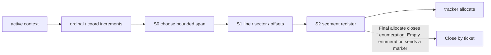

# blackwell_tma_request_generator

## Description

The single walker consumes ARMED setup slots in FIFO order and generates segments for the tracker. Each S0 segment acceptance advances its cursor. S1 and S2 may hold different tickets at the same time. [Address algorithm](blackwell_tma_setup.md#tensor-map) · [Segment definition](#segment)

| Signal / channel | Direction, type / width | Peer | Handshake or sampling condition |
| --- | --- | --- | --- |
| head / context, walk_start / slot_release | Input [tma_context_ref_t](blackwell_tma_setup.md#context) / [tma_context_t](blackwell_tma_setup.md#context), two tma_context_ref_t outputs | TMA unit, setup | head is the armed FIFO head with begin complete and successful binding if required. First S0.fire pulses walk_start. A single segment may also assert slot_release on that edge. Release determines setup's final state. Pulse release once when the last segment or close marker fires into S0. The unit/setup must accept it. |
| segment / generated | Output [tma_segment_t](#segment) / [tma_finish_t](blackwell_tma_completion_tracker.md#transfer-types) | tracker | S2 sends ordinary segments to allocate. The final allocate.fire also closes the ticket in the tracker. An empty enumeration passes a close-only marker through the same pipeline to generated and takes no tag. Both forms close each ticket exactly once. |
| drained / fault | Output bit / bit | TMA unit | Cursor, three elastic stages, and held generated empty / sticky identity fault. |

The [top-level common protocol](../top/blackwell_async_subsystem_top.md#common-protocol) defines clock, reset, and channel sampling.

## Functionality

### S0 acceptance and cursor advance

S0 accepts a new segment when empty or moving its old entry on this edge. Compute the first segment directly from the head parameters. Later segments use a single set of coordinate increments. S0 captures ticket, last/close-only, ordinal, valid length, operation mode, OOB, GMEM/SMEM bases and the byte position in the row. S1/S2 use only their stage inputs. Hold all fields on stall. If A's last segment enters S0 at f, B's first can enter at f+1. Use actual available space even if downstream previously stalled A.

| Stage | Computation at this stage | Output |
|---|---|---|
| S0 | Use the low seven bits of the current bases and offsets. A three-level minimum tree selects the shortest distance to remaining length, logical row end, panel end, SMEM sector end, valid GMEM line end, or the next OOB transition, limited to 128 B. Linear uses only applicable boundaries. | Longest nonempty prefix n of uniform access type. Legal FP16 always preserves whole elements |
| S1 | Add the captured row offset to the GMEM row base and its within-panel offset to the SMEM panel base. Linear adds ordinal to both command bases. Form the aligned line, sector and offsets, clearing GMEM fields for OOB. See [setup](blackwell_tma_setup.md#tensor-map) for panel stepping. | Both bases and offsets, swizzle selection, and n |
| S2 | Register segment or close marker. For a segment entering S0 at f without stalls, S1 captures at f+1, S2 at f+2, and the tracker at f+3. | At most one token per edge, including the last segment. No separate end-of-command slot. |

For each outer dimension the walker holds the GMEM address at its current slice origin. On a row carry into dimension d, increment that anchor by stride[d] and copy the result to inner anchors. At row end, advance the SMEM row base by 128 B and restart its panel base there. A panel crossing within a row advances the panel base by row_count × 128 B. Update cursors only on S0 acceptance. These recurrences preserve nonmonotonic strides and avoid per-segment multiplication. The virtual GMEM cursor advances modulo 2⁶⁴ through OOB regions. Only in-bounds segments use the cursor to form a GMEM request, within the [span checked by setup](blackwell_tma_setup.md#copy-span).

### Final segment and empty enumeration

A nonempty command releases its setup slot on its final S0.fire. Its ticket travels with the segment through S1/S2. Last allocate.fire closes enumeration on that edge. An empty command sends one close-only marker and also releases context when S0 accepts it. Close every command exactly once. Normal stop continues processing accepted commands.

### Reset and boundary conditions

Clear valid, cursor valid, result, and fault. The data side drains responses independently. Test separate stalls of S0/S1/S2, last-segment handoff to the next command, stable outputs, nonoverlapping ordinals, GMEM line crossings, full/partial OOB, nonmonotonic dimension strides, different addresses mapping to the same SMEM bank, recovery after filling all 64 tags, and continued load segment issue while waiting for GMEM returns.

### Segment type

`tma_segment_t` totals **193 bits**. Each segment spans one unswizzled SMEM sector. An in-bounds segment also fits one GMEM line. Pack fields high to low as below.

| Fields | bit | Meaning |
|---|---:|---|
| ticket, ordinal | 5, 64 | Original operation reference and ordinal of the first logical byte |
| gmem_line, goff | 64, 7 | Aligned GMEM line byte address and first byte's offset in it. Both zero for OOB |
| smem_sector, soff | 32, 7 | Aligned unswizzled SMEM byte address and first byte's offset in the sector |
| xor_group, logical_bytes | 3, 8 | Linear uses xor_group=0. For 128 B swizzle use (smem_sector>>7)&7. n=logical_bytes, range 1…128 |
| store, oob, last | 1, 1, 1 | Data direction, whole-segment OOB, final segment of instruction |

For segment byte `j=0…n−1`, let `u=soff+j`, physical group `g=(u>>4)^xor_group`, and byte lane `k=u&15`. The group's request address is `smem_sector+16*g`. Set `mask[g][k]`. The GMEM line lane is `goff+j`. These formulas also define reverse gather and byte enables on both sides. Each group has at most one atom and issues only with a nonempty mask. Full lines only permute the groups of the eight 16 B atoms. Misaligned segments also align bytes using the offsets at both ends. Generate port masks and group addresses combinationally from these fields.

OOB loads generate only the destination SMEM mask, actually write zeros, and count toward logical bytes. OOB stores have zero masks at both ends and only advance ordinal. Do not split OOB segments on a GMEM line boundary or issue a GMEM access for an out-of-range virtual address. Cover linear bases aligned to only 16 B, starts inside a sector, different GMEM/SMEM boundaries, FP16 row ends, and OOB transitions. [Completion events](blackwell_tma_completion_tracker.md#transfer-types)
