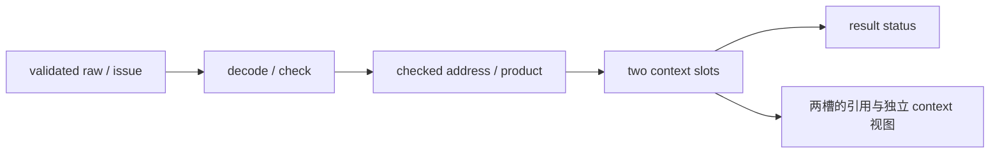

# blackwell_tma_setup

## Description

setup 从 TMA unit 接收 linear 或 tiled copy，为 walker 建立经过范围校验的不可变 context。两个槽共享一条四级乘法流水，当前命令枚举时可准备相邻命令。

| 信号 / 通道 | 方向、类型 / 位宽 | 对端 | 握手或采样条件 |
| --- | --- | --- | --- |
| request / result | 入 [tma_setup_req_t](#context) (1507 bit) / 出 [tma_setup_rsp_t](#context) (74 bit) | TMA unit | 接受时预留 free slot 与返回位置，result 在消费前稳定。 |
| arm / walk_start / slot_release | 各入 [tma_context_ref_t](#context) (6 bit) | TMA unit | unit 使已预检且准入的 READY 槽转 ARMED；首段 S0.fire 经 unit 回送 walk_start；walker 末次 S0.fire 的释放经 unit 原样回送。 |
| ctx[2] / slot_state[2] / slot_ticket[2] / span[2] | 出，每槽 [context](#context) 983 bit、五态枚举、ticket u5、[访问区间](#copy-span) | TMA unit、walker | unit 在 READY 复制长期字段，walker 只选沿前 ARMED 或正在枚举的槽；release 沿仍读旧值。 |
| drained / fault | 出 bit / bit | TMA unit | 两槽空且无计算/result；运行 fault 仅复位清除。 |

时钟、复位及通道的采样约定见[顶层公共协议](../top/blackwell_async_subsystem_top.md#common-protocol)。



## Functionality

### 分配与归还 setup 槽

两个 983-bit 槽各持 FREE/BUILD/READY/ARMED/WALK、ticket 和 span；共用一套四级乘法器及一个 held result。第一段进 S0 后为 WALK；单段命令可由 ARMED 直接释放。释放以本槽末段或空枚举标记进入 S0 为准。归还时可同沿接受针对同槽的新 build，先使用旧上下文再初始化新 owner。下游在 S0 以后不引用该槽。

<a id="copy-span"></a>
### 确定访问区间

每个地址空间的空位标志和闭区间来自本次 CHECK。SMEM 保留首末换位前 128 B sector 编号（各 11 bit）；swizzle 只在 sector 内重排。GMEM 取 in-bounds 交集中最低/最高实际 byte 的 128 B 行号（各 57 bit，正 stride 的两个坐标端点求界）；linear 取连续范围。无有效 GMEM 访问标空，OOB load 的零填目标仍计入 SMEM，纯 NO_ACCESS store 可标双空。padding 和 stride 间隙允许保守假相交。unit 将结果存到 ticket，用于与全部未结清的旧命令比较。

### 地址预检与发布

1. 在 DECODE 检查 id、opcode 与项目 map 的 rank/box/step/dtype/swizzle。仅成功的 demand descriptor 进入此模块。对 linear 检查 16 B 对齐、全 SMEM/GMEM 半开区间和 load 字节上限，包括加法进位。
2. 对 tiled，在 widened 运算中求 `elements=product(box)`、`total=2*elements` 和 `inner=2*box[0]`。对每个维度把 coord…coord+box−1 与 0…dim−1 取交。只有所有维度交集非空，才以实际 in-bounds 各维最大值与对应正 stride 求最高 GMEM 地址并检查 u64。整个 tile 越界可正常产生零源，不因虚地址越界失败。
3. 对实际 tile 写入/读取的所有 SMEM 原子检查逻辑 swizzle 后的地址。无 swizzle 比较末 byte。带 swizzle 时按项目 panel/row 布局计算最后一个实际 byte 的换位前地址，XOR 在每个 byte 所在 128 B sector 内完成，检查最高被访问 sector 落入 228 KiB 即可（容量为 128 B 的整数倍）。禁止以高维 stride 单调关系检查合法性。
4. 将 total/inner/elements 与解码参数写入 slot。linear 路径固定 decode/check/result 三拍。tensor 共用一个四级、II=1 的乘法流水。每沿可提交一个源操作数已就绪的乘积；box 连乘的下一项依赖前项返回，独立的最低/最高地址 stride 项可填这些间隙。各级带 slot、目标累加器和维号；每个已发乘积四沿后归入该槽，原槽在所有乘积返回及 CHECK 完成前保持。多个候选在两个 BUILD 槽间轮询，槽内就绪的 box 链优先、其余按维号和低/高端点顺序。延迟由实际启动的最后一个必需乘积及 CHECK/result 握手决定。无商余数预计算/传输，walker 使用逐维比较进位。

### 错误与资源回收

setup 发现非法 descriptor 或展开地址越界时向 unit 报运行故障，不发布 READY、不发 bind。检查 slot 早释放后仍有三个旧 ticket 收到返回，迟到响应均按原 ticket 路由；覆盖两个槽交错、结果背压、非单调 stride、GMEM 溢出与 SMEM 最后合法 byte。

<a id="tensor-map"></a>

### Tensor Map 编码及地址语义

TMA 的逻辑输入是描述 GMEM 张量与 SMEM tile 对应关系的 **128 B 项目对象**。外围把调用参数中按值传入的 CUDA opaque descriptor 翻译为本格式，校验后提供在当前 epoch 内地址稳定、128 B 对齐的只读映像。缓存按这个地址取项目字节。构建映像时保留维度的逻辑顺序、每一维的实际 byte stride、box、swizzle 和 GMEM base；不能按数组下标猜物理维度顺序。[支持范围与证据](../../proposals/supported_ptx.md)

#### 项目编码

所有数值小端，byte 0 为 packed vector 的最低字节。表中给出格式的可表示范围；入口只接受支持清单中已开放的组合。

| Byte | 字段 | 值及验证 |
|---|---|---|
| 0 | version | 0x10 |
| 1 | rank_m1、kind | [2:0] 为逻辑 rank−1，首版固定 rank=4；[4:3]=0 表示 tiled，[7:5]=0。四维对象的 rank_m1=3。 |
| 2 | dtype、interleave、fill | [3:0]=6 表示 FP16，[5:4]=0 表示无 interleave，bit6=0 表示 OOB 零填，[7]=0。 |
| 3 | swizzle、atom、l2promotion | [1:0]=0/1/2/3 表示 none/32/64/128 B；[3:2]=0，对应 16 B atom；[5:4]=0…3 为缓存提示，[7:6]=0。 |
| 4…11 | base | u64，16 B 对齐的 GMEM byte 地址。 |
| 12…31 | dim_m1[5] | 各 u32，有效维长为零扩展至 u33 后加 1。 |
| 32…71 | stride[5] | 各 u64；stride[0]=0 表示隐含 2 B，其余有效项为正、16 B 整数倍且 <2^40。 |
| 72…81 | box[5] | 各 u16，有效值 1…256，box[0]×2 为 16 B 整数倍。 |
| 82…86 | step[5] | 有效维均为 1。 |
| 87…127 | reserved | 全零。 |

第 5 维仅为公共 128 B 格式中的预留位置，dim_m1[4]、stride[4]、box[4]、step[4] 全部为 0。外围在映像正规化、异步登记前检查保留位、版本、范围与白名单。首版 tiled copy 接受 rank-4 FP16、无 interleave、128 B swizzle；setup 对已登记 ticket 发现非法映像时报告 fault。linear copy 无 Tensor Map。

#### 地址、OOB 与事务字节

设 tile 起点为有符号 coord，局部元素为 v。最低维 v[0] 最快推进，每维访问 0…box[i]−1。完整 tile 的 logical_bytes 为 `2 × product(box[i])`。对 in-bounds 的 u=coord+v：

```text
address = base + 2*u[0] + sum(u[i]*stride[i] for i = 1..rank-1)
ordinal = 2*(v[0] + box[0]*(v[1] + box[1]*(...)))
```

只对全部 `0 ≤ u[i] < dim[i]` 的元素生成上述 GMEM 地址。每个实际 byte 地址以扩展精度计算并检查 u64 范围。stride 对应独立逻辑维度，允许较高编号维的 stride 小于较低编号维的 stride。load 的 OOB 元素不发 GMEM 请求，向 SMEM 实际写两个零 byte，仍计入 barrier 的 logical_bytes。store 的 OOB 元素不写 GMEM，仅推进逻辑位置。store 起点非负。普通 linear copy 搬运连续字节，无 swizzle、无 OOB 零填。

SMEM 使用相同的字节换位做 load 和 store。设 row 为除 v[0] 的其余坐标按 box 顺序线性化，rows=product(box[1:4])，inner=2×box[0]，b=2×v[0]+byte_in_element。无 swizzle 时地址为 smem_base+row×inner+b。首版 span=128 B、16 B atom，smem_base 至少 16 B 对齐。inner≤128 时每行占一个 128 B sector；inner>128 的项目 map 按 **panel 优先**存储：先放所有行的第一个 128 B panel，再放第二个，依次类推。尾 panel 未用 byte 是 padding，不发请求、不计 logical_bytes。

```text
panel = b // 128
within = b % 128
x = smem_base + panel*rows*128 + row*128 + within
smem_addr = x ^ (((x >> 7) & 7) << 4)
```

项目 map 按 panel 顺序计算字节地址。`inner=256` 的两片各占完整的 rows 行。MMA descriptor 的 start 取换位前的子块地址。对相同逻辑坐标，TMA 的写地址与 MMA 的读地址须逐 byte 相等。[矩阵描述符](../tensor_core/blackwell_tc_mma_engine.md#matrix-descriptor)

所有填充目标及所有实际请求地址必须在本 CTA 的 228 KiB SMEM 范围。fabric 仅在上述逻辑地址上应用一次物理 bank 映射。setup 检查命令会触及的实际地址集合、walker 按逻辑 ordinal 切片，不把整张张量任意 OOB 虚地址计入错误。[PTX tensor copy](https://docs.nvidia.com/cuda/archive/12.8.2/parallel-thread-execution/index.html#data-movement-and-conversion-instructions-cp-async-bulk-tensor)

#### 可重算样例

分别改变各维 stride 与 panel，核对同一坐标的 GMEM 字节和换位后 SMEM 字节。实际 descriptor、非单调 stride 和跨 panel 的逐地址结果见 [FA4 设计记录](../../proposals/mma_inter_instruction_pipeline.md)。

测试非零 swizzle base、边缘部分/全部 OOB、跨 128 B GMEM 行、非法 stride 对齐、地址加法溢出、SMEM 最后合法 byte、非法字段失败不 bind。当前 epoch 中 map 必须保持只读，无 map writer 或失效请求。新 epoch 在排空后清 cache valid。

<a id="context"></a>

### Context 与 setup 类型

`tensor_decoded_t={base:64,dim[4]:u33,stride[1..3]:u40,box[4]:u9,swizzle:2,l2promotion:2}`，**356bit**。已静态验证 FP16、unit step、无 interleave、16 B atom。linear 时 map 全零。
`tma_context_t={cmd:tma_cmd_t,map:tensor_decoded_t,ticket:5,total_bytes:64,inner_bytes:16,iteration_count:64}`，**983bit**。iteration_count 对 tensor 为有效 tile 元素数，对 linear 为 byte 数；inner_bytes 是一行的逻辑 byte 数，linear 时为 0。

| 类型 | 字段 |
|---|---|
| tma_setup_req_t / tma_setup_rsp_t | issue,raw1024 / ticket5,context_slot1,total_bytes64,status4 |
| tma_context_ref_t | ticket5,context_slot1 |

unit 按 ticket 消费 cache.result，status=OK 才向 setup 交付 raw；linear.setup 的 raw=0。context 存活期间由 setup 唯一拥有，active view 为组合只读。source progress 要求全部必要源读交付；full progress 另含全部实际目标写 ACK，成功 load 还含 producer_rsp。

`tma_issue_t` 见 [unit](blackwell_tma_unit.md#issue-type)。
