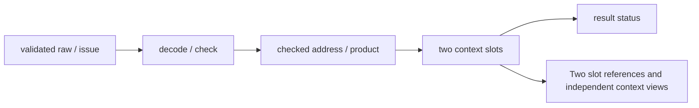

# blackwell_tma_setup

## Description

Setup accepts linear or tiled copies from the TMA unit and builds immutable, range-checked contexts for the walker. Two slots share one four-stage multiply pipeline. Setup may prepare the next command while the current one enumerates.

| Signal / channel | Direction, type / width | Peer | Handshake or sampling condition |
| --- | --- | --- | --- |
| request / result | Input [tma_setup_req_t](#context) (1507 bits) / output [tma_setup_rsp_t](#context) (74 bits) | TMA unit | Reserve a free slot and result position at acceptance. Hold result until consumed. |
| arm / walk_start / slot_release | Each input [tma_context_ref_t](#context) (6 bits) | TMA unit | The unit moves a checked and admitted slot from READY to ARMED, relays walk_start from the first S0.fire, and forwards the walker's release from its final S0.fire unchanged. |
| ctx[2] / slot_state[2] / slot_ticket[2] / span[2] | Output per slot: [context](#context) 983 bits, five-state enum, ticket u5, [access spans](#copy-span) | TMA unit, walker | The unit copies long-lived fields in READY. The walker selects only a pre-edge ARMED slot or one already enumerating. The release edge still reads old values. |
| drained / fault | Output bit / bit | TMA unit | Both slots empty and no computation/result / runtime fault cleared only by reset. |

The [top-level common protocol](../top/blackwell_async_subsystem_top.md#common-protocol) defines clock, reset, and channel sampling.



## Functionality

### Allocate and release setup slots

Each of two 983-bit slots has state FREE/BUILD/READY/ARMED/WALK, ticket, and span. They share a four-stage multiplier and one held result. The first segment entering S0 sets WALK. A single-segment command can release directly from ARMED. Release when the last segment or empty-enumeration marker enters S0. A new build for the same slot can be accepted on the release edge. Read old context before initializing the new owner. Stages beyond S0 have no references to the slot.

<a id="copy-span"></a>
### Determine access spans

CHECK produces an empty flag and inclusive span per address space. For SMEM retain the first and last unswizzled 128 B sector indices (11 bits each). Swizzle only permutes within a sector. For GMEM take the 128 B line indices of the lowest/highest actual byte in the in-bounds intersection (57 bits each, using coordinate endpoints with positive strides). Linear uses its contiguous range. Mark GMEM empty when no valid access exists. OOB load zero-fill destinations still count in SMEM. An all-NO_ACCESS store can mark both empty. Padding and stride gaps may cause conservative false overlaps. The unit saves spans in the ticket to compare against all unsettled older commands.

### Address precheck and publication

1. DECODE checks ID, opcode, and project map rank/box/step/dtype/swizzle. Only a successful demand descriptor reaches setup. For linear check 16 B alignment, full half-open SMEM/GMEM ranges, and the load byte limit, including addition carry.
2. For tiled copies compute `elements=product(box)`, `total=2*elements`, and `inner=2*box[0]` in widened arithmetic. In each dimension intersect coord…coord+box−1 with 0…dim−1. Only if all intersections are nonempty, use the actual maximum in-bounds coordinate in each dimension with its positive stride to compute the highest GMEM address and check u64. A completely OOB tile can produce a zero source normally. Its virtual addresses cannot cause a range failure.
3. Check the logically swizzled addresses of all actual SMEM atoms in the tile. Without swizzle compare the final byte. With swizzle compute the last actual byte's unswizzled address using the project panel/row layout. XOR stays within each byte's 128 B sector, so checking that the highest accessed sector fits 228 KiB suffices because capacity is a multiple of 128 B. Do not require higher-dimensional strides to be monotonic.
4. Write total/inner/elements and decoded parameters into the slot. The linear path takes three fixed cycles for decode/check/result. Tensor setup shares one four-stage, II=1 multiplier. Each edge can start one product whose operands are ready. Each next box product depends on the preceding result. Independent low/high address stride terms can use intervening cycles. Each stage carries slot, destination accumulator, and dimension. A product returns to its slot four edges after issue. Keep the original slot until all products return and CHECK finishes. Round-robin between the two BUILD slots. Within a slot prefer a ready box chain, then dimension and low/high endpoint order. Actual launch of the last required product and CHECK/result handshakes determine latency. The walker compares and carries by dimension, so no quotient or remainder is precomputed or transferred.

### Errors and resource release

An illegal descriptor or expanded address outside range raises runtime fault to the unit. Do not publish READY or issue bind. With three old tickets still receiving returns after early slot release, check that late replies route by original ticket. Cover two interleaved slots, result backpressure, nonmonotonic strides, GMEM overflow, and the last legal SMEM byte.

<a id="tensor-map"></a>

### Tensor Map encoding and address semantics

The logical TMA input is a **128 B project object** mapping a GMEM tensor to an SMEM tile. The surrounding system translates the by-value CUDA opaque descriptor argument into this format, validates it, and provides a read-only, 128 B aligned image at a stable address throughout the epoch. The cache reads project bytes at that address. Preserve logical dimension order, each actual byte stride, box, swizzle, and GMEM base. Do not infer physical dimension order from array indices. [Scope and references](../../proposals/supported_ptx.md)

#### Project encoding

All values are little-endian. Byte 0 is the least significant byte of the packed vector. The table gives representable ranges. Ingress accepts only combinations enabled by the support list.

| Byte | Fields | Value and validation |
|---|---|---|
| 0 | version | 0x10 |
| 1 | rank_m1, kind | [2:0] is logical rank−1, fixed at rank=4 in v1. [4:3]=0 denotes tiled and [7:5]=0. A rank-four object has rank_m1=3. |
| 2 | dtype, interleave, fill | [3:0]=6 denotes FP16, [5:4]=0 selects no interleave, bit6=0 selects OOB zero fill, and [7]=0. |
| 3 | swizzle, atom, l2promotion | [1:0]=0/1/2/3 selects none/32/64/128 B. [3:2]=0 selects 16 B atoms. [5:4]=0…3 is a cache hint and [7:6]=0. |
| 4…11 | base | u64, 16 B aligned GMEM byte address. |
| 12…31 | dim_m1[5] | Each u32. Zero-extend to u33 and add 1 to obtain the dimension length. |
| 32…71 | stride[5] | Each u64. stride[0]=0 implies 2 B. Other active entries are positive multiples of 16 B and <2^40. |
| 72…81 | box[5] | Each u16, valid range 1…256. box[0]×2 must be a multiple of 16 B. |
| 82…86 | step[5] | Each active dimension uses 1. |
| 87…127 | reserved | All zero. |

The fifth dimension is reserved in the common 128 B format. dim_m1[4], stride[4], box[4], and step[4] are all zero. The surrounding system checks reserved bits, version, ranges, and allowed combinations while normalizing the image before asynchronous registration. V1 tiled copy accepts rank-4 FP16, no interleave, and 128 B swizzle. If setup finds an invalid image for a registered ticket, raise fault. Linear copy uses no Tensor Map.

#### Addresses, OOB, and transaction bytes

Let signed coord be the tile origin and v a local element. v[0] advances fastest, with each dimension ranging from 0…box[i]−1. The complete tile's logical_bytes is `2 × product(box[i])`. For in-bounds u=coord+v:

```text
address = base + 2*u[0] + sum(u[i]*stride[i] for i = 1..rank-1)
ordinal = 2*(v[0] + box[0]*(v[1] + box[1]*(...)))
```

Generate the GMEM address above only for elements satisfying `0 ≤ u[i] < dim[i]` in every dimension. Compute each actual byte address at extended precision and check u64 range. Strides correspond to independent logical dimensions. A higher-index dimension may have a smaller stride. An OOB load element issues no GMEM request, writes two zero bytes to SMEM, and counts toward barrier logical_bytes. An OOB store element skips GMEM and advances the logical position. A store requires a nonnegative origin. Ordinary linear copy transfers contiguous bytes without swizzle or OOB zero fill.

SMEM uses the same byte swizzle for loads and stores. Let row linearize the coordinates other than v[0] in box order, rows=product(box[1:4]), inner=2×box[0], and b=2×v[0]+byte_in_element. Without swizzle the address is smem_base+row×inner+b. V1 uses span=128 B, 16 B atoms, and smem_base aligned to at least 16 B. For inner≤128 each row occupies a 128 B sector. For inner>128 the project map stores **panel first**: all rows of the first 128 B panel, then all rows of the second, and so on. Unused bytes in the final panel are padding. They generate no requests and do not count toward logical_bytes.

```text
panel = b // 128
within = b % 128
x = smem_base + panel*rows*128 + row*128 + within
smem_addr = x ^ (((x >> 7) & 7) << 4)
```

Compute byte addresses in panel order. Each of the two panels in `inner=256` spans all rows. The MMA descriptor start is the unswizzled subblock address. At identical logical coordinates, TMA write and MMA read addresses must match byte for byte. [matrix descriptor](../tensor_core/blackwell_tc_mma_engine.md#matrix-descriptor)

All fill destinations and actual requests must fit within this CTA's 228 KiB SMEM. The fabric applies physical bank mapping exactly once to these logical addresses. Setup checks the actual address set and the walker splits by logical ordinal. Virtual OOB addresses outside the accessed set cannot cause an error. [PTX tensor copy](https://docs.nvidia.com/cuda/archive/12.8.2/parallel-thread-execution/index.html#data-movement-and-conversion-instructions-cp-async-bulk-tensor)

#### Reproducible examples

Vary each dimension's stride and the panel independently. At the same coordinate check the GMEM byte and swizzled SMEM byte. See the [FA4 design record](../../proposals/mma_inter_instruction_pipeline.md) for actual descriptors, nonmonotonic strides, and individual addresses across panels.

Test nonzero swizzle base, partial/full OOB at edges, 128 B GMEM line crossings, illegal stride alignment, address addition overflow, the last legal SMEM byte, and rejection before bind for invalid fields. The map stays read-only during its epoch. There is no map writer or invalidation request. A new epoch clears cache valid after drain.

<a id="context"></a>

### Context and setup types

`tensor_decoded_t={base:64,dim[4]:u33,stride[1..3]:u40,box[4]:u9,swizzle:2,l2promotion:2}` is **356 bits**. FP16, unit step, no interleave, and 16 B atoms have already been statically validated. Linear uses an all-zero map.
`tma_context_t={cmd:tma_cmd_t,map:tensor_decoded_t,ticket:5,total_bytes:64,inner_bytes:16,iteration_count:64}` is **983 bits**. For tensor, iteration_count is the number of tile elements to iterate. For linear it is the number of bytes. inner_bytes is the logical byte length of a row, zero for linear.

| Type | Fields |
|---|---|
| tma_setup_req_t / tma_setup_rsp_t | issue,raw1024 / ticket5,context_slot1,total_bytes64,status4 |
| tma_context_ref_t | ticket5,context_slot1 |

The unit consumes cache.result by ticket and sends raw to setup only for status=OK. linear.setup uses raw=0. Setup exclusively owns each context throughout its lifetime and exposes a read-only combinational active view. Source progress requires delivery of all necessary source reads. Full progress also requires every actual destination write ACK and, for a successful load, producer_rsp.

See [unit](blackwell_tma_unit.md#issue-type) for `tma_issue_t`.
