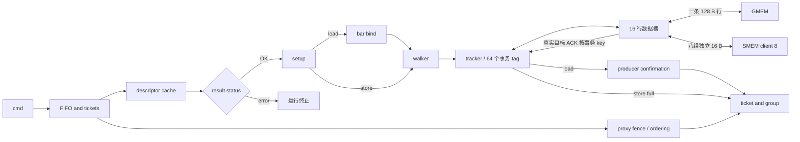

# blackwell_tma_unit

## Description

TMA 顶层拥有命令 FIFO、ticket 表和 bulk group 的成员年龄。数据命令按队列顺序进入一个地址生成器；已发命令可同时等待源返回、目标写确认或 barrier。完整地址计算上下文由 setup 持有，长期命令身份由 ticket 持有，段状态由 tracker 持有。[PTX 支持范围](../../proposals/supported_ptx.md)

| 信号 / 通道 | 方向、类型 / 位宽 | 对端 | 握手或采样条件 |
| --- | --- | --- | --- |
| cmd / rsp | 入 [tma_cmd_t](#command) / 出 [tma_rsp_t](#command) | 软件前端 | 接受边沿预留 ticket，rsp 可跨 issuer 乱序，选择后保持。 |
| gmem_req / gmem_rsp | 出 [gmem_req_t](#gmem-types) / 入 [gmem_rsp_t](#gmem-types) | GMEM | 单一 128 B 总线，按 class 路由回应。 |
| smem_req[8] / smem_rsp[8] | 出 [smem_atom_req_t](../smem/blackwell_smem_fabric.md#transactions) / 入 [smem_atom_rsp_t](../smem/blackwell_smem_fabric.md#transactions) | SMEM fabric | client8，端口 g 直连 SMEM 组 g。load 写及 ACK、store 读及返回各按组独立握手。 |
| order_req / order_rsp | 出 [order_req_t](../top/blackwell_async_subsystem_top.md#ordering) / 入 [op_done_t](../top/blackwell_async_subsystem_top.md#identity) | ordering 服务 | 显式 PROXY_FENCE 指令的请求与确认。 |
| bar_bind / bar_bind_rsp | 出 [bar_bind_t](../mbarrier/blackwell_mbarrier_frontend.md#command) / 入 op_done_t | barrier frontend | load 预检成功后绑定当前 phase。 |
| producer_done / producer_rsp | 出 [bar_producer_done_t](../mbarrier/blackwell_mbarrier_frontend.md#command) / 入 op_done_t | barrier frontend | load 完成一次，等对应对象更新确认。 |
| stop / epoch / drained / fault | 入 bit / 入 u16 / 出 bit / 出 bit | 顶层 | stop 封闭新外部 cmd，不阻断旧 ticket；drained 包含 held 响应。 |

时钟、复位及通道的采样约定见[顶层公共协议](../top/blackwell_async_subsystem_top.md#common-protocol)。

## Functionality

### 接受命令与完成字段

公开接口使用单 CTA 的规范化地址及项目 [Tensor Map](blackwell_tma_setup.md#tensor-map)。外部指令可发范围、修饰符与证据以[指令清单](../../proposals/supported_ptx.md)为准。opcode 是项目选择，字段从高到低打包。未用字段一律置零。

#### 命令及结果

| tma_cmd_t 字段 | bit | 含义 |
|---|---:|---|
| id、opcode | 58、3 | async_id_t 和下表操作。 |
| map_addr、smem_addr、global_addr | 64、32、64 | 128 B 对齐的已翻译项目 map 地址、本 CTA 逻辑 byte 地址、linear GMEM 地址。 |
| bytes、barrier_addr | 32、32 | linear 长度（显式 fence 固定 bytes=0）；load 的 8 B 对齐对象地址。 |
| coord | 128 | 4D tile 的四个 s32，coord[0] 在字段低位。维数由 opcode 和固定 descriptor 子集决定。 |
| cache_policy | 64 | 两种 4D tensor copy 均携带 .L2::cache_hint，其余命令置零；提示不改变数据和完成次序。 |
| wait_n | 1 | WAIT_GROUP_READ 只接立即数 0 或 1，前端在窄化前验证。 |

上述字段合计 **478bit**。对带有效 id 的未开放 opcode 或修饰符，前端在分配数据 ticket 前返回 UNSUPPORTED。`tma_rsp_t={done:op_done_t,logical_bytes:u64}`，126 bit。成功数据命令返回完整 logical_bytes，控制类返回 0。入口静态拒绝返回零字节；运行故障直接报顶层 fault。

| opcode | 名称 | 数据效果与完成 |
|---:|---|---|
| 0 | LOAD_TENSOR | Tiled GMEM→SMEM。rank 固定四维，coord 与 map 一致。收齐目标 SMEM 写 ACK 和绑定的 producer_rsp 后完成。 |
| 1 | STORE_TENSOR | Tiled SMEM→GMEM。源读取进入 bulk group 的读边界，所有目标 GMEM 写 ACK 进入 full 边界。 |
| 2 | LOAD_LINEAR | 连续 GMEM→SMEM，目标 mbarrier 完成。同一对象可有多条 load，每条只发一次本指令字节数。 |
| 3、4 | COMMIT_GROUP、WAIT_GROUP_READ | 按 issuer 登记组边界；wait 固定 .read，使用 wait_n，不访问 tensor payload。 |
| 5 | PROXY_FENCE | 固定 generic→async、shared::cta、调用线程的先前相关写，向真实 ordering 服务发请求，匹配确认后完成。 |
| 6 | PREFETCH_MAP | prefetch.tensormap 仅对描述符缓存发 hint，无 tile 数据、bind、copy group 或可见性责任。 |

线性 SMEM/GMEM 首址均按 16 B 对齐，bytes 是 16 B 的倍数。tile 的数据/地址效果与 OOB 见 [Tensor Map](blackwell_tma_setup.md#tensor-map)。单次 load 的 logical_bytes≤1,048,575；先验证全部范围再 bind。前端只可把确已指向本 CTA 的地址归一化成 CTA-local，不忽略 remote/multicast 位。fence.proxy.async.shared::cta 表达该 issuer 的旧 generic 写对后续 async 访问可见，必须经真实 ordering 确认。GMEM 数据请求只使用公共 READ/WRITE。

opcode=7 为拒绝码。未开放的 linear store、tensormap.replace、masked store、reduce、packed、im2col、multicast 等由前端在规整前拒绝，不产生控制事务。支持的指令实拼见[支持表](../../proposals/supported_ptx.md)；cluster 地址必须能证明指向当前 CTA 的 SMEM。

#### bulk group 的读截止

LOAD_TENSOR 与 STORE_TENSOR 在接受沿进入各自 issuer 的当前组。LOAD_LINEAR、hint 和 fence 不入组。每个活跃 tensor ticket 用 2 bit 保存组龄：0 为当前组，1 为最近关闭组，2 为更早关闭组。COMMIT_GROUP 在接受沿使同 issuer 的旧成员组龄饱和加一，空 commit 也推进组龄。WAIT_GROUP_READ(n) 在接受沿建立 18-bit pending：仅捕获沿前同 issuer、组龄大于 n 且 descriptor 或 source 尚欠的通用 ticket。n=0 等所有已提交组，n=1 跳过最近关闭组。两种 n 都排除当前组。每次命令接受至多一条。

对同沿到达的旧进度先扣除已满足的位；descriptor 和全部源读都结束才清相应 pending 位。后续接受、commit 或 ticket 复用不能增加旧快照。pending=0 可交付 wait 结果，背压保持。store 收齐实际 GMEM 写 ACK 才 full；load 收齐实际 SMEM 写 ACK 并确认 producer 更新才 full。

验收比对源读、目标写 ACK、producer_rsp 和最终响应的独立边沿。linear 用例每 phase 4×4096 B，其 mbarrier 一次登记 16384 B，四条 load 各扣 4096 B；下一 phase 使用同一地址及新 parity。tiled store 分别检查 group.read 0/1 与尾部 full 责任。

### 向执行路径派发

`tma_issue_t={ticket:5,cmd:tma_cmd_t}`，483bit。cmd 的唯一定义见本模块。

### GMEM 事务与回应身份

GMEM 总线128B（1024bit），地址64bit，mask128bit。`gmem_id_t={class:u2,tag:u6,phase:u1}` 共 9 bit。class0 用 [tracker 的段 key](blackwell_tma_completion_tracker.md#transfer-types)，保持到事务退休。class1 用 tag=0 及 [descriptor cache](blackwell_tma_descriptor_cache.md) 自己管理的 phase，最多一个 live。class2/3 保留。

| 类型 | 字段 |
|---|---|
| `gmem_req_t` | id9, op3, addr64, data1024, byte_mask128, cache_policy64 |
| `gmem_rsp_t` | id9, data1024, status4 |

op=0 READ、1 WRITE，其余保留。addr 对齐128B；prefetch.tensormap 作为描述符提示处理。READ 的成功返回表示数据已捕获。对 TMA store，GMEM 适配器只在该笔 WRITE 选中的字节已提交、且发起线程在观察完整完成后可经 generic proxy 读到其写入效果时返回 OK。非 OK 返回触发运行故障，已提交效果保留。

每个已接受请求返回一次带原 ID 的单拍响应，允许不同 ID 乱序。unit 由当前返回的 class 选择 data path 或 descriptor cache 的 ready。若 ready=0，外围持续保持 valid、完整 ID、data 和 status 至 fire；已锁定的回应可阻住同一物理口后续 class。数据行向 SMEM 的提交及 ACK 必须能够独立推进。返回不能等待新的请求被接受，失败同样须按原 ID 返回。

### 入口资源与接受条件

- 20 个 ticket，0…17 通用，18/19 保留给 group 或控制。各项保存 id58、opcode3、执行阶段、descriptor/source/full 和响应状态。数据 ticket 保存 logical_bytes64，tensor 成员另有组龄2；每个未完成 wait 保存截止位图18。子引用全部释放且软件响应消费后才复用 ticket。
- 组龄随成员 ticket 分配，在接受归组命令时清零。unit 使用通用 ticket 的 barrier_addr32 发起 bind，并用该地址及 [setup 访问区间](blackwell_tma_setup.md#copy-span) 检查 copy 依赖。setup 两槽只服务准备及 S0 枚举。held 软件响应保持选中 ticket 至 fire。
- GMEM 在 class0=data 和 class1=descriptor 间轮询。其余 class 保留。八组可在同沿传八笔不同 tag 的 atom。总线的 source 选择锁至 fire，response 只按实际 live class/id 返回；未知 class 消费并诊断。top 按固定组传递 valid/ready，保留 tag/group/phase，单组背压只锁该组的已展示响应。

cmd_ready 要求 epoch 匹配且 id 不重、ticket 可用，入 FIFO 的命令另需 FIFO 空间。静态非法修饰符在数据 ticket 登记前拒绝。group commit/wait 在接受沿登记，不占数据 FIFO，wait 不阻塞旧指令继续派发。操作按 FIFO 顺序 dispatch；可用空 setup 槽准备紧邻的 copy，遇显式 fence 不越过。各仲裁 held 状态在 stop 后继续工作。

#### 通用 ticket 的组合视图

`owner_view[0…17]` 由对应 ticket 的寄存字段组合驱动，每项类型为 `tma_owner_view_t={live:1,id:58,store:1,cache_policy:64,total_bytes:64,bound:1}`，从高位到低位共 **189 bit**。tracker 和 data path 可同沿读取，视图无独立握手或副本。`live` 取 ticket 占用位，空项的其余字段无效。

`store = (opcode == STORE_TENSOR)`。`id` 和 `cache_policy` 来自原命令，`total_bytes` 取 setup 成功发布的逻辑字节数。`bound` 记录本次 load 是否已收到成功的 bind 响应，新分配时清零。setup 槽归还后，旧段仍按 `tag.ticket` 读取原 ticket 的字段，直至该命令的子引用结清。

### 单条命令的生命周期

1. linear 直送 setup；tensor 和 descriptor hint 使用 cache.lookup。合法 hint 只尝试填 descriptor cache。成功 demand 将原 ticket 和 descriptor 交给 setup；实际 GMEM 回应非 OK 触发 fault。
2. setup 成功时将范围和 total_bytes 写入 unit.ticket；队首通过下文依赖检查后，load 发一次 bind，取得 OK 后才可送入 walker。bind 响应非 OK 触发 fault。bind 成功的 load（含空 load）须取得一次匹配 producer_rsp。
3. unit 提前把 READY 且准入的队首置 ARMED，tracker.begin(ticket) 初始化已有 ticket 对应的段跟踪状态。begin 可与上一命令枚举并行。walker 从 ARMED 队首直接采样第一段；首次 S0.fire 即命令发射，walk_start 按原引用回送 setup。末段进 S0 同沿归还 setup 槽，slot_release 带原 ticket/slot；其余级从流水寄存器读参数。unit 独立接收 source、full、finish，只有子引用和软件响应均已结清才回收 ticket。
4. store 的读进度满足已提交组 .read 的源要求，收齐实际 GMEM 写 ACK 并结清 ticket 后报告 full。load 的源与完整完成分别按[命令](blackwell_tma_unit.md#command)更新。tracker 的 producer_done 经 top→frontend，成功响应代表已提交对象，unit 不再扣 tx。旧组的读截止清位独立于 full 和软件响应消费。
5. PROXY_FENCE 是 FIFO 顺序边界。等覆盖的旧操作达到所需可见性，发送真实 ordering 并等 ACK，才放行后续访存。已发操作的内存和服务响应继续退休，软件取走旧 rsp 的时间不参与 fence 准入。

### 按序发射与跨命令交接

首段 S0.fire 将队首移出待发队列。walker 继续枚举旧命令时，unit 已可为新队首检查依赖、bind 和 begin。当这些步骤已完成且 S0 可用，独立后条首段最早在前条末段入 S0 的下一沿进入。所有 copy 共用 18 个通用 ticket、64 个段 tag、16 行数据 RAM 和各外部端口。load 还占 barrier frontend 的 producer 行（共 16 项）。无空 tag 时 S2 的背压逐级传回 S0。

依赖检查覆盖本 epoch 所有更早且相关责任尚未结束的 ticket。实现可在接受每个通用 ticket 时采样更早的 live 位图，旧 ticket 回收同沿先从各位图清旧位再登记新 owner，避免复用后把年轻 copy 当作前驱。load 的 GMEM 为读、SMEM 为写，store 方向相反。检查[两地址空间的保守区间](blackwell_tma_setup.md#copy-span)：只读相交可共存；若与老读相交且新操作要写，等老 source 完成；若与老写相交且任一方需要顺序，等老目标写 ACK 结清。load 的 barrier 对象另算 8 B 活跃写区间，数据访问与更早绑定或新绑定与更早数据可能冲突时，分别等旧对象更新或旧数据责任结束。指向同一 barrier 的合法 producer 可独立绑定；同址同 phase 的各笔字节由 frontend 按实际提交次序原子扣减。各自须先满足数据可见性并匹配本次绑定。未知范围按可能相交处理。空段不占数据区间，仍结清生成和绑定。store 与其他 copy 同样按依赖和真实端口准入。

两笔独立 16 KiB panel，各 128 个满段。以 A 首段 allocate 为 0，若 B 已准备好且各级 ready，A/B 的末段/首段分别在 124/125 入 S0、127/128 allocate、128/129 进入数据通路、129/130 发 GMEM READ。A 的 generated 在末段 allocate 同沿成立。连续三笔的首读为 2、130、258。另用三条 16 B linear load，SMEM 目的首址分别为 0x000、0x090、0x120（不同 sector 和物理组，barrier 与数据分离），扣住 A、B 的末 ACK，检查 C 仍可发读。暂停同组队首 ACK 可填满真实队列，届时后续 copy 按资源反压。仲裁、部分段、缓存或 producer 空间不足按实际 fire 计时。

### 复位、排空与验收

所有 copy 共用 128 B/拍的数据端口。按实际 mask、grant 与返回计算传输周期。[数据路径逐拍基准](blackwell_tma_data_path.md#peak)

同步复位清 ticket/FIFO/仲裁及 fault。正常换 epoch 要求 drained。未知身份、重复响应、活动事务非 OK（含 descriptor、数据、ordering 或 producer 服务）都报告顶层运行故障；本次运行结束，隔离后复位。

验收：验证linear load、tiled load/store、八组部分交付、异槽读返回、GMEM 写反压、desc hit/miss/失败、跨 issuer group、空 commit 使源读未结束的上一组由 1 进到 2、.read 0/1、最后目的写和 producer_rsp 分开暂停。测试乱序响应、64 个在途 tag、16 行满时的 GMEM 返回反压，以及数据槽复用后迟到的旧 tag 写 ACK。

## Submodules

| 子模块 | 实例数 | 连接与父模块控制 |
| --- | --- | --- |
| [fifo](../base/blackwell_fifo.md) | 1 | 8 项，各存 ticket5 与 cmd478。unit 按队首控制派发。 |
| [tma_descriptor_cache](blackwell_tma_descriptor_cache.md) | 1 | 向 setup 提供预检所需的描述符，与数据路径共用 GMEM。 |
| [tma_setup](blackwell_tma_setup.md) | 1 | 两个 context 槽校验地址并向 walker 发布 ARMED 上下文。 |
| [tma_request_generator](blackwell_tma_request_generator.md) | 1 | 单 walker 将队首命令枚举为 segment。 |
| [tma_completion_tracker](blackwell_tma_completion_tracker.md) | 1 | 在 ticket 下分配 tag，匹配事件并向 unit 报告进度和终态。 |
| [tma_data_path](blackwell_tma_data_path.md) | 1 | 按 tag 搬运 GMEM 行与 SMEM atom，所有 ticket 共用数据槽和端口。 |
