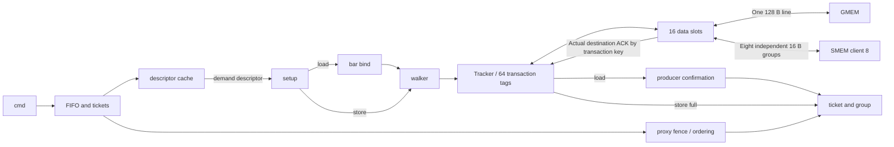

# blackwell_tma_unit

## Description

The TMA top level owns the command FIFO, ticket table, and bulk group member ages. Data commands enter one address generator in queue order. Issued commands may concurrently await source returns, destination write acknowledgments, or a barrier. Setup owns complete address-generation contexts, tickets own long-lived command identities, and the tracker owns segment state. [Supported PTX](../../proposals/supported_ptx.md)

| Signal / channel | Direction | Type / width | Peer | Sampling condition |
|---|---|---|---|---|
| `cmd` | Input | [tma_cmd_t](#command) (478 bits) | Software front end | On `cmd.fire`, reserve a ticket for the command. |
| `rsp` | Output | [tma_rsp_t](#command) (122 bits) | Software front end | On `rsp.fire`, deliver the held response. The receiver matches the full command ID. Independent responses may arrive out of acceptance order, including within one issuer. |
| `gmem_req` | Output | [gmem_req_t](#gmem-types) (1,292 bits) | GMEM | On `gmem_req.fire`, issue on the shared 128 B bus. |
| `gmem_rsp` | Input | [gmem_rsp_t](#gmem-types) (1,037 bits) | GMEM | On `gmem_rsp.fire`, route the return by class. |
| `smem_req[8]` | Output | [smem_atom_req_t](../smem/blackwell_smem_fabric.md#transactions) (255 bits) | SMEM fabric | On `smem_req.fire`, issue independently per client 8 group for load writes and store reads. |
| `smem_rsp[8]` | Input | [smem_atom_rsp_t](../smem/blackwell_smem_fabric.md#transactions) (207 bits) | SMEM fabric | On `smem_rsp.fire`, accept the matching group’s write ACK or read data. |
| `order_req` | Output | [order_req_t](../top/blackwell_async_subsystem_top.md#ordering) (163 bits) | Ordering service | On `order_req.fire`, submit the explicit PROXY_FENCE. |
| `order_rsp` | Input | [op_done_t](../top/blackwell_async_subsystem_top.md#identity) (58 bits) | Top-level ordering arbiter | On `order_rsp.fire`, accept its ordering acknowledgment. |
| `bar_bind` | Output | [bar_bind_t](../mbarrier/blackwell_mbarrier_frontend.md#command) (90 bits) | barrier frontend | On `bar_bind.fire`, bind the load after setup and dependency checks. |
| `bar_bind_rsp` | Input | op_done_t (58 bits) | barrier frontend | On `bar_bind_rsp.fire`, confirm the binding by ID. |
| `producer_done` | Output | [bar_producer_done_t](../mbarrier/blackwell_mbarrier_frontend.md#command) (90 bits) | barrier frontend | On `producer_done.fire`, submit the bound load’s completion once. |
| `producer_rsp` | Input | op_done_t (58 bits) | barrier frontend | On `producer_rsp.fire`, accept the matching object update acknowledgment. |
| `stop` | Input | 1 bit | Top level | Close new external commands. Accepted tickets continue. |
| `epoch` | Input | 16 bits | Top level | Level identifying the active CTA lifetime. |
| `drained` | Output | 1 bit | Top level | Level asserted after outstanding work and held transfers drain. |

The [top-level common protocol](../top/blackwell_async_subsystem_top.md#common-protocol) defines clock, reset, and channel sampling.

## Functionality

### Command acceptance and completion fields

The public interface uses normalized single-CTA addresses and the project [Tensor Map](blackwell_tma_setup.md#tensor-map). The [instruction list](../../proposals/supported_ptx.md) defines the supported external instructions, modifiers, and references. Opcodes are project-defined. Pack fields high to low and zero all unused fields.

#### Commands and results

| tma_cmd_t fields | bit | Meaning |
|---|---:|---|
| id, opcode | 58, 3 | async_id_t and the operation below. |
| map_addr, smem_addr, global_addr | 64, 32, 64 | 128 B aligned translated project map address, CTA-local logical byte address, linear GMEM address. |
| bytes, barrier_addr | 32, 32 | Linear length (explicit fence fixes bytes=0). Loads use an 8 B aligned object address. |
| coord | 128 | Four s32 coordinates for a 4D tile, with coord[0] in the low bits. Opcode and the fixed descriptor subset determine rank. |
| cache_policy | 64 | Both 4D tensor copy forms carry .L2::cache_hint. Other commands use zero. The hint does not alter data or completion order. |
| wait_n | 1 | WAIT_GROUP_READ accepts only immediate 0 or 1, checked by the simulation harness before narrowing. |

These fields total **478 bits**. `tma_rsp_t={done:op_done_t,logical_bytes:u64}` is 122 bits. Data commands return the full logical_bytes and control commands return zero.

| opcode | Name | Data effect and completion |
|---:|---|---|
| 0 | LOAD_TENSOR | Tiled GMEM→SMEM, fixed rank four, with coordinates matching the map. Complete after all destination SMEM write ACKs and the bound producer_rsp. |
| 1 | STORE_TENSOR | Tiled SMEM→GMEM. Source reads contribute to the bulk group's read boundary. All destination GMEM write ACKs contribute to full completion. |
| 2 | LOAD_LINEAR | Contiguous GMEM→SMEM with destination mbarrier completion. Multiple loads may bind the same object. Each reports its own instruction byte count once. |
| 3, 4 | COMMIT_GROUP, WAIT_GROUP_READ | Register the group boundary by issuer. Wait is fixed to .read, uses wait_n, and does not access tensor payload. |
| 5 | PROXY_FENCE | Fixed generic→async, shared::cta, covering the issuing thread's relevant preceding writes. Request actual ordering service and complete on matching acknowledgment. |
| 6 | PREFETCH_MAP | prefetch.tensormap hints the descriptor cache only. It has no tile data, binding, copy group, or visibility obligation. |

Both SMEM and GMEM linear bases are 16 B aligned and bytes is a multiple of 16 B. See [Tensor Map](blackwell_tma_setup.md#tensor-map) for tile data/address effects and OOB. One load has logical_bytes≤1,048,575. Normalized shared addresses target this CTA. Simulation checks alignment, actual address ranges and the byte bound. fence.proxy.async.shared::cta makes this issuer's preceding generic writes visible to subsequent async accesses and requires actual ordering acknowledgment. GMEM data requests use only the common READ/WRITE.

Opcode 7 is reserved. Simulation asserts that the input opcode and fields correspond to a normalized command in the [support table](../../proposals/supported_ptx.md).

#### Bulk group read cutoff

At acceptance, LOAD_TENSOR and STORE_TENSOR join the current bulk group of their full 10-bit issuer in the active epoch. For both, the read boundary covers the Tensor Map and all source data. LOAD_TENSOR also uses its mbarrier for destination completion. LOAD_LINEAR uses only mbarrier completion in this subset. Hints and fences have no group membership. [Supported PTX](../../proposals/supported_ptx.md#4-asynchronous-data-and-synchronization-instructions)

Each live tensor ticket stores a two-bit age. Age 0 denotes the open group, 1 the last committed group, and 2 any earlier committed group. COMMIT_GROUP closes the open group on acceptance and increments each member age for this issuer, saturating at 2. An empty commit also advances the ages. WAIT_GROUP_READ(n) captures an 18-bit pending set on acceptance. It selects pre-edge tickets from the same issuer whose age exceeds n and whose reads are unfinished. With n=0 this selects every committed group. With n=1 the most recent commit is skipped even if its group is empty. The unit accepts one command per edge.

A tensor ticket reaches the read boundary when its descriptor has reached setup, enumeration has closed, and the tracker reports all segment sources settled. Subtract matching source progress accepted on the wait's capture edge and clear existing snapshot bits on subsequent matching progress. Later commands and ticket reuse cannot enlarge the snapshot. Once it is empty the wait is eligible for the response port.

For example, one thread issues a tensor store, commits it, commits an empty group and executes `wait_group.read 1`. The store now has age 2. The wait can respond once the last source read has settled even if the store's GMEM write ACK is still outstanding. The store returns its own response after full completion. A tensor load similarly retains its destination writes and bound mbarrier update after its read boundary.

### Dispatch to execution

`tma_issue_t={ticket:5,cmd:tma_cmd_t}` is 483 bits. This module owns the cmd definition.

### GMEM transactions and response identity

The GMEM bus is 128 B (1024 bits), with a 64-bit address and 128-bit mask. `gmem_id_t={class:u2,tag:u6,phase:u1}` totals 9 bits. Class0 uses the [tracker segment key](blackwell_tma_completion_tracker.md#transfer-types) and retains it until transaction retirement. Class1 uses tag=0 and a phase managed by the [descriptor cache](blackwell_tma_descriptor_cache.md), with at most one live transaction. Classes 2/3 are reserved.

| Type | Fields |
|---|---|
| `gmem_req_t` | id9, op3, addr64, data1024, byte_mask128, cache_policy64 |
| `gmem_rsp_t` | id9, data1024, status4 |
| `tma_gmem_return_t` | id9, data1024 |

op=0 READ and 1 WRITE. Others are reserved. addr is 128 B aligned. Handle prefetch.tensormap as a descriptor hint. Successful READ means data has been captured. For a TMA store, the GMEM adapter returns OK only once the selected bytes of that WRITE have committed and the issuing thread can see their effects through the generic proxy after observing full completion. Simulation asserts status=OK whenever the GMEM service presents a valid response. The unit routes the 1,033-bit ID and data payload to the selected child on the same handshake.

Every accepted request receives one single-beat response with its original ID. Different IDs may return out of order. The current response class selects ready from the data path or descriptor cache. If ready=0, the external producer holds valid, full ID, data, and status until fire. A locked response can delay a later class on the same physical port. Data row commits to SMEM and their ACKs must progress independently. Returns must not wait for acceptance of a new request.

### Ingress resources and acceptance conditions

- There are 20 tickets: 0…17 general-purpose and 18/19 reserved for group or control. Each holds id58, opcode3, execution stage, descriptor/source/full, and response state. A data ticket stores logical_bytes64, a tensor member also stores two age bits, and each unfinished wait stores its 18-bit cutoff bitmap. Reuse a ticket only after all child references release and software consumes its response.
- Allocate group age with the member ticket and zero it when accepting a group member command. The unit binds using the general ticket's barrier_addr32 and checks copy dependencies against that address and the [setup access spans](blackwell_tma_setup.md#copy-span). The two setup slots serve only preparation and S0 enumeration. The response arbiter selects among eligible tickets and holds the full ID and payload until fire.
- GMEM round-robins between class0=data and class1=descriptor. Other classes are reserved. The eight SMEM groups can transfer eight atoms with different tags on one edge. Lock bus source selection until fire. Route responses by class and original transaction ID. Simulation asserts that valid responses belong to class 0 or 1 and match an outstanding request. The top passes valid/ready by fixed group, retaining tag/group/phase. A stalled group locks only its own presented response.

With external admission open, cmd_ready requires an available ticket and FIFO space for commands using the FIFO. The source provides a unique live ID in the current epoch. Register group commit/wait at acceptance outside the data FIFO. A wait does not block dispatch of older instructions. Dispatch operations in FIFO order. A free setup slot may prepare the immediately following copy without crossing an explicit fence. Held arbiters continue operating after stop.

#### Combinational general ticket view

`owner_view[0…17]` is driven combinationally from each ticket's registers. Each `tma_owner_view_t={live:1,id:58,store:1,cache_policy:64,total_bytes:64,bound:1}` entry totals **189 bits** from high to low. The tracker and data path can read it on the same edge. There is no independent handshake or copy. `live` takes the ticket's occupied bit. Other fields of an empty entry are invalid.

`store = (opcode == STORE_TENSOR)`. `id` and `cache_policy` come from the original command. `total_bytes` takes the logical byte count published by setup. `bound` records a matching bind acknowledgment for this load and clears on allocation. After setup slot release, old segments still use `tag.ticket` to read their original ticket fields until all child references settle.

### Command lifetime

1. Linear goes directly to setup. Tensor and descriptor hints use cache.lookup. A legal hint only attempts a descriptor cache fill. A demand lookup passes its original ticket and descriptor to setup.
2. When setup returns, write span and total_bytes into unit.ticket. When the head passes the dependency checks below, a load issues bind once and can enter the walker only after the matching bind acknowledgment. Every bound load, including an empty one, must receive one matching producer_rsp.
3. The unit arms an admitted READY head in advance. tracker.begin(ticket) initializes segment tracking for the existing ticket and may overlap enumeration of the preceding command. The walker samples the first segment directly from the ARMED head. First S0.fire issues the command. Relay walk_start to setup with the original reference. Release the setup slot on the edge where the last segment enters S0, carrying original ticket/slot in slot_release. Later stages read their pipeline registers. The unit independently accepts source, full, and finish. Reclaim the ticket only after child references and the software response settle.
4. Store read progress satisfies the source requirement of committed group .read. Report full after all actual GMEM write ACKs and ticket obligations settle. Update load source and full completion as specified in [command](blackwell_tma_unit.md#command). The tracker's producer_done travels through top→frontend. The matching producer_rsp confirms the object update committed. The unit does not deduct tx again. Old group read cutoff bits clear independently of full and software response consumption.
5. PROXY_FENCE is a FIFO ordering boundary. Wait until covered older operations reach the required visibility, send actual ordering, and wait for ACK before releasing later memory accesses. Memory and service responses to issued operations continue retiring. Software consumption time of old rsp does not affect fence admission.

### In-order issue and cross-command handoff

First S0.fire removes the head from the dispatch queue. While the walker enumerates the old command, the unit may check dependencies, bind, and begin for the new head. Once these steps finish and S0 has space, the first segment of an independent successor can enter on the edge immediately after the preceding last segment enters S0. All copies share 18 general tickets, 64 segment tags, 16 data RAM rows, and external ports. Loads also occupy one of 16 producer entries at the barrier front end. With no free tag, S2 backpressure propagates to S0.

Check all earlier tickets in this epoch with relevant unsettled obligations. Each general ticket may capture a bitmap of older live tickets at acceptance. When an old ticket retires, clear its old bit from all bitmaps before registering the new owner on the same edge so a reused ticket cannot make a younger copy a predecessor. Loads read GMEM and write SMEM. Stores reverse direction. Check the [conservative spans in both address spaces](blackwell_tma_setup.md#copy-span). Read-only intersections can coexist. If a new write overlaps an old read, wait for the old source to finish. If an access overlaps an old write and ordering is required, wait for the old destination write ACKs. Treat a load's barrier object as a separate active 8 B write range. If data overlaps an older binding, wait for the old object update. If a new binding overlaps older data, wait for the old data obligation. Legal producers targeting the same barrier can bind independently. The front end atomically deducts bytes for the same address/phase in actual commit order. Each producer must first satisfy data visibility and match its binding. Treat unknown spans as possibly intersecting. Empty segments occupy no data span but must finish generation and binding. Stores follow the same dependency and actual port admission rules as other copies.

Two independent 16 KiB panels each contain 128 full segments. Take A's first allocate as 0. With B prepared and all stages ready, A's last/B's first enter S0 at 124/125, allocate at 127/128, enter the data path at 128/129, and issue GMEM READ at 129/130. A sets generated on its final allocate. For three successive panels the first reads are 2, 130, and 258. Outstanding destination ACKs for two independent loads do not block a third independent load when its resources are available. Stalling a group's head ACK can fill its physical queue, after which resource backpressure applies to later copies. Partial segments, arbitration delays and stalls for cache or producer capacity extend these intervals.

### Reset, drain, and acceptance

All copies share the 128 B/cycle data ports. The transfer rate depends on enabled bytes and actual request and return handshakes. [Data path cycle baseline](blackwell_tma_data_path.md#peak)

Synchronous reset clears ticket, FIFO and arbitration state. Normal epoch transition requires drained. Simulation asserts that command IDs belong to the current epoch and are unique among live commands and that each acknowledgment matches an outstanding obligation.

## Submodules

| Submodule | Instances | Connections and parent control |
| --- | --- | --- |
| [fifo](../base/blackwell_fifo.md) | 1 | Eight entries holding ticket5 and cmd478 each. The unit controls dispatch from the head. |
| [tma_descriptor_cache](blackwell_tma_descriptor_cache.md) | 1 | Provides demand descriptors for setup and shares GMEM with the data path. |
| [tma_setup](blackwell_tma_setup.md) | 1 | Two context slots compute address spans and publish ARMED contexts to the walker. |
| [tma_request_generator](blackwell_tma_request_generator.md) | 1 | One walker enumerates the head command into segments. |
| [tma_completion_tracker](blackwell_tma_completion_tracker.md) | 1 | Allocate tags under each ticket, match events, and report progress and terminal state to the unit. |
| [tma_data_path](blackwell_tma_data_path.md) | 1 | Move GMEM lines and SMEM atoms by tag. All tickets share slots and ports. |
