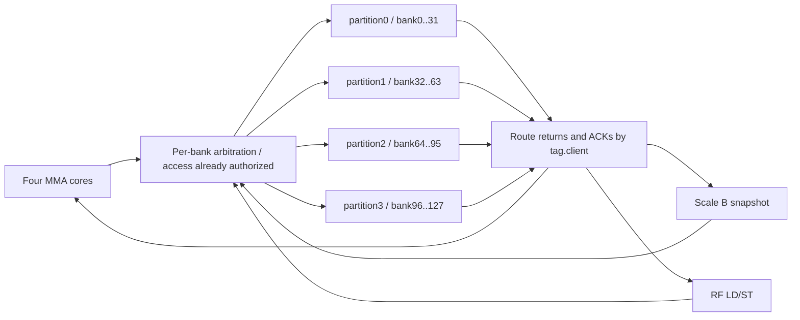

# blackwell_tmem_fabric

## Description

Connects TMEM clients to four 32-bank partitions, arbitrates per bank, combines nonconflicting requests, and routes by identity. The partitions exclusively own TMEM data, SRAM read outputs, backup returns, R_W, and ACKs. The fabric adds no duplicate payload buffer.

| Signal / channel | Direction | Type / width | Peer | Sampling condition |
|---|---|---|---|---|
| `clk` | Input | 1 bit | Top level | Rising edge samples synchronous state. |
| `rst_n` | Input | 1 bit | Top level | Sample low on a rising edge. Reset arbitration control. |
| `epoch_i` | Input | 16 bits | Top level | Level. Current single-CTA lifetime. Change only after old outstanding transactions are isolated. |
| `rd_req[6][128]` | Input | [tmem_rd_req_t](#transactions) (108 bits) | Four cores, scale B, LD/ST | Transfer on `rd_req.fire`. Clients0…5. Each entry has tag78, lane7, word7, and byte_mask16. |
| `rd_rsp[6][128]` | Output | [tmem_rd_rsp_t](#transactions) (210 bits) | Four cores, scale B, LD/ST | Transfer on `rd_rsp.fire`. Return tag78, data128, and status4 to the original client/lane. |
| `wr_req[6][128]` | Input | [tmem_wr_req_t](#transactions) (236 bits) | Four cores, LD/ST | Transfer on `wr_req.fire`. Each atom contains tag, lane, word, mask, and data128. |
| `wr_ack[6][128]` | Output | [tmem_wr_ack_t](#transactions) (82 bits) | Four cores, LD/ST | Transfer on `wr_ack.fire`. Original tag and status4 for an actual write only. |
| `live[3]` | Input | 61 bits per entry (1-bit valid, 2-bit record, 58-bit ID) | MMA engine | Level. Connected through the top. Per-bank arbitration is independent of this port. |
| `drained_o` | Output | 1 bit | Top level | Level. All four partitions drained and no held arbitrated request. |
| `fault_o` | Output | 1 bit | Top level | Level. Protocol fault level aggregated at the top. |

## Functionality

See [TMEM layout](blackwell_tmem_fabric.md#tmem-layout) for physical organization and addressing and [memory transaction](../top/blackwell_async_subsystem_top.md#memory-routing) for transactions. Total capacity is 256 KiB. Each bank supports at most 1R+1W per cycle.

Expand logical channels per [common interfaces](../top/blackwell_async_subsystem_top.md#common-protocol). Each atom has independent valid/ready. A channel vector does not add storage.

The fabric instantiates four partitions. Internal part_rd/ret/wr/ack each expand to 4×32 common atom channels, without additional external ports. Aggregate child drained indications at the output.

Expand each client interface over 128 banks. A request drives only the accessed lane.

Clients validate addresses against allocation and command and maintain authorization throughout the access lifetime. The fabric checks port client against tag.client, lane against port index, and epoch. Illegal requests must not reach SRAM. Integration assertions must catch the protocol violation.

### TMEM addressing and MMA layout

#### Addresses and storage

`tmem_addr_t` is 32 bits. The high 16 bits encode lane and the low 16 column. Valid lanes are 0…127 and columns 0…511. Widen before checking and do not truncate high bits. Each cell is 32 bits, with `bank=lane, word=column//4, cell=column%4` and a 128-bit bank word.

Every allocation covers all 128 lanes and is divided only by column. `warp_id%4` selects the RF-visible warp partition. Warps 0/4/8… of one CTA access the same partition. High warp bits do not add TMEM capacity.

#### MMA layout

Ordinary and WS share M128 and layout D. Global output (m,n) maps to lane=m, column=Dbase+n. Each core covers 32 contiguous lanes and all N columns. C and D share an address and use the full 32-bit cell. Dbase is the column field of d_tmem. M128 requires d_tmem.lane=0 and Dbase+N≤512.

A TMEM A row stores K elements in order. FP16/BF16 use 16 bits, TF32 uses 32, and i8 and f8f6f4 use 8-bit containers (low six bits for FP6, [5:2] for ordinary E2M1). mxf4/mxf4nvf4 use packed 4-bit nibbles. Element e has row bit offset e×container width. Let Aref contain lane0/col0 and w be the width. Without transpose, element (m,k) has lane=lane0+m and bit_index=k×w. Where transpose is allowed use lane=lane0+k and bit_index=m×w. column=col0+floor(bit_index/32) and bit within cell=bit_index%32. Widen before checking every lane<128, column<512, and allocation. Nontransposed M128 therefore requires lane0=0. Native FP4 forbids transpose. [MMA command](../tensor_core/blackwell_tc_mma_engine.md#mma-command) · [core](../tensor_core/blackwell_tc_mma_core.md)

#### Client-to-partition connections

Partition index is `lane // 32` and bank index within it is `lane % 32`. Connect requests as below and route read returns and write ACKs by original client and lane.

| Access | Client | Partition connection |
|---|---|---|
| C reads, D writes, nontransposed A reads | Core `i` (clients 0…3) | Direct connection to partition `i`. Local rows cover lanes `32i…32i+31`. |
| Transposed A reads | Core `i` (clients 0…3) | Each atom selects its partition by source lane `lane0+k`. One core may access several partitions. |
| Scale A and scale B reads | Scale A from each core, scale B from client 4 | Partition 0 only. Source lane is `x % 32`. [scale layout](../tensor_core/blackwell_tc_scale_b_snapshot.md#scale-layout) |
| RF LD/ST | client 5 | Connects to all four partitions. Each instruction accesses only the partition specified by `warp_id % 4`. [RF address mapping](blackwell_tmem_ldst_engine.md) |

Each bank arbitrates independently within a partition. Different clients accessing different banks on one edge can all be accepted when their banks' handshake conditions hold, including within the same partition.

### Memory transaction types

| Type | Fields (high to low) | Bits |
|---|---|---:|
| `tmem_rd_req_t` | tag78, lane7, word7, byte_mask16 | 108 |
| `tmem_wr_req_t` | tag78, lane7, word7, byte_mask16, data128 | 236 |
| `tmem_rd_rsp_t` | tag78, data128, status4 | 210 |
| `tmem_wr_ack_t` | tag78, status4 | 82 |

Mask bit b selects data[8b+:8] in a 16 B atom. Unselected bytes retain their values on writes and return zero on reads. See top-level memory-routing for tag78. Every write ACK must establish actual commit.

Each client can present 128 independent bank atoms. `bank_frame<T,N>` expands N channels without extra payload storage. Partial acceptance clears only the accepted entries. Hold the other atoms. A write cycle's ACK identity frame retains per-bank tag/status without copying write data.

### Per-bank selection and conflict arbitration

| State | Form | Purpose |
|---|---|---|
| Read round-robin cursor | One client index per bank | Fair selection among otherwise available service opportunities. |
| Write round-robin cursor | One client index per bank | Fair selection of writes from different clients. |
| Held selection | One read and one write selection plus valid per bank | Lock the source until downstream acceptance. Upstream holds payload. |
| Return routing | Combinational decode of tag.client | No additional return payload, live-ID table, or ACK copies. |

A grant at g reserves the macro access at g+1. First select the write to accept into R_W on this edge, then suppress ready for a same-bank, same-word read candidate. Both would execute at g+1, so resolve the conflict at g. The old R_W writing at g belongs to the slot already arbitrated on the previous edge and cannot replace this next-edge comparison. Different words permit simultaneous 1R+1W.

For bank `b` the only C source is core `b // 32` on lane port `b`. [core](../tensor_core/blackwell_tc_mma_core.md) presents a dependency-cleared request there. Hold an existing read selection until fire. For a new selection prioritize eligible local C (`token.kind=2`). Otherwise round-robin by client among eligible A, scale A/B, and RF reads. Writes prioritize eligible old D, then round-robin by client. Each bank advances independently.

A busy bank elsewhere cannot block ordinary clients at a bank without MMA demand. Insufficient read credit blocks only reads for that bank. Insufficient ACK credit blocks only new writes for the corresponding partition.

Lock a held request until partition acceptance. valid cannot depend on destination ready. The selected source must retain payload. Other sources can still access other banks.

### Partition frame assembly

Combine requests to different banks on one edge into one physical 32-bank partition operation. This does not admit multiple words to one bank or change tokens or completion counts.

One partition R_W can accept writes from multiple clients to different banks simultaneously. Each valid bank holds its own tag, word, and byte mask. Its ACK frame must therefore hold per-bank identities rather than a single frame owner.

Multiple reads to the same bank and word may share one source read only if they have identical read semantics and all destinations can be retained. The TMEM baseline does not require cross-client deduplication. Serial service is correct. The performance guarantee applies to the specified MMA windows.

A source request handshakes on the edge where the partition reserves the corresponding read credit or R_W/ACK space. Never acknowledge upstream before reserving physical capacity.

### From grant to return and ACK

The fabric decodes addresses and selects requests combinationally. A read grant or write acceptance is the corresponding partition request fire. Subsequent SRAM sampling, return, and actual write ACK follow the [partition read/write edges](blackwell_tmem_partition.md).

Each partition peaks at 512 B/cycle in each direction. Across four partitions the peak is 2048 B/cycle per direction. Count only actual enabled banks and bytes. Unused lanes and retries do not count as completed bytes.

Unaligned D, general descriptors, and real contention may lower throughput. Preserve return order and identity under conflict. Per-bank retention allows partial partition acceptance.

### Verification

When local C and another core's transposed A request the same readable bank, a fresh selection chooses C. If A is already held, deliver A first. Let two clients write different banks on one edge and stall their ACKs independently. Check partial retirement, original client/token, and held stability. Exhausting one bank's read credit or filling one partition's ACK frames blocks only affected requests. Advance round-robin only on actual acceptance.

Protocol faults add one bit `protocol_fault_q`. Set it for port/tag.client mismatch, lane index or epoch violation, or any partition fault. Follow the [common fault rules](../top/blackwell_async_subsystem_top.md#common-protocol) for assertion, reset, and outstanding responses.

## Submodules

| Submodule | Instances | Connections and parent control |
| --- | --- | --- |
| [tmem_partition](blackwell_tmem_partition.md) | 4 | Partition i connects to banks 32i…32i+31. The fabric selects requests per bank and routes each response to its original client. |
