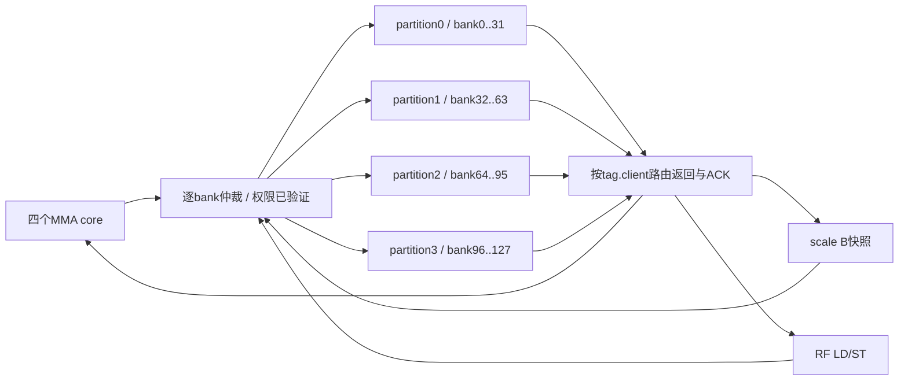

# blackwell_tmem_fabric

## Description

本模块连接TMEM客户端与四个32-bank partition，执行逐bank仲裁、无冲突请求合并及身份路由。TMEM数据、SRAM读输出、返回backup、R_W和ACK均由partition唯一持有，fabric不建立第二套payload缓存。

| 信号 / 通道 | 方向、类型 / 位宽 | 对端 | 握手或采样条件 |
| --- | --- | --- | --- |
| `clk`、`rst_n` | 输入，1 bit | 顶层 | 仲裁控制复位。 |
| `epoch_i` | 输入，16 bit，无握手 | 顶层 | 当前单CTA生命周期；旧在途未隔离前不得更改。 |
| `rd_req[6][128]` | 输入通道，[tmem_rd_req_t](#transactions) | 四核、scale B、LD/ST | client0…5，每项含tag78、lane7、word7、byte_mask16。 |
| `rd_rsp[6][128]` | 输出通道，[tmem_rd_rsp_t](#transactions) | 四核、scale B、LD/ST | 按原client/lane返回tag78、data128、status4。 |
| `wr_req[6][128]` | 输入通道，[tmem_wr_req_t](#transactions) | 四核、LD/ST | 逐atom含tag、lane、word、mask及data128。 |
| `wr_ack[6][128]` | 输出通道，[tmem_wr_ack_t](#transactions) | 四核、LD/ST | 原tag及status4；只对应真实写入。 |
| `live[3]` | 入，按年龄排序的 {valid1,rec2,id58} | MMA engine | 经 top 接入。逐 bank 仲裁独立于此端口。 |
| `drained_o` | 输出，1 bit，无握手 | 顶层 | 四partition均排空且无held仲裁请求。 |
| `fault_o` | 输出，1bit，无握手 | 顶层 | 协议 fault 电平，向顶层汇总。 |

## Functionality

物理组织与地址引用 [TMEM布局](blackwell_tmem_fabric.md#tmem-layout)；事务格式引用 [memory transaction](../top/blackwell_async_subsystem_top.md#memory-routing)。总容量256 KiB，每bank每拍至多1R+1W。

逻辑通道展开遵循 [公共接口](../top/blackwell_async_subsystem_top.md#common-protocol)；向量每个atom独立valid/ready，向量本身不是额外存储。

fabric内部实例化四个partition；内部part_rd/ret/wr/ack各为4×32条相同公共atom通道，不是额外外部端口，子模块drained聚合到本模块输出。

客户端接口按 128 个 bank 展开，每个请求只驱动所访问的 lane。

客户端负责根据allocation/命令完成地址合法性验证并在生命周期内保持授权。fabric检查端口client与tag.client一致、lane索引一致及epoch匹配；非法请求不应到达SRAM，集成断言必须捕获该协议错误。

### TMEM 地址与 MMA 布局

#### 地址和存储

`tmem_addr_t`为32bit：高16bit是lane，低16bit是column。有效lane为0…127、column为0…511；计算先扩展检查，不能截断高位。每cell为32bit，`bank=lane, word=column//4, cell=column%4`，一个bank word为128bit。

所有allocation覆盖完整128lane，仅按column划分。RF可见的warp分区由`warp_id%4`选择；同一CTA中warp0/4/8…访问同一分区，不由warp高位增加额外TMEM容量。

#### MMA 布局

普通与 WS 共用 M128、layout D。全局输出 (m,n) 位于 lane=m、column=Dbase+n；每核负责 32 个连续 lane 和全部 N 列，C、D 共用地址，均使用完整的 32-bit cell。Dbase是d_tmem的column字段；M128要求d_tmem.lane=0且Dbase+N≤512。

TMEM A 的一行按 K 个元素顺序排布；FP16/BF16 为 16 bit、TF32 为 32 bit、i8 和 f8f6f4 为 8-bit 容器（FP6 取低 6 bit，普通 E2M1 取 [5:2]），mxf4/mxf4nvf4 为紧凑 4-bit nibble。行内元素 e 的 bit 偏移为 e×容器位宽。令Aref的两个字段为lane0/col0，容器位宽为w。非转置时元素(m,k)的lane=lane0+m、bit_index=k×w；允许的转置时lane=lane0+k、bit_index=m×w。column=col0+floor(bit_index/32)，cell内bit=bit_index%32。先以扩展位宽检查所有lane<128、column<512及allocation，故M128非转置要求lane0=0。native FP4禁止转置。[MMA 命令](../tensor_core/blackwell_tc_mma_engine.md#mma-command) · [core](../tensor_core/blackwell_tc_mma_core.md)

#### 客户端到分区的连接

分区号为 `lane // 32`，区内 bank 号为 `lane % 32`。按下表连接请求路径，读返回与写 ACK 按原 client 和 lane 路由。

| 访问 | 客户端 | 分区连接 |
|---|---|---|
| C 读、D 写、非转置 A 读 | 核 `i`（client 0…3） | 直连分区 `i`，本核行号覆盖 lane `32i…32i+31`。 |
| 转置 A 读 | 核 `i`（client 0…3） | 每个 atom 按源 lane `lane0+k` 选分区，同一核可访问多个分区。 |
| scale A、scale B 读 | scale A 来自各核，scale B 来自 client 4 | 只接分区 0，源 lane 为 `x % 32`。[scale 布局](../tensor_core/blackwell_tc_scale_b_snapshot.md#scale-layout) |
| RF LD/ST | client 5 | 连接四个分区，每条指令只访问 `warp_id % 4` 指定的分区。[RF 地址映射](blackwell_tmem_ldst_engine.md) |

分区内各 bank 独立仲裁。多个客户端同拍访问不同 bank 时，只要对应 bank 的握手条件满足，就可同时接受，即使它们落在同一分区。

### 存储事务类型

| 类型 | 字段（从高到低） | 位数 |
|---|---|---:|
| `tmem_rd_req_t` | tag78, lane7, word7, byte_mask16 | 108 |
| `tmem_wr_req_t` | tag78, lane7, word7, byte_mask16, data128 | 236 |
| `tmem_rd_rsp_t` | tag78, data128, status4 | 210 |
| `tmem_wr_ack_t` | tag78, status4 | 82 |

mask bit b 对应 data[8b+:8]；16 B 原子，写未选 byte 保持，读未选 byte 返回0。tag78 见顶层 memory-routing；所有写 ACK 必须证明实际写入。

每 client 可提供128个独立 bank 原子；`bank_frame<T,N>` 只是N个通道的展开，不另占payload存储。部分接受只清对应项，其余原子保持。一个写周期的ACK身份帧保存逐banktag/status，不复制写数据。

### 逐 bank 选择与冲突仲裁

| 状态 | 形式 | 目的 |
|---|---|---|
| 读轮询指针 | 每bank一个client索引 | 空闲服务机会的公平选择。 |
| 写轮询指针 | 每bank一个client索引 | 不同客户端写请求公平选择。 |
| held选择 | 每bank读/写各一个选择及valid | 下游尚未接受时锁定上游，payload仍由上游持有。 |
| 返回路由 | 组合解码tag.client | 不另存返回payload、live-ID表或ACK副本。 |

grant沿g只预留下一沿g+1的宏访问。先选择本拍将被R_W接受的写，再把本拍同bank同word的读候选ready压低；二者若同时接受都将在g+1实际采样，因此必须在g决定冲突。旧R_W在g执行的写属于上一拍已经仲裁的时隙，不能误拿它替代下一拍冲突比较。不同word的1R+1W可以并行。

对 bank `b`，唯一的 C 读源是核 `b // 32` 的 lane `b` 端口。[core](../tensor_core/blackwell_tc_mma_core.md) 在此端口送出已通过依赖检查的请求。读端已有 held 选择时保持至 fire。新选择时，若本地核有合格的 C 读（`token.kind=2`），优先选它，否则在其余合格的 A、scale A/B 和 RF 读之间按 client 轮询。写端仍优先选择可提交的老 D，再按 client 轮询。各 bank 独立推进。

在无MMA需求的bank，不得因为别的bank忙而阻塞普通客户端。读credit不足只阻止该bank读；ACK credit不足只阻止相应partition的新写接受。

held请求锁定至partition接受。发出valid不能依赖对端ready；选中源必须保持payload，其他源的请求可以继续在其他bank执行。

### 组装分区帧

同一拍不同bank的请求合成为一次物理32-bank分区操作。这里的“合并”不把多个word请求塞入同一bank，也不改变请求的token或完成数量。

同一partition的R_W可以同时承接多个客户端的不同bank写；每个有效bank保存自己的tag、word和byte mask。ACK帧因而也是逐bank身份集合，不能只有一个全帧owner。

对同一bank同word的多个读，只有同一语义读取且目的集合可完整保留时才可共享一次源读。基线TMEM无需做跨客户端读去重；串行服务仍正确，性能保证只要求指定的MMA窗口。

源请求握手发生于partition已经预留相应读credit或R_W/ACK位置的沿。fabric不得先对上游确认，再等待尚未预留的物理容量。

### 从 grant 到返回与 ACK

fabric 的地址解码和选择为组合逻辑。读 grant 与写接受沿即分区相应请求的 fire，之后的 SRAM 采样、返回与实际写 ACK 均遵循 [partition 的读写边沿](blackwell_tmem_partition.md)。

每分区读、写峰值各512 B/cycle；四分区总峰值各2048 B/cycle。峰值按实际有效bank和byte mask统计，不把未使用lane或重试请求计入已完成字节。

D非对齐、一般descriptor和真实bank争用允许降低吞吐；不能改变返回排序/身份语义来隐藏冲突。逐bank保持避免把整分区ready误当成必须全有或全无。

### 验证

本地 C 与其他核的转置 A 同时请求同一可读 bank 时，新选择给 C。若 A 已 held，则先交付该笔 A。两个 client 同沿写不同 bank，各自暂停 ACK，检查部分退休、原 client/token 及 held 的稳定性。单个 bank 读 credit 耗尽或某一分区 ACK 帧满，仅对应请求受阻。实际接受才推进轮询。

协议故障额外计1bit `protocol_fault_q`，触发条件为端口与tag.client不符、lane索引或epoch违约，以及任一partition的fault。置位、复位和在途响应的处理遵循[公共故障规则](../top/blackwell_async_subsystem_top.md#common-protocol)。

## Submodules

| 子模块 | 实例数 | 连接与父模块控制 |
| --- | --- | --- |
| [tmem_partition](blackwell_tmem_partition.md) | 4 | 分区 i 连接 bank 32i…32i+31。fabric 逐 bank 选择请求并把各目的响应送回原 client。 |
