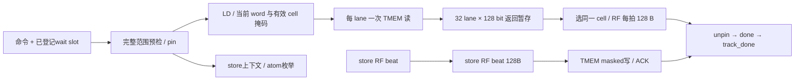

# blackwell_tmem_ldst_engine

## Description

本模块每方向有一个上下文。接受普通 32x32b LD x16/x32、ST x16，地址只按 [TMEM 布局](blackwell_tmem_fabric.md#tmem-layout) 展开。

| 信号 / 通道 | 方向、类型 / 位宽 | 对端 | 握手或采样条件 |
| --- | --- | --- | --- |
| `issue` | 入，局部ldst_issue_t，97bit | 顶层 R_RF_ISSUE | `{cmd:tmem_ldst_cmd_t,slot:5}`；顶层已分配 live 槽。 |
| `rf_store` | 入，[rf_beat_t](#rf-types)，1090bit | 外围 RF | 整warp的单个store beat。 |
| `rf_load` | 出，rf_beat_t，1090bit | 外围 RF | 整warp的单个load beat。 |
| `rd_req[128]` / `rd_rsp[128]` | 出/入，[tmem_rd_req_t](blackwell_tmem_fabric.md#transactions)/[tmem_rd_rsp_t](blackwell_tmem_fabric.md#transactions) | TMEM fabric | 按全局lane的独立atom通道。 |
| `wr_req[128]` / `wr_ack[128]` | 出/入，[tmem_wr_req_t](blackwell_tmem_fabric.md#transactions)/[tmem_wr_ack_t](blackwell_tmem_fabric.md#transactions) | TMEM fabric | 每bank每拍至多一条候选。 |
| `pin_req` / `pin_rsp` | 出/入，[tmem_pin_req_t](blackwell_tmem_manager.md#management-types)/[tmem_pin_rsp_t](blackwell_tmem_manager.md#management-types) | TMEM manager | 本引擎预检范围；manager 按固定 user 3/4 授权，id 路由回 LD/ST。 |
| `unpin` | 出，[tmem_unpin_t](blackwell_tmem_manager.md#management-types) | TMEM manager | 所有数据效果结束后释放各自的使用位。 |
| `track_done` | 出，[rf_track_done_t](blackwell_tmem_wait_tracker.md#wait-types)，67bit | TMEM wait tracker | 原slot/id和最终status。 |
| `done` | 出，[op_done_t](../top/blackwell_async_subsystem_top.md#identity)，62bit | 软件前端 | 本命令最终返回，与track_done分别保持。 |
| `stop_i` / `drained_o` | 入/出，1bit | 顶层 | 不阻止顶层已接受的派生issue；新外部LDST由顶层stop封闭，排空含RF、ACK、pin及完成出口。 |
| `fault_o` | 输出，1bit，无握手 | 顶层 | 协议 fault 电平，向顶层汇总。 |

## Functionality

RF 每个 beat 搬运 32 个线程各一个 b32，共 128 B。LD 保存当前 TMEM word 的 32 份 lane 返回，32×16 B = **512 B**。ST 保存一个 128 B 的 RF beat。每后端 LD/ST 共 **640 B** 数据暂存，RF 读出直接由 LD 暂存选择 cell。

RF 通道按[顶层握手](../top/blackwell_async_subsystem_top.md#common-protocol)传输，存储 tag 使用[公共存储身份](../top/blackwell_async_subsystem_top.md#memory-routing)。

### 命令及 beat 字段

`tmem_ldst_cmd_t={id:58,store:1,x32:1,base:32}`，92bit。x32=0 为 x16，x32=1 仅合法 LD。地址见[TMEM fabric](blackwell_tmem_fabric.md#tmem-layout)，RF映射见[本页排列](#rf-layout)。

`rf_beat_t={id:58,index:7,last:1,data:1024}`，1090bit。data[32*t+:32]对应thread t。index从0递增；last仅最后一个寄存器beat为1。一个逻辑beat携带整个warp，不允许thread级部分接受。

管理及 RF 命令的 issuer 低5bit必须0，表示一次完整 warp 命令。

### RF 数据排列

仅收敛 warp 的普通 `.32x32b`，LD x16/x32、ST x16。RF 每拍是一整个 warp 的 b32。令 t=线程号 0…31，j=寄存器序号 0…R−1，则 lane=base.lane+t、column=base.column+j，使用完整 cell。base.lane 必须是 32×(warp%4)，最后 column≤511；检查在宽算术中完成。同 CTA 的 warp0/4/8…使用同一物理分区，各自独立跟踪 RF 返回。没有 pack、unpack 或 split 偏移。对每个 beat 独立核对 32 个 cell，未被访问的 cell 保持。[实际指令表](../../proposals/supported_ptx.md) · [PTX LD](https://docs.nvidia.com/cuda/archive/12.8.2/parallel-thread-execution/index.html#tcgen05-instructions-tcgen05-ld)

### 接受指令与预检地址

issue_ready只由对应load/store上下文及已预留输出容量决定，不被stop撤销。issue.slot由顶层从wait tracker取得；不能先开始访存再尝试分配live 槽。load和store各保存一个slot，完成时原样返回，不自行复用它。

每个上下文保存cmd92bit、slot5、pin 有效位、beat索引7、阶段、done/track_done已发送位。数据暂存valid与身份只属于对应上下文。

CHECK 用扩展位宽验证整个 warp 分区及闭区间 `[base.column, base.column+R−1]`，R 为 16 或 32。全范围一次 pin 成功后才访存。client=5，token 为 `{store:1,pos:7,atom:6,reserved:2}`，atom 为线程号 t=0…31，reserved=0。LD 的 pos 是绝对 word 编号，ST 的 pos 是 RF beat 索引。用完整 id、方向、pos、atom 和物理 lane 路由匹配责任。

LD 保存当前 word 的 sent/returned 和下一 word 的 sent，各 32 bit。ST 每 lane 用两个 5-bit 前缀计数 sent_count、ack_count（0…16）校验顺序；当前 beat 的已发送位由 sent_count>index 得到。受阻的请求、tag 和 mask 保持至握手。

### LD 按 word 读取、按 cell 写回

令起始列为 b，末列为 e=b+R−1。word 按 w=b//4…e//4 升序。lo=max(b,4w)−4w，hi=min(e,4w+3)−4w；byte_mask 为 lo…hi 每个 cell 的四个 byte 置位。b=3、R=16 时读 word 0…4，首尾 mask 为 0xf000、0x0fff。

1. **读 word。** 每个 t 从 lane=base.lane+t、word=w 发一笔带上述 mask 的读。匹配的成功响应在 rd_rsp.fire 沿写入 word_buf[t] 的 128 bit，按 lane 独立接收。32 笔全部成功返回后，下一沿最早交付首个 RF beat。
2. **写 RF。** 对 c=lo…hi，每个线程取同一 cell，`data[32*t+:32]=word_buf[t][32*c+:32]`。beat 的 index=4w+c−b，last 仅在 index=R−1 置位。只在 rf_load.fire 后推进 c。RF 暂停时保持 word_buf、id、data、index、last；恢复后从原 beat 继续。
3. **预读与换 word。** 每 lane 当前 word 的请求已接受后即可为 w+1 展示读请求，且不超过 e//4。当前 word 在 RF 末次 fire 前占 word_buf；提前到达的下一 word 返回保留在该 bank 的有序返回口。RF 接收末 cell 的同沿可把已到的下一 word 返回直接写进相应 lane，RF 采样沿前旧值；先结算所有当沿 fire，再旋转两份 sent 与 returned，保留未完成或 held 的新请求。该沿未到的 lane 以后独立补齐。末 beat 实际 RF 写回才满足整条 LD 的数据完成条件。

**理想时序。** 32 bank 首 word 同在 g grant，g+3 收齐。整 word 的 RF 写回在 g+4…g+7；第二 word 可在 g+1 grant，返回最早 g+4 有效，握手可等到 g+7 同沿替换。无争用、RF 持续 ready 时首尾部分 word 也只交付有效 cell，R 个 RF beat 连续，末沿 g+R+3（x16 为 g+19，x32 为 g+35）。读次数仍为每 lane 对齐 4/8，非对齐 5/9，暂存仍为 512 B。RF 长暂停可能占用 TMEM 返回 credit，仲裁按实际 grant/ret_fire 推进。

### ST 接受 RF beat 与追踪 ACK

pin成功后只接受匹配id、期望index及last的rf_store。一个beat被接收后，组合从其1024bit data形成各atom的payload和byte mask；未发atom共享同一份RF暂存。

普通 store 一个 lane 写一个完整 cell，其他 cell 的 byte mask 为零。一个 beat 内地址两两不同。

当前 beat 最后一笔 wr_req.fire 的同沿即可用下一 rf_store.fire 替换 128 B 暂存。按 lane 递增 sent_count。ACK 须来自该 lane、完整 id 匹配、pos=ack_count 且 ack_count<sent_count；同 bank 的 ACK 由 [partition](blackwell_tmem_partition.md) 按序交付。成功 ACK 才递增 ack_count。所有 lane 最终 16 笔写均确认才可成功完成。若每拍全 warp 获准，从首个 RF beat 接受到末写 ACK 最早为 18 个边沿间隔（0 接 RF、1…16 接受写、3…18 接 ACK）。

### 完成与错误

数据完成后先unpin，再发布普通done；done被外部消费后才发布track_done，后者证明该操作连同最终返回责任均已结清。track_done消费后释放上下文，任何出口不得重复发送。load/store共用出口采用轮询，held选择保持到fire。

顶层必须独立消费普通done，不得等wait_done后才给done.ready，否则wait等待track_done会形成环。实际load/store完成边界仍是最后RF beat/ACK，后续控制握手只延迟可观察完成。

已登记后发现范围/使用者违约、非 OK 返回或错误 RF 身份时置 fault。错误读不写 RF，错误写 ACK 不解除对应依赖。已交付的 RF beat 和已确认的写保留，已展示的载荷遵循顶层保持规则。正常 stop 继续服务已接受责任。

协议错误RF id/index/last不能写入另一个上下文。非法/重复存储返回不能清别的atom mask；所有检查以完整id和token为准。

### 验收

- LD 用 lane、column 均可区分的值，遍历 x16/x32 和四种 b%4。逐笔核对 `(id,lane,w)` 只读一次、首尾 byte_mask，以及各线程各寄存器的值与 index/last。覆盖 e=511 和越界预检。
- 分别延迟前后 word 的 grant/返回、暂停当前末 RF beat，验证换 word 同沿采旧写新，晚到预读按原 word 归属。扣住 ST 的旧 ACK，验证新 RF beat 在最后实际写接受沿可接替；填满 partition 的两个 ACK 帧才随真实 credit 反压。
- 覆盖四个 warp 分区并独立暂停两个完成出口。迟到 MEMORY 触发 fault，不能结算为成功 ACK；外围仅在 RF beat 实际写回后读取该寄存器。

本地 fault 为 1bit；非 OK、未知或重复的存储/pin 响应，以及不匹配的 RF id/index/last 触发置位。置位、复位和在途响应的处理遵循[公共故障规则](../top/blackwell_async_subsystem_top.md#common-protocol)。
