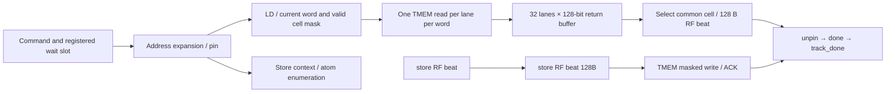

# blackwell_tmem_ldst_engine

## Description

One context per direction supports ordinary 32x32b LD x16/x32 and ST x16. Expand addresses only according to [TMEM layout](blackwell_tmem_fabric.md#tmem-layout).

| Signal / channel | Direction | Type / width | Peer | Sampling condition |
|---|---|---|---|---|
| `issue` | Input | local ldst_issue_t (97 bits) | Top-level R_RF_ISSUE | Transfer on `issue.fire`. `{cmd:tmem_ldst_cmd_t,slot:5}`. The top has already allocated the live slot. |
| `rf_store` | Input | [rf_beat_t](#rf-types) (1,090 bits) | External RF | Transfer on `rf_store.fire`. One store beat for a complete warp. |
| `rf_load` | Output | rf_beat_t (1,090 bits) | External RF | Transfer on `rf_load.fire`. One load beat for a complete warp. |
| `rd_req[128]` | Output | [tmem_rd_req_t](blackwell_tmem_fabric.md#transactions) (108 bits) | TMEM fabric | On `rd_req.fire`, issue independently by global lane. |
| `rd_rsp[128]` | Input | [tmem_rd_rsp_t](blackwell_tmem_fabric.md#transactions) (206 bits) | TMEM fabric | On `rd_rsp.fire`, capture the matching atom by lane. |
| `wr_req[128]` | Output | [tmem_wr_req_t](blackwell_tmem_fabric.md#transactions) (236 bits) | TMEM fabric | On `wr_req.fire`, issue at most one write candidate per bank each cycle. |
| `wr_ack[128]` | Input | [tmem_wr_ack_t](blackwell_tmem_fabric.md#transactions) (78 bits) | TMEM fabric | On `wr_ack.fire`, settle the matching actual write by tag. |
| `pin_req` | Output | [tmem_pin_req_t](blackwell_tmem_manager.md#management-types) (61 bits) | TMEM manager | On `pin_req.fire`, request authorization for fixed user 3 or 4. |
| `pin_rsp` | Input | [tmem_pin_rsp_t](blackwell_tmem_manager.md#management-types) (58 bits) | TMEM manager | On `pin_rsp.fire`, match the returned ID to the LD/ST operation. |
| `unpin` | Output | [tmem_unpin_t](blackwell_tmem_manager.md#management-types) (61 bits) | TMEM manager | Transfer on `unpin.fire`. Release the respective use bit after all data effects complete. |
| `track_done` | Output | [rf_track_done_t](blackwell_tmem_wait_tracker.md#wait-types) (63 bits) | TMEM wait tracker | Transfer on `track_done.fire`. Original slot and ID. |
| `done` | Output | [op_done_t](../top/blackwell_async_subsystem_top.md#identity) (58 bits) | Software front end | Transfer on `done.fire`. Final command response, held independently of track_done. |
| `stop_i` | Input | 1 bit | Top level | Level closing external admission at the top. Continue derived issues already accepted there. |
| `drained_o` | Output | 1 bit | Top level | Assert when RF, ACK, pin and completion obligations drain. |

## Functionality

Each RF beat carries one b32 for each of 32 threads, totaling 128 B. LD holds the current TMEM word's 32 lane returns, 32×16 B = **512 B**. ST holds one 128 B RF beat. LD/ST data buffering totals **640 B per backend**. RF reads select cells directly from the LD buffer.

RF channels follow [Top-level handshake](../top/blackwell_async_subsystem_top.md#common-protocol). Memory tags use the [common memory identity](../top/blackwell_async_subsystem_top.md#memory-routing).

### Command and beat fields

`tmem_ldst_cmd_t={id:58,store:1,x32:1,base:32}` is 92 bits. x32=0 selects x16. x32=1 is legal only for LD. See [TMEM fabric](blackwell_tmem_fabric.md#tmem-layout) for addressing and [RF arrangement below](#rf-layout) for RF mapping.

`rf_beat_t={id:58,index:7,last:1,data:1024}` is 1090 bits. data[32*t+:32] corresponds to thread t. index increments from 0. Set last only on the final register beat. One logical beat carries the whole warp. Per-thread partial acceptance is forbidden.

Management and RF commands require the issuer's low five bits to be zero, denoting a whole-warp command.

### RF data layout

Support only converged warp ordinary `.32x32b`, LD x16/x32 and ST x16. Each RF beat carries one b32 per thread for a whole warp. For thread t=0…31 and register index j=0…R−1, lane=base.lane+t and column=base.column+j, using the full cell. Require base.lane=32×(warp%4) and final column≤511, checked in wide arithmetic. Warps 0/4/8… of one CTA share a physical partition and track their RF returns independently. There is no pack, unpack, or split offset. Unaccessed cells retain their contents. [supported instruction table](../../proposals/supported_ptx.md) · [PTX LD](https://docs.nvidia.com/cuda/archive/12.8.2/parallel-thread-execution/index.html#tcgen05-instructions-tcgen05-ld)

### Instruction acceptance and address expansion

issue_ready depends only on the corresponding load/store context and reserved output capacity. stop cannot revoke it. The top obtains issue.slot from the wait tracker before memory access. Load and store each retain one slot and return it unchanged at completion. They cannot reuse it themselves.

Each context holds cmd92, slot5, pin valid, beat index7, stage, and done/track_done sent bits. Buffer valid and identity belong only to that context.

CHECK determines the complete warp partition and inclusive column range `[base.column, base.column+R−1]`, with R=16 or 32. Simulation asserts in extended arithmetic that the last column fits and the complete warp targets its assigned partition. Access memory only after the pin acknowledgment for the full range. client=5, token=`{store:1,pos:7,atom:6,reserved:2}`, atom is thread index t=0…31, and reserved=0. LD pos is the absolute word index. ST pos is the RF beat index. Match obligations by full ID, direction, pos, atom, and physical lane routing.

LD keeps 32 bits each of sent/returned for the current word and sent for the next word. ST keeps two 5-bit per-lane prefix counts, sent_count and ack_count (0…16), to check order. sent_count>index identifies already issued lanes for the current beat. Hold stalled requests, tags, and masks until handshake.

### LD word reads and RF cell writeback

Let b be the starting column and e=b+R−1 the last. Visit words w=b//4…e//4 in ascending order. lo=max(b,4w)−4w and hi=min(e,4w+3)−4w. In byte_mask set all four bytes of each cell lo…hi. For b=3 and R=16 read words 0…4 with first/last masks 0xf000 and 0x0fff.

1. **Read the word.** For each t issue one read with this mask to lane=base.lane+t and word=w. On matching successful rd_rsp.fire write the 128-bit return into word_buf[t], accepting lanes independently. The first RF beat can deliver on the edge after all 32 reads return successfully.
2. **Write RF.** For c=lo…hi select the same cell index in each thread's word, `data[32*t+:32]=word_buf[t][32*c+:32]`. Beat index=4w+c−b. Set last only at index=R−1. Advance c only on rf_load.fire. When RF stalls, hold word_buf, ID, data, index, and last. Resume with the original beat.
3. **Prefetch and word handoff.** Once a lane's current word request is accepted it may present a read for w+1, up to e//4. The current word owns word_buf through its last RF fire. Early next-word returns wait at the corresponding bank's ordered return port. On the edge RF accepts the final cell, available next-word returns may overwrite the corresponding lane buffers while RF samples pre-edge data. Settle all fires on the edge before rotating both sent sets and returned. Retain unfinished or held new requests. Fill remaining lanes independently as they return. Data completion for the entire LD requires actual RF writeback of the last beat.

**Ideal timing.** With first-word grants for all 32 banks at g, returns complete at g+3. RF writes the complete word at g+4…g+7. The second word can receive grants at g+1, present returns at g+4, and handshake at g+7 for same-edge replacement. With no contention and RF continuously ready, partial first and last words deliver only valid cells. R consecutive RF beats finish at g+R+3 (g+19 for x16, g+35 for x32). Read counts per lane are 4/8 aligned or 5/9 unaligned. Buffering stays 512 B. A long RF stall can occupy TMEM return credits. Arbitrate from actual grant/ret_fire.

### ST RF beat acceptance and ACK tracking

After pin acknowledgment, accept a store beat when the RF buffer has space. The RF source supplies the matching ID, expected index and last. Once a beat is accepted, derive each atom's payload and byte mask combinationally from its 1024-bit data. Unissued atoms share the same RF buffer.

An ordinary store writes one full cell per lane and zeros the byte mask for other cells. Addresses within a beat are pairwise distinct.

The next rf_store.fire may replace the 128 B buffer on the same edge as the current beat's final wr_req.fire. Increment sent_count per lane. An ACK must come from that lane, match the full ID, have pos=ack_count, and satisfy ack_count<sent_count. The [partition](blackwell_tmem_partition.md) delivers same-bank ACKs in order. Each ACK.fire increments ack_count. Completion requires confirmation of all 16 writes in every lane. With full-warp grants every cycle, the earliest interval from first RF acceptance to last write ACK is 18 cycles (RF at 0, write acceptance at 1…16, ACKs at 3…18).

### Completion and register visibility

After data completion, unpin and publish ordinary done. Publish track_done only after external consumption of done, confirming settlement of the operation and its final response. Release the context after track_done consumption. Neither output may send twice. Round-robin on the shared load/store outputs and hold selection until fire.

The top must consume ordinary done independently of wait_done. Waiting for wait_done before asserting done.ready creates a cycle through track_done. Actual load/store data completion remains the last RF beat/ACK. Later control handshakes delay observable completion.

Simulation asserts the RF ID, index and last on every valid beat and matches each memory return to its outstanding lane, full ID and token. Each pin response must identify the context awaiting authorization. Normal stop continues accepted obligations.

The RF consumer can read a destination register after its beat writes back.
