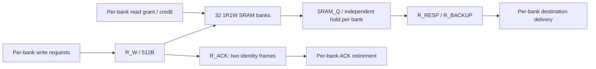

# blackwell_tmem_partition

## Description

Instance parameter `PARTITION_ID=0…3` selects 32 consecutive TMEM banks. Each bank has 128 words ×128 bits and 1R1W. Capacity is 64 KiB per partition and 256 KiB across four partitions.

| Signal / channel | Direction | Type / width | Peer | Sampling condition |
|---|---|---|---|---|
| `clk` | Input | 1 bit | Top-level clock domain | Rising edge samples synchronous state. |
| `rst_n` | Input | 1 bit | Top-level clock domain | Sample low on a rising edge. Clear control without initializing SRAM data. |
| `rd_req[32]` | Input | [tmem_rd_req_t](blackwell_tmem_fabric.md#transactions) (108 bits) | TMEM fabric | Transfer on `rd_req.fire`. tag78, global lane7, word7, byte_mask16. |
| `rd_rsp[32]` | Output | [tmem_rd_rsp_t](blackwell_tmem_fabric.md#transactions) (206 bits) | TMEM fabric | Transfer on `rd_rsp.fire`. tag78, data128. |
| `wr_req[32]` | Input | [tmem_wr_req_t](blackwell_tmem_fabric.md#transactions) (236 bits) | TMEM fabric | Transfer on `wr_req.fire`. tag, lane, word, byte mask, data128. |
| `wr_ack[32]` | Output | [tmem_wr_ack_t](blackwell_tmem_fabric.md#transactions) (78 bits) | TMEM fabric | Transfer on `wr_ack.fire`. Tag corresponding to an actual write. |
| `read_credit_o[32]` | Output | 2 bits each | TMEM fabric | Level. 0…3 free return reservations. |
| `write_credit_o` | Output | 2 bits | TMEM fabric | Level. Number of ACK identity frames available for new R_W acceptance, 0…2. |
| `drained_o` | Output | 1 bit | TMEM fabric | Level. No granted read, return, R_W, or ACK. |

## Functionality

The global lane selects partition `lane // 32` and local bank `lane % 32`. Within that bank, `word=column//4` and `cell=column%4`. See [TMEM layout](blackwell_tmem_fabric.md#tmem-layout) for details. This module owns physical SRAM and all return/write acceptance state. The fabric arbitrates and routes.

Each atom channel has independent valid/ready. See [common interfaces](../top/blackwell_async_subsystem_top.md#common-protocol) and [memory transaction](../top/blackwell_async_subsystem_top.md#memory-routing) for definitions and byte order.

For local port p, the request carries global lane 32 × PARTITION_ID + p. word ranges from 0…127. byte_mask bit b selects byte b of data. Return zero for unselected read bytes and preserve stored values for unselected write bytes.

### Partition data and in-flight slots

| State | Capacity | Purpose |
|---|---:|---|
| SRAM | 65536 B | 32×128×16 B, the sole copy of TMEM data. |
| SRAM_Q | 512 B | 16 B synchronous read output per bank, in the macro or an equivalent external register. |
| R_RESP | 512 B | One primary return per bank. |
| R_BACKUP | 512 B | One additional return per bank to absorb an irrevocable read. |
| Read tag/credit | Three metadata entries per bank | Cover every granted but undelivered read without additional payload storage. |
| R_W | 512 B | One write payload with a 32-bank valid mask and a word address, tag and byte mask for each selected bank. |
| R_ACK | Two identity frames | Each holds a bank mask and per-bank tags without write data. |

R_RESP+R_BACKUP total 1 KiB per partition. SRAM_Q is the third physical place to hold a return. A macro whose output cannot hold with read enable low uses one external register for this Q position.

### Read credit, sampling, and delivery

Each bank maintains `outstanding = granted − delivered` in the range 0…3. Reserve a position before read_fire. Delivering an old return may free and reuse a credit on the same edge.

A granted read is irrevocable. At grant g, register word/read-enable for g+1. The macro samples and produces Q at g+1. If destination ready drops, withhold new grants without space. Issued reads still need room in Q, primary return, or backup. A later macro read must not overwrite a Q that has not moved.

Move returns in request order within each bank. A destination can consume the primary return as backup or Q replaces it on the same edge. Pending returns cannot bypass the head or exchange order. Move data, tag, and byte mask together.

Assert SRAM read-enable only with credit and guaranteed space in Q on the scheduled return edge. request.valid alone is insufficient. Compute next-edge space from valid bits and reservations for arriving reads. Current Q.empty is insufficient.

| Read event | Edge | State after edge |
|---|---:|---|
| Bank grant | g | Credit decremented, tag marked issued. |
| Synchronous macro read complete | g+1 | SRAM_Q holds 16 B and its identity. |
| Return transfer | g+2 | R_RESP or backup holds the atom. |
| Destination rd_rsp_fire | g+3 | Destination buffer captures and credit returns. |

These are the earliest edges without backpressure. Stalls delay movement while preserving the identity of granted reads. Other banks can deliver while some banks stall.

### Write request, actual write, and ACK

Capture each edge's granted wr_req bank set into R_W, at most one word per bank. At acceptance also reserve one of two ACK frames, maintaining the invariant below.

`occupied_ACK_frames + R_W_inflight_frames <= 2`.

On the next cycle, R_W commits each valid bank's masked payload to SRAM and marks the reserved frame ACK-valid. Actual write of old R_W and acceptance of the next write frame can coincide. When ACK space runs out, stall new writes and preserve old payload.

| Write event | Edge |
|---|---:|
| R_W accepts write payload and reserves ACK space | w |
| Masked SRAM write commits and generates ACK | w+1 |
| Earliest client ACK acceptance | w+2 |

Each bank selects the oldest ACK frame in which it has not retired. ACKs in the other frame can advance independently where this bank's order does not constrain them. Each bank retires independently. Never resend an accepted bank ACK. On ACK.fire for a frame's final bit, the allocator can reserve the frame for a new R_W on the same edge. Deliver old frame contents before writing the new reference. Credit includes whole frames guaranteed to return on this edge. ACK.ready is independent of new write grant. ACK backpressure does not require the D slot to retain old payload. The ACK tag retains old block/generation.

When deciding rd_req_fire and wr_req_fire at g, compare the words that would execute at g+1. For the same bank and word accept the write first, deassert read ready, and withhold its grant. Reads/writes granted at g−1 execute at g. Their conflicts were excluded on the preceding edge and old reads cannot be canceled. No actual macro sampling edge has same-word 1R+1W. Different words can proceed concurrently. Avoid undefined read-during-write behavior. Masked byte writes do not require an internal read-modify-write or consume a read port.

### Reset and credit conservation

Reset clears valid, credit state, tag validity, and ACK state, preserving TMEM payload. Drain or isolate pre-reset transactions under the common lifecycle rules. An old return cannot attach to a new token after reset.

Simulation asserts that a request’s lane belongs to the partition and matches the port and that its word is in range.

Outstanding reads per bank equal the Q, return, and reserved read identities and cannot exceed three. A retiring entry releases its credit for same-edge reuse. Each ACK retires only its original write identity, including across D generation changes.

Simulation checks credit conservation and asserts that each transferred return or ACK matches an outstanding request and retires once.

## Submodules

| Submodule | Instances | Connections and parent control |
| --- | --- | --- |
| [banked_sram](../base/blackwell_banked_sram.md) | 1 | One parameterized array serves 32 banks. The partition owns read credits, write acceptance, and return identity. |
