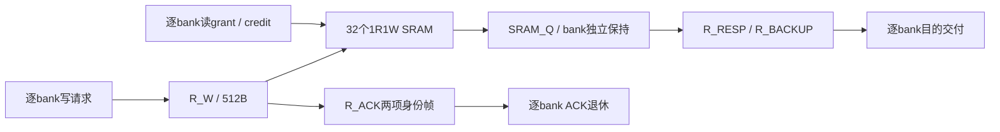

# blackwell_tmem_partition

## Description

实例参数 `PARTITION_ID=0…3`，每实例管理32个连续TMEM bank。每bank为128 word×128 bit、1R1W，分区容量64 KiB；四分区构成256 KiB。

| 信号 / 通道 | 方向、类型 / 位宽 | 对端 | 握手或采样条件 |
| --- | --- | --- | --- |
| `clk`、`rst_n` | 输入，1 bit | 顶层时钟域 | 清控制，不初始化SRAM数据。 |
| `rd_req[32]` | 输入通道，[tmem_rd_req_t](blackwell_tmem_fabric.md#transactions) | TMEM fabric | tag78、全局lane7、word7、byte_mask16。 |
| `rd_rsp[32]` | 输出通道，[tmem_rd_rsp_t](blackwell_tmem_fabric.md#transactions) | TMEM fabric | tag78、data128、status4。 |
| `wr_req[32]` | 输入通道，[tmem_wr_req_t](blackwell_tmem_fabric.md#transactions) | TMEM fabric | tag、lane、word、byte mask、data128。 |
| `wr_ack[32]` | 输出通道，[tmem_wr_ack_t](blackwell_tmem_fabric.md#transactions) | TMEM fabric | 已实际写入对应的tag/status。 |
| `read_credit_o[32]` | 输出，各2 bit，无握手 | TMEM fabric | 0…3个可用返回预留位置。 |
| `write_credit_o` | 输出，2 bit，无握手 | TMEM fabric | 可用于新R_W接受的ACK身份帧数，0…2。 |
| `drained_o` | 输出，1 bit，无握手 | TMEM fabric | 无已grant读、返回、R_W或ACK。 |
| `fault_o` | 输出，1bit，无握手 | TMEM fabric | 协议 fault 电平，向顶层汇总。 |

## Functionality

地址映射 `bank=lane`、`word=column//4`、`cell=column%4`，详见 [TMEM布局](blackwell_tmem_fabric.md#tmem-layout)。本模块拥有物理SRAM及所有返回/写接受状态，fabric只仲裁路由。

所有atom通道独立valid/ready，定义及字节序见 [公共接口](../top/blackwell_async_subsystem_top.md#common-protocol) 和 [memory transaction](../top/blackwell_async_subsystem_top.md#memory-routing)。

lane须落在本分区且与端口索引一致。word范围0…127；byte_mask bit b选择data的第b个byte。读mask未选字节在返回时清零；写mask未选字节保持原存储。

### 分区数据与在途槽

| 状态 | 容量 | 唯一用途 |
|---|---:|---|
| SRAM | 65536 B | 32×128×16 B，唯一TMEM数据。 |
| SRAM_Q | 512 B | 每bank16 B同步读输出；宏内或等价外置实现。 |
| R_RESP | 512 B | 每bank一条主返回。 |
| R_BACKUP | 512 B | 每bank一条额外返回，承接不可撤销读。 |
| 读tag/credit | 每bank三项元数据 | 覆盖已grant尚未交付的全部读，不另存payload。 |
| R_W | 512 B | 一份写payload；32-bank mask、word、tag、byte mask另计。 |
| R_ACK | 两项身份帧 | 每帧bank mask及逐banktag/status；没有写data。 |

R_RESP+R_BACKUP合计1 KiB/分区。不存在第三个外部返回槽；SRAM_Q是第三个实际承接位置。若宏没有read-enable保持能力，须把等价Q放在外部，并在物理资源表重分类，而不是再增加一份Q。

### 读 credit、采样与交付

每bank维护 `outstanding = granted − delivered`，范围0…3。read_fire前必须预留一个位置；本拍交付旧返回可以同时归还并复用credit。

grant后的读不可取消；grant沿g保存下一沿g+1的word/read-enable控制，实际宏在g+1采样并产生Q。目的ready突降时停止无空间的新grant，已经发出的读取仍必须进入Q、主返回或backup。Q尚未搬走时禁止使其被下一次宏读覆盖。

返回位置按该bank的请求先后搬运。主返回可以在同拍被目的消费并由backup或Q补入；两个待发返回不得跳过队首互相换序。数据、tag及byte mask一起移动。

SRAM read-enable不是“只要有request.valid就置1”，而是已有credit且Q在预定返回沿可安全接收才置1。实现用有效位和已预留到达状态计算下一拍可用位置，不能只看当前Q.empty。

| 读事件 | 边沿 | 沿后状态 |
|---|---:|---|
| bank获准 | g | credit减少，tag进入已发状态。 |
| 同步宏读完成 | g+1 | SRAM_Q保存16 B及对应身份。 |
| 返回转移 | g+2 | R_RESP或backup保存该atom。 |
| 目的rd_rsp_fire | g+3 | 目的buffer捕获，credit归还。 |

这些是无背压最早边沿；背压只延迟移动，不改变已grant读的身份。部分bank被暂停时，其余bank正常交付。

### 写请求、实际写与 ACK

每拍wr_req的获准bank集合捕获到R_W；同一bank最多一个word。接受时同时预留两项ACK帧之一，因此始终满足：

`occupied_ACK_frames + R_W_inflight_frames <= 2`。

R_W在下一拍把每个有效bank的masked payload提交到SRAM，并将预留身份帧转为ACK有效。旧R_W实际写入与下一帧写接受可以同拍发生；ACK槽没有空间时只停新写，不覆盖旧payload。

| 写事件 | 边沿 |
|---|---:|
| R_W接受写payload，预留ACK位置 | w |
| masked SRAM实际写入，生成ACK | w+1 |
| ACK最早被客户端接受 | w+2 |

每bank总是选择最老且该bank尚未退休的ACK帧；另一帧中不受此bank顺序约束的ACK可以独立推进。ACK 帧按 bank 独立退休；一个 bank ACK 已被接受后不再发送。当某帧最后一位在本沿 ACK.fire 时，分配器可在同沿将该帧预留给新的 R_W；对外先交付旧帧内容，再写新引用。credit 含该沿确定归还的整帧，ACK.ready 不依赖新写是否获准。ACK反压不会要求D槽保留旧payload，旧block/generation保存在ACK tag中。

在边沿g决定rd_req_fire和wr_req_fire时，比较二者将于g+1执行的word：同bank同word先接受写，读ready=0且尚未grant。已经在g−1获准的读/写于g执行，其冲突在上一沿已经排除，不得撤销旧读。实际宏采样的任意一沿绝无同word1R+1W；不同word可以并行。禁止依赖未定义的read-during-write行为。写masked byte不用内部读改写，所以不会挤占读端口。

### 复位、错误与验证

复位清valid、credit、tag有效性和ACK状态，不清TMEM payload。复位前在途事务由公共生命周期规则排空或隔离；禁止复位后把旧返回挂到新token。

正常片内SRAM不存在可恢复总线错误；非法lane/word/tag是接口违约，在发送前验证并由断言捕获。若集成宏支持ECC错误，错误返回仍退休相应credit并携带非零status，不能伪造成功数据。

验收分别在 grant 后各沿撤去 ready，核对每 bank 的 outstanding 等于 Q、返回及预留读身份数且 ≤3。满时可在退休旧项的同沿复用 credit。连续两帧写后暂停单 bank ACK，分别观察写接受、实写和逐 bank ACK。切换 D 代、混合 client、遍历 byte mask 时，旧 ACK 只退休旧身份。

协议故障额外计1bit `protocol_fault_q`，触发条件为非法分区lane、返回/ACK控制身份重复或credit不守恒。置位、复位和在途响应的处理遵循[公共故障规则](../top/blackwell_async_subsystem_top.md#common-protocol)。

## Submodules

| 子模块 | 实例数 | 连接与父模块控制 |
| --- | --- | --- |
| [banked_sram](../base/blackwell_banked_sram.md) | 1 | 32 个 bank 共用一份参数化阵列。分区负责读 credit、写接受及返回身份。 |
