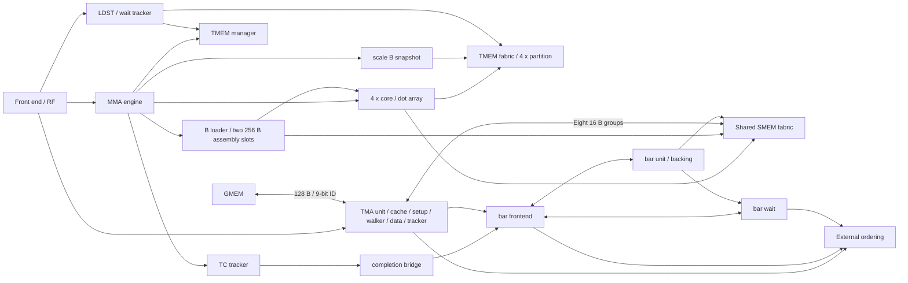

# blackwell_async_subsystem_top

## Description

Connects one SM100a single-CTA asynchronous backend to the warp instruction front end, RF, LSU, GMEM, and ordering services. The top level handles joint acceptance, shared port routing, and CTA lifetime. The surrounding system handles decode, warp convergence, and program order. See [Supported PTX](../../proposals/supported_ptx.md) for ingress commands.

Allegro v1 uses `SHARE_FP_DOT_ADDER_TREE=1` on all four MMA cores. The [dot array](../tensor_core/blackwell_tc_dot_array.md#floating-point-storage) defines storage, issue credits and retirement timing for this configuration. Setting the elaboration parameter to 0 selects an experimental independent-tree configuration outside v1 acceptance.

| Signal / channel | Direction | Type / width | Peer | Sampling condition |
|---|---|---|---|---|
| `mma_cmd` | Input | [mma_cmd_t](../tensor_core/blackwell_tc_mma_engine.md#mma-command) (446 bits) | Warp front end | On `mma_cmd.fire`, allocate one of three records atomically with tracker.register_op. |
| `tc_op_done` | Output | [op_done_t](#identity) (62 bits) | Warp front end | On `tc_op_done.fire`, deliver one completion per accepted ID. |
| `tc_commit` | Input | [tc_commit_t](../tensor_core/blackwell_tc_completion_tracker.md#commit-contract) (90 bits) | Warp front end | On `tc_commit.fire`, capture the issuer’s earlier operations for one arrival. |
| `tc_commit_done` | Output | op_done_t (62 bits) | Warp front end | On `tc_commit_done.fire`, deliver the original commit ID and status. |
| `tmem_manage` | Input | [tmem_manage_cmd_t](../tmem/blackwell_tmem_manager.md#management-types) (102 bits) | Management front end | On `tmem_manage.fire`, accept a management operation from the front end responsible for same-address ordering. |
| `tmem_manage_rsp` | Output | [tmem_manage_rsp_t](../tmem/blackwell_tmem_manager.md#management-types) (94 bits) | Management front end | On `tmem_manage_rsp.fire`, return the status and ALLOC base for the front end’s weak SMEM write. |
| `tmem_alloc_credit` | Output | 1 bit | Management front-end warp arbiter | Connect directly to manager.alloc_credit_o. The arbiter filters ALLOC before driving tmem_manage.valid. DEALLOC is independently eligible. [Admission and release edges](../tmem/blackwell_tmem_manager.md#alloc-admission) |
| `tmem_ldst` | Input | [tmem_ldst_cmd_t](../tmem/blackwell_tmem_ldst_engine.md#rf-types) (92 bits) | Warp front end | On `tmem_ldst.fire`, accept the warp LD/ST command. |
| `tmem_ldst_done` | Output | op_done_t (62 bits) | Warp front end | On `tmem_ldst_done.fire`, deliver final status by ID. |
| `rf_store` | Input | [rf_beat_t](../tmem/blackwell_tmem_ldst_engine.md#rf-types) (1,090 bits) | RF | On `rf_store.fire`, accept the next RF source beat. |
| `rf_load` | Output | [rf_beat_t](../tmem/blackwell_tmem_ldst_engine.md#rf-types) (1,090 bits) | RF | On `rf_load.fire`, write the reserved RF destination. The final beat settles the read dependency. |
| `tmem_wait` | Input | [tmem_wait_cmd_t](../tmem/blackwell_tmem_wait_tracker.md#wait-types) (58 bits) | Warp front end | On `tmem_wait.fire`, capture the issuing warp’s preceding stores at its cutoff. |
| `tmem_wait_done` | Output | op_done_t (62 bits) | Warp front end | On `tmem_wait_done.fire`, deliver the wait result after the captured stores settle. |
| `tma_cmd` | Input | [tma_cmd_t](../tma/blackwell_tma_unit.md#command) (478 bits) | Warp front end | On `tma_cmd.fire`, accept a load, store, descriptor prefetch or bulk-group command. |
| `tma_rsp` | Output | [tma_rsp_t](../tma/blackwell_tma_unit.md#command) (126 bits) | Warp front end | On `tma_rsp.fire`, deliver the matching ticket’s software result. |
| `bar_cmd` | Input | [bar_cmd_t](../mbarrier/blackwell_mbarrier_frontend.md#command) (192 bits) | Warp front end | On `bar_cmd.fire`, accept init, arrive, try_wait, inval or the associated visibility command. |
| `bar_rsp` | Output | [bar_rsp_t](../mbarrier/blackwell_mbarrier_frontend.md#command) (63 bits) | Warp front end | On `bar_rsp.fire`, deliver the command’s status and applicable predicate. |
| `smem_rd[8]` | Input | [smem_rd_req_t](../smem/blackwell_smem_fabric.md#transactions) (126 bits) | External LSU | On `smem_rd.fire`, accept a client 12 read on its group subject to barrier-object exclusion. |
| `smem_rd_rsp[8]` | Output | [smem_rd_rsp_t](../smem/blackwell_smem_fabric.md#transactions) (210 bits) | External LSU | On `smem_rd_rsp.fire`, return the matching read data and status. |
| `smem_wr[8]` | Input | [smem_wr_req_t](../smem/blackwell_smem_fabric.md#transactions) (254 bits) | External LSU | On `smem_wr.fire`, accept a client 12 write on its group subject to barrier-object exclusion. |
| `smem_wr_ack[8]` | Output | [smem_wr_ack_t](../smem/blackwell_smem_fabric.md#transactions) (82 bits) | External LSU | On `smem_wr_ack.fire`, return one acknowledgment for the accepted write. |
| `gmem_req` | Output | [gmem_req_t](../tma/blackwell_tma_unit.md#gmem-types) (1,292 bits) | GMEM | On `gmem_req.fire`, issue a TMA data or descriptor transaction on the shared 128 B bus. |
| `gmem_rsp` | Input | [gmem_rsp_t](../tma/blackwell_tma_unit.md#gmem-types) (1,037 bits) | GMEM | On `gmem_rsp.fire`, match out-of-order returns by 9-bit ID. Response ready is independent of request ready. |
| `order_req` | Output | [order_req_t](#ordering) (163 bits) | Ordering service | On `order_req.fire`, issue release, acquire, proxy/init fence or CTA_CLOSE. |
| `order_rsp` | Input | [order_rsp_t](#ordering) (62 bits) | Ordering service | On `order_rsp.fire`, settle the matching visibility operation. |
| `close_req` | Input | Event without payload | CTA controller | On `close_req.fire`, begin closing the active CTA. |
| `close_rsp` | Output | status_t (4 bits) | CTA controller | On `close_rsp.fire`, deliver close status after drain and close processing. |
| `open_req` | Input | 16 bits | CTA controller | On `open_req.fire`, accept the new epoch after isolation under the lifetime protocol. |
| `open_rsp` | Output | status_t (4 bits) | CTA controller | On `open_rsp.fire`, deliver open status. |
| `lsu_quiescent` | Input | 1 bit | External LSU | Level. Observe completion of old LSU work and visibility obligations. |
| `isolated` | Input | 1 bit | Isolation control | Level. Observe isolation of external responses for reset and epoch control. |
| `epoch` | Output | 16 bits | CTA controller | Current epoch level, updated on an accepted open. |
| `stopped` | Output | 1 bit | CTA controller | Level indicating closure of normal issue. |
| `drained` | Output | 1 bit | CTA controller | Level asserted after outstanding work and held transfers drain. |
| `fault` | Output | 1 bit | CTA controller | Sticky runtime fault level, cleared by isolated reset. |
| `clk` | Input | 1 bit | External clock and reset | Rising edge samples synchronous state. |
| `rst_n` | Input | 1 bit | External clock and reset | Sample low on a rising edge to reset control. |

## Functionality

### Common protocol, reset, and status codes

#### Clock and handshakes

- One clock `clk`, sampled on the rising edge. `rst_n` is an active-low **synchronous** reset. Sequential module port tables may omit the common clock/reset. Combinational arithmetic modules have no clock. SRAM data and Q have no reset port.
- In tables, `x : T` denotes a logical channel expanded into `x_valid`, `x_ready`, and `x_payload : T`. The source drives valid/payload and the sink drives ready. Array entries handshake independently. Events without payload still have valid/ready.
- `fire(t)=valid(t-) && ready(t-)`, where `t-` denotes the instant before edge t. New register values are visible after t and may be sampled downstream at t+1 at the earliest. Combinational functions contain no hidden registers.
- The external GMEM interface provides a stallable response channel. With gmem_rsp_valid asserted and ready=0, hold ID, 1024-bit data, and status stable until fire. For a nonstallable L2, the adapter must obtain guaranteed storage for each complete reply before issuing its request and stop issuing when credits run out. Return credit when TMA accepts the response. Adapter credits and free tags jointly limit issue. Account for adapter storage separately. Stopping new requests must not block outstanding returns, SMEM writes, or their ACKs. [GMEM types and classes](../tma/blackwell_tma_unit.md#gmem-types)
- When `valid && !ready`, hold valid and the entire payload/tag. A sender must generate valid independently of ready. ready may depend on local capacity and downstream ready but must not create a cross-module combinational loop.
- See [Elastic register](../base/blackwell_pipeline_reg.md) and [FIFO](../base/blackwell_fifo.md) for the state equations for a stalled stage and simultaneous dequeue/enqueue in a full FIFO respectively.
- When channels require atomic acceptance, assert ready only when all resources can be reserved. Do not consume one side and lose identity while waiting for the other. For explicitly identified top-level atomic groups, valid may be qualified by the other endpoint's capacity-ready only if ready is independent of the group's valid and capacity is retained until joint fire. This exception applies only to those groups.

#### Identity, completion, and reset

The full operation identity is [async_id_t](blackwell_async_subsystem_top.md#identity). `seq` is unique per issuer in an epoch and does not wrap. Match memory returns by [full memory identity](#memory-routing).

Acceptance, source read, destination write acceptance, actual write commit, ACK retirement, and software response consumption are separate events. A module's `done` means all required side effects have completed. Output backpressure may delay response consumption and cannot undo committed effects.

Normal shutdown `stop` closes new external commands. Internal replies, producer completions, and drain continue. `drained` must account for accepted commands, requests, returns, pipelines, and held responses. Static cached contents alone are not outstanding operations.

Reset clears valid, credit state, live IDs, allocation, and cache valid bits. Payload RAM persists. External memory must cancel old transactions or guarantee no further responses before reset. The top permits a new epoch only after isolation acknowledgment. Normal epoch transition requires every engine drained, dirty barriers written back, and ordering complete. Never use epoch mismatch to silently discard valid in-flight work.

At an authorized epoch change modules clear static cache/collector valid bits, allocation/permit, and local sequence numbers while preserving payload.

Modules report fault on non-OK memory or ordering replies to active transactions, illegal internal identities, duplicate returns, and execution protocol violations. The external LSU performs the weak SMEM write of a management result. Its non-OK ACK takes the same fault path. The top aggregates faults into sticky `fault`. Its registered level supplies the common 1-bit `halt_i` to execution control modules (it may be omitted from port tables) and signals run termination to the CTA controller. An error cannot advance a dependent writeback, arrival, complete-tx, successful done, or close. Preserve committed writes and completed handshakes. Hold already presented valid/payload until handshake or external isolated reset. On detection suppress only successful commits depending on the error and settle independent actual fires. During `halt_i=1` close new instructions and derived work. After an already presented channel handshakes, do not refill it. Recovery isolates old requests, responses, RF, and ordering interfaces externally and then applies a full synchronous reset. Neither drained nor close_rsp is required first.

#### Status codes

The common `status_t` is 4 bits. Static ingress rejections use the encodings below. Exceptional status during execution follows the fault contract above.

| Value | Name | Meaning |
|---:|---|---|
| 0 | OK | Success. An unsatisfied wait predicate may still return OK |
| 1 | UNSUPPORTED | Outside the project instruction subset |
| 2 | INVALID | Illegal field or combination |
| 3 | RANGE | Address, count, or size out of range |
| 4 | MEMORY | External transaction error |
| 5 | STALE | Epoch/object lifetime mismatch |
| 6 | PROTOCOL | Nonlive ID, duplicate response, or hardware protocol order violation (software collector sequences are not checked) |
| 7…15 | reserved | Never issued. Treat as PROTOCOL if received |

Ingress precheck may reject illegal commands with UNSUPPORTED/INVALID/RANGE before asynchronous registration. Synchronous TMEM management precheck uses its own response slot. These rejections have no data or synchronization side effects. A violation discoverable only after reading a descriptor, object, or expanded address terminates the run if the command has already registered. Legal tensor OOB, physical collector misses, and wait timeouts take their modules' normal paths.

#### Configuration and resource accounting

The physical configuration has four cores, TMEM of 128×128×128 bits, and SMEM of 32×1824×32 bits. Multiply per-instance capacity by instance count. Broadcast views do not add a second copy of storage.

Count data bytes, control bits such as valid/tag/credit, and macro read outputs separately. Capacity includes FIFOs, payload registers, pipeline registers, and adapter storage. Backpressure when a finite table fills. Never overwrite a live entry to improve throughput.

In port tables `T[N]` denotes N channels or a bus of T entries. Specify whether handshakes are independent. Compute `bits(T)` from the owning module's fields. Low-index elements occupy low bits, and ascending byte addresses map from low to high payload bits. Pack structures from high to low in field-table order unless the owner specifies explicit bit/byte encoding.

### Common operation identity

| Type/field | Width | Definition |
|---|---:|---|
| `async_id_t.epoch` | 16 | Current single-CTA lifetime, changed only after the backend drains |
| `async_id_t.issuer` | 10 | CTA thread index, `warp=issuer[9:5]`, `lane=issuer[4:0]` |
| `async_id_t.seq` | 32 | External commands use 0…0xfffffffe in increasing order without wrap or reuse |
| `async_id_t` | 58 | Packed order `{epoch,issuer,seq}` |
| `op_done_t` | 62 | `{id:async_id_t,status:status_t}` |

All commands from one issuer share an increasing seq. Do not compare seq across issuers. The caller submits TC MMA/COMMIT in each issuing thread's program order. A commit covers only operations in its epoch accepted before the cutoff with **the same full 10-bit issuer**. Different lanes of the same warp have independent sets. The external instruction front end handles cross-thread synchronization.

Reserve `{epoch,issuer=1023,seq=0xffffffff}` exclusively for the top-level final ordering on CTA close. External commands must not use it. Do not allocate seq=0xffffffff for other issuers either, so the reserved number cannot become a legal software identity through another ingress.

### Ordering service

`order_req_t={id:58, kind:3, scope:2, from_proxy:2, to_proxy:2, addr:64, bytes:32}` totals 163 bits, with `order_rsp_t=op_done_t`. kind=0 RELEASE, 1 ACQUIRE, 2 PROXY_FENCE, 3 reserved, 4 CTA_CLOSE, 5 MBARRIER_INIT_RELEASE. Other values are invalid. scope=0 CTA, 1 GPU, 2 SYS, 3 CLUSTER (the single-CTA cluster containing this CTA). proxy=0 generic, 1 async, 2 tensormap, 3 reserved.

Match acknowledgments by ID, with at most one ordering transaction outstanding per ID. Except for CTA_CLOSE, bytes=0 covers the issuer's relevant preceding accesses at the specified scope. Nonzero bytes covers the half-open range [addr,addr+bytes). Check addition overflow in 65 bits.

- CTA_CLOSE uses the reserved close identity, scope=CTA, addr=bytes=0, and async→generic. The ACK must cover the finite prefix of work from all issuers in the closing epoch, including internal backing writebacks. The reserved issuer serves only to route the ACK.
- RELEASE acknowledges only after prior writes satisfy visibility at the specified scope. Synchronization updates such as arrival can commit afterward.
- ACQUIRE follows successful phase observation by the wait. Return a successful software wait only after external acquire acknowledgment.
- PROXY_FENCE confirms that subsequent to_proxy accesses can observe earlier from_proxy writes.
- MBARRIER_INIT_RELEASE first requires all earlier objects initialized by this issuer in the CTA to have committed. Publish their initialization to the single-CTA cluster. Release subsequent synchronization only after a matching ACK.

The external ordering adapter must not return OK unconditionally. An OK acknowledgment requires the visibility guarantee for the requested kind and scope. For TMA copy, each successful destination write ACK guarantees implicit visibility for that write. Explicit proxy fence, barrier release/acquire, and CTA_CLOSE still require their own ordering acknowledgments.

### Common memory identity and type references

`mem_tag_t={id:async_id_t,client:u4,token:u16}` is 78 bits. On a given interface the full tag distinguishes each undelivered source read or unretired write ACK. Within an ID/client retain the token until its return or ACK retires. Different commands can use the same client and token simultaneously. Their responses still belong to their respective IDs.

| client | Purpose |
|---:|---|
| 0…3 | TMEM for four cores and SMEM A |
| 4 | Scale B snapshot, TMEM only |
| 5 | RF LD/ST, TMEM only |
| 6 | Shared B loader, SMEM only |
| 7, 10, 13…15 | Reserved |
| 8 | TMA data |
| 9 | External memory identity class for TMA descriptors |
| 11 | mbarrier backing |
| 12 | External ordinary SMEM LSU |

| Type/semantics | Owner |
|---|---|
| TMEM addresses, MMA layout, tmem_rd/wr requests and rsp/ack | [TMEM fabric](../tmem/blackwell_tmem_fabric.md#transactions) |
| SMEM addresses, separate and combined smem_atom requests/returns | [SMEM fabric](../smem/blackwell_smem_fabric.md#transactions) |
| GMEM 128 B requests/returns and gmem_id_t | [TMA unit](../tma/blackwell_tma_unit.md#gmem-types) |
| Ordering requests and acknowledgments | [Ordering in this module](#ordering) |
| MMA command/descriptor, B selection and residency key | [MMA engine](../tensor_core/blackwell_tc_mma_engine.md#mma-command) |
| B load/data/result | [B loader](../tensor_core/blackwell_tc_b_loader.md#types) |
| RF command/beat, wait and completion registration | [LDST](../tmem/blackwell_tmem_ldst_engine.md#rf-types), [wait tracker](../tmem/blackwell_tmem_wait_tracker.md#wait-types) |
| TMA context/segment/tag events | [setup](../tma/blackwell_tma_setup.md#context), [request generator](../tma/blackwell_tma_request_generator.md#segment), [tracker](../tma/blackwell_tma_completion_tracker.md#transfer-types) |

Frame arrays have independent valid/ready per atom. Do not generally require a whole frame to be ready. Reservation and partial acceptance must not duplicate completed transactions. Hold unaccepted payload. Fabric/partition own their physical SRAM, return, and ACK state. Parents only route. Static cached data does not constitute in-flight work. Close still waits for three command records, two assembly slots, partial distribution, and all held results.

### Internal connections and reservations

| Producer → consumer | Channel, state, and release |
|---|---|
| MMA cmd → engine + TC tracker | Joint fire. Let re/rt be the capacity-ready signals reserved for this command, independent of group valid. external_ready=re&&rt, engine_valid=v&&rt, register_valid=v&&re. engine_done writes the reserved operation entry independently of software op_done.ready. Issue handoff does not reregister it. |
| TC tracker → bridge ↔ bar frontend | ready_commit carries slot and the commit ID/address. bar_req/rsp submits once. The slot is released on retire, after software consumes commit_done. Connect candidate commit addr to frontend.commit_candidate_addr. Suppress new registration when commit_blocked and let registered transactions proceed. |
| engine / LDST ↔ manager | Arbitrate pins fairly between two sources and retain source/ID through response delivery. Fixed users correspond to MMA rec 0…2, LD, and ST. Unpin arbitrates independently and may release a use bit while pin_rsp is stalled. |
| R_RF_ISSUE ↔ RF tracker → LDST | Allocate a live entry on external ldst acceptance. The top holds cmd92, saves slot5 when slot returns, sends issue97, then releases its record. Ordinary done acceptance is independent of wait_done. |
| engine → SMEM / TMEM fabric | live[3] holds {valid1,rec2,id58} in acceptance order, oldest first. SMEM uses live at R_BREQ ingress to compare ages of same-group A candidates. TMEM identifies C reads from the local core's token.kind. Modules share one epoch. |
| TMA ↔ frontend | bind_req/rsp precedes the first load request. Route producer_done/rsp directly as a pair with separate storage from software responses. During normal execution each successfully bound load submits exactly one complete-tx. |
| frontend ↔ unit ↔ backing, frontend ↔ wait | Reserve service_req/rsp by route/slot. unit.change broadcasts without backpressure. wait.probe queries through the front end. Same-address busy from waits and old commits feeds the INIT/INVAL exclusive gate. Only backing initiates writeback and refill. |
| Execution modules → top → CTA controller and modules | Aggregate local runtime faults into a termination level. Isolated reset takes priority over normal close. |

The front end enforces program order. See [MMA core](../tensor_core/blackwell_tc_mma_core.md) for MMA handoff and blockwise same-address dependencies. Settle bar.sync, thread synchronization, and RF dependencies according to actual external visibility, RF writeback, and fences.

### Routing, timing, and lifetime

TMEM clients0…3 are the cores, 4 is scale B, and 5 is LDST, each with 128 lane routes. SMEM clients0…3 are core A, 6 is B loader, 8 is TMA data, 11 is barrier backing, and 12 is external LSU (including ordinary management result writes). Each client selects one of eight atom ports by group=(addr>>4)&7. TMA req[g] connects to client8 group g and routes by write to wr_req[8][g] or rd_req[8][g]. Multiplex wr_ack[8][g] and rd_rsp[8][g] onto rsp[g], preserving direction and original tag. All eight readies are independent. If both response classes compete in one group, round-robin among acceptable candidates, then lock the presented selection until fire. Other groups may retire concurrently. Group and tag distinguish each copy's reads and writes. The [client8 token](../tma/blackwell_tma_completion_tracker.md#transfer-types) carries transaction tag, group, and phase. Reuse its data slot after write request acceptance. The single backing port round-robins among candidate groups and holds a presented reply.

Ordering sources are the TMA unit (including proxy fence), barrier front end (including init-release fence), wait, and final close. Round-robin fairly. Keep one held selection/source and one outstanding source/ID until matching ACK. Before init release, the barrier front end waits for actual commit of preceding init objects. Reject accesses outside the local singleton cluster. Ordering ACK service must be independent of subsequent software wait consumption. At close the reserved ID serves routing only. kind=CTA_CLOSE covers all issuers, including internal dirty backing writes.

| Lifetime | Entry and exit conditions |
|---|---|
| CLOSED / OPEN_RESULT | Synchronous reset enters CLOSED and sets 16-bit `epoch` to 0. In CLOSED, all open operations including the first require `isolated && open.epoch != epoch`, so the first permitted value is 1…65535. Latch the new epoch on open handshake. Submodules initialize by their own rules upon observing the new epoch. Enter RUN after open_rsp consumption. The earliest first command acceptance is the next edge. |
| RUN → DRAIN | Accept close once all external instruction valid signals are zero and no command is held. Block new instructions. Continue derived issue, reads/writes, RF, producers, done, and ordering for accepted work. |
| DRAIN → FLUSH | All accepted operations, tracker live entries, held returns, and external LSU work have finished. lsu_quiescent is asserted. |
| FLUSH → ORDER | Write back dirty objects individually and receive their actual successful ACKs, then issue CTA_CLOSE once. |
| ORDER → END | Receive the matching successful CTA_CLOSE ACK. |
| END → CLOSED | Once free of pins and held responses the manager accepts epoch_end and clears allocation. After final close_rsp consumption retain the old epoch for comparison on the next open. |

The top holds epoch/FSM, fault, arbiter held/source, outstanding ordering and pin identities, R_RF_ISSUE, flush/close-order handshake state, and final response valid. Publish normal close result only after END.

### Nonempty commits across issuers

A commit captures its issuer’s preceding unfinished operations. Independent issuers in the same warp can commit and complete separately.

Once a younger MMA’s own writes and unpin settle, it can notify the tracker and satisfy its issuer’s commit while an older MMA awaits a write ACK. Both records remain occupied until in-order reclamation. A later fault on the older MMA preserves the younger MMA’s committed arrival and suppresses a successful arrival dependent on the failed write.

### MMA pipeline timing

#### Cycle boundaries for consecutive MMAs

Let M0 and M1 be successive N128 FP16→FP32 same-address accumulations with all write lanes enabled. SMEM A and B are independent and each 4 KiB aligned, K-major, with no swizzle, LBO=128 B, and SBO=256 B. Precheck/pin in advance, select partitions in time, use same-address four-cell-aligned D, and assume no core backpressure or other client contention. Map each 128 B half-block's eight atoms to distinct groups across all 32 physical banks. Column block j has four eight-row groups. Each instruction issues Q=N/2 microtiles per core. All table entries are handshake edges. F=64i is instruction i's first N128 dot and S=F+4j. Negative edges of the first instruction come from warmup.

| object specification | grant | Readiness and consumption |
|---|---|---|
| Two 128 B halves of B[j] | S−10, S−9 | Return at S−8 and S−7, distribute at S−6, and first op_load at S−1. Adjacent blocks alternate assembly slots. |
| Two frames per core for C[j] | S−6, S−5 | Return at S−3 and S−2. Load the first microtile at S−1. The first grant can coincide with the last op_load of the block two positions earlier. |
| Next instruction's A[r] | g=F−64+16r+4c+h | c selects core 0…3 and h=0/1. Each grant reads 16 B from each of eight rows on that core and returns at g+2. Group r is ready by F−49+16r and its first op_load is F+r−1. |

With the previous first dot at 0, the next C0 gets grants at 58/59 and returns at 61/62 for first load at 63. C1 gets grants at 62/63 and returns at 65/66 for block 1's first load at 67.

| Relative to the preceding first dot at edge 0 | Acceptance observation |
|---|---|
| 63 → 64 | Edge 63 issues M0's last dot and loads M1's first microtile. Edge 64 issues M1's first dot. |
| 68 → 72 | M0's last result enters D at 68. The final two write frames are accepted at 69/70, the last frame writes at 71, and its final ACK retires at 72. |
| 73 → 75 | With timely service M0's local_done can be accepted at 73. Return remaining resources and publish done at 74. The tracker can accept at 75. |

For consecutive single-family instructions with all writes enabled, aligned accesses, and timely service, the tail formula is L=F+Q−1 and final ACK=L+Ldot+5, where Ldot is the corresponding [arithmetic family](../tensor_core/blackwell_tc_dot_array.md) pipeline stage count minus one. Use actual interface events for cold fill, WS hits, family changes, fully disabled writes, and contention. Load R_OP when all cores have first-group inputs and R_OP space before the edge. The earliest first dot is the next edge. Acceptance of the first cold source R_BREQ does not establish readiness of other inputs.

| FP16, A and B from SMEM, each word read once | N64 | N128 | N256 |
|---|---:|---:|---:|
| Unique A+B per backend per instruction | 4+2 KiB | 4+4 KiB | 4+8 KiB |
| Minimum SMEM read cycles | 48 | 64 | 96 |
| Dot service cycles | 32 | 64 | 128 |

#### N128 accumulation timing

Under the service conditions above, eight successive N128 instructions issue their first dots at edges 0, 64, 128, 192, 256, 320, 384, and 448. Each row below changes one event while all other inputs and slots are ready on time.

| Delayed event | Earliest dependent event |
|---|---|
| M0 block 0 receives its final successful write ACK at 64 | M1 can receive its first C0 read grant at 65. |
| Only M0’s final block ACK moves to 80 | M1 can still issue its first dot at 64. |
| M1 receives its final C1 return at 70 | M1 can issue its first block 1 dot at 72. |

## Submodules

There is one instance of each direct submodule below per backend. The top handles joint acceptance, pin arbitration, ordering routes, and close control.

| Path | Direct submodules |
| --- | --- |
| MMA and commit | [tc_mma_engine](../tensor_core/blackwell_tc_mma_engine.md), [tc_completion_tracker](../tensor_core/blackwell_tc_completion_tracker.md), [tc_async_completion](../tensor_core/blackwell_tc_async_completion.md) |
| TMEM allocation, access, and waits | [tmem_manager](../tmem/blackwell_tmem_manager.md), [tmem_fabric](../tmem/blackwell_tmem_fabric.md), [tmem_ldst_engine](../tmem/blackwell_tmem_ldst_engine.md), [tmem_wait_tracker](../tmem/blackwell_tmem_wait_tracker.md) |
| SMEM and TMA | [smem_fabric](../smem/blackwell_smem_fabric.md), [tma_unit](../tma/blackwell_tma_unit.md) |
| mbarrier objects and waits | [mbarrier_frontend](../mbarrier/blackwell_mbarrier_frontend.md), [mbarrier_unit](../mbarrier/blackwell_mbarrier_unit.md), [mbarrier_wait](../mbarrier/blackwell_mbarrier_wait.md), [mbarrier_backing](../mbarrier/blackwell_mbarrier_backing.md) |

### Module index

The 35 specifications are listed by module. Multiple instances share one specification.

| Subsystem | Module |
|---|---|
| top | [blackwell_async_subsystem_top](../top/blackwell_async_subsystem_top.md) |
| tensor_core | [blackwell_tc_async_completion](../tensor_core/blackwell_tc_async_completion.md), [blackwell_tc_b_loader](../tensor_core/blackwell_tc_b_loader.md), [blackwell_tc_completion_tracker](../tensor_core/blackwell_tc_completion_tracker.md), [blackwell_tc_dot_array](../tensor_core/blackwell_tc_dot_array.md), [blackwell_tc_mma_core](../tensor_core/blackwell_tc_mma_core.md), [blackwell_tc_mma_engine](../tensor_core/blackwell_tc_mma_engine.md), [blackwell_tc_scale_b_snapshot](../tensor_core/blackwell_tc_scale_b_snapshot.md) |
| tmem | [blackwell_tmem_fabric](../tmem/blackwell_tmem_fabric.md), [blackwell_tmem_ldst_engine](../tmem/blackwell_tmem_ldst_engine.md), [blackwell_tmem_manager](../tmem/blackwell_tmem_manager.md), [blackwell_tmem_partition](../tmem/blackwell_tmem_partition.md), [blackwell_tmem_wait_tracker](../tmem/blackwell_tmem_wait_tracker.md) |
| smem | [blackwell_smem_fabric](../smem/blackwell_smem_fabric.md) |
| tma | [blackwell_tma_completion_tracker](../tma/blackwell_tma_completion_tracker.md), [blackwell_tma_data_path](../tma/blackwell_tma_data_path.md), [blackwell_tma_descriptor_cache](../tma/blackwell_tma_descriptor_cache.md), [blackwell_tma_request_generator](../tma/blackwell_tma_request_generator.md), [blackwell_tma_setup](../tma/blackwell_tma_setup.md), [blackwell_tma_unit](../tma/blackwell_tma_unit.md) |
| mbarrier | [blackwell_mbarrier_backing](../mbarrier/blackwell_mbarrier_backing.md), [blackwell_mbarrier_frontend](../mbarrier/blackwell_mbarrier_frontend.md), [blackwell_mbarrier_unit](../mbarrier/blackwell_mbarrier_unit.md), [blackwell_mbarrier_wait](../mbarrier/blackwell_mbarrier_wait.md) |
| dot | [blackwell_dot_align_fixed_rz](../dot/blackwell_dot_align_fixed_rz.md), [blackwell_dot_emax_tree](../dot/blackwell_dot_emax_tree.md), [blackwell_dot_fp32_pack](../dot/blackwell_dot_fp32_pack.md), [blackwell_dot_signed_reduce_tree](../dot/blackwell_dot_signed_reduce_tree.md), [blackwell_f16tf32_dot](../dot/blackwell_f16tf32_dot.md), [blackwell_f4f6f8_dot](../dot/blackwell_f4f6f8_dot.md), [blackwell_fp4_dot](../dot/blackwell_fp4_dot.md), [blackwell_int8_dot](../dot/blackwell_int8_dot.md) |
| base | [blackwell_banked_sram](../base/blackwell_banked_sram.md), [blackwell_fifo](../base/blackwell_fifo.md), [blackwell_pipeline_reg](../base/blackwell_pipeline_reg.md) |
